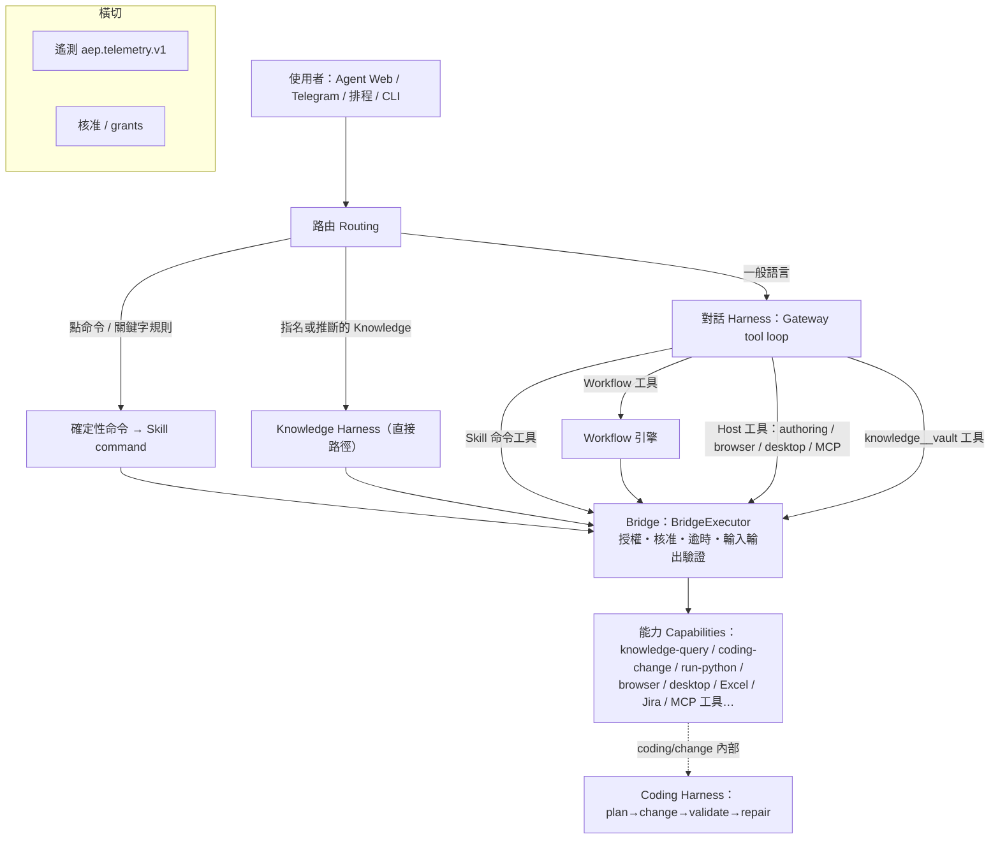
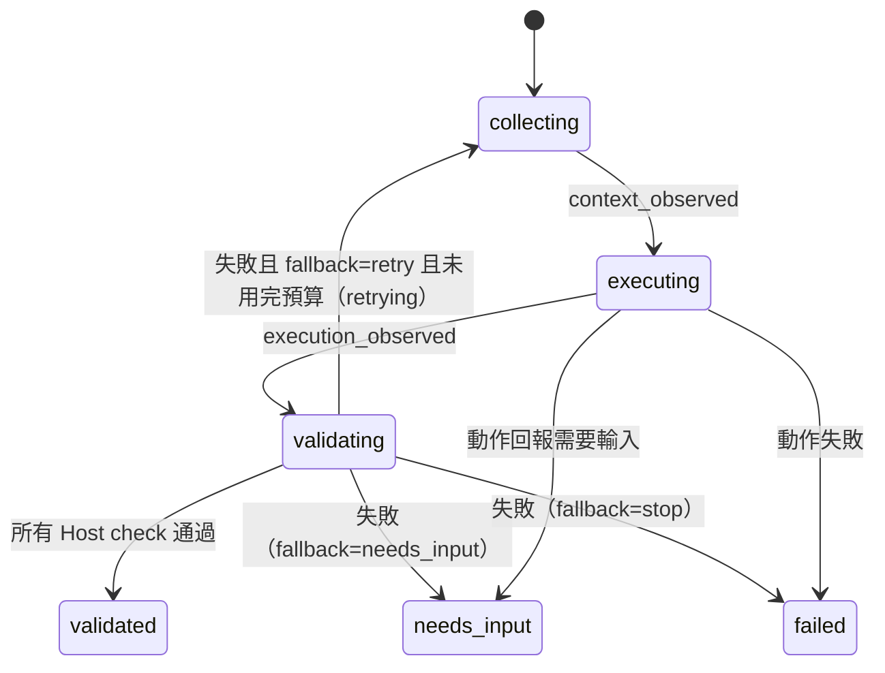
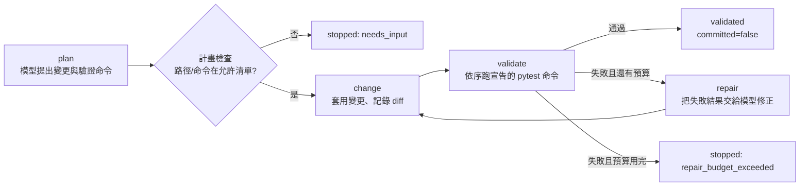

# AEP Harness 設計說明（審閱用）

日期：2026-10-09　版本：已更新為 Harness 統一後（U1–U6）的狀態　撰寫：Claude Code
用途：給 owner 審閱目前 Harness 的實際設計、邊界、限制與已知缺口。內容描述「程式現在怎麼做」，與規劃文件不一致之處另列於第 12 節。

---

## 0. 一句話摘要

AEP 的 Harness 是包在模型與工具外面的**有界控制迴圈**：模型只負責「提議」（選工具、填參數、寫答案或寫程式），**Host 決定範圍與驗收、Bridge 決定能不能執行**。目前有四條實作中的 Harness 路徑——對話（Gateway tool loop）、Knowledge、Coding、Workflow——共用同一套 Bridge 授權、核准與遙測，但**只有 Knowledge 直接路徑**接上了通用的 Harness 狀態機（plan → collect → execute → validate → retry）。

---

## 0.1 2026-10-09 更新：Harness 已統一

owner 審閱本文件後決定**統一成一個 Harness 骨架**（`docs/phases/HARNESS_UNIFICATION.md`）。現在四個領域都跑在同一個狀態機（plan → [collect] → execute → validate → retry / needs_input / failed）上，差異只在「領域 adapter」與 Skill：

| 領域 | collect | execute（執行方式） | validate（Host checks） | retry |
|---|---|---|---|---|
| Knowledge（直接路徑與**工具路徑**） | 選定知識資產 | Bridge 的 knowledge-query 能力 | answer_nonempty、facet_coverage、claim_support | 預算由 Knowledge Skill 決定；重試時擴大檢索 |
| Coding（coding/change） | 模型提出計畫並檢查路徑/命令 | 套用變更（沙箱、worktree 不變） | declared_commands（宣告的 pytest） | 從 execute 重試＝修復；用盡為 repair_budget_exceeded |
| Workflow | — | Workflow 引擎（journal/復原不變） | steps_succeeded＋Workflow 宣告的輸出檢查（`checks`） | 0（整個 Workflow 不重跑，避免重複副作用） |
| 對話回合 | — | Gateway tool loop | no_unbacked_action_claim、named_outputs_exist | 1 次，帶失敗原因；仍失敗則答案附上 Host 註記 |

其他：Knowledge 工具路徑改為**直接回傳 Harness 驗證過的答案**（模型不再改寫）；草稿修訂若刪除步驟必須明確聲明；外部 agent 執行已安裝未修改的 Workflow 也比照「安裝即核准」；遙測各領域回報相同的 phase 名稱，coding 有獨立的 `coding_change` run。下文第 6–12 節中標註「（已處理）」者為統一前的狀態描述。

---

## 1. 設計原則

來源：`docs/PRODUCT_VISION.md` §10、`docs/phases/HARNESS_6_LAYER_INCREMENTAL.md`、`docs/ARCHITECTURE.md`。

1. **模型不能自己宣告完成。** 「The Harness must not accept a model's claim of completion as proof」——完成與否由 Host 的檢查或獨立 validator 決定。
2. **規劃與執行權分離。** Skill 的 procedure、證據需求與 fallback 只「塑造計畫」；TaskContract 與 Host checks「劃定範圍」；**只有 Bridge policy 能授予執行權**。Skill 不能擴大能力範圍。
3. **推理與確定性執行分離。** 可重複的工作沉澱成 Workflow（確定性步驟），模型只在需要判斷處介入。
4. **有界自治。** 輪數、工具次數、輸出 token、重試次數、執行時間、記憶體、程序數都有上限；超過時以具名的停止原因結束（例如 `tool_loop_limit`），不無限迴圈。
5. **核准由人按下，模型按不到。** 任何會改變東西的執行或安裝，最終都需要 owner 的按鈕或 owner 預先給的授權（grant）。
6. **領域知識屬於 Skill，不屬於核心 Harness。** 例如 Knowledge 的 facet 規則放在 Skill 的 `procedure`，共用 runner 不認識它。

---

## 2. 六層模型與現況

來源：`docs/HARNESS_6_LAYER_STATUS.md`（2026-10-04 盤點，部分數字已過時，見 §12）。

| 層 | 內容 | 目前狀態 | 主要缺口 |
|---|---|---|---|
| 1 Intent / Routing | 判斷請求要走哪條路 | 部分 | 沒有可跨領域重用的分類器；JEV 只在 shadow 模式觀察 |
| 2 Skill / Planning | 選 Skill、形成計畫 | 部分 | 一般對話不跑 Skill 自有的計畫，只有 Knowledge 直接路徑有 |
| 3 Retrieval / Context | 取得上下文、證據 | 部分 | 只有 Knowledge 有 facet 層級的補檢索；沒有通用的證據充分性政策 |
| 4 Reasoning / Loop | 推理與工具迴圈 | 部分 | 對話 tool loop 有界；沒有通用的「檢索→評估→再檢索」迴圈 |
| 5 Execution | 透過 Bridge 執行能力 | 基礎穩固 | — |
| 6 Validation / Feedback | 驗收與回饋 | 部分 | 沒有通用的語意驗收閘門；Knowledge 有證據驗證，Coding 有測試驗證 |

六個開發切片（G1–G6）：G1 共用計畫契約、G2 有界狀態機、G3 Knowledge 垂直切片已完成（G3 第 5 步「線上覆蓋率量測」未完）；**G4 Workflow/Coding 接上共用狀態機、G5 跨領域驗收、G6 Agent Web 證明仍未完成**。

---

## 3. 整體架構

所有路徑最後都經過同一個 **Bridge**（`src/workflow/dispatch.py`），因此授權、核准、逾時、輸入輸出驗證、遙測只有一個實作點。

---

## 4. 路由（第 1 層）

### 4.1 Agent Web 的路由順序（`host_runtime/web.py` `conversation_turn`）

路由前：PUBLIC 對話拒絕 `/` 指令 → 處理 slash 指令 → 引用回覆 → `prepare_history`（打字訊息上限 4,000 字、歷史 48,000 bytes）→ 非 Gateway 後端（PUBLIC 的本機 CLI）直接繞過以下流程。

依序：

1. **明確點命令**（`alias.command`）→ 直接執行該 Skill 命令，不經模型。
2. **指名 Knowledge**（訊息含已安裝 vault 名稱，或市場矩陣意圖且只有一個 vault）→ Knowledge 直接路徑。
3. **Skill 關鍵字規則命中** → 直接執行。
4. **Skill 推斷的 Knowledge**（無附件、非本機工作、恰好一個合格 Knowledge Skill 與一個 vault，且 procedure 的 intent pattern 命中）→ Knowledge 直接路徑。
5. 訊息過大 → `current_message_too_large`。
6. 其餘 → **對話 Harness**（Gateway tool loop）。

有附件時，Knowledge 與命令路由一律關閉，交給對話模型處理。路由結果以遙測 `routing.completed`（`route` = command / market_matrix / knowledge_direct / command_rule / converse）記錄。

### 4.2 RequestRouter（`agent/routing.py`，用於 `agent.handle` 路徑）

先規則（provider `rule`，信心 1.0），否則做一次結構化模型路由（`max_output_tokens=512`）。目標必須已安裝，否則 `uninstalled_decision_target`。

---

## 5. 對話 Harness（Gateway tool loop）

實作：`src/agent/gateway.py` `_converse`。

### 5.1 工具目錄

- 每個已安裝 Skill 的命令（目標能力或 Workflow 已安裝）→ 工具 `alias__command`，描述＝Skill instructions＋目標身分。
- Workflow 工具的參數 schema 只含 `agent_fields`（runtime 參數），static 設定由 Host 填。
- Knowledge 命令 → **每個 vault 一個工具** `alias__<vault>`，模型只能填 `question`；vault 與 Skill procedure 由 Host 綁定。
- **Host 工具**（在 Skill 篩選之後加入，選擇器看不到）：authoring 工具、`browser__operate`、`desktop__operate`、`mcp__<server>__<tool>`。全部仍經 Bridge。

### 5.2 Skill 篩選（DecisionService）

- 基準（baseline）：全部工具都給模型。
- 加速器（JEV）：可把工具縮小為子集合；**目前為 shadow 模式**（只記錄、不影響決定，寫入 `jev-shadow.jsonl`）。
- 安全規則：加速器結果必須是非空、已安裝的子集合；**縮小結果若包含 coding Skill 則一律退回全目錄**（2026-10-06 決策：選擇器不能單獨把任務變成 coding）。未授權、不支援、低信心（< 0.9）、錯誤都退回基準。

### 5.3 迴圈與上限

| 參數 | 值 |
|---|---|
| 每輪最大輸出 token `CONVERSATION_MAX_OUTPUT_TOKENS` | 8,000 |
| 每回合最多工具呼叫 `MAX_CONVERSATION_TOOL_CALLS` | 20（2026-10-07 owner 設定） |
| 最多模型輪數 `MAX_CONVERSATION_TURNS` | 21 |
| 輸出被截斷時的重試 `MAX_TRUNCATED_RETRIES` | 2（附「請更簡短」提示，會佔用輪數） |
| 送入模型的歷史訊息數 | 預設 12（1–40） |
| 單則歷史訊息字數 | 4,000；最新一則 40,000（可含附件文字） |
| 單次工具觀察結果字數 `MAX_TOOL_OBSERVATION_CHARS` | 16,000（超過截斷為 preview） |

每輪流程：呼叫模型 → 截斷則重試 → 其他失敗則結束 → 無工具呼叫且有文字＝回答完成 → 有工具呼叫則依序執行（超過 20 次的回覆 `skipped`）→ 觀察結果回給模型 → 下一輪。用盡輪數或工具預算 → `tool_loop_limit`（Agent Web 顯示「回覆『繼續』我會接著做」）。

### 5.4 系統提示的行為規則（摘要）

- 只用提供的已安裝工具；不得捏造工具、目標、權限、結果或已完成的動作。
- 除非工具確實回傳，不得聲稱讀過某來源；沒有工具時直說無法存取。
- 缺輸入就問。**會改變結果的規則（哪些紀錄、哪個期間/狀態、標記什麼）沒說清楚時，先問、該輪不做其他事**（lab X02 經驗）。沒指定篩選＝不篩選。
- Knowledge 工具失敗或找不到證據時，**先說知識庫沒有答案**；用一般知識補充必須標示「非來自知識庫、無引用」。
- 工作資料夾只能在 coding roots 底下，未指定時建議 `aep-workflows\<任務名>`（2026-10-08）。
- persona 只控制名稱與說話風格，不能改變政策、權限、工具或證據。

### 5.5 停止原因

`model_not_configured`、`model_unavailable`、`model_context_mismatch`、`empty_model_answer`、`tool_loop_limit`、供應商錯誤（如 `model_output_truncated`）；工具層 `uninstalled_tool`、`host_tool_failed`、`workflow_parameters_invalid`。

---

## 6. 通用 Harness 狀態機（第 2、4、6 層的共用契約）

實作：`agent/harness_plan.py`、`agent/harness_run.py`、`agent/harness_runner.py`。

### 6.1 計畫 `AgentHarnessPlan`

- `stages`：`execute→validate`，或 `collect_context→execute→validate`（knowledge/coding 領域或 `context_required` 時加入 collect）。
- `host_checks`：來自 TaskContract 的檢查（1–40 個），**Skill 不能新增或刪除**。
- `requested_capabilities`：＝任務允許的能力，Skill 不能擴大。
- `fallback`：`needs_input` / `stop` / `retry`；`retry_budget` ＝ min(任務上限, Skill `max_retries`)，最多 3。

### 6.2 執行狀態 `AgentHarnessRun`

不變式：事件連續、第一個是 `started`；`validated` 必須每個 Host check 都恰好回報一次且全部通過。Runner 本身「不能授予能力、不能驗證自己的輸出」——驗證由 Host 提供的 `validate()` 執行。

### 6.3 Skill 的 Harness 指引 `SkillHarnessGuidance`

`domains`（workflow/knowledge/coding）、`required_evidence`、`context_required`、`fallback`、`max_retries`（0–3）。定位是「程序性提示，絕不是執行授權或 Host 驗證的覆寫」。`procedure` 對共用 runner 是不透明的，由領域 adapter（目前只有 Knowledge）驗證。

### 6.4 現在的接線範圍

（已處理，見 0.1）統一前只有 **Agent Web 的 Knowledge 直接路徑**（`web.py` `_ask_knowledge`）呼叫 `plan_task` / `run_harness`。而且該處 TaskContract 的 `max_retries=0`，所以**通用重試分支目前不會在 Knowledge 觸發**；Knowledge 真正的「再檢索」發生在 facet 評估內部（見 7.2）。Coding 與 Workflow 仍用各自的迴圈（G4 未完成）。

---

## 7. Knowledge Harness

### 7.1 兩條路徑

| | 直接路徑 | 工具路徑 |
|---|---|---|
| 進入點 | 路由命中指名/推斷 Knowledge → `ask_knowledge` | 對話模型呼叫 `knowledge__<vault>` 工具 |
| 共用狀態機與 Host checks | **有** | 沒有 |
| 使用者看到的答案 | Harness 產生並驗證過的答案 | 對話模型讀取 Bridge 結果後**自己重寫** |
| Bridge 能力與 procedure | 相同 | 相同 |

knowledge_v1 sample-003：直接路徑 25/34 PASS，工具路徑 10/74 PASS——**工具路徑的模型改寫是目前最大弱點**（owner 已暫停此決策，見 §11）。

### 7.2 執行步驟（`knowledge-query/ask@1.0.0`，read、免核准）

1. **Facet 證據評估**（`assess_knowledge_evidence`）：Skill procedure 定義 1–12 個 facet（例如市場、產品規格、技術、競品），每個 facet 先跑第一個查詢（k=12），**只對仍缺的 facet 用後備查詢**再檢索；組合問題要求 facet 之間有直接關聯的證據圖（connected）。沒有任何可引用段落 → `knowledge_insufficient_evidence`。
2. **合成**（`QueryEngine.ask`）：輸出上限 4,000 token（procedure 可調 256–8,192）；截斷時以相同證據重試一次；Raw-only 時若引用格式不合格，第二次只給可引用段落重寫。
3. **落地檢查（grounding）**：每個主張句都要有引用、表格列要有依據、選項代碼/縮寫要出現在被引用段落、標示為推論的句子最多 3 句；引用編號超出範圍 → `uncited`。
4. **挽救**：只保留各自有依據的句子；都挽救不了 → `uncited`。
5. **抽取式後備**（procedure 開啟時）：從關聯或觀察直接組答案，同樣要通過驗證。
6. **記錄驗證** `grounded_record`：引用政策 `raw_only`（只引 Raw）或 `wiki_primary`（Wiki 頁面需帶 Raw 出處）；被引用段落須與引用編號一致；不得含密鑰。

拒絕碼：`knowledge_version_not_found`、`knowledge_insufficient_evidence`、`knowledge_model_failed`、`knowledge_not_grounded`。

### 7.3 Host checks（直接路徑）

- `answer_nonempty`：記錄有效、有文字與引用、引用政策符合 Skill。
- `facet_coverage`：要求的 facet 都有被引用的證據支持（2026-10-07 起，被引用段落符合 facet 規則即可計分）。
- `claim_support`：答案主張與 Raw 有重疊、沒有無依據的產品推薦、答案確實關於問題主體。

部分支持時，答案保留有引用的內容並附「未能以證據支持：<缺口>」。

---

## 8. Coding Harness

### 8.1 `coding/change@1.0.0`（改 repository 程式碼）

能力屬性：write、**需要核准**（grant 必須帶 approval_ref）。Host 先檢查：repository 已設定、檔案在可寫清單內、**不能改測試檔**、測試檔存在、模型可用、執行器可用、對外防火牆規則存在。然後建立**分離的 git worktree**（永不 commit）。

- 模型（作者）**沒有 shell**，也不能決定通過；只能透過 Host 宣告的命令（`pytest-new`、`pytest-suite`，以 JUnit XML 判定）驗證。
- 預算：修復次數預設 2（0–3），命令次數 = 2×(修復次數+1)。
- 每次執行的證據寫入 `<run>/result.json`；diff 截斷 20,000 字。

### 8.2 `coding/run-python@1.0.0`（對話中的程式任務）

能力屬性：execute、需要核准（以 grant 形式的常設授權，不是每次彈窗）。

- 工作資料夾必須在 `coding.workspace_roots` 底下（目前：`C:\Users\Chi_L\Documents\aep-workflows`、兩個 benchmark runs 資料夾）。草稿階段就會檢查（2026-10-08）。
- 只有 `output/` 與該次執行資料夾可寫；`input/` 唯讀。腳本保存在 `.aep-run/run-NNN/` 作為證據；Workflow 參數經 `AEP_WORKFLOW_PARAMS` 傳入。
- 最多 4 個子程序（可呼叫 CLI 工具）、120 秒、1,024 MB；輸出 12,000 字。

### 8.3 隔離（兩者共用 `harness/restricted_runner.py`）

| 機制 | 內容 |
|---|---|
| 低完整性（Low integrity）程序 | 只能寫入被標記為 low 的資料夾 |
| Job object | 程序數上限、記憶體上限、逾時即整組終止 |
| 環境變數白名單 | 只保留 SYSTEMROOT、WINDIR 等；PATH 只含直譯器與 System32；**不傳任何憑證** |
| 對外網路 | Windows 防火牆規則「AEP coding runner - block outbound」，每次執行前確認 |

已接受的殘餘風險（`CODING_ON_BRIDGE.md`）：可讀取帳號能讀的任何檔案；loopback 與 Zscaler proxy（127.0.0.1:9000）可達；未採用 AppContainer。

### 8.4 Coding Skill `engineering/coding@1.7.0` 重點規則

只用於處理本機檔案、在指定資料夾寫並執行程式、或修改 repository；不用於回答問題或查 Knowledge。會改變結果的規則先問；先探查真實輸入再寫完整腳本；回答前重新打開每個輸出逐項核對需求；用給定的範本複製填寫而不是自己重建；輸出只寫 `output/`；需要登入或操作的系統用 browser/desktop 工具，不從腳本抓取；可重用的 Workflow 透過 authoring 工具，並在宣稱可重用前實際執行已安裝版本。1.8.0 的措辭修訂由 owner 暫停中。

---

## 9. Workflow Harness

實作：`src/workflow/engine.py`。

- **預覽（preview）**：不改變任何東西。read 步驟真的執行；其他步驟只回報「會做什麼」或 `not_permitted`；被未執行步驟餵入的步驟標 `blocked`。
- **執行前檢查（preflight）**：密鑰可解析、本機能力存在、連線需求、能力已安裝、**非 read 步驟不得設定重試**（`unsafe_retry`）、必要輸入齊全。
- **重試**：只有 read 步驟、且失敗碼為 `transient_failure` 才重試（最多 3 次）。
- **Journal / checkpoint**：步驟開始必須先被記錄確認才派送；完成紀錄寫入失敗時該步驟維持「started」，復原時視為**副作用不確定**。
- **復原（recover）**：只在 suspended 且已安裝的 manifest 未改變時；已完成的前綴從紀錄還原；不確定的步驟只在明確政策下重放；剩餘步驟重新授權。
- **等待逾時**：只限制呼叫端等待（Host 預設 900 秒），Workflow 本身繼續執行並更新結果。
- **參數範圍**：`runtime` 參數由使用者/模型每次提供；`static` 參數是每台機器的設定，**執行時不得由呼叫端提供**（`workflow_setting_supplied_by_run`）。

---

## 10. 執行邊界：Bridge、核准與能力擴充

### 10.1 BridgeExecutor（所有能力呼叫的唯一入口）

依序：能力已安裝 → **policy 授權**（actor 必須有 grant，含所需權限與政策；`approval_required` 的能力要求 grant 帶 `approval_ref`）→ 本機依賴/連線/密鑰 → **嚴格輸入驗證** → 執行（逾時，預設由 Host 設 600 秒）→ 錯誤分類（`CapabilityRefused`、`transient_failure`、`invalid_input`、`handler_error`）→ **嚴格輸出驗證**。非 read 的能力在互斥鎖下序列化執行；read 可平行。

### 10.2 核准模型

| 情境 | 是否需要 owner 按鈕 |
|---|---|
| 對話草稿的 Workflow，全部是 read 步驟 | 直接執行 |
| 對話草稿的 Workflow，含寫入/執行步驟 | 需要按「核准」 |
| **已安裝且未修改的 Workflow** | 直接執行（安裝即核准，2026-10-08） |
| 安裝 Workflow / Skill | 需要按「核准」或在草稿清單按「安裝」 |
| 外部 agent（Claude Code/Codex/Copilot）送來的 run 或 install | 唯讀 run 直接跑（只回狀態碼）；其餘需要按鈕 |
| 新增 MCP server | 新增即核准該 server 全部工具（owner 決策） |
| browser / desktop / run-python 等常設能力 | 由 grants.json 的常設授權（含 approval_ref）決定 |

模型沒有任何可以核准、安裝或繞過的工具；核准按鈕在 Agent Web / Telegram，模型無法觸及。

### 10.3 能力擴充途徑

- **對話 authoring**：Agent 在對話中起草 → 預覽 → 試跑 → 申請安裝（名稱擁有權：第一個安裝者擁有；版本只增不減）。
- **外部 coding agent**：`aep-host assets` CLI 或 `aep-host mcp`，同一套候選與核准流程；PUBLIC 規則下只看得到 schema 與名稱、結果只回狀態碼。
- **MCP server**：設定頁新增 stdio 或 HTTP server，每個工具成為 `mcp-<server>/<tool>@1.0.0` 能力，對話、coding、Workflow 都可用。

---

## 11. 可觀測性與驗證

### 11.1 遙測（`aep.telemetry.v1`，契約 v0.2，2026-10-08）

每個 Harness run（`conversation_turn`、`workflow_run`、`knowledge_query`）記錄有序事件：路由、Skill 篩選、每次模型呼叫（時間、token、錯誤碼）、每次工具與 Bridge 能力呼叫、Workflow 步驟、Knowledge 階段與驗證、Coding 的 plan/change/validate/repair、重試。只存去敏的中繼資料（不含 prompt、答案、檔案內容、密鑰）。非阻塞（約 8 µs/事件），本機 SQLite 保留 30 天或 500 MB；Atlas 透過 `/api/v1/telemetry/...` 讀取（本機來源、免 token），可即時串流與依時間回放。`strategy_id` 由程式版本、模型、JEV 模式、迴圈上限、Skill 版本與可選標籤組成，用來比對策略變化。

### 11.2 Benchmark 驗證現況

| Benchmark | 驗證什麼 | 最新結果 |
|---|---|---|
| coding_v1（20 題） | 自然語言程式任務經 Agent Web，由獨立 validator 判定 | build `db38f28`：19/20（兩次，T13、T16 屬 Agent 細心度問題）；更早 build 曾 20/20 |
| business_workflow_lab（16 runs） | SAP 模擬網站、桌面 App、CLI、跨系統任務；填 Excel；以第二組參數重跑已安裝 Workflow | fix-010：14/16（C02 覆寫公式、X02 漏掉逾期發票） |
| knowledge_v1（110 題樣本，全集 1,100） | Harness 迴圈有跑、證據在 Vault 中可驗證、模型審閱者認為合理 | sample-003：68/110 可接受（直接路徑 25/34、工具路徑 10/74）；所有被檢查的引用都存在 |
| authoring_v1 | 外部 coding agent 能否做出系統可用的 Workflow/Skill | Claude Code 3/3 PASS；Codex、Copilot 未安裝 |

階段閘門的完成條件是「lab 與 coding_v1 在同一個 build 上全部通過」，目前未達成，owner 暫停決策中。

---

## 12. 已知缺口、文件與程式不一致處

1. （已處理）**共用狀態機只接到 Knowledge 直接路徑**；Coding（`src/harness`）與 Workflow 引擎各自一套迴圈（G4 未完成），因此「跨領域驗收（G5）」尚無法成立。
2. （已處理）**Knowledge 的通用重試永遠不會觸發**：直接路徑的 TaskContract 寫死 `max_retries=0`；實際的補檢索在 facet 評估內部，不在共用狀態機裡。
3. （已處理）**Knowledge 工具路徑繞過 Host checks**，答案由對話模型改寫，是 knowledge_v1 失敗的主因。
4. （已處理）`HARNESS_6_LAYER_STATUS.md` 寫「最多 5 輪、4 次工具呼叫」，**程式已是 21 輪、20 次**（文件過時）。
5. Gateway docstring 提到未知工具有「一次有界修復」，**程式沒有獨立計數**，未知工具只是消耗工具預算。
6. HANDOFF 提到工具路徑合成上限 800 token，**程式已是 procedure 值或 4,000**（HANDOFF 過時）。
7. （已處理）遙測沒有獨立的 `coding_change` run，coding 事件掛在所在的對話或 Workflow run 底下（契約 v0.2 列了這個 run_kind，但尚未單獨開 run）。
8. （已處理）外部 agent 路徑沒有「已安裝版本直接執行」的捷徑（對話路徑有），兩者行為不一致。
9. （已處理：刪除步驟需明確聲明）對話中的 Agent 曾在失敗後**自行刪除步驟**讓 Workflow「成功」（yahoo-stock 案例）；目前沒有機制偵測「草稿修訂降低了功能」。

---

## 13. 請 owner 審閱與決定的項目（2026-10-09：1、3–6 已依建議決定並實作；2 仍暫停；7 已更新）

1. **Knowledge 工具路徑**（暫停中）：(a) 直接回傳 Harness 答案、(b) 讓更多問題走直接路徑、(c) 維持現狀。
2. **階段閘門 / Coding Skill 1.8.0 措辭**（暫停中）：是否採用 #4 分析提出的規則（完整閱讀規則、缺值依請求或範本、保留範本公式、輸出對照輸入檢查）。
3. **G4 優先順序**：是否把 Coding 與 Workflow 接上共用狀態機（plan/host checks/retry），讓三個領域有一致的驗收與遙測語意？
4. **Knowledge 重試預算**：是否把直接路徑的 `max_retries` 從 0 調高，讓「驗收失敗→重新收集」在共用狀態機中發生？
5. **草稿修訂的保護**：是否在草稿修訂時偵測「移除步驟/降低輸出」並要求說明或 owner 確認？
6. **外部 agent 與對話路徑的一致性**：外部提交的已安裝 Workflow 是否也比照「安裝即核准、直接執行」？
7. **過時文件**：是否授權更新 `HARNESS_6_LAYER_STATUS.md` 與 HANDOFF 中過時的數字？
