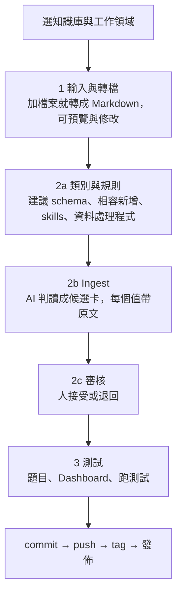
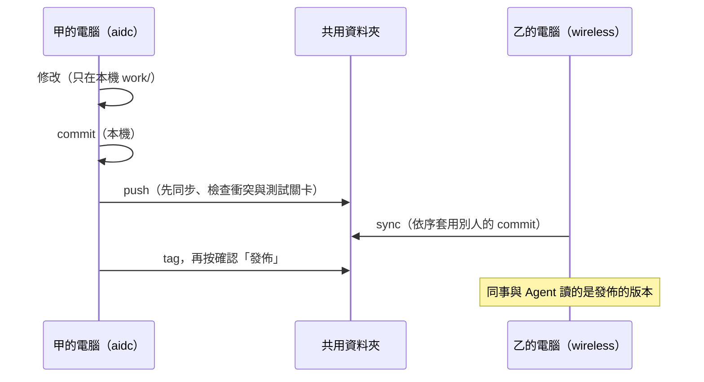
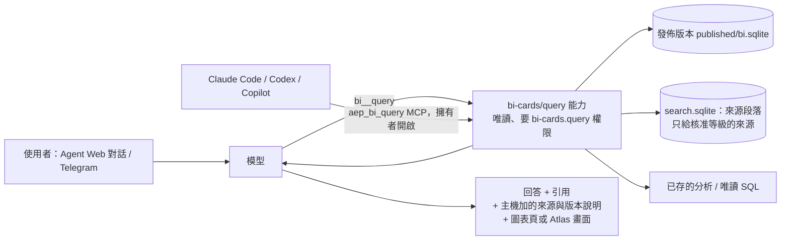

# BI 知識庫：資料結構、建置流程、多人共建與 Agent 推論

> 這份文件描述的是 `main` **9d81844c**（2026-11-06）的程式碼。它整合這幾天的討論與設計，給工程師和擁有者看；細節放在各 phase 文件，這裡只講整體與現況，並連過去。
>
> 每一節用三種標記：**已完成**（程式碼現在就這樣做）、**已決定未實作**、**未定**。文件與程式碼不一致時，以程式碼為準，並列在各節最後的「文件與程式碼不一致」。
>
> 例子都是虛構的（例如 `FAKE-ROVER`、`aidc` 領域）。

詳細設計：

| 主題 | 文件 |
|---|---|
| vault 與同步 | [`docs/phases/BI_VAULT.md`](../phases/BI_VAULT.md) |
| 卡片模型（欄位、證據、關係、profile、schema 合併） | [`docs/phases/BI_CARD_MODEL.md`](../phases/BI_CARD_MODEL.md) |
| 來源放進知識庫 | [`docs/phases/BI_SOURCES_IN_REPOSITORY.md`](../phases/BI_SOURCES_IN_REPOSITORY.md) |
| 建置流程（Session A／B、harness） | [`docs/phases/BI_BUILD_FLOW.md`](../phases/BI_BUILD_FLOW.md) |
| 頁面重新設計、領域、多人 | [`docs/phases/BI_PAGE_SIMPLE.md`](../phases/BI_PAGE_SIMPLE.md) |
| 測試、工具、分析 | [`docs/phases/BI_TEST_AND_TOOLS.md`](../phases/BI_TEST_AND_TOOLS.md) |
| 讓 Agent 讀 vault | [`docs/phases/BI_VAULT_ASKING.md`](../phases/BI_VAULT_ASKING.md) |
| 概述與用途的補齊、範例標記 | [`docs/phases/BI_SUMMARY_FILL.md`](../phases/BI_SUMMARY_FILL.md) |
| 介面合約 | [`docs/CONTRACTS.md`](../CONTRACTS.md)（BI 各節） |
| 決策與理由 | [`docs/DECISIONS.md`](../DECISIONS.md)，以日期查 |

任務指定的 `BI_PLATFORM_RELEASE` 文件不存在於 repo（`BI_CARD_MODEL.md` 有連到它）；平台發佈的內容散在 `BI_CARD_MODEL.md` §4.3 與 `DECISIONS.md` 2026-11-05。

---

## 1. 資料結構與內容定義

### 1.1 一句話

**共用資料夾裡的 commit 是唯一的真相；每台電腦的 SQLite 都是從 commit 重建出來的索引。**

```mermaid
flowchart LR
  subgraph 共用資料夾（SharePoint／OneDrive 同步）
    C[commits/作者/序號.json<br/>每個 op = 一個 unit 的新值]
    F[applications/…/sources、skills、tools、profile<br/>只新增、不改寫的檔案]
    T[tags/、publish/]
  end
  subgraph 每台電腦
    W[work/：還沒 push 的改動與本機 commit]
    B[(bi.sqlite<br/>工作版本)]
    P[(published/bi.sqlite<br/>發佈版本)]
    S[(staging.sqlite<br/>來源、執行、候選卡)]
    X[(search.sqlite<br/>全文索引)]
  end
  C -->|依 clock, author, seq 套用| B
  W --> B
  T -->|發佈的 tag 所指的 commit| P
  F --> S
  B --> X
```

### 1.2 資料夾結構（已完成）

共用資料夾由通用的知識庫引擎管理（`src/knowledge/repo/repository.py`）：

| 路徑 | 內容 |
|---|---|
| `repo.json`、`REPO.md` | 知識庫的 id、標題、目的；`REPO.md` 是給人看的說明，自動產生 |
| `commits/<作者>/<序號>.json` | 已 push 的 commit：`number, purpose, kind, created, ops, files`。每個 op 是 `{unit, value, base}`，`base` 是作者改之前那個值的雜湊 |
| `tags/<名稱>.json` | 指向一個已 push 的 commit，永不移動 |
| `publish/<作者>/<序號>.json` | 發佈紀錄：哪個 tag 是大家要讀的版本 |
| `withdrawn/` | 撤回的來源 |
| `schemas/` | 這個知識庫用到的 schema 檔（每個 vault 都帶著自己用的 schema） |
| `applications/<領域>/sources/` | 原始檔 `<sha8>-<檔名>`，與轉好的 Markdown 版次 `markdown/<sha8>/rev-<n>-<作者>.md` |
| `applications/<領域>/skills/<名稱>/rev-<n>-<作者>.md` | 判讀規則（skill）的版次 |
| `applications/<領域>/tools/<名稱>/rev-<n>-<作者>.py` | 資料處理程式的版次 |
| `applications/<領域>/profile/rev-<n>-<作者>.json` | 這個領域用哪些卡片類型和欄位 |
| `library/<項目>/{sources,skills,tools,profile}/` | 跨領域的資料庫項目，預設 `products`、`technologies`、`competitors`；`library/skills/` 放所有領域共用的 skill |
| `library/skill-review/` | 給同事看的範例 skill，不是工作中的領域 |
| `cards/<卡片 id>.md`、`cards/_manifest.json` | 發佈時產生的卡片頁，只寫出、不讀回 |
| `published/<tag>.sqlite` | 發佈時寫一次的快照（目前沒有程式讀它） |

預設領域是 `aidc`、`aerospace`、`robotics`、`wireless`；使用者可以新增（`meta:home:<id>`，見 §2.2）。舊版的 `skills/`、`sources/` 頂層資料夾仍讀得到舊 commit，新的寫入只用 `schemas`、`applications`、`library`（`homes.py`）。

每台電腦本機：`<workspace>/bi/vaults/<vault id>/` 放 `bi.sqlite`、`vault_build.json`（建置標記）、`vault_sync.json`、`published/`；引擎另有 `repo.sqlite` 與 `work/`（還沒 commit 的改動與本機 commit `work/commits/<n>.json`）。

### 1.3 Commit unit：真相的單位（已完成）

每次寫入都在一個 transaction 裡做，做完撤回，再把差異記成 unit（`vault.py`）。所以 `bi.sqlite` 的任何內容，都能從 unit 重建。

| Unit | 存什麼 |
|---|---|
| `schema` | 這個知識庫用的基礎版本，例如 `bi.schema/v1.1@5.0.0` |
| `schema_change:<種類>:…` | 加在基礎版本上的相容新增，種類有 `domain, type, field, enum, label, used_by`（§3.5） |
| `card:<id>` | `{type, key, name, synthetic}`，加上改名留下的 `former_keys`、人解除範例標記的 `mark_cleared {at, by, reason}` |
| `field:<id>:<欄位>` | 目前的值與它的來源 `{kind, ref, by, at}`、歷史；`value: null` 是清空 |
| `evidence:<id>:<欄位>` | 這個欄位的證據**整份清單**：每筆 `{run_id, source_id, source_name, locator, excerpt, basis, at}`，可再有 `reference_id, stance, reference_at, reference_time_basis, assessment` |
| `state:<id>:<欄位>` | 欄位狀態：未知、不適用、待確認、確認沒有 |
| `relation:<id>`、`relation_evidence:<id>` | 卡片之間的關係與它的依據 |
| `source:<sha256>` | 一個來源：檔名、所在資料夾、機密等級、大小、Markdown 版次清單 |
| `profile:<領域>`、`skill:…`、`tool:<領域>/<名稱>` | 目前版次的路徑、作者、雜湊 |
| `analysis:<slug>` | 一個分析：`{title, question, kind, code, chart, params?, requires?}` |
| `meta:dashboard`、`meta:dashboard:<領域>` | 整個知識庫的 Dashboard（feed 與 Atlas 讀這個），以及各領域自己的 |
| `meta:home:<id>` | 使用者新增的領域 `{label, domain}` |
| `meta:<key>` | 其他資料集層級的設定（文字） |
| `check:question:<組>/<slug>`、`check:extract:<slug>` | 測試題目與擷取測試案例 |
| `proposal:<hash>` | 待人審核的提案（例如匯入時碰到人改過的值） |
| `import:<id>` | 一次匯入的紀錄 |
| `decision:<hash>` | 人對一個衝突的決定 |

**穩定 id 與改名。** 卡片 id 是 `sha256(類型\0鍵)` 的前 12 個十六進位字，只在建立時算一次，之後不變（`store.py` `card_id_for`）。改名時 id 不變，舊鍵記進 `former_keys` 並保留，不能被別張卡拿走；新名字已被用走就拒絕（`name_taken`）。連結欄位存成 `{card, name}`，所以改名不會斷連結。

### 1.4 卡片的內容（已完成）

- **名稱**：每個類型有命名欄位（`naming`），卡片名稱由它決定。
- **結構化欄位**：種類有 `str int float bool date enum list link linklist`。
- **欄位類別**：
  - `sourced`：要有來源；
  - `judgement`：判斷，例如概述；
  - `derived`：從其他資料算出來，不由人或 AI 寫。
- **閱讀欄位** `summary`（概述）、`usage`（用途）、`scope`（範圍）：
  - AI 寫的這三個欄位，依據一律是 `inference`（推論）；
  - 答 `unknown` 就不寫；
  - profile 一律允許這三個欄位和 `aliases`。
- **證據**：每筆有原文摘錄與位置（`locator` 是行號）。
  - 立場 `stance`：`supports`（支持，預設）、`refutes`（反駁）、`context_only`（僅背景）。
  - 來源時間 `reference_at`：取來源的 `source_date` 或 `date`；都沒有時用寫入時間，並標 `reference_time_basis = submission_fallback`。
  - 審查程度用文字表示，沒有數字權重。
- **時間**：
  - `cards.created`、`cards.updated` 在重建時從 commit 紀錄算出；
  - schema 另有 `updated`、`source_date`、`date`、`last_confirmed`（derived）、`review_due` 等欄位；
  - 程式裡**沒有** `as_of` 欄位。
- **範例資料標記** `synthetic`：
  - 名稱、欄位或備註符合 `importer.FICTIONAL`（`虛構|範例|示範|^SAMPLE-`）時，匯入就標記；
  - 標了範例的卡，`confidence: verified` 會降為 `assumed`；
  - 人可以用 `POST /api/bi/cards/<id>/unmark` 解除，要寫理由，記在 `card:` unit 的 `mark_cleared`；
  - 名稱以 `SAMPLE-` 開頭的不能解除，要先改名；
  - 之後再有一列說它是範例，就會重新標記，並移除 `mark_cleared`。
  - 「待查證」不再算範例標記（`DECISIONS.md` 2026-11-05）。

### 1.5 本機的 SQLite（已完成）

**`bi.sqlite`：工作版本的索引**，DDL 在 `store.py`：

| 資料表 | 內容 |
|---|---|
| `cards` | 卡片：id、類型、鍵、名稱、版本、synthetic、建立／更新時間 |
| `fields` | 每個欄位的目前值與來源 |
| `history` | 只增不改的變更紀錄，含舊來源、舊證據 |
| `evidence` | 證據列，含立場與來源時間 |
| `relations`、`relation_evidence` | 關係與依據 |
| `field_states` | 欄位狀態 |
| `card_names` | 舊名與別名 |
| `card_marks` | 人解除的範例標記 |
| `card_app_folders` | 卡片屬於哪些領域，由「證據 → 來源 → 資料夾」推出，沒有自己的 unit |
| `proposals`、`vault_keys` | 待審提案，以及它對應哪個 unit |
| `meta`、`imports` | 資料集設定、匯入紀錄 |

**模型版本**：`MODEL_VERSION = 11`，存在 `PRAGMA user_version`（不放 `meta`，因為 `meta` 的每一列都是 unit）。版本低於程式時，第一次開啟就整份重建（`vault.ensure_current`）；`vault_build.json` 也記著輸入的指紋。

**其他本機資料庫**：

- **`staging.sqlite`**：
  - 存 `sources`、`markdown`（Markdown 版次）、`conversions`；
  - 存 `runs`、`candidates`、`run_layouts`（AI 執行與候選卡）；
  - 存 `recipes`、`sessions`。
  - 還沒 commit 的工作都在這裡，不會被同步。
- **`search.sqlite`**：全文索引，與 `bi.sqlite` 分開存放。
  - 卡片表 `card_text`，以及來源切段表 `chunk_text`（每段約 1,200 字，含行號）。
  - 兩者都是 FTS5 trigram。
- **發佈版本 `published/bi.sqlite`**：
  - 從發佈的 tag 所指的 commit 重建；從沒發佈過就用已 push 的最新版本。
  - 不含這台電腦的本機 commit、還沒 commit 的改動、未解決的衝突。
  - 同事與 Agent 讀的就是它。
- **答案快取 `answer_cache/`**：
  - 每台電腦自己的，不共用；
  - 同一個請求重用第一個可用的模型回答；
  - 撤回來源時清掉。

### 1.6 文件與程式碼不一致

- `BI_VAULT.md` 的資料夾描述（`vault.json`、`changes/`、`.json` skill、11 個市場區隔資料夾）是舊的。現在是 `repo.json`、`commits/`、`.md` skill、4 個預設領域，市場區隔改成卡片上的 `segment` 值，Markdown 放在 sources 資料夾裡面。`BI_VAULT.md` 也說索引在 `bi.sqlite` 裡，實際是另一個 `search.sqlite`。
- `BI_SOURCES_IN_REPOSITORY.md`：
  - 路徑寫成 `sources/<folder>/…`，程式是 `applications/<領域>/sources/…`；
  - `markdown` 在程式裡是清單；
  - 文件說重建卡片時忽略 `source:` unit，實際上它決定 `card_app_folders`。
- `BI_CARD_MODEL.md` 開頭仍寫「No code yet」。它和 `CONTRACTS.md` 的新資料表清單都漏了 `card_marks`。
- 程式碼裡的說明也有過時的：`vault.py` 開頭的 unit 清單漏了 `source:`、`relation:`、`profile:`、`analysis:`、`check:`、`meta:home:` 等，`store.py` 仍寫「shared change files」。

---

## 2. 建置 BI 知識庫的流程

### 2.1 頁面的三個步驟



最上面一列在每個分頁都看得到：**知識庫**（`#bi-dataset`、新增、加入、管理）與**工作領域**（`#bi-b-src-folder`、新增領域）。工作領域決定之後的來源、規則、測試與 Dashboard 屬於誰（`BI_PAGE_SIMPLE.md` §9、§13）。已訂閱的唯讀副本只能看步驟 1，不能新增來源。

### 2.2 步驟 1：輸入與轉檔（已完成）

- **新增領域**會寫一個 `meta:home:<id>` unit，並建好 `sources, skills, tools, profile` 資料夾；這個領域經由 `schema_merge` 進入 schema（`BI_PAGE_SIMPLE.md` §10）。刪除領域還沒做。
- **加入檔案就轉檔**：
  - 可接受 csv、tsv、xlsx、pdf、docx、pptx、md、txt；
  - 沒有文字的 PDF 會被拒絕（`source_no_text`）；
  - 其他轉檔失敗的檔案仍會留下，並記著失敗原因。
- **Markdown 版次**：
  - 可以選版次、預覽、編輯，編輯會存成新的版次；
  - 原始檔永遠不改；
  - AI 執行時讀目前的版次，並記下它用的是哪一版（`markdown_rev`）。

### 2.3 步驟 2a：類別與規則（已完成）

- **建議 schema**（`schema_suggest.py`，`BI_PAGE_SIMPLE.md` §15）：
  - 按一下，只問模型 schema 合不合；不寫卡片，也不依賴之後 ingest 用的擷取方法；
  - 一次最多看 10 份來源，預設看這個領域還沒 ingest 的來源；
  - 每一列建議都要有在來源裡找得到的原文，找不到原文的不列出、只計數；
  - schema 已經有的類型或欄位，會變成「待釐清」；
  - 沒有要改時回答「不用改」。
  - 新增欄位或允許值可以直接「加入 schema」。新類型、同義詞、沒有允許值的列舉欄位，會帶著這一列打開 AI 面板討論。
  - 2026-11-06 用真實模型（gpt-5.5）測過四次，每次 45–215 秒、約 9–11k tokens，原文都找得到。
- **相容新增，不是新版本**（`schema_merge.py`，`BI_CARD_MODEL.md` §4.3）：
  - 新增的類型、欄位、允許值、顯示名稱，都是基礎版本上各自的 `schema_change:` unit，依鍵的順序套用，所以每台電腦得到一樣的 schema；
  - 畫面上顯示成「5.0 加 1 項新增」，不顯示雜湊；
  - 「預覽升級」只列出比基礎版本新、而且保留這個知識庫已加入項目的版本；
  - 移除或改型別這類「不是新增」的改動，仍是新版本，要人決定。
- **Schema 草稿**：在主畫面是一張改動表（類型、欄位、改動、說明），用 AI 編輯，按「套用到資料集」生效；JSON、版次、試跑放在「進階」。
- **判讀規則（skills）**：
  - 一次執行用 classify skill，加上 `applies_to` 符合來源資料夾的 extract skill；固定的證據規則寫在程式裡；
  - 不能用別的領域的規則讀這個領域的來源（`run_folder_mismatch`）；
  - 產生哪些卡片類型，依序看：人指定的、skill 經 profile 篩過的、profile、預設的 Signal／Technology／Application。
  - 可以和 AI 一起修改規則，所有 AI 對話共用右側同一個面板。
- **資料處理程式（tools）**：把原始來源轉成 CSV 或 Markdown，產出成為同一資料夾裡的新來源，再走一樣的預覽和審核。
  - **核准綁定雜湊**：每個新版次第一次在一台電腦執行前，要由那台電腦的人核准那份程式碼的 SHA-256，核准只存在本機，不共用。AI 可以起草、可以試跑已核准的草稿，但不能核准。
  - **防護**（`analyses.GUARD`）：程式在獨立的 `python -I` 行程裡跑，環境幾乎是空的，限時 300 秒，最多 20 個檔、50 MB。audit hook 擋網路、子程序、原生程式庫（ctypes）、輸出資料夾以外的寫入，也擋讀 frame、gc 與 trace。2026-11-06 起，防護在腳本開始前才裝上、保留自己的副本，腳本無法把它關掉；有 numpy 時，工具也拿不到 ctypes（`DECISIONS.md` 2026-11-06）。
  - **核准代表什麼**：防護只擋常見的失誤，**不是沙箱**。刻意寫成要做壞事的程式，仍可能找到 Python 的漏洞繞過，程式也讀得到使用者讀得到的檔案。**人讀過並信任程式碼，才是真正的把關**。頁面的核准步驟與使用手冊 6.8.3 都這樣寫。
- **Profile**：每個領域用哪些類型與欄位。編輯器在「進階」。

### 2.4 步驟 2b、2c：Ingest、審核、commit

- **AI 判讀**（已完成）：AI 產出的是**候選卡**，每個值都要帶證據，人看過才寫入。
  - 執行在背景跑：`extracting` → `review`／`partial`／`failed`，失敗的段落可以單獨重試。
  - 每份來源的機密等級都要在模型的核准範圍內（`classification_not_approved`）。
  - 標成事實（`fact`）的值，原文必須在那一段找得到；找不到就降為 `unknown` 並警告。值裡的數字沒出現在原文，就降為推論。
  - 已有的卡片，AI 不會直接改 `confidence` 或 `evidence_grade`，只會提出提案。
- **一次一份來源**：批次 ingest（S4）**已決定未實作**，目前一次執行只讀一份來源。
- **審核**（已完成）：
  - 下拉選單列出等待審核的執行，表格列出候選卡，右側是明細；
  - 接受或退回一張卡，會立刻畫出藍勾或紅叉；
  - 可以一次接受所有沒有錯誤的候選卡；
  - 待審提案可以批次處理，退回要寫理由。
- **commit**（已完成）：
  - 試跑的結果不能寫入；
  - schema 在執行後改過的，要重跑；
  - 接受的候選卡裡有錯誤，就整批不寫入。
- **兩次執行的差異**（`BI_EXTRACTION_VARIANCE.md`）：
  - 同樣的請求在同一台電腦上會重用第一個可用的回答，所以重跑結果穩定；
  - 勾「不沿用上次的回答」就重新問模型。
- **閱讀欄位補齊（reading runs）**（已完成，但只有 API 能啟動）：
  - `POST /api/bi/runs {reading: true}`；
  - 用每張卡自己的內容補空的 `summary`、`usage`（不含 `scope`）；
  - 一張卡問一次模型，同時跑兩張；
  - 結果出現在同一個審核下拉選單（`BI_SUMMARY_FILL.md`）。
- **schema fit 勾選**：仍在「進階」。用自訂擷取方法時，這個勾選和「不沿用」都不會生效。

### 2.5 步驟 3：測試、Dashboard、分享

- **題目屬於領域**（已完成）：
  - 題目是 `check:question:<組>/<slug>`，可以帶 `home`；
  - 一個領域只跑自己的題目；
  - 沒有標領域的題目，只在「全部領域」總覽跑，總覽是唯讀的（`BI_PAGE_SIMPLE.md` §11）。
- **跑測試**（已完成）：
  - `bi_bench` 讓 Agent 把每題問兩次：一次讀工作版本，一次讀發佈版本；也評分擷取案例；
  - 一次只能有一個測試在跑；
  - 報告記著整個知識庫的雜湊與各領域的雜湊，所以看得出結果對哪個版本有效。
- **各領域自己的 Dashboard**（已完成，`BI_PAGE_SIMPLE.md` §12）：
  - 分析是共用的，各領域的 Dashboard 選要放哪些；
  - 沒有讀 `domain` 參數的面板，標「全庫資料」。
- **push 的關卡**：見 §3.4。
- **commit、push、tag、發佈**（已完成，目前是分開的按鈕）：
  - 發佈一定要人按確認（`confirm: true`）；
  - 一步完成的「分享」（S6）**已決定未實作**。

### 2.6 文件與程式碼不一致

- `BI_PAGE_SIMPLE.md` 第 3 行仍寫 S2、S5–S8 未開始。它自己的 S2、S5、§8、§15 都說已完成，程式也是。
- `BI_PAGE_SIMPLE.md` §2、§9.4、§9.5 描述的是整個知識庫一起的關卡、以及在領域裡跑「全庫」題目。程式依 §11、§14 的做法。
- `BI_TEST_AND_TOOLS.md` 還寫著「還沒用真實模型試過」，關卡描述成「完全同樣 unit 的最新一次」。`bi_bench.py` 開頭的說明也是這樣。實際的關卡是逐題、依領域雜湊判斷。
- 使用者指南 `docs/guides/BI_BUILD.zh-TW.md` 整份過時，需要重寫：
  - 它寫的是六個步驟，現在頁面是三步；
  - 它說訂閱副本看不到「建立與匯入」；
  - 它說 AI 判讀只用腳本化的模型測過；
  - 它沒提到領域、建議 schema、資料處理程式、profile、審核表、閱讀欄位補齊、測試題目、push。

---

## 3. 多人共同建置與管控

### 3.1 原則

擁有者的話：「我們要支援多人開發一個vault」、「這是一個多人合作的平台，但為了不彼此干擾，每一個domain會有專人來處理」。

- **一個領域一位負責人，這是工作上的約定，不是權限**（已完成，也就是什麼都不強制）。AEP 不加檔案權限，誰能存取由 IT 透過 SharePoint 決定。沒有任何「負責人」欄位會擋人，「定案」也不檢查是誰按的（`DECISIONS.md` 2026-11-05、`BI_PAGE_SIMPLE.md` §11、§14）。更早的領域權限設計（V8）在 2026-10-29 取消。
- **設計目標是讓一個領域的人可以不受干擾地工作**：別的領域改了什麼，不應該擋住這個領域。

### 3.2 什麼時候分享出去（已完成）



- **修改、commit**：
  - 都只在這台電腦上。
  - commit 一次帶走這台電腦所有還沒 commit 的改動，是整個知識庫一起的；來源會先自成一個 commit。
  - 「只 commit 這個領域」引擎支援（`Repository.commit(only=…)`），但頁面還沒接，**已決定未實作，等擁有者決定**。
- **push**：
  - 依序做三件事：同步、檢查 schema 衝突、引擎 push。
  - 有衝突或被關卡擋下時，什麼都不寫入。
- **sync**：依 `(clock, author, seq)` 的順序套用別人的 commit。檔案晚到或有變動，就重建。
- **tag 與發佈**：
  - tag 永不移動，發佈要人按確認；
  - 發佈是整個知識庫一起的，誰來發佈由擁有者決定；
  - 同事與 Agent 讀發佈的版本，從沒發佈過就讀已 push 的最新版本。
  - 發佈後讀者看不到各領域的 Dashboard：feed 是整個知識庫的。

### 3.3 衝突與「定案」（已完成）

- **unit 層級的衝突**：
  - 一個 op 的 `base` 和目前的值不同，而且新舊值也不一樣，就是衝突。
  - push 時由人選「我的」「他們的」或另填一個值。
  - 選了某個 `field:` 的一邊，對應的 `evidence:` 也跟著選同一邊。
  - sync 時才發生的衝突，記在 `conflicts` 表。
- **schema 的衝突**有兩種：
  - `clash`：一個新增已經不適合它的基礎版本；
  - `race`：兩個人同時改了同一處。
  - push 會被這台電腦的 commit 新造成的 clash 擋下。
- **定案**（`correction.py`，`BI_PAGE_SIMPLE.md` §14）：
  - 一個欄位有爭議時，人寫下值和理由「定案」。
  - 會拒絕這個欄位上還開著的提案，並讓它贏過已經 push 的競爭改動。
  - 之後仍要 commit、push、過測試關卡。

### 3.4 push 的測試關卡：依領域判斷（已完成）

`bi_bench.gate`、`domain_reach.py`，`DECISIONS.md` 2026-11-06：

- **哪個結果算數**：每題取最新一個仍算數的結果。整個知識庫的雜湊相同，或這題所屬領域的雜湊相同，就算數。
- **哪些退步會擋 push**：
  - 這次 push 動到那個領域；
  - 那題沒有領域；
  - 這次 push 動到共用的東西。
  - 其他情況只留下「其他領域，不擋這次 push」的說明。
- **沒有任何算數的測試**：照樣可以 push，但會附上「沒有跑過測試」（擁有者 2026-11-05）。
- **一個 unit 屬於哪些領域**（`domain_reach`）：
  - 卡片類的 unit 看卡片 `domain` 欄位改動前後的值；
  - 關係看兩端；
  - 來源、skill、tool、profile 與各領域的 meta 屬於自己的領域；
  - `import:` 不屬於任何領域；
  - 其他屬於所有領域。

### 3.5 schema 自動合併（已完成）

互不重疊的新增各自是 unit，兩個人的新增就是兩個 unit，引擎沒有東西可以衝突。改同一個鍵、但值不同，就像其他 unit 一樣是衝突。新增在新的基礎版本上不再適用時（clash），每台電腦都一樣地把它排除，並列進 push 的衝突清單。三方合併和為新增寫 `meta:schema_history` 都被否決（`DECISIONS.md` 2026-11-05）。

### 3.6 同一張卡被兩個領域碰到：擁有者的規則與現況

擁有者的規則：「關於同一張卡，概述應該不會變，證具, raw data連結就append上去，時間也是取合集」。

**狀態：已決定未實作。** 要在引擎的衝突路徑加上合併規則（`DECISIONS.md` 2026-11-06、`BI_PAGE_SIMPLE.md` §14、`docs/TASKS.md`）。

| 規則要的 | 程式現在做的 | 怎麼知道的 |
|---|---|---|
| 概述不變（先寫的留下） | 表格或 CSV 匯入的值不同時，**會取代**概述；只有人改過的值才變成提案（`store.py`） | 實測 |
| 兩人各自補同一個空的概述，第二個變提案 | 第二個人 push 時是衝突 | 實測 |
| 證據 append | `evidence:<卡>:<欄位>` 存整份清單，兩台電腦各自加一筆會**衝突** | 讀程式得知，未實測 |
| 原始資料連結 append | `source:` unit 帶資料夾，同一個檔放在兩個領域會衝突 | 實測 |
| 時間取合集 | 每筆證據的 `reference_at` 會跟著證據合併；`updated` 是單一值，兩個不同的值會衝突。提議的修法是「較晚的日期贏」 | 實測 |

同一台電腦上已經做到的部分：

- 來源只是重複一個值時，會加上它的引用，不改卡片版本；
- 兩次讀到同一個 `reference_id`，算一筆引用；
- 被取代的值，它的證據移進歷史；只是增長的清單，證據都保留。

### 3.7 名稱字典、寫入紀錄、11-04 21:25 事件

- **各領域自己的名稱字典**：已決定未實作，排在 Dashboard 之後（`docs/TASKS.md`）。目前沒有程式。
- **2026-11-04 21:25 的事件**：
  - 真實的 `market-intel` 知識庫上出現 4 個沒有人認領的未 commit 改動：一張卡的 `body` 被接受了一個提案，`data-coverage` 被隱藏。
  - 因為 Agent Web 當時不記錄請求，查不出是誰；擁有者決定在 11-05 丟棄（`docs/phases/BI_SUMMARY_FILL.md`、`DECISIONS.md` 2026-11-05）。
- **寫入紀錄**（已完成，`write_log.py`）：這次事件是它的由來。
  - 每個 POST／PUT／PATCH／DELETE 寫一行 JSON，在 `logs/agent-web-writes.log`。
  - 記錄時間、方法、不含 query 的路徑、狀態碼、來源位址、`User-Agent`、`Referer`，與自稱的 `X-AEP-Client`。
  - 不記錄內容、query、cookie、token。
  - 寫紀錄失敗或塞住時，請求照常進行，紀錄會丟掉；檔案約 5 MB 換一個，保留 3 個。
  - `X-AEP-Client` 是自稱的，**不是身分驗證**。

### 3.8 文件與程式碼不一致

- `DECISIONS.md` 2026-11-05 說 `aidc` 的人會被 `wireless` 的退步擋住、不做依領域的關卡。這已被 2026-11-06 取代，程式只擋 push 動到的領域。`bi_bench.standing` 的說明仍寫「每個工作領域都擋」，過時了。
- `BI_VAULT.md` 說衝突的欄位改動會變成待審提案。實際上 push 時回傳衝突、什麼都不寫，等人選；只有 sync 時才發生的衝突，才記成衝突。
- `store.py` 開頭說匯入不會覆蓋人設的值，這是對的；但它會覆蓋先前匯入或 AI 寫的概述，這正是 §3.6 的落差。
- `bi_bench.gate` 讀這台電腦**所有**知識庫的測試報告，靠雜湊比對才不會用到別的知識庫的結果。文件沒有提到。

---

## 4. AEP Agent 如何透過 BI 知識庫框出資料、推論、給出結果

### 4.1 一次對話怎麼走到知識庫



- **什麼時候模型看得到 `bi__query`**（已完成）：
  - 要有某個版本的 `engineering/bi-knowledge` Skill 開著，而且裝了 `bi-cards/query@1.0.0`。
  - 工具說明裡帶著 Skill 的作法，以及這台電腦有哪些知識庫和它們的目的；模型要選一個，並說明用了哪個。
  - 每次呼叫都經過 Bridge，沒有授權就回 `permission_denied`。
- **Telegram**：用同一個工具；不能嵌 Atlas 畫面（`embed_unavailable`），主機會加上來源說明。
- **讀哪個版本**：
  - 先盡力同步一次，再讀**發佈的版本**；從沒發佈過就讀已 push 的最新版本。
  - 這台電腦的本機 commit 和未 commit 的改動，不會被讀到。
  - 回答會說「內容來自發佈版本 v1」，或說明知識庫還沒發佈。
  - 不是 BI schema 的資料集會被拒絕。

### 4.2 框出需要的資料（已完成）

`bi__query` 的輸入：

- **搜尋**：`dataset`、`entity_type`、`text`（≤200 字）、`domain`、`field`／`value`、`follow_links`（預設要），`limit` 1–100（預設 20）。
- **關係**：`hops` 0–3（預設 0）。
- **整個資料集**：`analysis` 加 `params`，或 `sql` 加 `chart`（兩者不能同時用）。

搜尋的方式：

- **逐字比對**：
  - 每個以空白分開的詞，都要出現在卡片的名稱、鍵或某個目前欄位值裡（不分大小寫、子字串比對），可以分散在不同欄位；
  - 別名欄位也一起比；
  - schema 升級後移除的欄位不搜。
- **相近結果**：
  - 沒有卡片同時有全部的詞、而且查詢有兩個以上的詞時，回傳至少有兩個詞的卡片，符合多的在前，並註明「這些可能不是答案」；
  - 完全沒有結果時，提示改用較短的詞，再回答「沒有」；
  - **沒有**編輯距離或相似度比對，這是決定。
- **關係走訪**：
  - 廣度優先、雙向、每張卡只走一次；遇到迴圈就停，被退回的關係不走；
  - 最多 3 層、30 張相關卡、20 張直接卡；
  - 關係狀態對應到說法：confirmed／unreviewed 是事實，inferred／pending／disputed 照原樣標示；一條路徑的可信度取最弱的一步。

### 4.3 推論與引用

- **回傳的內容**：
  - 每張卡有 `card`（`類型:鍵`）、`name`、`trusted`、`synthetic`、各欄位的值與來源（`kind:ref`）、欄位狀態、連結與關係。
  - `trusted` 只在卡片不是範例、而且人設了 `confidence=verified` 時才是真的。
  - **證據原文不在卡片回傳裡**。原文來自 `passages`：
    - 有 `text` 時，從發佈版本的來源全文索引取最多 5 段，每段約 160 字，含來源名稱與行號；
    - 測試指定版本時不給 passages。
- **整個資料集的回答**：
  - 知識庫跑已存的分析（發佈版本）；
  - `sql` 是一個唯讀語句，最多 200 列、10 秒。
- **怎麼推論、怎麼引用**：規則寫在 Skill 的作法裡（`manifest.py`）。
  - 卡片引用成 `[卡片 <類型>:<鍵>]`，來源引用成 `[來源 <來源名>:<行>]`；
  - 分清**事實**與**推論**，不可信的卡片標「待驗證」或「範例資料」；
  - 資料集裡沒有的，說「在這份資料集中沒有…」。
  - 例：「事實：FAKE-CO 的 FAKE-ROVER 使用 FAKE-CHIP 晶片 [卡片 CustomerProduct:FAKE-ROVER]」。
- **主機補上的說明**：模型沒寫的，主機加在回答下面：
  - 知識庫與版本（「資料來源：知識庫 vault-x 發佈版本 v1」）；
  - 訂閱資料集的來源；
  - 範例資料的提醒。
- **對話的回答不快取**。答案快取只用在擷取、補齊、建議 schema。

### 4.4 分析、Dashboard、Atlas（已完成）

- **已存的分析**：
  - `analysis:<slug>` 在發佈版本上跑；
  - 單一個 slug 也回傳它的定義，讓對話可以提議修改；
  - 分析的 Python 腳本有同樣的防護（§2.3），SQL 是唯讀、在副本上跑。
- **每次回答都有圖表頁**：每個有回答的 `bi__query` 呼叫，都會寫一頁獨立的 HTML 圖表，附在回答裡。
- **Atlas**：
  - `bi__atlas_show` 用知識庫、slug、參數或 Dashboard 名稱來指定；網址由主機組，不接受網址，不認得的參數會被拒絕；
  - 一則回答最多嵌 6 個畫面；AEP 不寫入 Atlas。
- **feed `aep.bi.analysis_feed/v1`**：
  - 只給發佈版本，請求不會觸發腳本執行；
  - 結果依（定義雜湊、commit、參數）快取，還沒算好就回 `result_not_ready`；
  - 只接受這台電腦頁面的 GET。
  - Atlas 拿來對照的合約是 `tests/fixtures/bi_feed/golden/`（固定在 schema 2.0.0），不能任意改。

### 4.5 外部 coding agent：`aep_bi_query`（已完成）

- **開關**：
  - `aep-assistant` MCP 伺服器的 `aep_bi_query`，只在 `host.json` 的 `assistant_bi_query` 為 true 時列出，預設關閉；
  - 只有擁有者能在 Agent Web 的 Settings → Coding agents 開啟，不用重啟；
  - 對話不能替擁有者打開它。
- **能做和不能做的**：
  - 只能讀已註冊的 `vault-<id>`，不接受 `sql`；
  - 經過同一個能力與授權，所以 passages 也受同樣的等級限制。
- **已知限制（接受）**：stdio 橋接器在關閉時仍會列出這個工具。

### 4.6 資料機密等級與核准

- **AI 判讀**（已完成）：
  - 來源有 UNCLASSIFIED、INTERNAL、CONFIDENTIAL、RESTRICTED 四種等級，預設 INTERNAL；RESTRICTED 不能核准；
  - 擷取、重試、補齊、schema 與 skill 對話、harness、方法，都會檢查來源等級是否在模型的核准範圍。
- **對話的 passages**（已完成）：只回傳核准等級的來源段落，其他的只計數（`passages_withheld`），並說「另有 N 段來源未核准」。
- **已知落差（未定，要在放入高於 INTERNAL 的資料前補上）**：
  - `bi__query` 與 `aep_bi_query` 回傳的**卡片欄位值、分析與 SQL 的結果，沒有檢查等級**，就送到對話模型；這些欄位常常是從 INTERNAL 來源擷取的。
  - 對話的模型關卡把每個請求都當成 UNCLASSIFIED。
  - 現在的做法是擁有者把 INTERNAL 加進核准（`BI_VAULT.md`）；只檢查 passages 是記錄過的決定（`DECISIONS.md`）。
  - **在知識庫放入 CONFIDENTIAL 以上的來源之前，要先補上欄位的等級檢查**。

### 4.7 使用者看到什麼

- 模型的文字，帶 `[卡片 …]`、`[來源 …]` 引用；
- 主機加的知識庫、版本、範例資料說明；
- Agent Web 裡的圖表頁或 Atlas 畫面；Telegram 只有文字和來源說明。
- 引用是純文字，**還不能點進卡片或來源**（未定）。

### 4.8 文件與程式碼不一致

- `BI_VAULT_ASKING.md`：
  - G1 說知識庫的回答沒有主機加的引用，程式已經會加了；
  - 文件規定的 `vault.published` 欄位，程式沒有。
- `CONTRACTS.md` 較早的 `aep_bi_query` 與能力段落，缺 `hops`、`related`、`passages`、`passages_withheld`、`sample_note`、`analysis`、`sql`，後面的段落才補上。
- `DECISIONS.md` 寫「卡片搜尋維持子字串掃描」，同一天稍後改成逐字比對加相近結果排序，程式與 `CONTRACTS.md` 是後者。
- `CONTRACTS.md` 說沒有核准就什麼都不讀。程式確實不讀，但仍把所有符合的段落計為 `passages_withheld`，所以回答會說有段落被保留。
- `BI_TEST_AND_TOOLS.md` 沒說測試讀指定版本時不給 passages，而且那時的 `analysis` 用的是內建分析包，不是知識庫存的分析。

---

## 5. 未完成與未定，一覽

| 項目 | 狀態 | 在哪裡 |
|---|---|---|
| 同一張卡的合併規則（概述先寫的留下、證據與連結 append、時間取合集） | 已決定未實作 | §3.6 |
| 只 commit 這個領域 | 已決定未實作，等擁有者 | §3.2 |
| 各領域的名稱字典 | 已決定未實作 | §3.7 |
| 批次 ingest（S4）、一步分享（S6）、表格化與收尾（S7、S8） | 已決定未實作 | §2.4、§2.5 |
| 卡片欄位與分析結果送進對話前的等級檢查 | 未定，放 CONFIDENTIAL 以上資料前要補 | §4.6 |
| 可以點的引用 | 未定 | §4.7 |
| 發佈後各領域的 Dashboard／feed | 未定 | §3.2 |
| 真正的沙箱（AppContainer 或 job object）取代 audit hook | 未定（日後替換，介面不變） | §2.3 |
| `bi-b-fit` 勾選是否移除 | 等擁有者或 orchestrator | §2.4 |
| 使用者指南 `BI_BUILD.zh-TW.md` 重寫 | 未排 | §2.6 |


### 同卡合併補充（2026-11-06）

| 項目 | 規則／進度 |
|---|---|
| 概述、用途、範圍 | 自動寫入保留第一份；後來不同的內容與證據成為待審提案。人工明確更正仍可替換。 |
| 欄位證據與原始來源連結 | 已知為追加時取合集；欄位替換仍將舊證據放入歷史。 |
| 時間 | 各證據保留自己的時間；卡片 updated 取較晚日期。 |
| 同檔案進入兩個領域 | **尚未處理**：`source:` 的 folder 仍會衝突；需要另外定義一份來源的多個歸屬，不屬於這次欄位證據合併。 |
