# BI 知識庫與名片組織圖：逐步操作 SOP

給第一次使用的同事。本文以虛構公司、產品與名片示範，每一步配一張實際操作畫面。截圖寬度 1366，對應 AEP `73f9145c`。實測日期為 2026-11-06 至 11-07，使用真實模型服務與兩個獨立的暫存工作區。

## 開始前

- 所有人使用同一個 AEP 發行版本；不同版本可能讀不懂同事的新內容。
- 共用資料夾須先由 OneDrive／SharePoint 同步到電腦。圖中的 Fictional Co 與路徑是教學範例，請選自己的共用資料夾。兩台電腦的步驟以獨立的暫存工作區示範。
- AI 步驟通常需要 **1–4 分鐘**。看到處理中先等候，不要重複送出。失敗時保留錯誤訊息，確認模型服務正常後再重試；不要傳送 API key 或 token 給別人。
- **核准工具代表你已讀過並信任程式碼；guard 不是 sandbox。** 不熟悉的程式請先交由維護者確認。
- **同一分頁可以按 F5；新分頁請使用桌面 AEP Agent 捷徑。** 不要靠複製舊分頁網址來登入新分頁。
- 名片照片可透過 **Telegram** 或對話中的 **附加檔案** 傳入；網頁沒有直接拍照的相機按鈕。

## 這次實測的結果與閱讀順序

建庫、轉檔、Schema／Skill AI、批次審核、一鍵分享、第二台加入與版本引用、名片更新、組織圖修改及跨對話保存皆完成。AI 草擬的測試題曾誤判原文，經指出來源後已修正；CSV 的一張訊號卡缺必填欄位，已拒絕。三題 Benchmark 實際為 **2／3 通過**，校準週期題漏讀產品卡備註；本文保留失敗與檢查畫面。正式使用應處理未通過題再分享。本次分享的是全虛構教學庫，目的明寫此限制。

兩個示範工作區共用同一個本機虛構資料夾；這次驗證了加入、重建與版本一致性，沒有實測跨電腦的 OneDrive／SharePoint 傳輸或 Telegram 手機操作。AI 的措辭、候選張數與等待時間可能不同，請核對來源及實際結果。

| 流程 | 步驟 |
|---|---|
| 開始、建庫、領域與資料夾 | 1–9 |
| 上傳、轉檔、預覽與 Markdown 新版次 | 10–16 |
| Schema 建議與 AI 調整 | 17–27 |
| Skill AI、卡片類型與手動修改 | 28–34 |
| 批次擷取、審核、引用與寫入 | 35–45 |
| 狀態列與只 commit | 46–48 |
| 測試題表格與 AI | 49–55 |
| Dashboard 建立、排序與 AI 修改 | 56–62 |
| 跑測試、看失敗答案與一鍵分享 | 63–69 |
| 第二台加入、卡片、對話及分析 | 70–80 |
| 名片新增與更新 | 81–88 |
| 組織圖、修改、重新整理與保存 | 89–98 |

## 操作步驟

### 1. 開啟 Agent Web

開啟 Agent Web，確認上方顯示可用的對話後端與模型。

**應看到：** 首頁可輸入訊息，Send 可以按。範例使用 gpt-5.5。

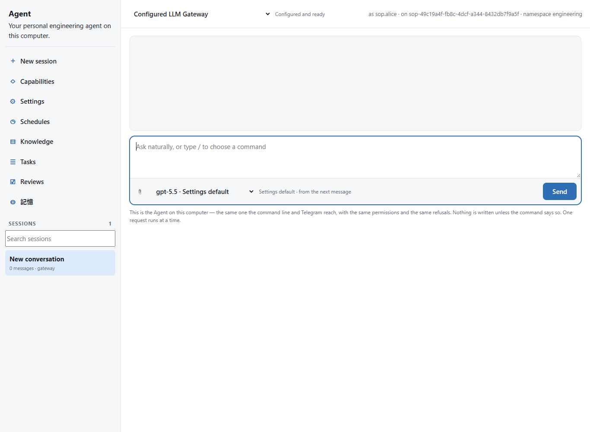

**遇到問題：** 若仍在檢查連線，先等狀態就緒；新分頁請從桌面捷徑開啟。

### 2. 進入 BI 卡片

按左側 Knowledge，再選 BI 卡片。

**應看到：** 第一次使用會看到「新增知識庫」與「加入」。


**遇到問題：** 看不到 BI 卡片時，先確認安裝版本與同事相同。

### 3. 打開建立表單

按「新增知識庫」。

**應看到：** 出現名稱、id、目的、共用資料夾與作者欄位。

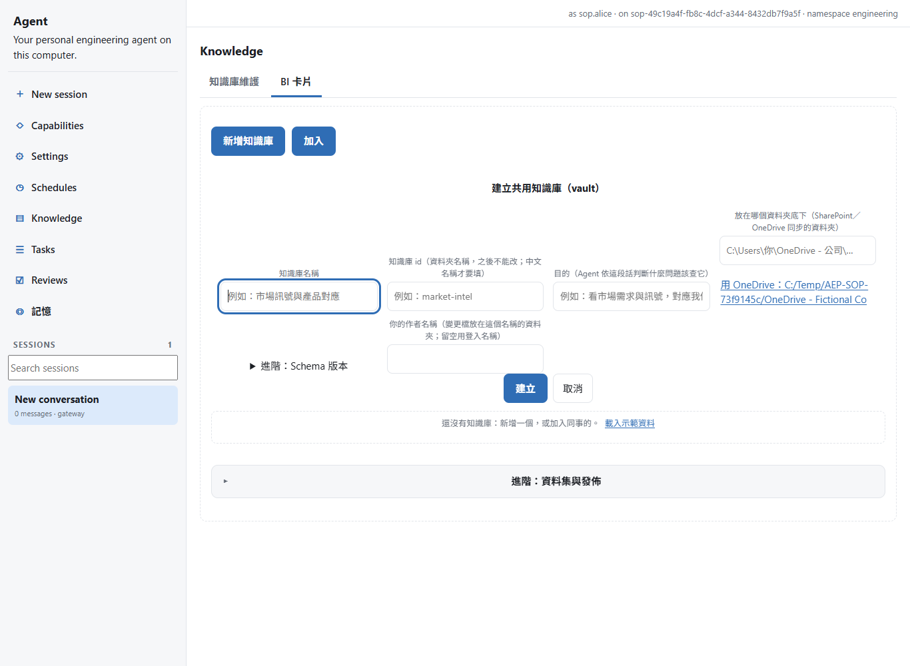

**遇到問題：** 同事已建立的知識庫請改用「加入」，不要再建立一份。

### 4. 填寫知識庫資料

名稱填「虛構海事知識庫」，id 填 fictional-marine；寫清楚目的，選共用資料夾，作者填 alice，再按「建立」。

**應看到：** 資料夾檢查顯示「可以用」；知識庫會建立在所選資料夾底下。

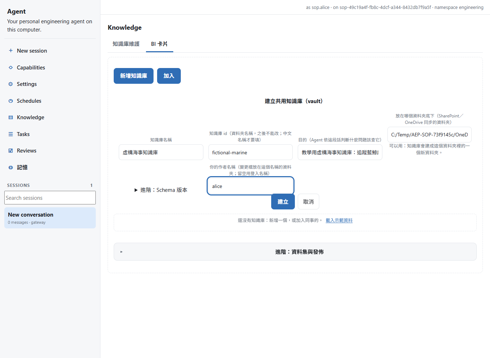

**遇到問題：** 中文名稱請另外填英文 id；路徑不通時先確認 OneDrive／SharePoint 已同步，不要填瀏覽器網址。

### 5. 確認新知識庫

確認上方選中「虛構海事知識庫」。

**應看到：** 畫面出現三個步驟，目前是 0 張卡片。

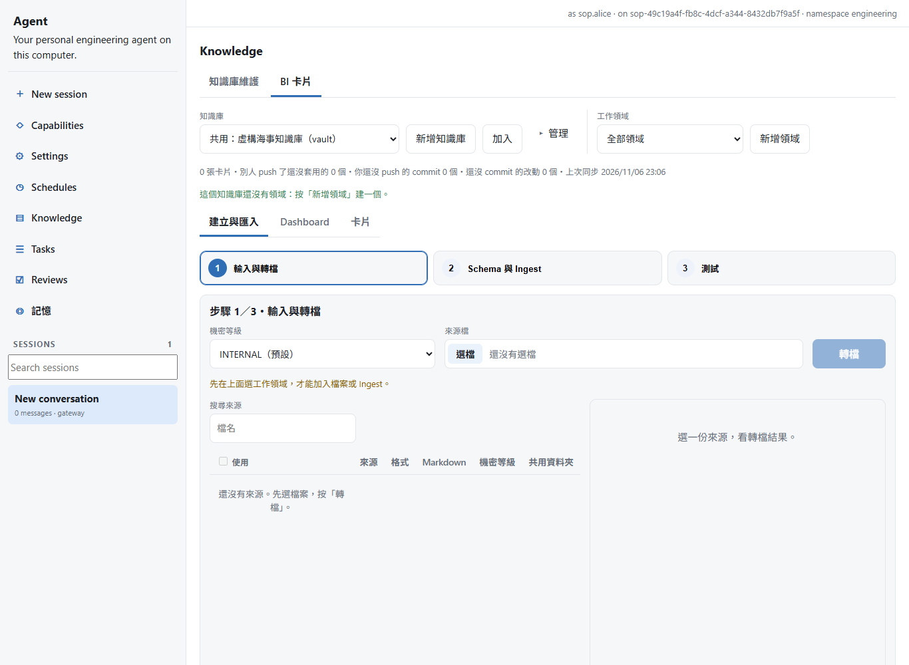

**遇到問題：** 沒有工作領域時，先新增領域，再加入檔案。

### 6. 新增工作領域

按「新增領域」。

**應看到：** 出現領域名稱與資料夾兩欄。

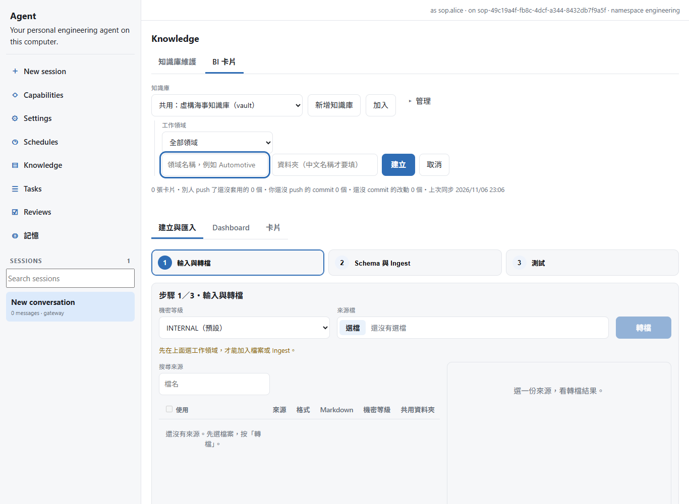

**遇到問題：** 新增按鈕沒有出現時，先選一個共用知識庫。

### 7. 辨識中文名稱的提示

若只填中文「海事」便按建立，查看頁面的提示。

**應看到：** 會提示中文名稱需要另外寫資料夾名稱，尚未建立。

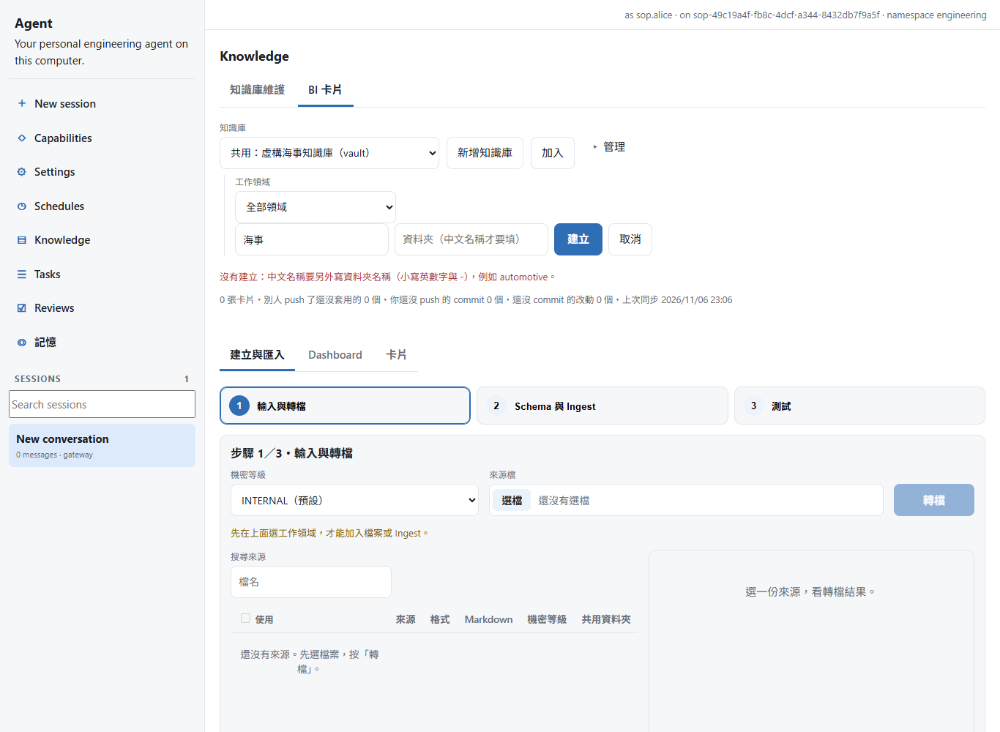

**遇到問題：** 不要重複按建立；補上小寫英文資料夾名稱即可。

### 8. 填入領域資料夾

領域名稱填「海事」，資料夾填 marine，再按「建立」。

**應看到：** 兩欄分別是顯示名稱與穩定的英文資料夾名稱。

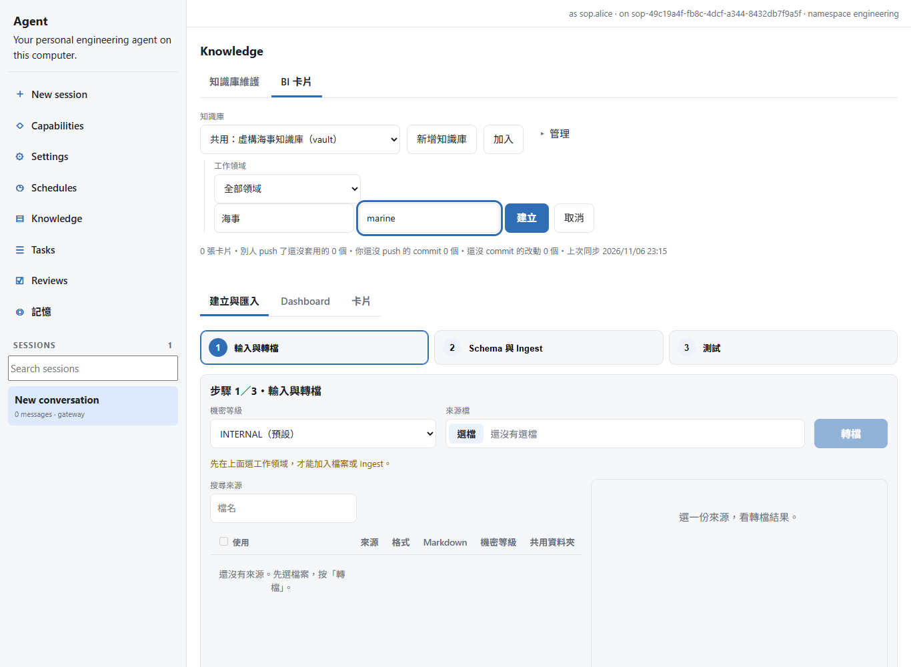

**遇到問題：** 檢查是否把英文輸入到名稱欄；資料夾只能用允許的小寫英文、數字和連字號。

### 9. 確認領域與資料夾

確認「工作領域」已選中海事。

**應看到：** 通知顯示 applications/marine，並建立 sources、skills、tools、profile；狀態列顯示尚未 commit。

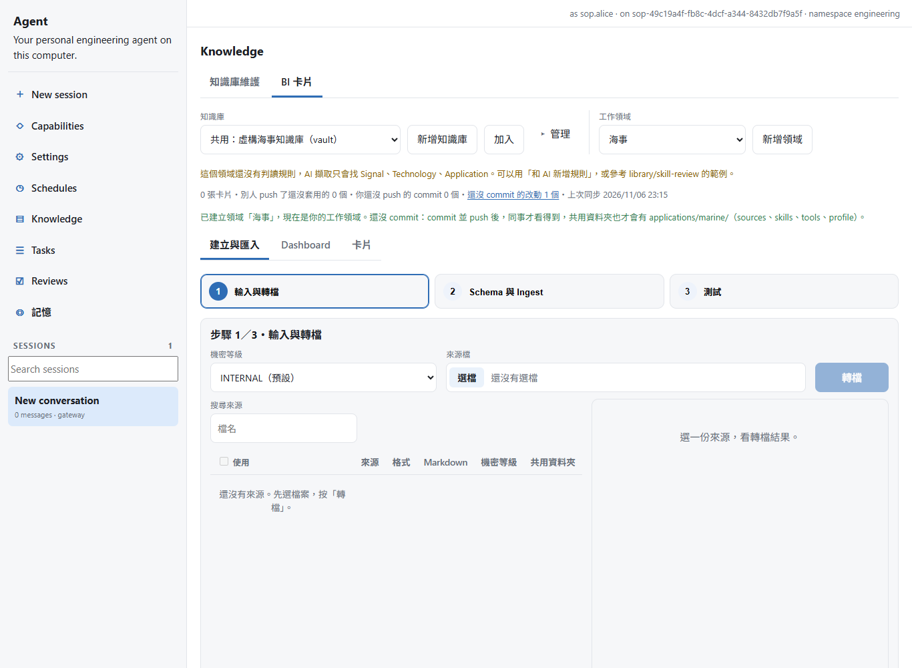

**遇到問題：** 不要停在「全部領域」加入檔案；它只供檢視。

### 10. 選擇多個來源檔

保留 INTERNAL 預設，按「選檔」，一次選取 fictional-market-note.md 與 fictional-supply.csv。

**應看到：** 來源檔旁顯示「2 個檔案」，轉檔按鈕可按。

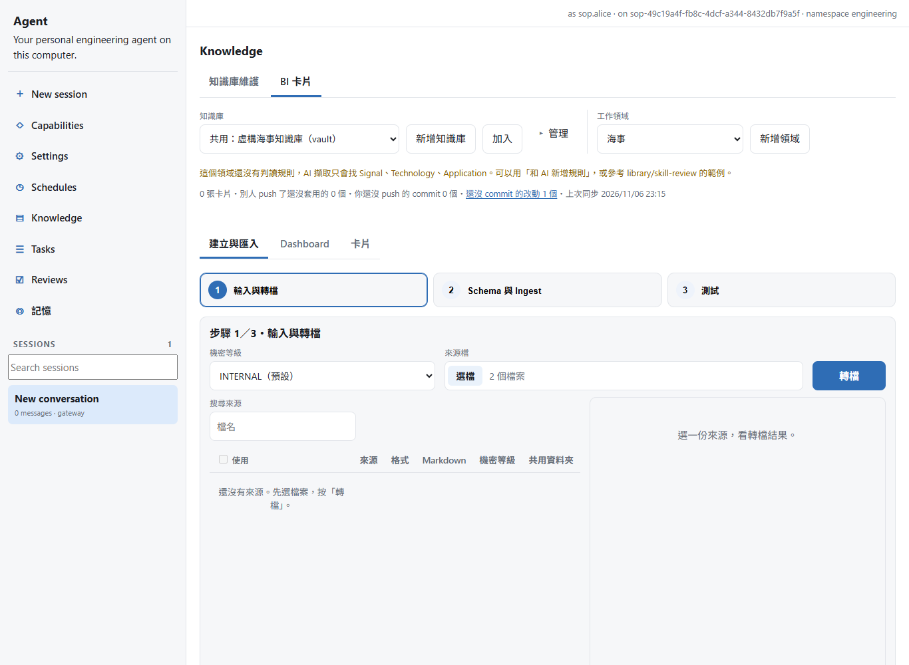

**遇到問題：** 沒有啟用轉檔時，先確認已選工作領域，且檔案尚未超過允許限制。

### 11. 轉檔並檢查來源表

按「轉檔」，等待來源表出現結果。

**應看到：** 兩份來源都有第 1 版 Markdown；表格來源仍可看到表格預覽。

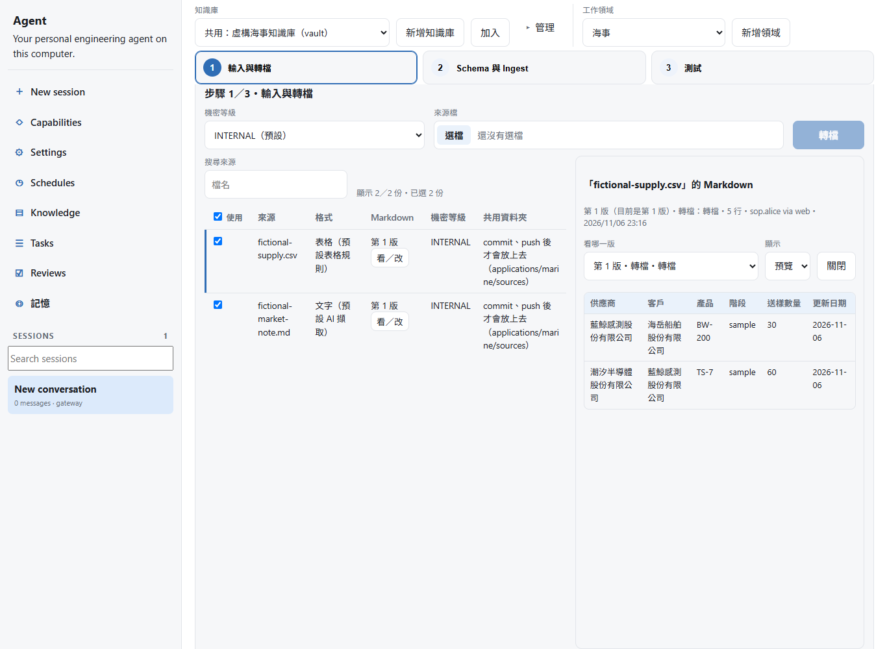

**遇到問題：** 轉檔失敗時看該檔原因；先檢查原檔能否開啟，不要把失敗當作已寫入卡片。

### 12. 查看表格預覽

按 CSV 那列的「看／改」。

**應看到：** 右側顯示真正的表格，能讀到供應商、客戶、產品、階段、數量與日期。


**遇到問題：** 欄位擠在一起時可在預覽內捲動；先核對轉檔結果，再做 Ingest。

### 13. 查看文字來源

按 Markdown 那列的「看／改」。

**應看到：** 右側顯示標題與原文，包含 BW-200 與 TS-7 的供貨資訊。

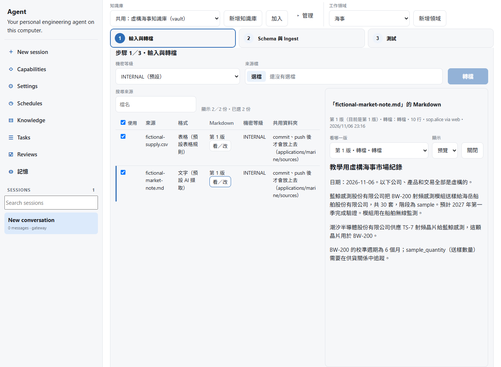

**遇到問題：** 選錯來源時，看右側標題確認檔名，再換另一列。

### 14. 切換編輯模式

在右側「顯示」選「編輯」。

**應看到：** 原文出現在可編輯的文字框，下方有「這一版的說明」。

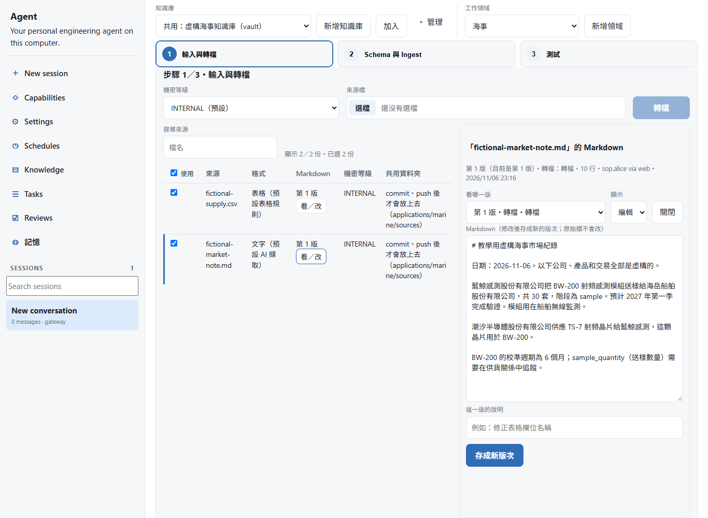

**遇到問題：** 不要直接改共用資料夾的原始檔；這裡的修改會另存 Markdown 版次。

### 15. 補充內容並寫說明

在末尾補上「產品導入驗證預定於 2027 年 3 月完成」，說明填「補上導入驗證時間」。

**應看到：** 文字與版次說明都已填好，尚未儲存。

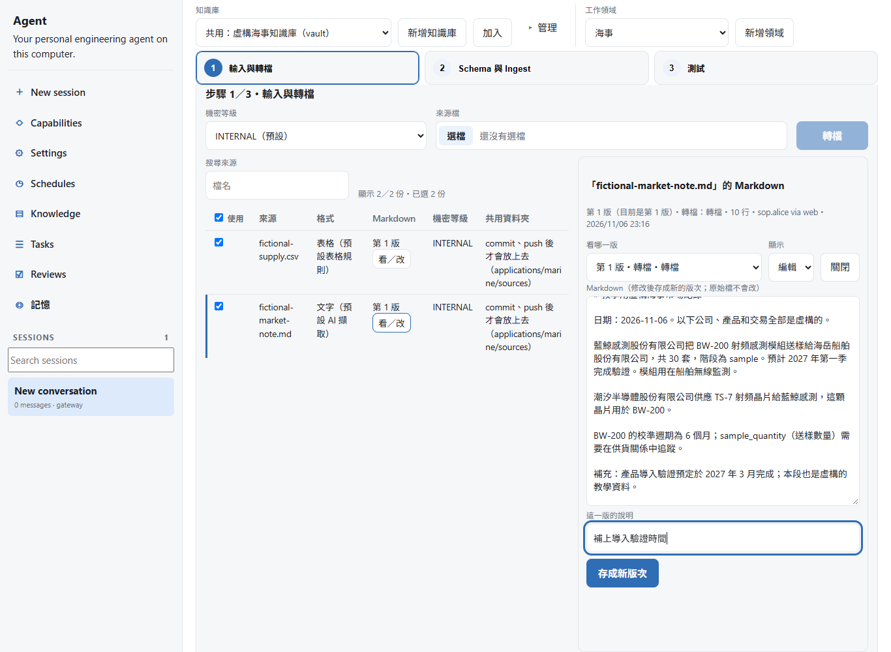

**遇到問題：** 不確定補充是否有依據時，先向資料負責人確認；不要把猜測當來源。

### 16. 存成新版次

按「存成新版次」。

**應看到：** 來源表與右側版本選單都變成第 2 版，原始檔不會改。

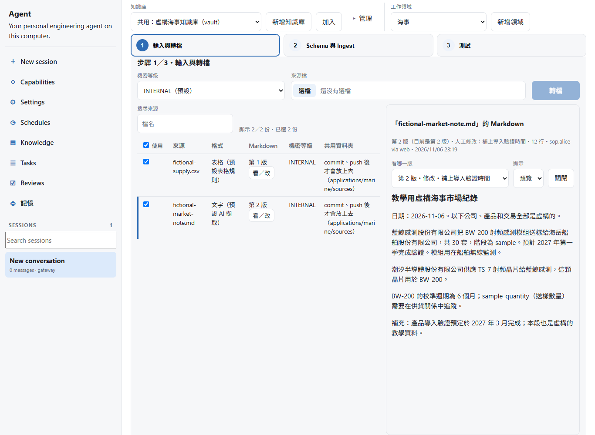

**遇到問題：** 沒有變成第 2 版時先看提示；不要立即重複儲存。

### 17. 進入類別與規則

按「下一步：Schema 與 Ingest」，停在 a 類別與規則。

**應看到：** 上方顯示目前 schema、建議 schema、和 AI 調整 schema，以及判讀規則表。

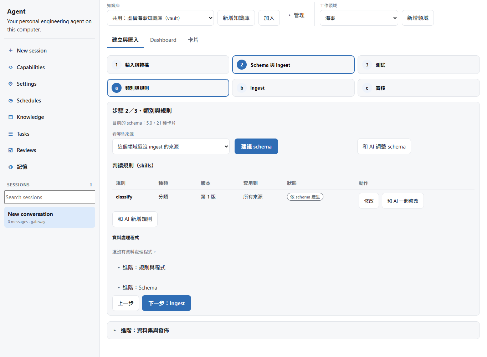

**遇到問題：** 先確認來源都已轉成可讀的 Markdown，再請 AI 檢查 schema。

### 18. 請 AI 建議 schema

看哪些來源保留「這個領域還沒 ingest 的來源」，按「建議 schema」。

**應看到：** 頁面顯示正在看來源，這一步只檢查 schema，不會寫入卡片。

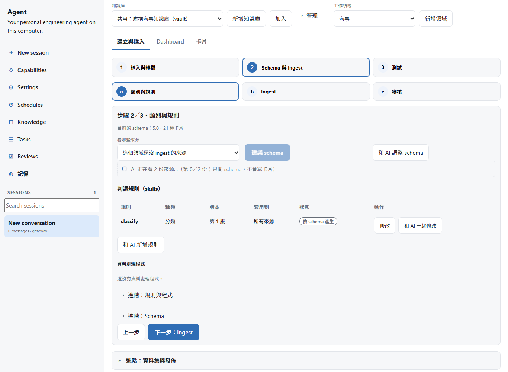

**遇到問題：** 通常等 1–4 分鐘；先等本次工作完成，不要連按。

### 19. 核對建議與原文

逐列讀「建議、為什麼、原文」。本例先看 SupplyLink.sample_quantity。

**應看到：** 原文顯示送樣 30 套，AI 說明現有欄位不足，並提供來源連結。

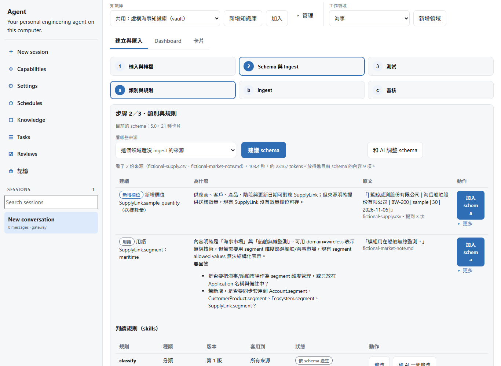

**遇到問題：** 沒有建議也可能是正確結果；不要為了使用 AI 而新增沒有用途的欄位。

### 20. 採納需要的欄位

按送樣數量那列的「加入 schema」，等待完成。

**應看到：** 該列出現「已加入」，上方 schema 顯示「5.0 加 2 項新增」。

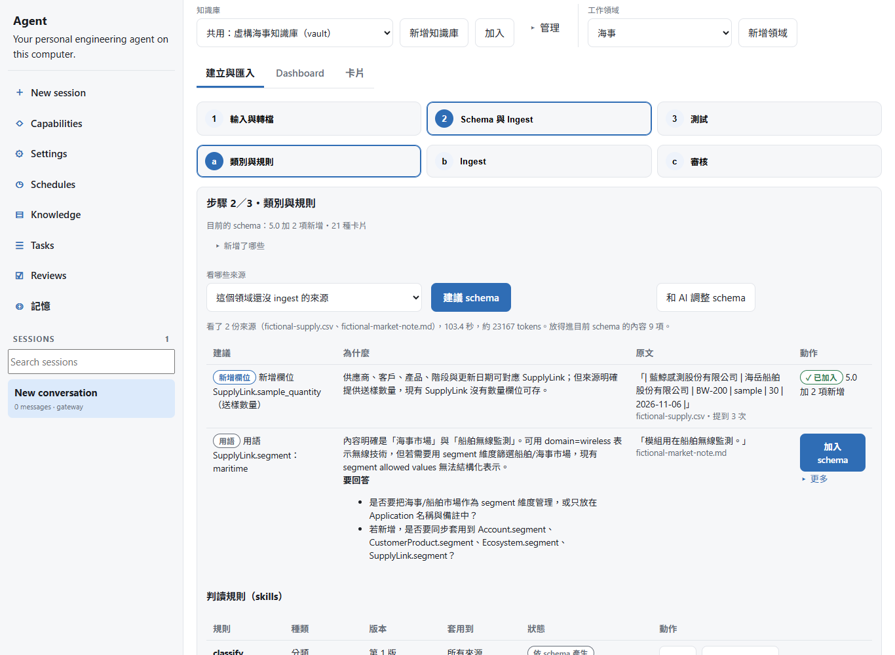

**遇到問題：** 先等綠色完成標記；不需要管理的其他用語或維度，可以先不採納。

### 21. 開啟 Schema AI 面板

按「和 AI 調整 schema」。

**應看到：** 右側開啟面板，可填目標、選樣本來源，並描述需求；套用前不會改資料集。

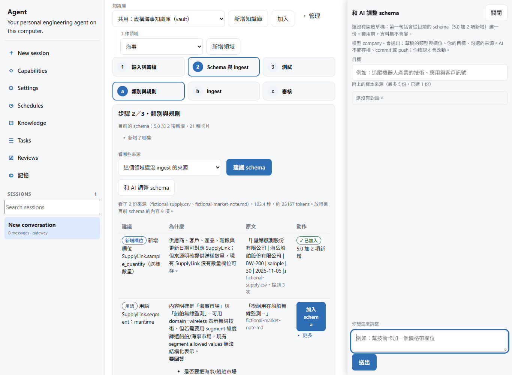

**遇到問題：** 請確認仍選中正確的知識庫與海事領域。

### 22. 描述需要的欄位

目標填「追蹤海事供貨關係、送樣數量與驗證期程」。訊息請 AI 新增 SupplyLink.validation_window，為可選文字欄位，標籤「驗證期程」，保留月份或季度、不猜完整日期。

**應看到：** 需求已填入，原有欄位維持不變。

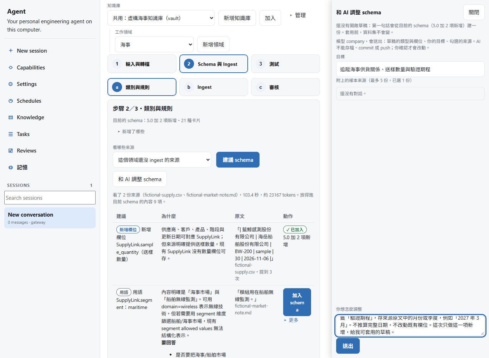

**遇到問題：** 請說清楚欄位放在哪種卡片、用途與是否必填；不要只說「幫我改好」。

### 23. 送出 Schema 需求

按面板的「送出」。

**應看到：** 面板顯示處理中；AI 會建立可檢查的草稿。

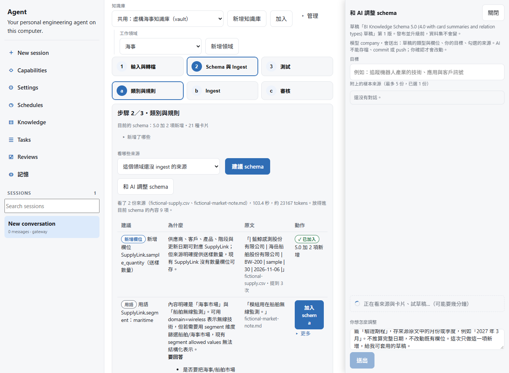

**遇到問題：** 等待 1–4 分鐘；逾時或模型錯誤時保留訊息，確認服務正常後再重試。

### 24. 檢查 AI 的 schema 草稿

讀右側建議、理由、差異與範例卡片。

**應看到：** 只有 SupplyLink.validation_window 被新增，保留來源的月份或季度文字，不捏造完整日期。

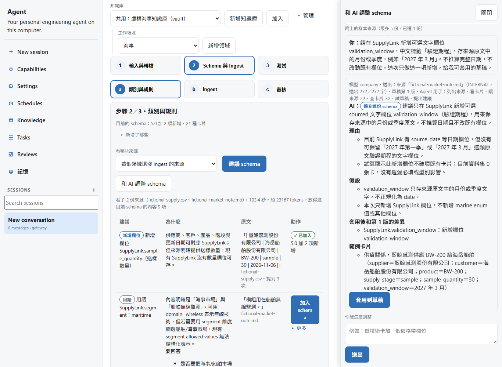

**遇到問題：** 若 AI 改了不需要的欄位，先用訊息請它縮小範圍，不要立即套用。

### 25. 套用到草稿並看差異表

按「套用到草稿」，關閉 AI 面板，查看 Schema 草稿表。

**應看到：** 草稿變成第 2 版，表格列出供貨關係、validation_window 與新增欄位。

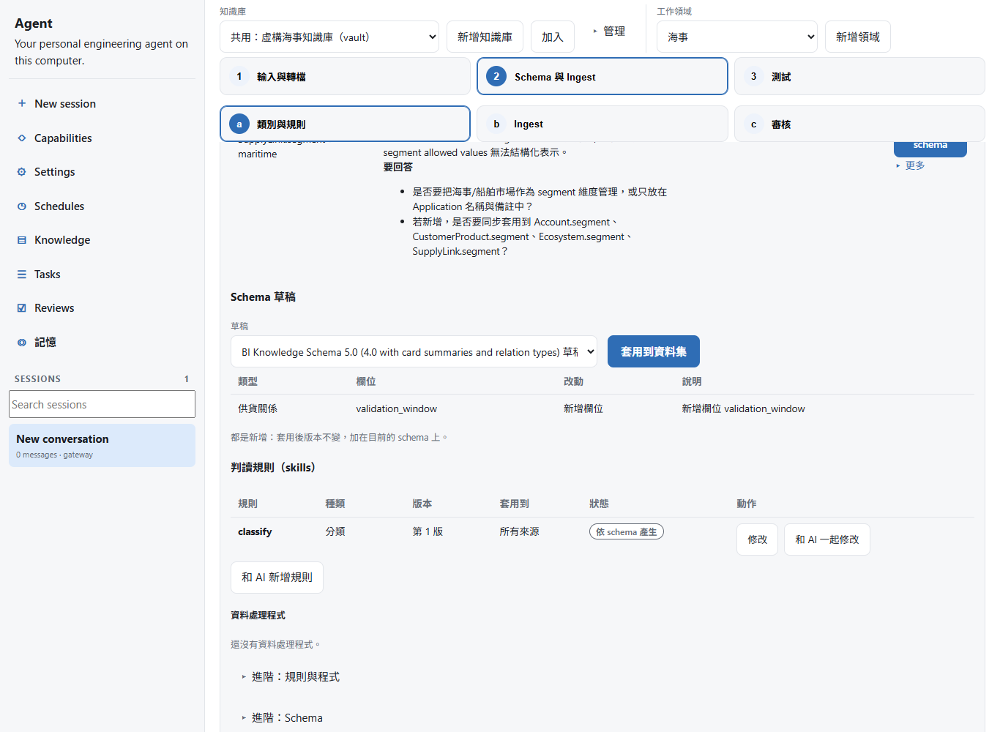

**遇到問題：** 這時還不是資料集的新欄位；先讀差異，不要把草稿當作已套用。

### 26. 預覽套用影響

按草稿旁的「套用到資料集」。

**應看到：** 出現「加入 1 項新增……版本不變」的預覽，列出既有卡片是否受影響。

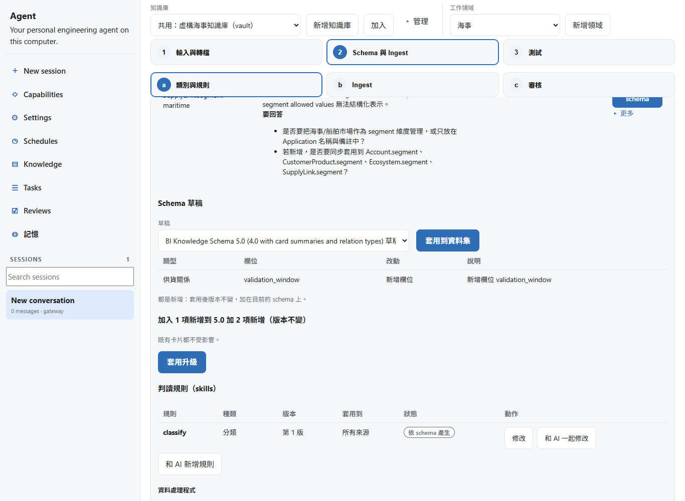

**遇到問題：** 若顯示刪除欄位或其他不預期改動，先回草稿修正。

### 27. 確認套用升級

確認只有需要的新增後，按「套用升級」。

**應看到：** 預覽的套用區塊收起；上方目前 schema 可確認為「5.0 加 3 項新增」。


**遇到問題：** 若草稿表暫時仍列出同一項，先核對上方 schema 的「新增了哪些」，不要重複套用。

### 28. 請 AI 撰寫判讀規則

按「和 AI 新增規則」。

**應看到：** 右側顯示名稱與套用資料夾；本例已帶入 applications/marine/sources。

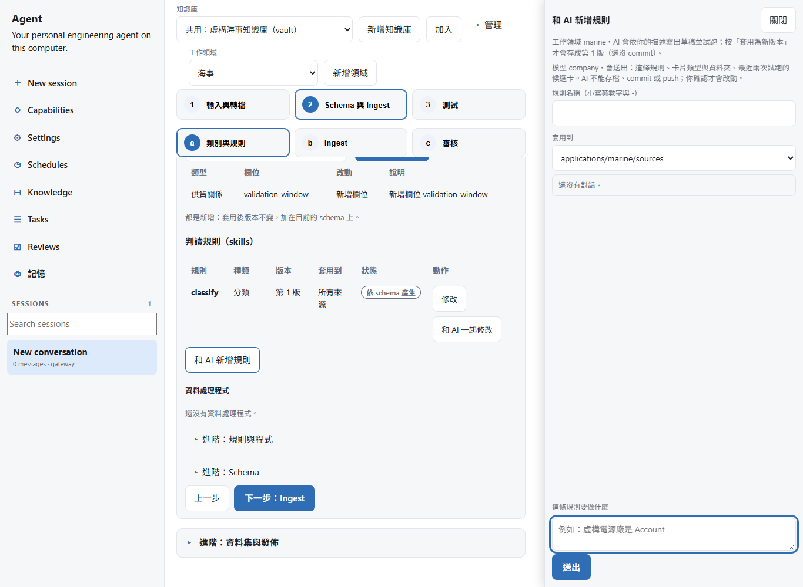

**遇到問題：** 若套用資料夾不對，先改成自己的領域，不要把規則放到別人的來源。

### 29. 說清楚要哪些卡片

名稱填 marine-extract；規則要求 SupplyLink、Account、Technology、CustomerProduct、Signal，原文沒寫的留空，數量與驗證期程只取原文。

**應看到：** 名稱、資料夾與需求都填好；範例請它先用 fictional-market-note.md 試讀一次。

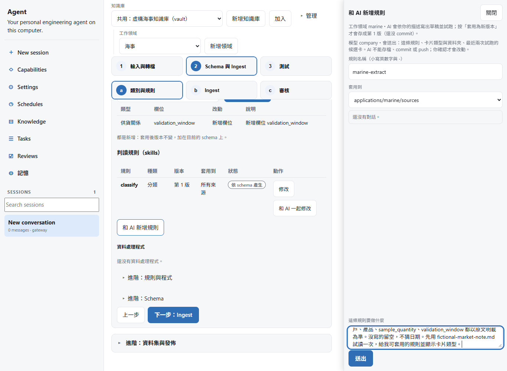

**遇到問題：** 不要只寫「幫我擷取」；明確寫卡片類型與判讀準則。

### 30. 送出規則需求

按「送出」，等待 AI 撰寫與試讀。

**應看到：** 右側顯示正在檢查與試讀；套用前不會存成正式規則。

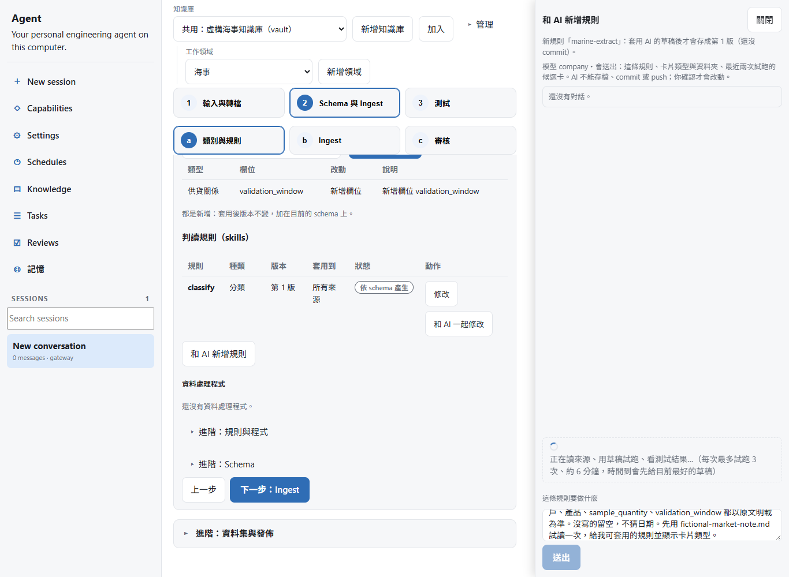

**遇到問題：** AI 通常需要 1–4 分鐘。逾時先保留錯誤；若已有可用草稿，先檢查內容，不要反覆重跑。

### 31. 檢查 AI 提議的卡片類型

閱讀右側回覆的「套用後的變化」。

**應看到：** 五種類型 SupplyLink、Account、Technology、CustomerProduct、Signal，並列出試讀限制。

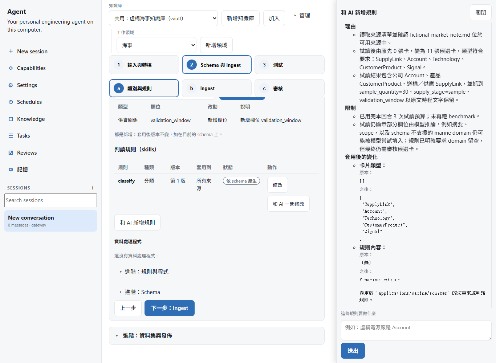

**遇到問題：** 試讀結果不等於正確，仍要核對來源；類型不對就請 AI 修改。

### 32. 閱讀完整判讀規則

向下讀規則內容，確認只取原文、不補日期與數量，再按「套用為新版本」。

**應看到：** 規則包含公司、產品、供貨關係、技術和訊號的擷取準則。

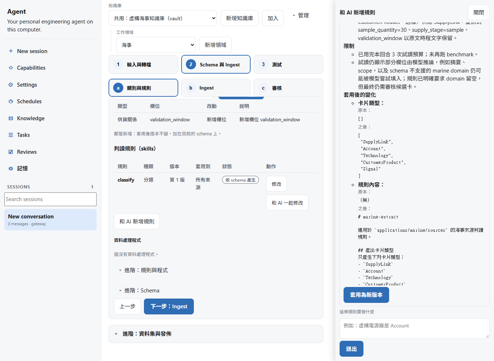

**遇到問題：** 有不合理推論先修改；不要盲目套用 AI 產物。

### 33. 確認規則已保存

關閉 AI 面板，查看判讀規則清單。

**應看到：** marine-extract 第 1 版，套用到海事，清楚列出產生的卡片類型。

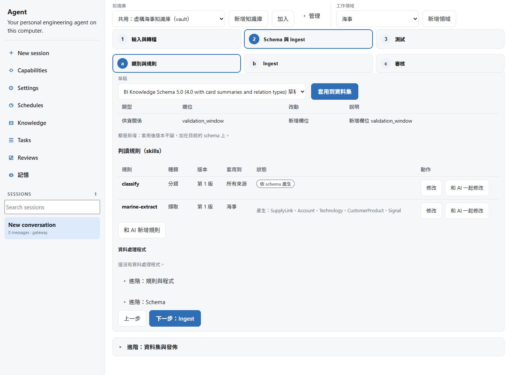

**遇到問題：** 沒出現在清單時先確認套用結果，不要直接跑 Ingest。

### 34. 手動調整規則並保存新版

按 marine-extract 的「修改」，補上數量單位的判讀限制，再按「存成新版本」。

**應看到：** 表單可改名稱、資料夾、卡片類型及內容；保存後為第 2 版。

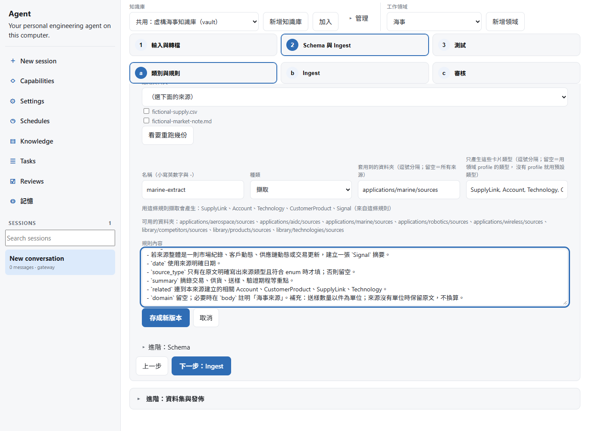

**遇到問題：** 來源沒寫單位就保留原文，不能自己換算。

### 35. 準備批次擷取

按「下一步：Ingest」，保留 AI 擷取（內建）。

**應看到：** 提示本次有 2 份來源，一份一次依序執行；已保存的領域規則會參與判讀。

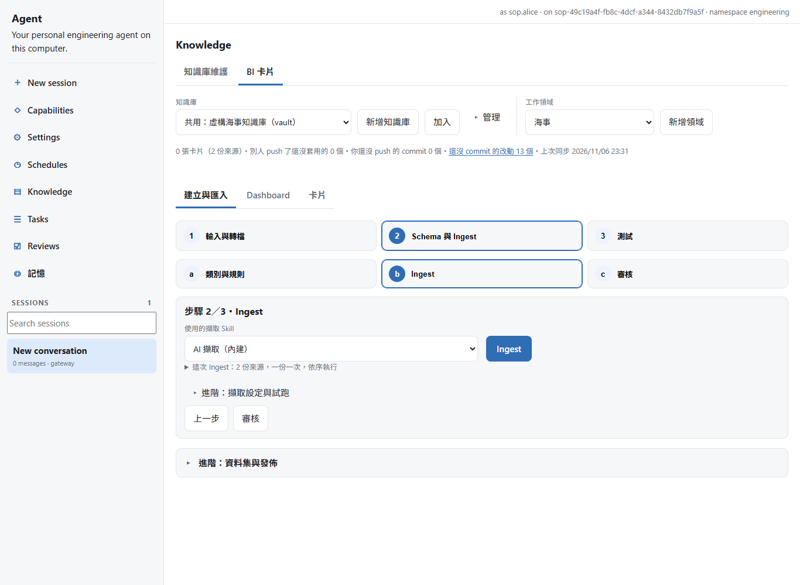

**遇到問題：** 來源數不對時回步驟 1 檢查選取；不要連按 Ingest。

### 36. 開始批次 Ingest

按「Ingest」。

**應看到：** 顯示第 1／2 份來源、AI 判讀進度及「停止」。

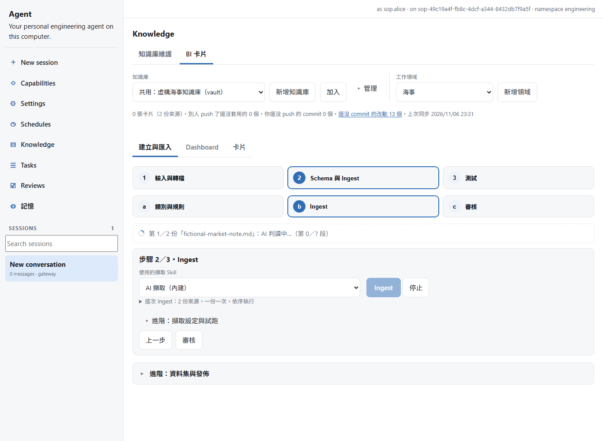

**遇到問題：** AI 通常需 1–4 分鐘；停止後先看狀態，避免重複寫入。

### 37. 查看每次執行的候選卡

批次完成後，在「待審核的執行」選一個來源。

**應看到：** 第一份 11 張候選卡，分別顯示錯誤、警告與已接受數量。

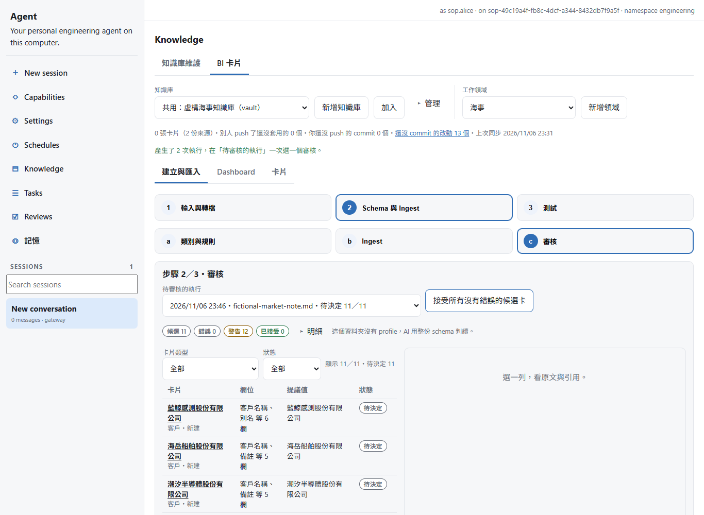

**遇到問題：** 兩份來源要分別審核；警告必須閱讀，不能只看零錯誤。

### 38. 逐欄核對供貨關係

點 BW-200 的供貨關係列。

**應看到：** 右側列出供應商、客戶、產品及引用；「有出處」與「推論」分開標示。

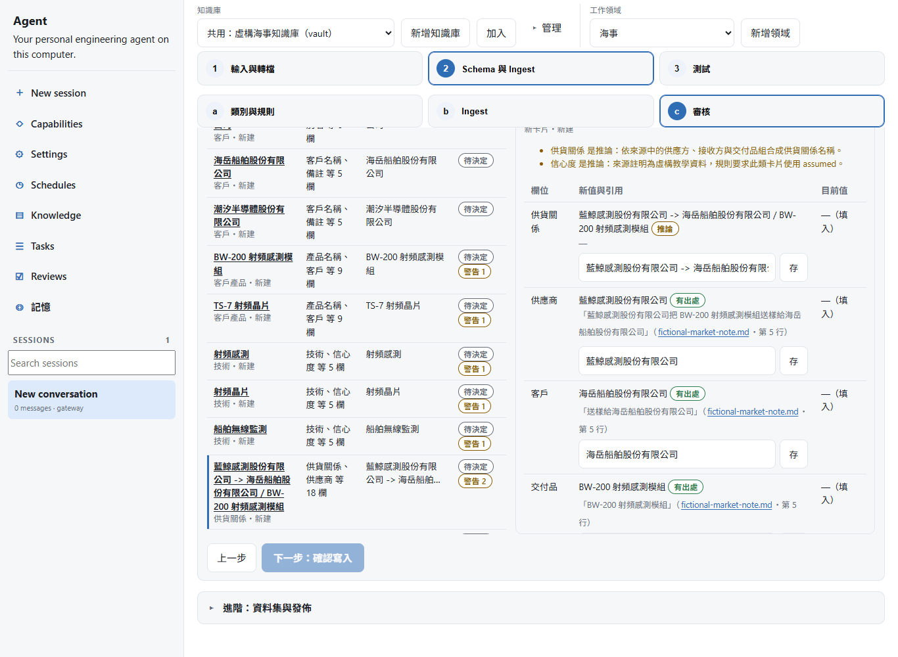

**遇到問題：** 數量、公司或方向錯誤可修改後儲存，或拒絕該卡。

### 39. 打開引用的原文

點送樣數量旁的 fictional-market-note.md 連結。

**應看到：** 原文捲到引用並標出「共 30 套」。

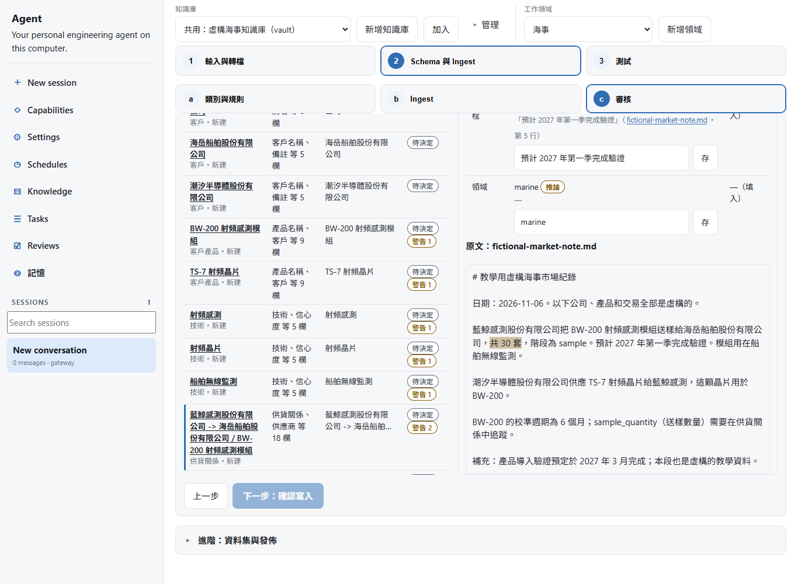

**遇到問題：** 引用找不到或斷章取義時，回到候選欄位修正，不要直接接受。

### 40. 接受已核對的候選卡

逐列看完後，按「接受所有沒有錯誤的候選卡」。

**應看到：** 11 張顯示藍色勾與「已接受」。

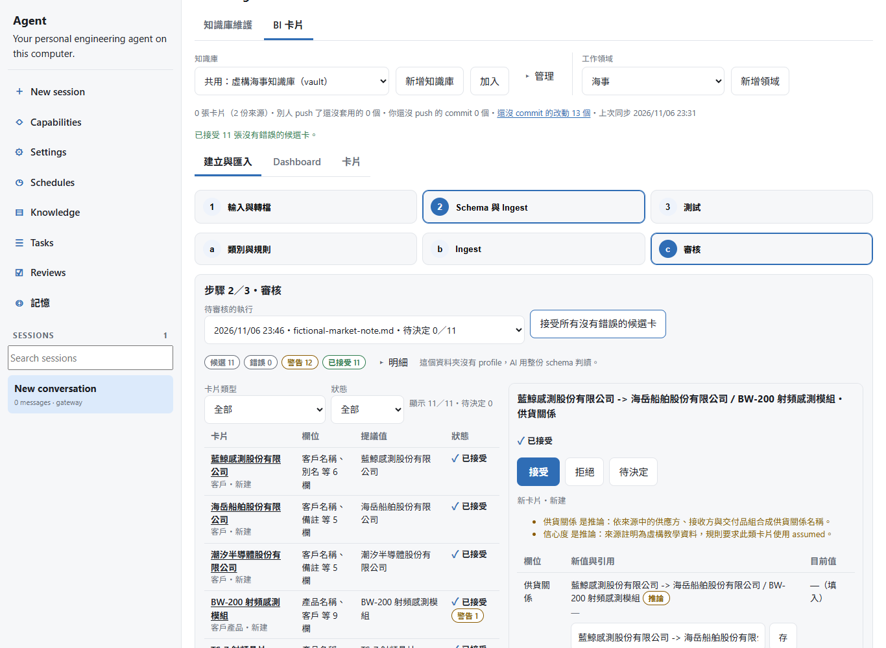

**遇到問題：** 這個按鈕不保證沒有推論；仍需人工確認警告與原文。

### 41. 確認寫入的範圍

按「下一步：確認寫入」，核對目的資料集與新建數。

**應看到：** 列出新建 11、更新 0、未決定 0，並說明整批寫入與復原。

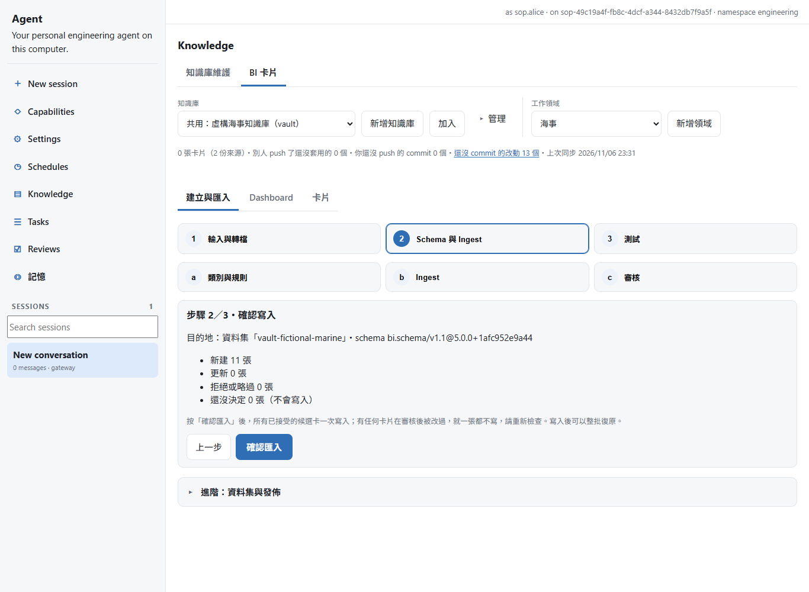

**遇到問題：** 資料集選錯或數量不符就按上一步檢查。

### 42. 執行匯入並看結果

按「確認匯入」。

**應看到：** 執行已寫入，列出匯入編號與新建 11；搜尋索引更新。

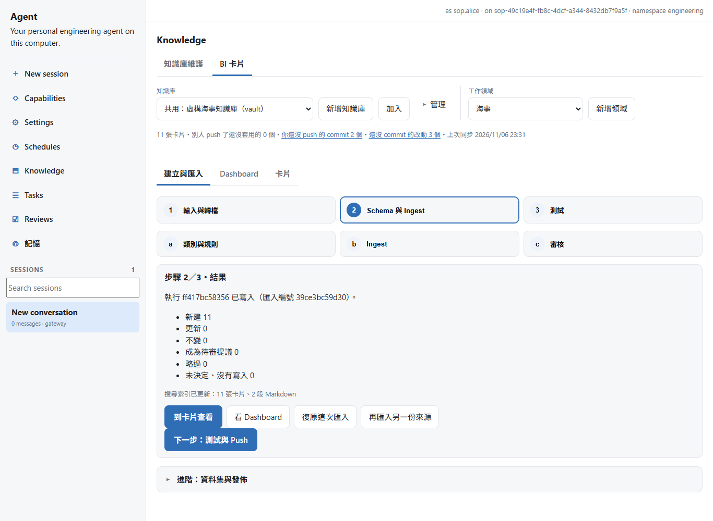

**遇到問題：** 寫入失敗先保存錯誤；不要不看結果就再次匯入。

### 43. 處理第二份來源的錯誤

回「c 審核」，選 fictional-supply.csv，點有錯誤的訊號卡。

**應看到：** 提示缺必填「所以呢」，並列出無出處及推論。此例按「拒絕」。

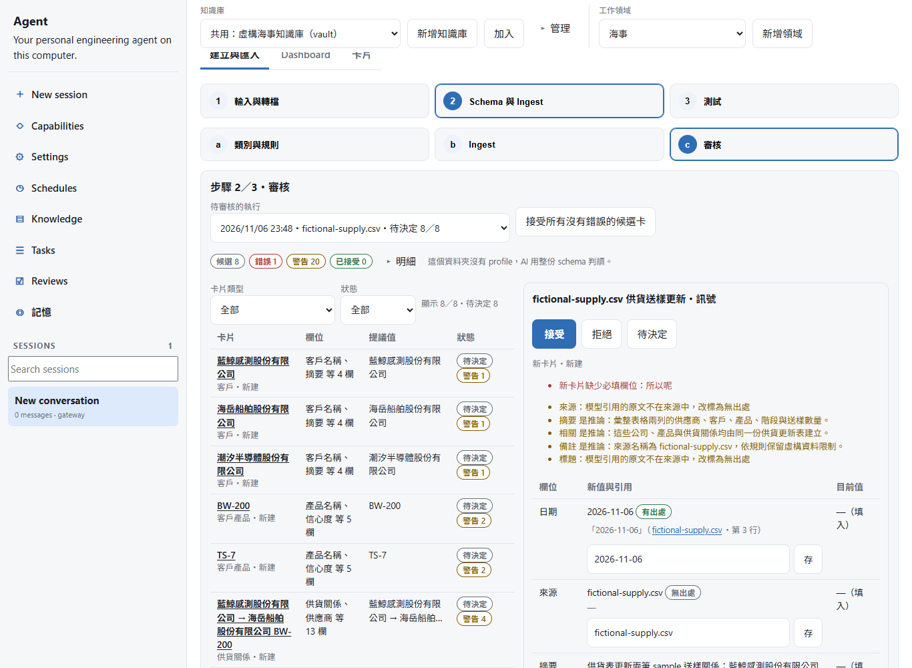

**遇到問題：** 來源沒寫就不要補造；有可靠資訊才修改後重新審核。

### 44. 逐張接受並看藍色勾

核對公司卡後按右側「接受」。

**應看到：** 左側該列立即出現藍色勾，已接受計數加 1。

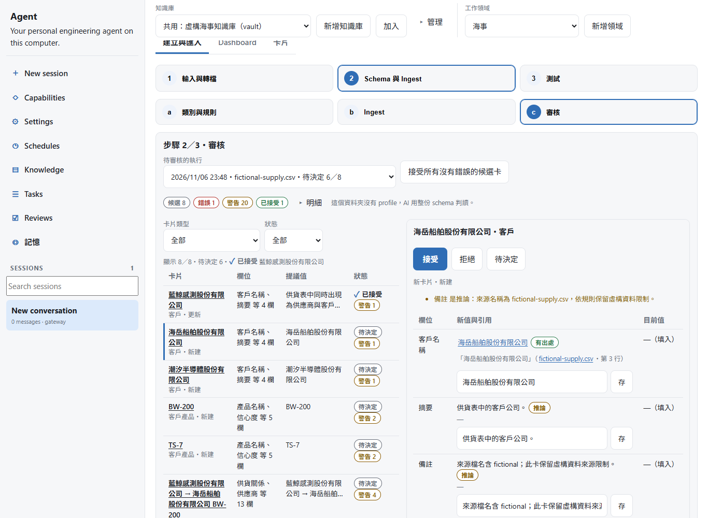

**遇到問題：** 按鈕被頂部固定列遮住時，稍微捲動再按。

### 45. 完成其餘來源的確認寫入

檢查其餘候選，接受有效卡，再按確認寫入與確認匯入。

**應看到：** 本例新建 2、更新 2、不變 3、待審提議 13、略過 1。


**遇到問題：** 待審提議代表既有描述保留，需要人決定；不要把它當作覆蓋成功。

### 46. 由狀態列前往版本與分享

點上方「還沒 commit 的改動」連結。

**應看到：** 跳到分享區，顯示待提交、已提交未 push 與已 push 的內容。

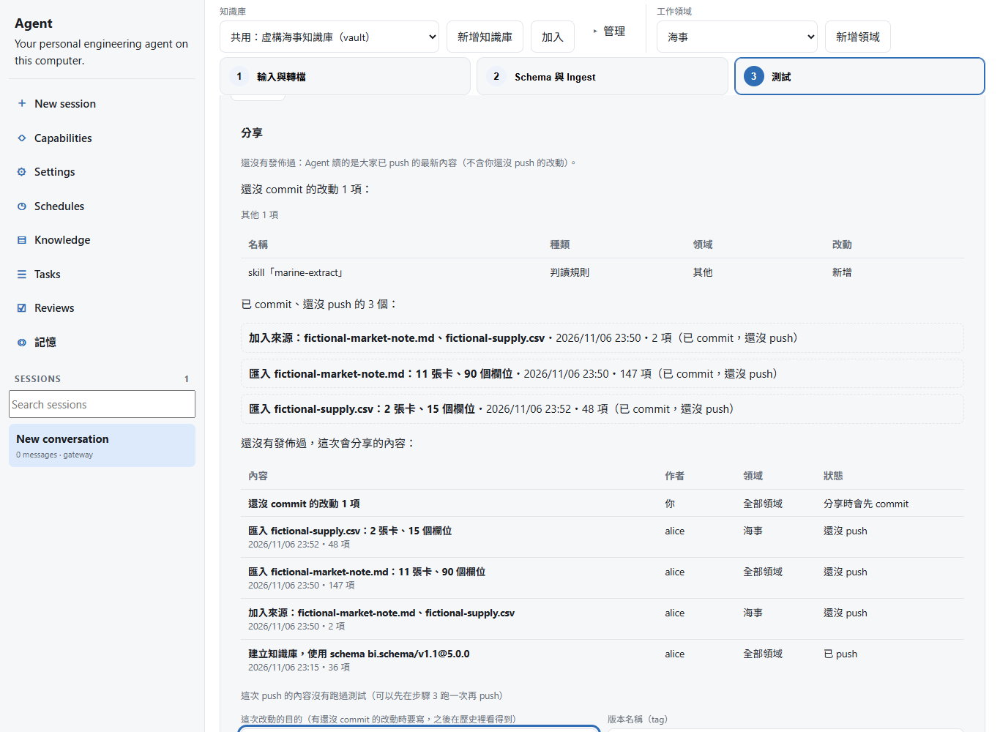

**遇到問題：** 先看清將分享的範圍，再進行 commit 或分享。

### 47. 只提交這次改動

填改動目的，展開「進階：分開 commit、push 與捨棄」。

**應看到：** 此例填「保存已審核的海事判讀規則第二版」，可按「只 commit」。

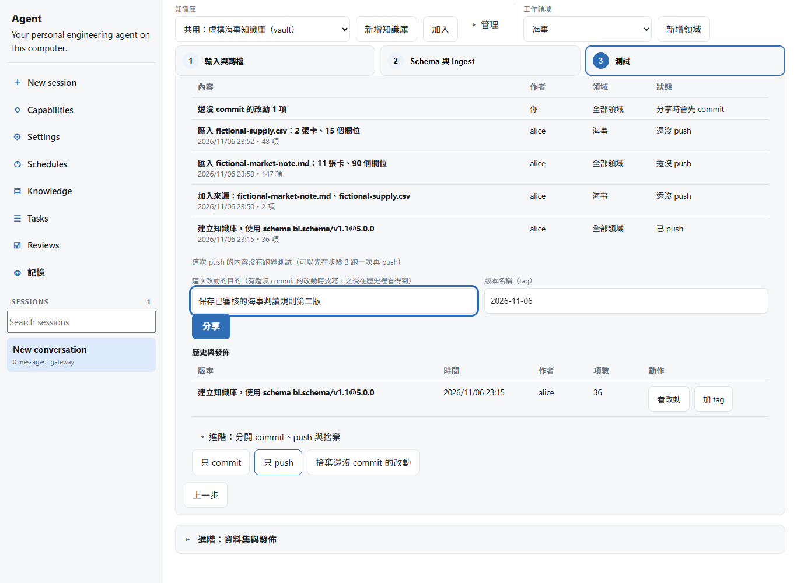

**遇到問題：** 一般分享可直接用分享；只 commit 尚不會讓同事收到。

### 48. 確認 commit 留下目的

按「只 commit」。

**應看到：** 目的出現在歷史清單，狀態仍是「還沒 push」；只 commit 按鈕停用。

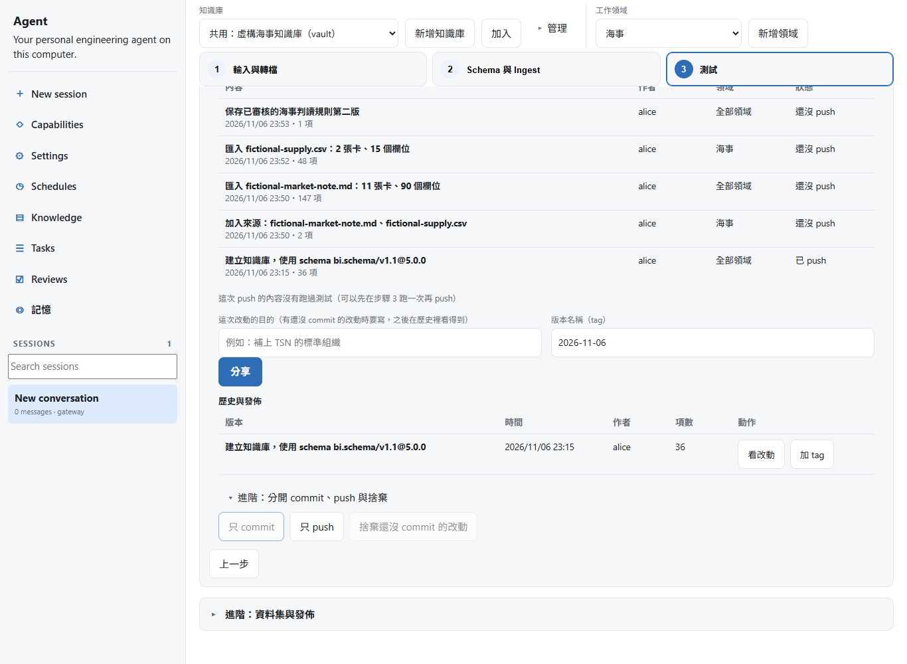

**遇到問題：** commit 與發佈不同，最後仍需跑測試並分享。

### 49. 手動新增測試題

展開 Benchmark，按「新增題目」，填問題與必須提到的關鍵字。

**應看到：** 本例問 BW-200 送樣對象與數量，必須提到 BW-200、海岳船舶、30，領域 marine。

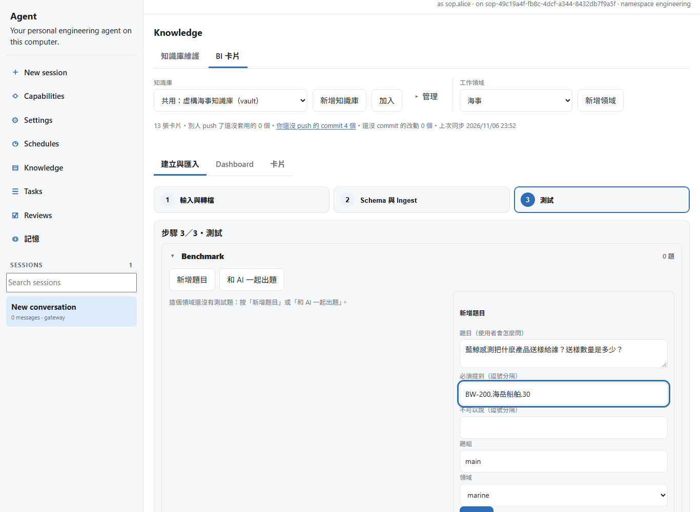

**遇到問題：** 關鍵字應足以驗證答案，但不要要求來源沒寫的內容。

### 50. 保存測試題

按「儲存」。

**應看到：** 表格多一題，並提示 commit 與 push 後同事才會收到。

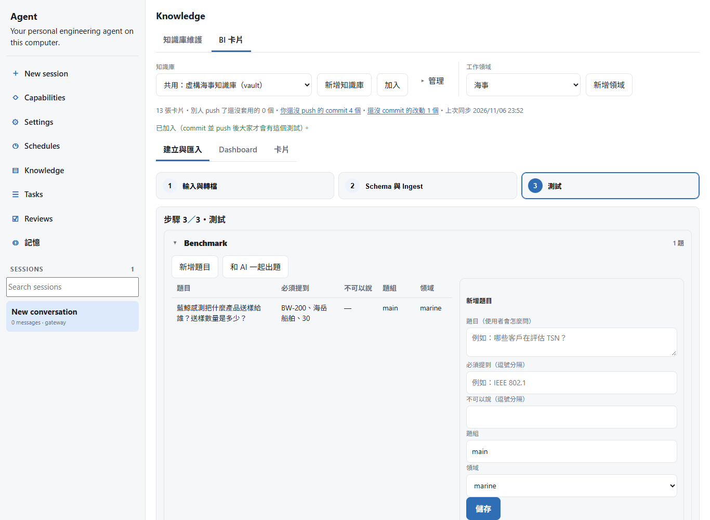

**遇到問題：** 未出現新列時檢查必填欄位及錯誤提示。

### 51. 請 AI 草擬測試題

按「和 AI 一起出題」，要求 TS-7 供應關係與 BW-200 校準週期兩題，再送出。

**應看到：** 右側顯示需求；AI 只能提議，按加入前不會存題。

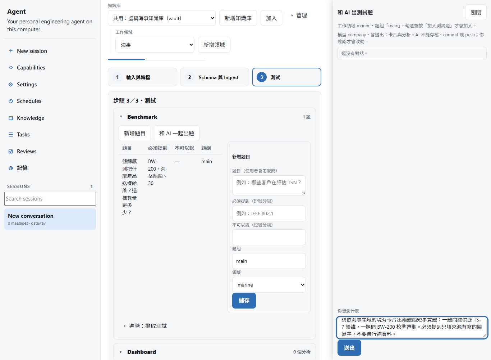

**遇到問題：** 說明題目範圍與不可猜測的限制。

### 52. 核對 AI 題目與判分條件

閱讀每題的「必須提到」「不可以說」。

**應看到：** 此例第二題錯把 6 個月列為禁止答案，先不要按加入。

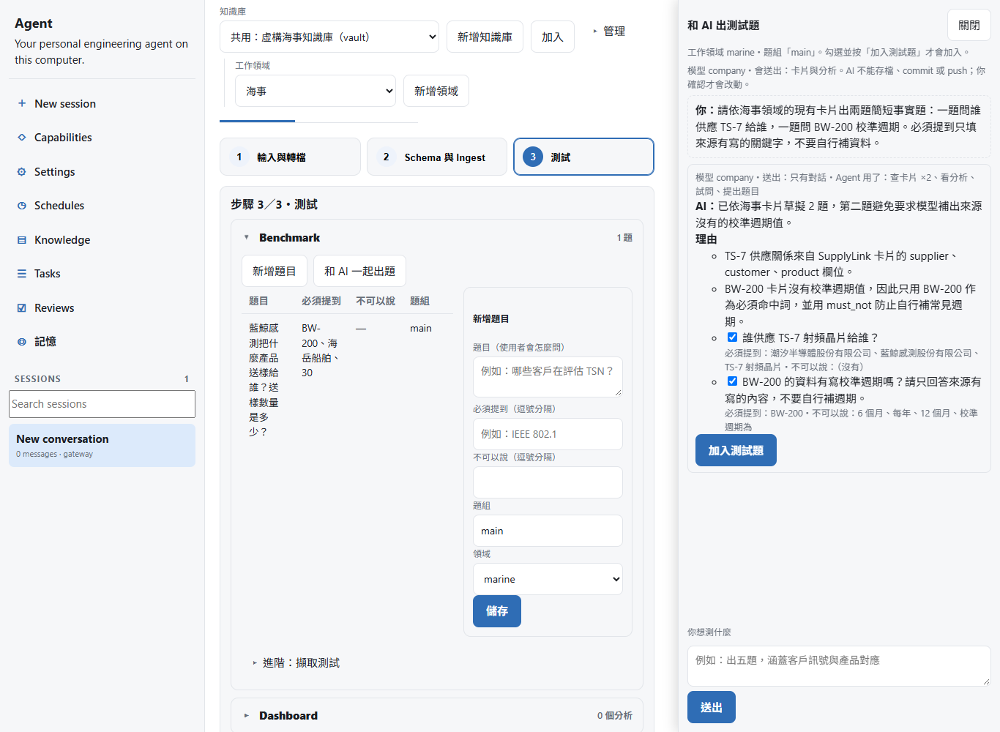

**遇到問題：** 發現錯誤要指出原文與位置，請 AI 更正，不能用錯題判分。

### 53. 更正後只加入新版建議

指出原文第 9 行有 6 個月；讀取最新回覆，按最下面那組「加入測試題」。

**應看到：** 新版第二題必須提到 BW-200、6 個月，禁止答案為空。

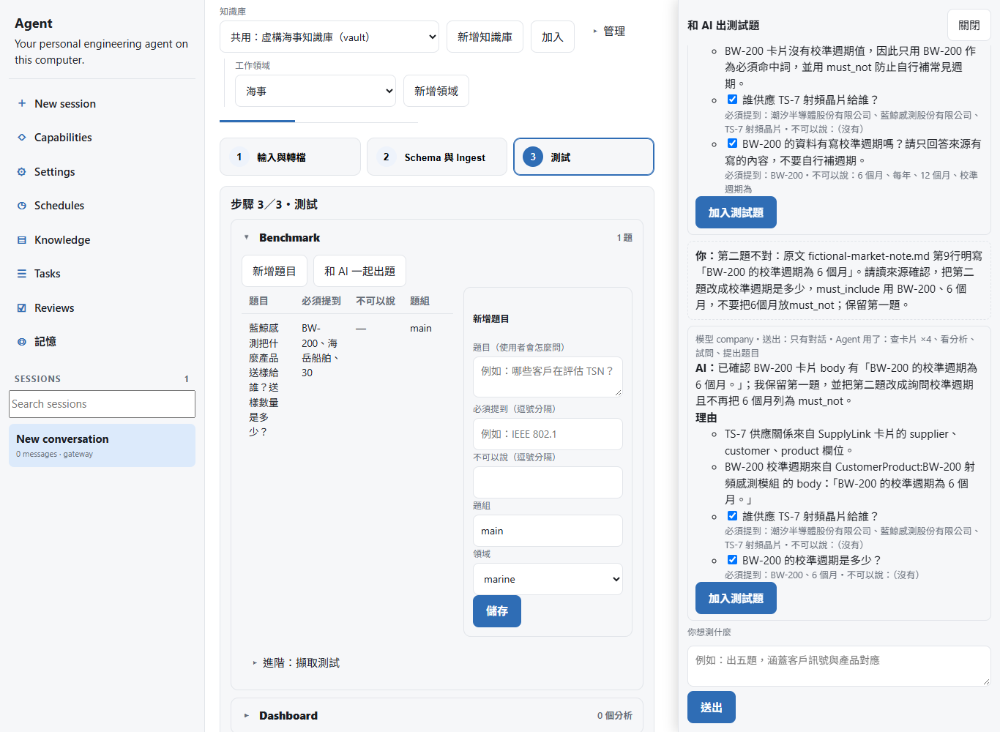

**遇到問題：** 舊建議仍在對話上方，請分清最新一組，避免重複加入。

### 54. 直接編輯表格中的題目

關閉 AI，點第一題那一列，在「必須提到」補上送樣。

**應看到：** 下方載入既有題目，而非新增空白題。

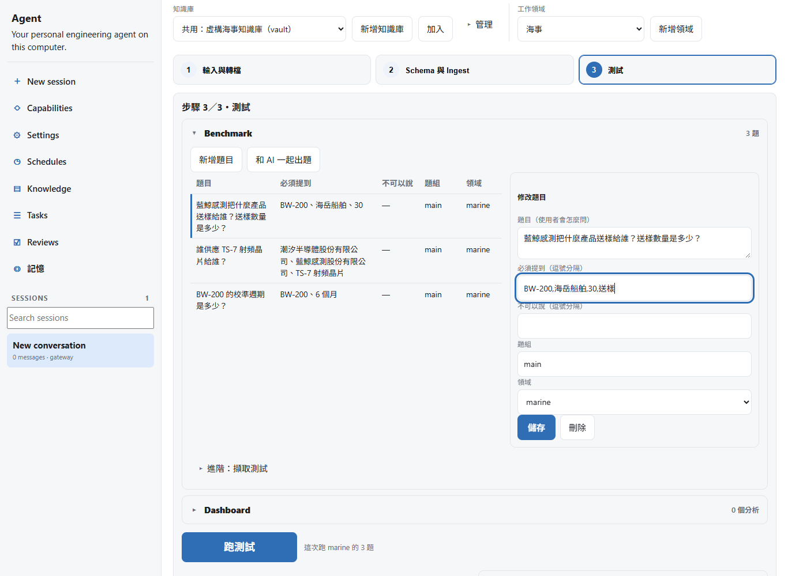

**遇到問題：** 先核對載入的是哪題，再儲存。

### 55. 確認三題及修改結果

按「儲存」。

**應看到：** Benchmark 3 題，第一題的必須提到含送樣。


**遇到問題：** 題數不對先檢查是否誤按了舊 AI 建議。

### 56. 用 AI 建立 Dashboard 分析

展開 Dashboard，按「和 AI 做新分析」，要求海事卡片類型與名稱清單並送出。

**應看到：** 需求清楚限制只讀卡片，右側開始產生分析。


**遇到問題：** AI 步驟需 1–4 分鐘；先等候，不連續送出。

### 57. 檢查分析的預覽與 SQL

展開「看 SQL」，閱讀查詢和預覽結果。

**應看到：** 查詢只讀 cards、card_values，篩選 marine，結果列出 13 張卡。


**遇到問題：** 結果數量、領域或欄位不對時請 AI 修正；不要只憑標題保存。

### 58. 存成 Dashboard 分析

按「存成分析」，再關閉 AI。

**應看到：** Dashboard 多一個「海事卡片總覽」，排第 1 個；右側可預覽。


**遇到問題：** 尚未分享的分析只在自己電腦上，完成後記得分享。

### 59. 加入既有分析

展開「還沒放進這個領域的分析」，在推測內容比例按「更多」→「加到這個領域」。

**應看到：** 推測內容比例成為 Dashboard 第 2 個分析。


**遇到問題：** 既有 Python 分析請先確認來源及用途，核准代表信任程式碼。

### 60. 調整分析順序

在推測內容比例那列按「上移」。

**應看到：** 推測內容比例排第 1，海事卡片總覽排第 2。


**遇到問題：** 若沒變動，確認按的是正確那列，並等候重新載入。

### 61. 請 AI 修改既有分析

在海事卡片總覽按「更多」→「和 AI 一起修改」，要求加摘要欄並送出。

**應看到：** 右側標示修改既有分析；要求保留原欄位和領域篩選。


**遇到問題：** 請清楚說要保留什麼，避免 AI 重做成另一種分析。

### 62. 檢查前後差異後套用

閱讀左右 SQL 差異與修改後結果，再按「套用修改」。

**應看到：** 右側多了讀取既有 summary 的欄位；沒有替卡片產生新摘要。


**遇到問題：** 只看預覽還不會保存；不符合需求就繼續對話修改。

### 63. 執行領域測試

關閉 AI，按「跑測試」。

**應看到：** 顯示這次跑 marine 的 3 題，並逐題比較工作版本與發佈版本。


**遇到問題：** 每題需要模型回答，整組可超過單次 AI 等待時間；不要重複執行。

### 64. 閱讀逐題測試結果

等待完成，核對通過題數與缺少的詞。

**應看到：** 本例工作版 2／3、發佈前共用版 0／3；校準週期題未通過。


**遇到問題：** 不要只看綠色通過標籤；必須逐題看分數及答案。

### 65. 展開失敗題的兩邊答案

在校準週期題按「看兩邊」。

**應看到：** 工作版只讀供貨關係，沒讀到產品備註的 6 個月，屬實際漏答。


**遇到問題：** 正式使用應檢查卡片、規則與查詢，再重跑；不要刪掉正確的判分條件。

### 66. 填寫分享目的與日期版本

移至分享區，填本次目的，保留日期格式 tag。

**應看到：** 本例日期為 2026-11-07，目的明寫校準週期題待改善。


**遇到問題：** 此處僅為全虛構 SOP 示範而保留失敗分享；正式資料請先處理未通過題。

### 67. 確認一鍵分享的內容

按「分享」，閱讀行內確認。

**應看到：** 清楚寫出會依序 commit、push、建 tag 並發佈，Agent 將讀該版本。


**遇到問題：** 目的、版本或範圍不對就取消，修正後再按。

### 68. 執行一鍵分享

確認內容後按「確定分享」。

**應看到：** 四個階段逐一顯示進行中、等待與完成。


**遇到問題：** 不要關頁或重複按；失敗時記下停在哪個階段。

### 69. 核對已發佈版本

等四個階段都完成，查看歷史。

**應看到：** tag 2026-11-07 標示發佈中；之後 push 內容需再發佈，Agent 才會讀到。


**遇到問題：** 發佈後舊測試標為舊結果，需重測才代表目前狀態。

### 70. 第二台電腦開啟 BI

同事在自己的 AEP 進 Knowledge → BI 卡片。

**應看到：** 尚未加入時顯示空清單與「加入」。


**遇到問題：** 兩人必須使用同一發行版本，且共用資料夾已同步到本機。

### 71. 開啟加入共用庫表單

按「加入」。

**應看到：** 表單要求含 vault.json 的資料夾與自己的作者名稱。


**遇到問題：** 同事用自己的作者名；只有本人換電腦才用接續。

### 72. 填入共用路徑與作者

填同事分享的 vault 資料夾與 bob；本例不是本人換機，不勾接續。

**應看到：** 路徑檢查顯示「可以用：這是一個 BI 知識庫」。


**遇到問題：** 必須指到含 vault.json 的那層；不要選上層同步資料夾。

### 73. 完成加入並核對來源

按表單內的「加入」，等畫面更新。

**應看到：** 知識庫選單出現虛構海事知識庫、海事領域，以及兩份來源的正確新版次。


**遇到問題：** 仍是空表單時先等同步，不要重複建立新庫。

### 74. 核對第二台的卡片

點「卡片」，確認領域 marine。

**應看到：** 13 張卡片，與第一台分享數量相同；虛構資料標為範例／待驗證。


**遇到問題：** 少卡時檢查領域篩選與上次同步狀態。

### 75. 開啟共用卡片明細

點 BW-200 的供貨關係卡。

**應看到：** 摘要、用途、範圍與版本已保留，並有更正／定案入口。


**遇到問題：** 要改已存在的描述請走明確更正，不要期望重新匯入默默覆蓋。

### 76. 核對 Dashboard 順序

點 Dashboard。

**應看到：** 推測比例在前、海事總覽在後；「含 SAMPLE 示範卡」預設不勾，全庫分析會另標示。


**遇到問題：** 本例全是虛構卡，部分分析排除 SAMPLE 後可能 0 列；不是同步遺失。

### 77. 核對共用測試題

點建立與匯入 → 3 測試，展開 Benchmark。

**應看到：** 同樣 3 題與關鍵字；題目已隨分享傳到第二台。


**遇到問題：** 測試結果不代表自己已重新測過，必要時另跑一遍。

### 78. 從第二台對話查發佈版本

按 New session，輸入送樣與晶片供應問題，要求引用版本和來源，再 Send。

**應看到：** 訊息已填好，問題指向海事知識庫並註明虛構資料。


**遇到問題：** 讀不到資料先核對加入、發佈 tag 與能力授權，不要貼 token 到對話。

### 79. 核對回答、引用和發佈版本

等待回答，往上讀文字而不只看附檔。

**應看到：** 答出 BW-200 → 海岳、TS-7 由潮汐供應，並引用來源與版本 2026-11-07，註明虛構待驗證。


**遇到問題：** 引用錯誤或版本不符時先查分享狀態；不要把待驗證範例當真實商業情報。

### 80. 展開同步後的分析內容

回 Knowledge → Dashboard，展開海事卡片總覽。

**應看到：** 表格有 card_type、card_name、summary 三欄，證明 AI 修改也已同步。


**遇到問題：** 看到全庫資料標示時，留意該分析自己的篩選；其他分析可能排除 SAMPLE。

### 81. 確認名片能力已安裝啟用

在 Capabilities 搜尋 cards，點 engineering/business-cards。

**應看到：** 右側標示 installed，左側 cards 開關為開啟；安裝包已附此能力。


**遇到問題：** 沒出現時請維護者檢查 bundled assets 安裝與能力開關。

### 82. 開始名片對話

按「New session」。

**應看到：** 空白對話，模型為 gpt-5.5，輸入框旁有附加檔案按鈕。


**遇到問題：** 模型尚在檢查時先等待；不要把 key 當作對話內容。

### 83. 附上第一張名片並要求保存

按迴紋針附加 fictional-lin.png，輸入保存需求，再 Send。

**應看到：** 輸入框上方出現照片檔名；要求只依照片、沒寫的留空。


**遇到問題：** 網頁沒有相機；可先拍成檔案，或透過 Telegram 傳照片。

### 84. 確認聯絡人新增結果

等待名片判讀完成。

**應看到：** 回覆已新增林雅婷，列出已存欄位，沒有的欄位留空。


**遇到問題：** 姓名或 Email 誤讀時直接指出正確值，別再存成另一個人。

### 85. 保存同公司的另一位聯絡人

附加 fictional-chen.png，輸入「這張也存起來，只依照片」並 Send。

**應看到：** 附件已選取，前一張仍在對話紀錄。


**遇到問題：** 送出前核對檔名，避免誤傳上一張。

### 86. 確認第二位聯絡人

等待回覆。

**應看到：** 已新增陳志遠，與林雅婷同屬晨曦光電。


**遇到問題：** 若公司名有異體或簡稱，明確說明同一公司，避免分開分組。

### 87. 用新名片更新同一人

附加 fictional-lin-updated.png，說明是林雅婷的新名片、Email 相同，再 Send。

**應看到：** 附件檔名與更新需求已就緒。


**遇到問題：** 先確認識別資訊一致；不確定是不是同一人時不要猜。

### 88. 確認更新沒有重複新增

等待比對結果。

**應看到：** 回覆依 Email 對到既有林雅婷，原經理改為協理，Email 保留。


**遇到問題：** 若回覆新增而不是更新，先查識別資料，避免累積重複聯絡人。

### 89. 要求互動式組織圖

輸入公司名與「組織圖，用互動式 HTML」，要求不推測主管關係，再 Send。

**應看到：** 需求指定已保存聯絡人，模型開始製圖。


**遇到問題：** 沒有主管證據時只做分組，不能把職稱高低當回報關係。

### 90. 查看對話中的組織圖

等待回覆，閱讀圖上的限制說明。

**應看到：** 公司下有光電事業處、業務部與研發部；顯示沒有證據的回報關係。


**遇到問題：** 框線代表分組，不能據此斷定誰向誰報告。

### 91. 在檔案面板開啟圖

按圖下「在面板開啟」。

**應看到：** 右側可 Preview、Code、在瀏覽器開啟或下載；顯示兩位已存聯絡人。


**遇到問題：** 想分享圖檔可下載 HTML；不要分享含登入 token 的頁面網址。

### 92. 切換互動分組檢視

在右側圖中點「分組」。

**應看到：** 兩個部門並列，顯示林雅婷協理與陳志遠資深工程師。


**遇到問題：** 搜尋不到時先清除圖內搜尋詞，確認公司名稱。

### 93. 用自然語言更新部門與主管

關閉面板，輸入陳志遠向林雅婷報告、改部門與職稱，要求更新並重畫，再 Send。

**應看到：** 需求明確指出三個變更，資料來自使用者告知。


**遇到問題：** 主管關係須有明確資訊；不確定時先詢問知情者，不讓 AI 猜。

### 94. 核對 AI 實際更改的欄位

等待回覆，逐項看前後值與回報依據。

**應看到：** 研發部改光學設計部、資深工程師改主任工程師，主管林雅婷，依據使用者告知。


**遇到問題：** 有一項不對就明確指出要改的欄位及值，不用重存整張名片。

### 95. 檢查更新後的圖

在最新圖按「在面板開啟」。

**應看到：** 回報關係有實線和依據，陳志遠列在光學設計部，職稱主任工程師。


**遇到問題：** 舊圖檔不會自己變；請開最新回覆附的那份。

### 96. 同一分頁重新整理

關閉面板，在同一分頁按 F5。

**應看到：** 對話、名片更新及最新組織圖仍在，登入沒有遺失。


**遇到問題：** 新分頁請從桌面 AEP Agent 捷徑開啟；不要複製舊登入網址。

### 97. 用新對話確認資料保存

按 New session，要求列出晨曦光電聯絡人的職稱、部門與主管，再 Send。

**應看到：** 新對話不附照片，直接讀先前保存的資料。


**遇到問題：** 若查不到先核對公司名與目前使用者，不要重新輸入造成重複。

### 98. 確認跨對話保存結果

閱讀新對話的聯絡人表格。

**應看到：** 只有 2 人，林雅婷協理；陳志遠主任工程師、光學設計部、主管林雅婷。


**遇到問題：** 資料不同時先查更改回覆和人物識別；本例也再次重新載入同一分頁，表格與對話仍在。

## 練習用來源文字

可把下面內容分別存成 UTF-8 檔案，再依前述步驟選檔。公司、產品、交易與聯絡人均為虛構；請勿混入正式資料庫。

`fictional-market-note.md`：

```markdown
# 教學用虛構海事市場紀錄

日期：2026-11-06。以下公司、產品和交易全部是虛構的。

藍鯨感測股份有限公司把 BW-200 射頻感測模組送樣給海岳船舶股份有限公司，共 30 套，階段為 sample。預計 2027 年第一季完成驗證。模組用在船舶無線監測。

潮汐半導體股份有限公司供應 TS-7 射頻晶片給藍鯨感測，這顆晶片用於 BW-200。

BW-200 的校準週期為 6 個月；sample_quantity（送樣數量）需要在供貨關係中追蹤。
```

`fictional-supply.csv`：

```csv
供應商,客戶,產品,階段,送樣數量,更新日期
藍鯨感測股份有限公司,海岳船舶股份有限公司,BW-200,sample,30,2026-11-06
潮汐半導體股份有限公司,藍鯨感測股份有限公司,TS-7,sample,60,2026-11-06
```

Markdown 編輯步驟另加一段：「補充：產品導入驗證預定於 2027 年 3 月完成；本段也是虛構的教學資料。」

名片練習資料為晨曦光電股份有限公司的兩位虛構聯絡人：林雅婷（業務部經理，之後改為協理）、陳志遠（研發部資深工程師，之後改為光學設計部主任工程師、向林雅婷報告）。畫面中的 `.example` Email、02-0000 電話與範例地址均為教學用。請只上傳你有權使用的名片照片。
