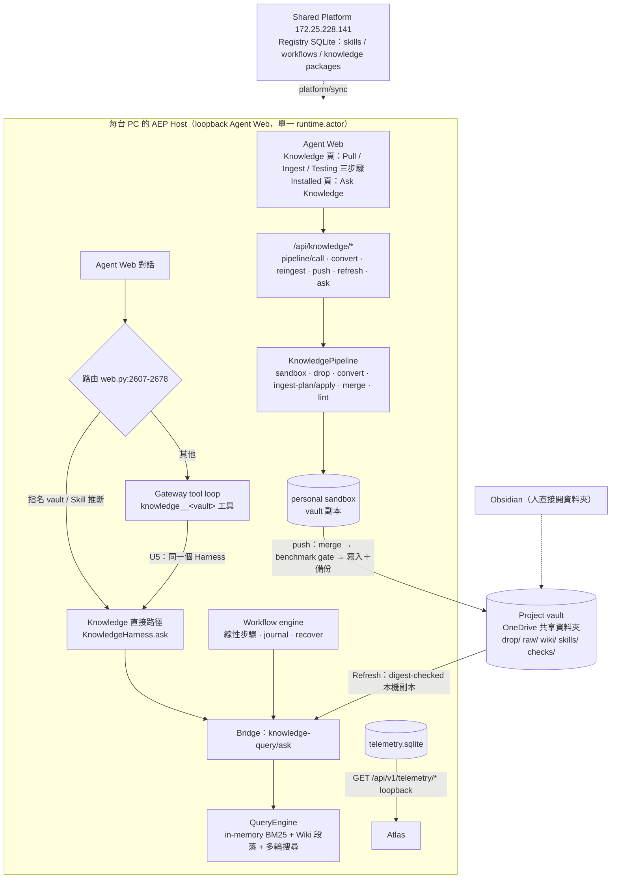
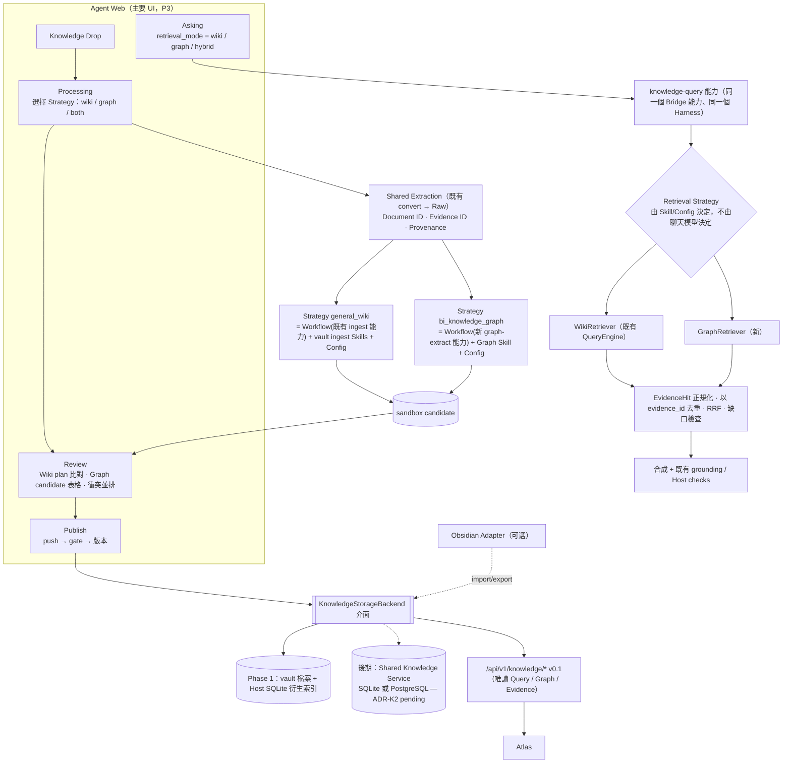

# AEP Knowledge Strategy v1.1（修訂提案，待 owner 審閱）

> 2026-10-17，K01（documentation only）。取代 v1.0（[原文](KNOWLEDGE_STRATEGY_v1.0_original.md)），差異見
> [KNOWLEDGE_STRATEGY_v1.1_DIFF.md](KNOWLEDGE_STRATEGY_v1.1_DIFF.md)；所有現況陳述的檔案與行號證據在
> [K01_AS_IS_GAP_ANALYSIS.md](K01_AS_IS_GAP_ANALYSIS.md)（下文以「K01 §n」引用）。
>
> **狀態：提案。** 本文件不改變 `docs/ARCHITECTURE.md`、`docs/DECISIONS.md` 或任何程式。ADR 都是草案。
> **K02 之後的所有工作，都要等 owner 核准本文件才開始。**

## 0. 修訂原則（owner，2026-10-17，具約束力）

| # | 原則 | v1.1 在哪裡落實 |
|---|---|---|
| P1 | 保留既有 Harness 與 Workflow Engine；Strategy = Workflow + Skills + Configuration；不另建 DSL 或執行引擎 | §1.2、ADR-K1 |
| P2 | 保留長期 multi-user 目標；Phase 1 可在 Host SQLite 上 PoC，但正式設計要支援 Shared Knowledge Service、多人協作與可替換的 Knowledge Storage Backend（定義介面）；中央 PostgreSQL 為 pending ADR | ADR-K2、§1.3 |
| P3 | 主要 Knowledge Management UI 是 AEP Agent Web；Obsidian 只是可選的 Legacy Import/Export Adapter | ADR-K3、K01 §3 |
| P4 | Ingestion 與 Retrieval 分開設計；同一文件可經不同 Strategy 產生 Wiki 與 Graph，共用 Document ID、Evidence ID、Provenance | ADR-K4、§1.2 |
| P5 | 三種 benchmark：Wiki-only、Graph-only、Hybrid；20–30 題關係型問題；六項指標；量化門檻待 owner 確認 | §5 |
| P6 | 先調查 knowledge tool path 低成功率 | K01 §2、ADR-K6 |
| P7 | Review Policy 可設定；General Wiki 維持 KNOWLEDGE_COLLAB；BI 可提議 Domain Owner Review，先列衝突 | ADR-K5 |
| P8 | 重用既有 Document Extraction；OCR、進階圖表、Object Storage、PostgreSQL RLS 屬後期 | §4 |
| P9 | 遵守 repo 架構與協作規則；列出需要修改的規則；PR 流程以問題呈現 | ADR-K9、§7.3 |
| P10 | Atlas ↔ AEP 明確 API 契約；Phase 1 定義最小 Query / Graph / Evidence API 與 envelope，供 Atlas 以 mock 平行開發 | ADR-K7、§6 |

---

## 1. AS-IS vs TO-BE Architecture

### 1.1 AS-IS（已驗證，詳見 K01）



重點（K01 §1）：
- 沒有 PostgreSQL、Alembic、RLS、Object Storage，也沒有多人 `/api/v1/knowledge` 伺服器。
- Knowledge vault 是 OneDrive 共享資料夾，不是 Git repository（Git 因 OneDrive 破壞 `.git` 而被否決）。
- 沒有 Graph / entity / relation / claim 儲存；最接近的是 `src/knowledge/market_matrix.py`（market × product family 的詞彙共現，明確標示 `market_fit_verified: False`）。

### 1.2 TO-BE（Phase 1 PoC → 長期）



設計要點：
1. **Strategy 不是新引擎。** Ingestion Strategy 是一個已安裝 Workflow（步驟是 Bridge capability），加上它使用的 Skills（vault 中的 ingest skills、新的 graph extraction skill），加上一份 Strategy Config（宣告式，沒有 `steps`/`needs`）。人工審核不在 Workflow 中：Workflow 產出 sandbox candidate 後結束，由 Agent Web 審核，再走既有 push / publish（ADR-K1）。
2. **Retrieval Strategy 是 knowledge-query 能力的一個參數**，不是新的聊天工具。每個 vault 仍只有一個 `knowledge__<vault>` 工具；wiki / graph / hybrid 由已安裝的 Knowledge Skill procedure 或 Strategy Config 決定，Harness 驗證後直接回傳（ADR-K6）。這樣 Graph 不會重演 tool path 的問題。
3. **一份文件只解析一次。** 兩條 Strategy 都讀同一份 Raw（既有 `drop → convert → raw/`，`KnowledgeSource.source_id`＋`sha256` 已存在），共用 `document_id`、`evidence_id`（ADR-K4）。
4. **Storage 可替換。** 所有讀寫經 `KnowledgeStorageBackend` 介面；Phase 1 實作是 vault 中的檔案（讓既有 merge / benchmark gate / push 與 OneDrive 共享照常運作）＋ Host 端衍生索引；中央服務是後期選項（ADR-K2）。

### 1.3 長期多人目標（保留，P2）

| 能力 | Phase 1（PoC） | 長期（Shared Knowledge Service） |
|---|---|---|
| 身分 | 每台 Host 一個 `runtime.actor`；vault `maintainers` 清單 | 每個請求帶成員身分（Shared Platform 已有 Member Portal 帳號，`docs/DECISIONS.md` 2026-10-15） |
| 協作 | sandbox → merge → benchmark gate → push（KNOWLEDGE_COLLAB） | 同一流程，但 push 目標是服務的 API，而不是共享資料夾 |
| 儲存 | vault 檔案 + Host SQLite 索引 | Backend 介面背後的服務（SQLite 或 PostgreSQL，ADR-K2） |
| 存取控制 | OneDrive 資料夾權限 + per-vault `privacy` | 服務端 ACL；是否需要 RLS 取決於 ADR-K2 |
| Atlas | 讀 Host 的 `/api/v1/knowledge/*`（loopback） | 讀服務的同一版本 API |

---

## 2. Existing Component Reuse Matrix

R = Reuse（照用）、E = Extend（加欄位 / 加 adapter / 加 Skill）、N = New。路徑皆已在 K01 驗證。

| 元件 | 實際路徑 | 處置 | 說明 |
|---|---|---|---|
| Workflow engine（preview / preflight / journal / recover） | `src/workflow/engine.py`、`src/workflow/checkpoints_sqlite.py`、`src/common/assets.py:268-273, 514-527` | R | Strategy 的執行者。步驟為線性 tuple，無 DAG、無中途人工步驟；v1.1 不需要它們（ADR-K1） |
| Bridge（授權、核准、I/O 驗證） | `src/workflow/dispatch.py` | R | 所有新能力都經 Bridge |
| Harness 狀態機 | `src/agent/harness_plan.py`、`harness_run.py`、`harness_runner.py` | R | Graph / Hybrid 檢索沿用 collect → execute → validate → retry |
| Knowledge Harness（領域 adapter，兩條路徑共用；不是另一套迴圈） | `src/host_runtime/knowledge_harness.py` | E | 加 retrieval_mode；Skill 選擇改用通用綁定規則（ADR-K6 規則 G3） |
| Gateway 工具迴圈與 vault 工具 | `src/agent/gateway.py:98-118, 400-433, 808-817, 908-966` | E | 不新增 Graph 工具；套用 ADR-K6 的通用接合規則 G1、G2、G4（所有領域適用） |
| Knowledge pipeline（sandbox、drop、convert、plan/apply、merge、lint、push） | `src/knowledge/pipeline.py`、`sandbox.py`、`merge.py`、`lint.py`、`src/host_runtime/knowledge_push.py` | R/E | Graph candidate 以檔案進 sandbox，沿用 merge / gate / push |
| Pipeline Bridge 能力 | `src/capabilities/knowledge_pipeline/handlers.py` | E | 新增 `graph-extract`、`graph-plan` 類能力 |
| 文件擷取（PDF / PPTX / DOCX） | `src/knowledge/office.py` | R | 不加 OCR（P8）。PDF 無表格模型、PPTX 不含 speaker notes（K01 §4.1） |
| Raw 與 provenance | `src/knowledge/raw.py`、`src/knowledge/contracts.py` | E | 加穩定 `evidence_id`（ADR-K4） |
| 檢索與合成 | `src/knowledge/query.py`（BM25、`Citation`、`Passage`）、`search_rounds.py`、`query_rewrite.py`、`evidence.py`、`procedure.py` | R/E | WikiRetriever = 既有 QueryEngine；EvidenceHit 由 `Passage` 擴充 |
| 市場矩陣 | `src/knowledge/market_matrix.py` | E | Graph schema 種子（market、product family 兩種 entity） |
| 衝突與決策 | `src/knowledge/conflicts.py` | E | 已有 append_decision / resolve，但無 UI / route（K01 §3） |
| Agent Web Knowledge 頁 | `src/host_runtime/web_page.py:1362-1639`、`src/host_runtime/web.py`（`/api/knowledge/*`） | E | 加 Strategy 選擇、Graph 審核、wiki 瀏覽／編輯 |
| Reviews 面板 | `web.py` `/api/reviews`、`/api/reviews/decide` | R | Domain-owner 提議若採用，沿用卡片 |
| knowledge_v1 benchmark 與評分 | `benchmarks/knowledge_v1/`（`run.py`、`reference.py`、`reference_grade.py`、`compare.py`、`evidence.py`） | E | 加 relationship 指標與 retrieval_mode 維度 |
| 遙測 | `src/telemetry/`、`docs/telemetry/AEP_ATLAS_TELEMETRY_CONTRACT.md` | R/E | latency / token / loop 指標的來源；Knowledge API 沿用其版本慣例 |
| Shared Platform Registry | `docs/shared-platform-preview.md`、Registry SQLite | R（後期 E） | knowledge package 已可經 `platform/sync` 安裝；Shared Knowledge Service 的可能宿主 |
| Strategy Config | — | N | 宣告式綁定（ADR-K1） |
| KnowledgeStorageBackend 介面 | — | N | ADR-K2 |
| Graph schema、GraphRetriever、Hybrid fusion | — | N | §4 |
| `/api/v1/knowledge/*` v0.1 | — | N | §6 |

---

## 3. ADR 草案

> 每份 ADR 都是草案，核准後才會寫入 `docs/DECISIONS.md`（以新增條目，不改舊條目）。

### ADR-K1：Strategy = Workflow + Skills + Configuration

- **Context.** v1.0 提出自有 Strategy Manifest（DAG、重試、checkpoint、human_approval）。AEP 已有 Workflow engine（journal、recover、preflight、只對 read 步驟重試、安裝即核准）與統一 Harness 狀態機（`docs/phases/HARNESS_UNIFICATION.md`）。`AGENTS.md` 規則 2 要求「Workflow defines HOW EXACTLY」，規則 4 要求 Skills 是程序與領域指引。
- **Options.**
  - A. v1.0 的自有 Manifest 與執行器。
  - B. Strategy = 已安裝 Workflow + Skills + 宣告式 Config；人工審核是兩段之間的邊界。
  - C. 擴充 Workflow engine，支援 DAG 與 human_approval 步驟。
- **Recommendation: B.** Strategy Config 的最小形狀：

  ```json
  {
    "schema_version": "aep.knowledge.strategy.v1",
    "id": "bi_knowledge_graph",
    "version": "0.1.0",
    "kind": "ingestion",
    "output": "graph",
    "workflow": {"namespace": "knowledge", "name": "graph-ingest", "version": "0.1.0"},
    "skills": [{"namespace": "knowledge", "name": "bi-graph-extract", "version": "0.1.0"}],
    "review_policy": "general_collab",
    "drafts_searchable": false
  }
  ```

  沒有 `steps`、`needs`、`condition`；順序與重試由 Workflow manifest 決定。Retrieval Strategy 的 Config 則是 `{"kind": "retrieval", "mode": "wiki|graph|hybrid", "max_rounds", "max_hops", "fusion": "rrf"}`，由 Knowledge Skill procedure 引用。
- **Consequences.** 不新增執行引擎，安裝 / 核准 / 遙測都沿用。「加第三個 mock strategy 不需改 Harness」可以用「安裝一個新 Workflow + Config」驗證。代價：Workflow 沒有條件分支，`both` 以兩個 Workflow run 表示；審核暫停是 sandbox candidate 狀態，不是 Workflow 狀態。選項 C 若未來真有需要，另開 ADR。

### ADR-K2：Knowledge Storage Backend 介面；中央 PostgreSQL（**pending**）

- **Context.** P2 要求可替換 backend，並保留 Shared Knowledge Service。現況：vault 是 OneDrive 共享資料夾；Host 用多個 SQLite（state、telemetry、experience）；Shared Platform 的 Registry 是 SQLite；`docs/ROADMAP.md:312` 把「storage/index technology for knowledge retrieval」列為 open decision；repo 文件沒有任何 PostgreSQL 決策（K01 §6）。在 OneDrive 中放 SQLite 檔案有與 `.git` 相同的同步損壞風險（推論，依 `docs/DECISIONS.md` 2026-10-11 否決 Git 的理由）。
- **介面（建議，Phase 1 必做）。** 以 Python Protocol 定義，型別都是既有 `Contract`（frozen、extra=forbid）：

  ```text
  KnowledgeStorageBackend
    documents:  get_document(document_id) / list_documents(vault, cursor)
    evidence:   get_evidence(evidence_id) / resolve(locator) / evidence_for(document_id)
    wiki:       read_page(path) / list_pages(prefix, cursor)            # 既有 vault 檔案
    graph:      get_entity(id) / find_entities(type, text, cursor)
                neighbors(entity_id, relation_types, depth<=3) / claims_for(entity_id)
    candidates: stage(candidate_set) / list_candidates(sandbox) / discard(...)
    publish:    publish(candidate_set, policy) -> version   # 冪等：同 digest 不重複發佈
    version:    current_version(vault) / digest()
  ```

  Retrieval 只依賴這個介面；Atlas API 也只依賴它。
- **Options（不做決定）。**

  | 選項 | 內容 | 優點 | 缺點 / 風險 |
  |---|---|---|---|
  | A | vault 檔案（Graph 為 JSONL / Markdown frontmatter）＋ Host SQLite 衍生索引 | 與 merge / benchmark gate / push / OneDrive 共享相容；不需伺服器；可重建 | 單機索引；大量 Graph 查詢效能未知；ACL 只到資料夾層級 |
  | B | Shared Platform 上的 Knowledge Service，SQLite（沿用 Registry 部署方式） | 與現有 172.25.228.141 部署、憑證 pinning、Member Portal 一致 | 單寫者；平台目前在一台辦公 PC 上；需新服務與 API 授權 |
  | C | 中央 PostgreSQL（JSONB、GIN、遞迴 CTE；可選 pgvector / Apache AGE） | 多人並發、RLS、成熟備份 | 新增維運元件與 Alembic；與 local-first 合約（`AGENTS.md` 規則 16）需設計離線行為；IT 支援未知 |
  | D | 專用 Graph DB（如 Neo4j / Kùzu 嵌入式） | 圖查詢表達力 | 新依賴、授權與維護需評估（使用者全域規則：引入新套件前確認授權與維護狀態） |

- **Recommendation.** 只建議「Phase 1 實作選項 A 作為 PoC，並以介面隔離」。**是否採用 C（或 B / D）為 pending**，決定條件：Phase 1 benchmark 結果、實際資料量、多人並發需求、IT 是否能提供 PostgreSQL。
- **Consequences.** Phase 1 不寫 Alembic、不寫 RLS。任何 backend 都必須通過同一組介面契約測試。

### ADR-K3：Agent Web 是主要 Knowledge Management UI；Obsidian 是 Adapter

- **Context.** P3。現況 Agent Web 已有 Drop、Processing、Review（plan 比對、merge 衝突並排）、Publishing（push / refresh / publish）與 Asking；缺 wiki 瀏覽／編輯、衝突決策 UI、Graph 任何介面（K01 §3）。Obsidian 現在只是「人直接打開同一個資料夾」，程式只做了 `.obsidian` 排除與 frontmatter / wikilink 容忍。
- **Options.** A：Agent Web 為主、Obsidian 為可選 import/export adapter。B：維持 Obsidian 為編輯器。C：同時支援雙向即時同步。
- **Recommendation: A.** Obsidian Adapter 的範圍：import（把既有 Obsidian vault 以 `adopt` 納入 Raw/Wiki，已有 `src/knowledge/migrate.py` 與 K2.1 adopt 步驟）、export（把發佈版本寫成 Obsidian 可讀的資料夾）。不做雙向同步。
- **Consequences.** 需要補的 UI：wiki 頁樹與檢視、wiki 段落編輯（走 sandbox 與既有 sourced-line 保護）、衝突決策紀錄、Graph candidate 審核表、Strategy 選擇、retrieval_mode 選擇。vault 規則檔（`CLAUDE.md`、`skills/*/SKILL.md`）目前「在 Obsidian 中編輯」的描述（`docs/DECISIONS.md` 2026-10-11 K3）需在 ARCHITECTURE / 使用手冊改寫為「在 Agent Web 編輯，Obsidian 可選」。

### ADR-K4：共用 Document ID、Evidence ID 與 Provenance

- **Context.** 現況有 `KnowledgeSource{source_id, original_ref, sha256, raw_ref, page, slide, parent_source_id}`（`src/knowledge/contracts.py:9-16`），Raw frontmatter 帶 `source_id`、`source_sha256`、`extractor`（`src/knowledge/raw.py:37`）；沒有持久化的 passage ID，答案中的 `[n]` 只在單次回答內有效（`query.py:1449-1456`）；引用是 `Citation{kind, source, raw_ref, section, page, slide, wiki_page}`（`src/knowledge/query.py:254-265`）。`section` 是 Raw 文件中的序號，重新擷取或擷取器版本改變時可能位移，不是穩定 ID（推論）。
- **Options.** A：位置式 ID（raw_ref + section）。B：內容定址 ID。C：資料庫自增 UUID。
- **Recommendation: B.**
  - `document_id` **直接沿用既有 `source_id`**（`"src-" + sha256(original bytes)[:16]`，`src/knowledge/raw.py:126-131`）：同一份位元組不論檔名都得到同一 ID，不另造新 ID。
  - `document_version_id = document_id + "@" + extractor`（例如 `pdf.v1`），擷取器升版產生新版本。
  - `evidence_id = "ev-" + sha256(document_id | locator | normalized_text)[:20]`；`locator` = page / slide / table / image 位置。
  - 重新擷取時保存 `evidence_map`（舊 → 新 evidence_id，依 normalized_text 相同或相似度），舊 ID 永不重用。
  - Wiki 的 sourced line 與 Graph 的 claim 都引用 `evidence_id`；Hybrid 以 `evidence_id` 去重，且同一 `document_id` 的兩個 hit 不算兩份獨立證據。
- **Consequences.** 需要在 Raw 寫入時計算並保存 evidence_id（additive，不改既有 Raw 不變性）；舊 Raw 需一次性回填（`adopt` 類步驟）。

### ADR-K5：可設定的 Review Policy，及其與 KNOWLEDGE_COLLAB 的衝突

- **Context.** P7。既有決策：
  - `docs/phases/KNOWLEDGE_COLLAB.md:170-171`：「Any maintainer listed for the project may push; no second approval is needed」；`:281-283`：「There is no vault lock and no domain-owner approval」。
  - `docs/DECISIONS.md` 2026-10-11「K3 ingest rules live in the vault; one approval publishes a merge」（「per-domain approval was not required」）、2026-10-11「Knowledge collaboration works like branches and pull requests」（「Co-developers may push without a second approval」）、2026-10-11「Knowledge pushes have no lock; a benchmark gate decides」。
  - 另一方面：`AGENTS.md:25`（規則 15，domain owners validate business correctness）、`docs/ARCHITECTURE.md:160-179`（business review by department owner）與 `:757`（E2E-05 流程圖的 domain-owner review；同節 `:771-772` 說「Domain approval is a later business decision」）、`docs/PRODUCT_ACCEPTANCE_TESTS.md:197, 218`（E2E-05 criterion 8「A domain owner approval is separate from technical validation and publication」）仍寫著 domain-owner review。
  - 部分調和：sandbox scope（一個 sandbox 一個資料夾，`docs/DECISIONS.md` 2026-10-13）、shared page 變更以 proposal 呈現（KNOWLEDGE_COLLAB:89-91）、domain owner 審 vault-rule proposals（`docs/DECISIONS.md` 2026-10-12 Experience review defaults）。
- **Options.** A：所有 Knowledge 一律 KNOWLEDGE_COLLAB。B：Review Policy 為 Strategy Config 的一個欄位，General Wiki = `general_collab`，BI Knowledge = 提議中的 `domain_owner_review`。C：全面改為 domain-owner review。
- **Recommendation: B 的機制（policy 可設定）建議採用；`domain_owner_review` 的內容為 pending owner 決定。** 提議內容：BI claim 依 claim domain（market / product / technology / account）分派審核者；跨 domain 關係由雙方之一核准即可；benchmark gate 仍適用；policy 只在發佈時檢查，不加 vault lock。
- **衝突清單（不改既有決策）。**

  | 既有決策 / 規格 | 衝突點 |
  |---|---|
  | KNOWLEDGE_COLLAB:170-171, 281-283 | BI policy 會引入「第二個人核准」 |
  | DECISIONS 2026-10-11 K3（per-domain approval not required） | 同上 |
  | DECISIONS 2026-10-11 branches/PR（no second approval） | 同上 |
  | DECISIONS 2026-10-11 no lock | 不衝突（提議不加鎖） |
  | 文件互相矛盾：ARCHITECTURE:757、PRODUCT_ACCEPTANCE_TESTS:197, 218 vs KNOWLEDGE_COLLAB | 既有矛盾，與本提案無關，但 owner 需要決定哪一份為準 |
- **Consequences.** 若 owner 採用 BI policy，需要新增一條 DECISIONS 條目說明「BI 例外」，並更新 KNOWLEDGE_COLLAB 的適用範圍說明；General Wiki 不變。

### ADR-K6：Harness 接合處的通用規則（Knowledge tool path 不再失分，Graph 不重蹈覆轍）

- **Context（K01 §2）.** `docs/HARNESS_DESIGN.zh-TW.md` §7.1 / §11.2 的「工具路徑 10/74」是 2026-10-07 sample-003 的數字，**當時聊天模型會改寫結果**。2026-10-09 起（`0b39228a`，U5）工具路徑執行同一個 Knowledge Harness，validated 答案直接成為回合答案（`src/agent/gateway.py:808-817`）。U5 之後的 core 集（core-009 至 core-015），工具路徑可接受率 147/182（80.8%），直接路徑 56/70（80.0%）；但 110 題 sample 集在 U5 後只有 sample-004，而其中 41 題因 trace 早於 record 欄位而無法判定、21 題是 `knowledge_not_validated`。殘留根因：
  1. 未驗證結果（`ok=false`）交回聊天模型，且移除 record（`gateway.py:938`），模型自行組答案；對話回合的 Host checks 只有 `no_unbacked_action_claim` 與 `named_outputs_exist`（`src/agent/conversation_harness.py:6-10`），沒有引用或 grounding 檢查。
  2. 是否呼叫工具、以及 `question` 的措辭，由聊天模型決定；限制只寫在 schema 描述裡（`gateway.py:98-118`），沒有強制。
  3. 工具路徑永遠用「第一個符合條件的 Knowledge Skill」（`knowledge_harness.py:76-91, 118-121`），不能依 vault 或 retrieval mode 綁定。
  4. 第一個 validated 結果就結束回合（`gateway.py:808-817`），若 Graph 以另一個工具提供，Hybrid 的融合會由聊天模型在多次工具結果之間完成，或根本不發生。
  5. 回傳答案截斷為 12,000 字元（`gateway.py:948`），長答案（core-005 曾有 >10,000 字元）可能被截。
- **Options.**
  - A. Graph 作為另一個 `graph__<vault>` 工具，由聊天模型組合。
  - B. Retrieval mode 放在同一個 knowledge-query 能力內；融合與驗證在 Harness 內；工具路徑只回傳 Harness 結果。
  - C. 把所有 Knowledge 問題都導到直接路徑（`docs/DECISIONS.md` 2026-10-07 已否決：無法處理混合工作）。
- **定位（owner 2026-10-17 指示改為通用規則）.** 共用狀態機（`harness_runner.py`）只有一套；
  `knowledge_harness.py` 是**領域 adapter**，只提供 execute（Bridge 的 knowledge-query 能力）與
  validate（Host checks），本身沒有迴圈。驗收放在 Host 而不放在 Skill，是因為 Skill 不能新增／刪除
  Host checks、不能驗證自己的輸出（HARNESS_DESIGN 原則 2、§6.1）。上述根因都**不是迴圈本身的限制**，
  而是發生在 Skill 碰不到的「對話工具迴圈 ↔ 領域 adapter」接合處。因此修正一律寫成**所有領域適用的
  通用接合規則**，不在 Knowledge 加特例。
- **Recommendation: B，加上四條通用接合規則**（每條先寫失敗測試，再改；屬 Harness 變更，需 owner 同意）：
  - **G1 未通過驗收的結果不交給模型改寫。** 任何領域的 Harness 結果若未通過 Host checks，對話迴圈一律
    把 Harness 產生的文字與 Host 註記（例如「以下未能以證據支持：…」）原樣回給使用者，並保留紀錄
    （record / evidence）；只有 Harness 完全沒有產出時，才交回模型，且模型的回答必須標示「未經驗證」。
    對 Knowledge 而言，這修正根因 1；對 Coding、Workflow 與未來的 Graph 同樣適用。
  - **G2 使用者原句優先。** 對話模型呼叫任何 Harness 工具時，Host 一併傳入使用者原句；領域 adapter
    以原句為主要輸入，模型改寫版只作補充並記錄差異供評分。修正根因 2。
  - **G3 Skill 依綁定的資產選擇。** 領域 adapter 選 Skill 時，依 Skill 宣告綁定的資產（vault、
    Workflow、Strategy Config）選擇；同一資產有多個 Skill 時依明確優先序，沒有綁定才退回目前的
    「第一個符合者」。不再由安裝順序決定。修正根因 3，也是 Graph / Hybrid 依 mode 選 Skill 的前提。
  - **G4 輸出長度一致。** 對話迴圈回傳 Harness 結果的長度上限，與該領域宣告的輸出上限一致；仍需截斷時，
    附上取得完整結果的方式並在 Host 註記說明。修正根因 5。
  - 根因 4（第一個 validated 結果即結束回合）不另立規則：Retrieval mode 在同一能力內（選項 B），
    Hybrid 的融合在 Harness 內完成，不需要跨工具結果融合。
  並完成 HARNESS_UNIFICATION U7 的量測（U5 後 110 題 sample 集，grader 1.4）。
- **Consequences.** Graph / Hybrid 不新增聊天工具；Agent 看到的仍是一個 vault 一個工具。四條規則
  寫進 `docs/HARNESS_DESIGN.zh-TW.md`（對話 Harness 一節）而非 Knowledge 一節；Coding 與 Workflow 的
  回歸測試也要涵蓋 G1、G3。`docs/HARNESS_DESIGN.zh-TW.md` §7.1、§11.2 與 `docs/TASKS.md:1454` 需更新（過時）。

### ADR-K7：Atlas Knowledge API 契約與版本

- **Context.** P10。既有遙測契約慣例：envelope 的 `schema_version: "aep.telemetry.v1"`，文件版本 v0.x；加選填欄位不升版；破壞性變更升 `v2`；GET only、loopback、無 token、只允許本機 Origin；cursor 分頁；Atlas 必須容忍未知欄位與事件。
- **Options.** A：沿用遙測慣例，`schema_version: "aep.knowledge.v1"` + `contract_version: "0.1"`。B：OpenAPI 的 `info.version` 單一版本。C：URL 版本以外不另標版本。
- **Recommendation: A**（細節見 §6）。URL 前綴 `/api/v1/knowledge/`；每個回應帶 `schema_version`、`contract_version`；OpenAPI 文件與 JSON Schema 在 `docs/contracts/knowledge-api/`（K09 建立）。
- **Consequences.** 讀取路由是否也比照遙測「免 token」是 owner 問題：Graph / Evidence 回傳的是內容（passage 文字），不是去敏的中繼資料，與遙測不同（見 §8 Q10）。

### ADR-K8：資料分類與「外部模型」路由

- **Context.** v1.0 未定義「外部模型」。既有規則與程式：
  - `docs/DECISIONS.md` 2026-10-02：未分類資料只能送已核准的內部 Gateway；原生 Codex / Claude Code 只能拿到明確 PUBLIC 的上下文。
  - `src/agent/data_policy.py:11`：`DataClass = PUBLIC | INTERNAL | CONFIDENTIAL | RESTRICTED | UNCLASSIFIED`，未知永不當 PUBLIC；`kind="agent"`（原生 CLI）只收 PUBLIC（`:128-137`）；Gateway 需要 host-admin 核准且**RESTRICTED 永遠不可核准**（`:82-83`）。
  - `src/models/approved.py:36-41`：Gateway 的每個模型請求目前都視為 UNCLASSIFIED（尚無欄位層級來源）。
  - 每個 vault 有 `privacy: private|public`（`docs/DECISIONS.md` 2026-10-03）；Copilot / Claude Code / Codex agent mode 的資料例外（2026-10-12、2026-10-15）。
- **定義（建議，沿用既有 `BackendKind = model | agent`）。**

  | 類別 | 例子 | 可接收（沿用 `DataPolicy`） |
  |---|---|---|
  | internal model（`kind=model`，internal Gateway） | 公司 Gateway 上已核准的模型 | host-admin 核准的類別；RESTRICTED 除外 |
  | external agent（`kind=agent`，native） | 原生 Claude Code、Codex、Copilot CLI / agent mode | 只有 PUBLIC（及 owner 明列的例外） |
  | external model API | 任何非公司 Gateway 的雲端 API | Phase 1 一律不允許（`internal_gateway` 必須為 true） |

- **分類（建議）。** 不另訂新列舉，直接使用 `DataClass`。Knowledge 預設 `UNCLASSIFIED`（與現況等價）；`privacy: public` 的 vault 視為 PUBLIC；BI 的客戶 / 商機內容建議標為 `CONFIDENTIAL`（若標 RESTRICTED，依現行程式完全不能送任何模型，BI 抽取將無法進行）。分類掛在 document 上，傳遞到 evidence、entity、claim（取 `classification_rank` 最高者，`data_policy.py:26-27`）。衍生摘要、索引、log 繼承分類；遙測本來就不存內容。
- **Recommendation.** 定義建議採用；**BI 內容的類別（CONFIDENTIAL 或 RESTRICTED）以及 Gateway 核准是否涵蓋 CONFIDENTIAL，為 pending owner 決定**。模型選擇在 server 端 fail-closed，沿用 `DataPolicy` 與 Bridge policy。
- **Consequences.** per-vault `privacy` 需擴充為 document 層級並保持相容（`private` → `UNCLASSIFIED`、`public` → `PUBLIC`）；`ApprovedModelClient` 需要能帶入 Knowledge 材料的實際類別，而不是一律 UNCLASSIFIED。未驗證：local CLI 經 MCP `aep_knowledge_*` 工具取得的 Knowledge 結果是否再經分類檢查（K01 §7）。

### ADR-K9：協作流程（PR vs 在 main 直接 commit）（**pending**）

- **Context.** v1.0 要求「一個 Issue 一個 PR、不得自行 merge」。實況（K01 §10）：自 2026-10-05 起都直接在 main commit；`docs/TASKS.md:74` 寫著「A row says done only after its pull request merges」（較早的 E2E 表格）；`AGENTS.md:35-36` 說 migration PR 要小；CI `verify.yml` 在 `pull_request` 與 push 到 `main` 都會跑；repo 中沒有 branch protection 設定；沒有任何 DECISIONS 條目規定 PR 或直接 commit。
- **Options.**
  - A. 維持現況：main 直接 commit，記錄在 TASKS / HANDOFF，push 由 owner 指示。
  - B. Knowledge Strategy 的工作（K02+）一律 feature branch + PR，owner merge。
  - C. 混合：docs / benchmark 結果直接 commit；程式變更走 PR。
- **Recommendation: pending（不預設）。** 若選 B 或 C，需要修改的文件見 §7.3。
- **Consequences.** 選 B / C 時，CLAUDE.md「commit completed coherent work」的語意改成「commit 到 feature branch」，HANDOFF 需記錄 PR 編號。

---

## 4. Revised MVP Scope

### 4.1 範圍

| In（Phase 1 MVP） | Out（後期） |
|---|---|
| Tool-path 殘留問題修正與 U7 量測（ADR-K6） | OCR、掃描 PDF |
| 關係型問題集、評分擴充、Wiki-only baseline | 進階圖表理解（embedded series、vision_estimation） |
| Document / Evidence ID（ADR-K4）與 Storage Backend 介面（ADR-K2 選項 A） | Object Storage |
| Strategy Config（ADR-K1）；General Wiki Strategy = 既有 ingest 包成 Workflow | PostgreSQL、Alembic、RLS（ADR-K2 pending） |
| BI Graph Strategy PoC：entity 類型只取 market、product family、application、technology、competitor（以 `market_matrix.py` 為種子；其餘待 owner 提供 schema） | Account、CustomerProduct、Opportunity 等含客戶資料的類型（CONFIDENTIAL / RESTRICTED，待 ADR-K8） |
| Graph candidate 進 sandbox、在 Agent Web 審核、經既有 push 發佈 | Submission server、多人並發寫入 |
| GraphRetriever、Hybrid（RRF + evidence_id 去重 + 缺口檢查），在同一個 knowledge-query 能力內 | `auto` 策略推薦 |
| `/api/v1/knowledge/*` v0.1 唯讀 API + mock fixture（Atlas） | Atlas 品質 / 衝突 / 回饋 / 審核佇列 API |
| Agent Web：Strategy 選擇、Graph 審核表、wiki 頁瀏覽（唯讀） | wiki 所見即所得編輯器、Obsidian 雙向同步 |
| 三種 benchmark 與門檻判定 | XLSX / HTML 擷取（既有 K4 項目） |

### 4.2 階段

| 階段 | 內容 | 出口條件 |
|---|---|---|
| Phase 0（本文件） | K01 審閱 | owner 核准 v1.1，回答 §8 的問題 |
| Phase 1a：量測基礎 | AEP-K02、K03 | tool path 與 direct path 差距在門檻內；Wiki-only baseline 已記錄 |
| Phase 1b：契約 | AEP-K04、K05、K09（API v0.1 + mock） | 介面與 ID 契約測試通過；Atlas 可對 mock 開發 |
| Phase 1c：Graph PoC | AEP-K06、K07、K08 | 一份 PPTX/PDF 只解析一次，產出 Wiki 與 Graph candidate，審核後發佈 |
| Phase 1d：判定 | AEP-K10 | 三種 benchmark 結果對照 §5.5 門檻；owner 決定 go / no-go 與 ADR-K2 |
| Phase 2+ | Shared Knowledge Service、OCR、Object Storage、PostgreSQL（若採用） | 另行規劃 |

---

## 5. Benchmark Plan

### 5.1 三種 benchmark

| 名稱 | retrieval_mode | 證據來源 |
|---|---|---|
| Wiki-only | `wiki` | 既有 QueryEngine（wiki_primary + Raw） |
| Graph-only | `graph` | 已發佈的 Graph（entity / relation / claim，各帶 evidence_id） |
| Hybrid | `hybrid` | 兩者，RRF 融合、以 evidence_id 去重 |

三者用同一個 vault 版本、同一份 Raw、同一個模型 alias、同一個 Knowledge Skill 版本，只換 mode；`strategy_id`（遙測）記錄差異。每題同時經直接路徑（`/api/knowledge/ask`）與對話工具路徑各跑一次，以監看 tool path。

### 5.2 關係型問題集草案（25 題，合成措辭，無客戶資料）

領域依現有 knowledge_v1：5 個市場（Wireless Communication、Aerospace / Defense、Automotive、AI / Server、Semiconductor）× 產品族（signaling / non-signaling wireless tester、signal generator / analyzer、VNA、oscilloscope）。題目不含型號與客戶名，正式版由 owner 修訂後 pin sha256（比照 `benchmarks/knowledge_v1/questions.py`）。

| ID | 關係型態 | hops | 問題（草案） |
|---|---|---|---|
| R01 | market → product family | 1 | 知識庫中，哪些產品族與 Automotive 市場有直接證據關聯？各列出依據文件。 |
| R02 | product family → market | 1 | VNA 產品族在哪些目標市場有應用證據？哪些市場沒有？ |
| R03 | market × family 矩陣 | 1 | 列出 5 個市場 × 4 個產品族中，有直接證據的格子與只有間接提及的格子。 |
| R04 | application → family | 1 | 毫米波天線量測這類應用，知識庫連結到哪些產品族？ |
| R05 | technology → market | 1 | 哪些市場文件提到高速串列介面（如 PCIe / DDR 類）的測試需求？ |
| R06 | technology → family → market | 2 | 高速訊號完整性需求，經由哪個產品族，連到哪些市場？請標出每一步的證據。 |
| R07 | standard → family | 1 | 與 5G NR FR2 一致性測試相關的內容，對應到哪些產品族？ |
| R08 | market → application → family | 2 | Aerospace / Defense 市場中提到的雷達相關應用，各對應哪個產品族？ |
| R09 | competitor → family | 1 | 知識庫中的競品資料，分別針對我方哪些產品族？ |
| R10 | competitor × market | 2 | 哪些市場同時有競品比較資料與我方產品族的應用資料？ |
| R11 | shared application | 2 | 哪些應用同時出現在 Automotive 與 Semiconductor 兩個市場？涉及哪些產品族？ |
| R12 | family ↔ family | 1 | 哪些測試情境需要 signal generator / analyzer 與 oscilloscope 一起使用？ |
| R13 | 反向 / 負面 | 1 | oscilloscope 產品族與 Wireless Communication 市場是否有直接證據？若沒有，請說明知識庫缺什麼。 |
| R14 | trend → market | 1 | AI / Server 市場文件中提到哪些技術趨勢？各自的來源是哪份文件？ |
| R15 | trend → family | 2 | 上題的技術趨勢，有哪些在知識庫中被連到特定產品族？ |
| R16 | requirement → option | 2 | 某市場的量測需求（例如寬頻寬分析）在知識庫中連到哪些產品功能或選項類別？ |
| R17 | 多來源一致性 | 1 | 對「VNA 用於 Semiconductor 晶圓量測」這個關係，知識庫中有幾份獨立文件支持？是否有矛盾？ |
| R18 | 來源追溯 | 1 | 「signaling tester 用於 Automotive 車聯網測試」這個主張的原始文件、頁碼與段落是什麼？ |
| R19 | 3-hop 鏈 | 3 | 從「衛星通訊（NTN）」這個技術出發，經應用與產品族，連到哪些市場？ |
| R20 | 比較 | 2 | 在 Wireless Communication 市場，signaling 與 non-signaling tester 的應用場景有何不同？各引證據。 |
| R21 | 缺口偵測 | 1 | 哪些市場 × 產品族組合，知識庫完全沒有證據？ |
| R22 | 時間 / 版本 | 1 | 關於某產品族在 AI / Server 市場的應用，最新的來源文件是哪一份？與較早文件說法是否一致？ |
| R23 | 聚合 | 2 | 每個產品族最常被連到的前兩個應用是什麼？只計有直接證據者。 |
| R24 | 推論界線 | 2 | 若某市場需要 EVM 量測，知識庫是否直接說明應使用哪個產品族？請區分「文件陳述」與「推論」。 |
| R25 | 跨 domain | 3 | 哪些技術概念同時連到兩個以上產品族，且這些產品族又共同出現在同一市場？ |

每題附：`relation_types`、`hops`、`expected_shape`（list / matrix / chain / yes-no-with-gap）。黃金答案不手寫；比照 `docs/DECISIONS.md` 2026-10-09，以 `benchmarks/knowledge_v1/reference.py` 產生參考答案與逐點引用，再由人工把參考答案轉成 **gold relation triples**（subject, relation, object, evidence 檔案），作為 Relationship Accuracy 的依據。

### 5.3 指標定義與量測方式

| 指標 | 定義 | 量測方式（重用既有元件） |
|---|---|---|
| Answer Accuracy | 參考答案 key points 的涵蓋率：(covered + partial/2) / key points；另記 contradicted 與 invented | `benchmarks/knowledge_v1/reference_grade.py`（既有方法，company Gateway 模型評分） |
| Evidence Accuracy | (a) 引用可解析率：答案引用的 evidence 中，能解析到 Raw 中逐字存在之段落的比例；(b) 支持率：評審模型認定段落支持其所引主張的比例 | (a) `benchmarks/knowledge_v1/evidence.py` `verify`（擴充為依 evidence_id 解析）；(b) `judge.py` |
| Relationship Accuracy | 答案中陳述的關係三元組對 gold triples 的 precision、recall、F1；另記「無證據關係」數（invented relations） | 新增：評分模型從答案抽出三元組 → 正規化 entity（依 Graph canonical key 或別名表）→ 與 gold 比對 |
| Latency | 每題端到端秒數（p50、p90） | 遙測 `conversation_turn` / `knowledge_query` 的 `run.completed.duration_ms`；benchmark 的 `seconds` |
| Token Cost | 每題所有模型呼叫的 input + output tokens 總和；並報告 `token_reports / llm_calls` 涵蓋率 | 遙測 `llm.completed`（`docs/telemetry/AEP_ATLAS_TELEMETRY_CONTRACT.md` §3、§7） |
| Loop Count | 每題的模型輪數 + Harness retry 次數 + 檢索 rounds（Graph hops 另列） | 遙測 `tool.completed.loop_index` 最大值、`retry.scheduled` 數；Knowledge record 的 search rounds |

### 5.4 Baseline 程序

1. 凍結：AEP build（commit）、vault 版本 digest、Knowledge Skill 版本、模型 alias、問題集 sha256；寫入 `metadata.json` 與遙測 `strategy_label`。
2. 參考答案：對 25 題執行 `reference.py`（只讀 vault，引用逐字驗證；依 `docs/DECISIONS.md` 2026-10-09 的資料例外，僅限 `privacy: public` 的 vault）；人工產生 gold triples 並 commit。
3. Wiki-only baseline：在現行 live Knowledge 上，直接路徑與工具路徑各跑 **2 次**（core-015 review 指出單次量測有雜訊），記錄六項指標。
4. Graph-only 與 Hybrid：Graph PoC 完成後，在**同一 vault 的 sandbox 副本**上跑，同樣 2 次。
5. 比較用 `benchmarks/knowledge_v1/compare.py`（擴充 mode 維度）；結果寫入 `benchmarks/knowledge_v1/runs/<id>/review.zh-TW.md`。
6. GUI 不需要；可在上班時間跑（依 owner 的 GUI 測試時段規則，非 GUI 任何時間可跑）。

### 5.5 MVP 成功門檻（**草案，待 owner 確認**）

參考值：knowledge_v1 core-015（wiki，22 題可回答）涵蓋率 0.503、median 71 s、p90 114 s；校準上限：第二份獨立 Claude Code 答案 0.53（`docs/DECISIONS.md` 2026-10-10）。

| 指標 | Hybrid（MVP 主門檻） | Graph-only | Wiki-only（baseline，不設門檻） |
|---|---|---|---|
| Answer Accuracy（涵蓋率平均） | ≥ 0.50，且 ≥ Wiki-only + 0.05 | 記錄，不設門檻 | 記錄 |
| Evidence Accuracy (a) 可解析率 | 100%（任何無法解析的引用即該題 FAIL） | 100% | 記錄 |
| Evidence Accuracy (b) 支持率 | ≥ 0.85 | ≥ 0.85 | 記錄 |
| Relationship Accuracy | precision ≥ 0.80、recall ≥ 0.60；invented relations 比 Wiki-only 少 ≥ 30% | precision ≥ 0.85 | 記錄 |
| Latency | p50 ≤ 1.5 × Wiki-only p50；p90 ≤ 240 s | p50 ≤ Wiki-only p50 | 記錄 |
| Token Cost | 平均 ≤ 1.5 × Wiki-only | ≤ 1.0 × Wiki-only | 記錄 |
| Loop Count | 檢索 rounds ≤ 3、hops ≤ 3、retry ≤ Skill 預算；0 次 `tool_loop_limit` | 同左 | 記錄 |
| Tool-path parity | 工具路徑可接受率與直接路徑差距 ≤ 5 個百分點（兩次平均） | 同左 | 同左（K02 出口條件） |
| 回歸 | 既有 knowledge_v1 core 36 題、coding_v1、business_workflow_lab 不退化（各自既有判定） | — | — |

---

## 6. API Contract Draft（Atlas ↔ AEP，contract v0.1）

### 6.1 共通規則

- 前綴 `/api/v1/knowledge/`。Phase 1 由 Agent Web（loopback）提供；長期由 Shared Knowledge Service 提供同一版本。
- 所有回應使用 envelope；欄位命名 snake_case；時間為 UTC RFC3339；ID 為字串。
- 版本：`schema_version: "aep.knowledge.v1"`（envelope 與資料形狀的相容性版本）、`contract_version: "0.1"`（本文件版本）。加選填欄位只升 `contract_version` 小版；移除或改語意升 `aep.knowledge.v2`（比照遙測契約 §9）。
- 分頁：cursor（`pagination.next_cursor`，null 表示結束），`limit` 預設 50、上限 500。
- 錯誤：`error` 物件形狀與 AEP `Failure` 一致：`{code, message, retryable}`；HTTP 狀態碼 400 / 404 / 409 / 503。
- 讀取路由只回傳**已發佈**內容（`drafts_searchable: false`）；分類高於呼叫端允許者不回傳，並在 `warnings` 註明數量（不回內容）。
- Atlas 端解析時應忽略未知欄位（AEP 端 `Contract` 為 `extra="forbid"`，Atlas 端模型應為 `extra="ignore"`）。

### 6.2 Envelope

```json
{
  "schema_version": "aep.knowledge.v1",
  "contract_version": "0.1",
  "request_id": "req-5f2c0a9e1b7d",
  "generated_at": "2026-10-17T08:00:00Z",
  "data": {},
  "pagination": {"next_cursor": null, "limit": 50},
  "warnings": [{"code": "classification_filtered", "message": "3 items withheld"}],
  "error": null
}
```

`data` 與 `error` 恰有一個非 null。

### 6.3 Endpoints（OpenAPI 風格草案）

```yaml
openapi: 3.1.0
info: {title: AEP Knowledge API, version: "0.1"}
paths:
  /api/v1/knowledge/health:
    get: {summary: 服務與 backend 狀態, responses: {"200": {description: Envelope<Health>}}}
  /api/v1/knowledge/vaults:
    get: {summary: 已發佈 vault 與版本, responses: {"200": {description: Envelope<list[Vault]>}}}
  /api/v1/knowledge/query:
    post:
      summary: 以指定 retrieval_mode 問答（經同一個 Knowledge Harness）
      requestBody: {content: {application/json: {schema: {$ref: "#/components/schemas/QueryRequest"}}}}
      responses: {"200": {description: Envelope<QueryAnswer>}}
  /api/v1/knowledge/graph/entities:
    get:
      summary: 列出 / 搜尋 entity
      parameters: [vault, entity_type, q, cursor, limit]
      responses: {"200": {description: Envelope<list[Entity]>}}
  /api/v1/knowledge/graph/entities/{entity_id}:
    get: {summary: 單一 entity 與其 claims, responses: {"200": {description: Envelope<EntityDetail>}, "404": {description: Envelope<null>}}}
  /api/v1/knowledge/graph/entities/{entity_id}/neighbors:
    get:
      summary: 鄰接關係（depth 1–3）
      parameters: [relation_type, depth, cursor, limit]
      responses: {"200": {description: Envelope<Subgraph>}}
  /api/v1/knowledge/evidence/{evidence_id}:
    get: {summary: 證據段落與出處, responses: {"200": {description: Envelope<Evidence>}}}
  /api/v1/knowledge/documents/{document_id}:
    get: {summary: 文件中繼資料與版本, responses: {"200": {description: Envelope<Document>}}}
```

`POST /query` 會呼叫模型，與遙測的唯讀 GET 性質不同；其授權方式為 owner 問題（§8 Q10）。Mock 階段 Atlas 可只用 GET 路由。

### 6.4 資料形狀（pydantic 友善）

```json
{
  "Document": {
    "document_id": "src-3fa94c1e0b2d7a55",
    "vault": "rs-knowledge",
    "original_ref": "drop/market/sample-deck.pptx",
    "sha256": "<64 hex>",
    "versions": [{"document_version_id": "src-3fa94c1e0b2d7a55@pptx.v1", "extractor": "pptx.v1", "raw_ref": "raw/market/sample-deck.md", "created": "2026-10-17T08:00:00Z"}],
    "classification": "UNCLASSIFIED"
  },
  "Evidence": {
    "evidence_id": "ev-81c0d2a4f6e9b3c57a10",
    "document_id": "src-3fa94c1e0b2d7a55",
    "document_version_id": "src-3fa94c1e0b2d7a55@pptx.v1",
    "kind": "text",
    "locator": {"page": null, "slide": 7, "section": 12, "image_ref": null},
    "text": "<passage, verbatim from Raw>",
    "described_by": null,
    "classification": "UNCLASSIFIED"
  },
  "Entity": {
    "entity_id": "ent-product_family-vector_network_analysis",
    "entity_type": "product_family",
    "canonical_key": "vector_network_analysis",
    "display_name": "Vector network analyzers",
    "aliases": ["VNA"],
    "properties": {},
    "schema_version": "aep.knowledge.entity.product_family.v1",
    "status": "published",
    "classification": "UNCLASSIFIED"
  },
  "Relation": {
    "relation_id": "rel-<hash>",
    "source_entity_id": "ent-product_family-vector_network_analysis",
    "relation_type": "applied_in",
    "target_entity_id": "ent-market-semiconductor",
    "claim_ids": ["clm-<hash>"],
    "evidence_ids": ["ev-81c0d2a4f6e9b3c57a10"],
    "claim_kind": "source_assertion",
    "verification_status": "verified",
    "status": "published"
  },
  "Claim": {
    "claim_id": "clm-<hash>",
    "subject_entity_id": "ent-product_family-vector_network_analysis",
    "statement": "<one sentence>",
    "claim_kind": "source_assertion",
    "verification_status": "assumed",
    "review_status": "reviewed",
    "evidence": [{"evidence_id": "ev-81c0d2a4f6e9b3c57a10", "role": "supports"}]
  },
  "QueryRequest": {
    "vault": "rs-knowledge",
    "question": "Which product families have direct evidence in the automotive market?",
    "retrieval_mode": "hybrid",
    "max_rounds": 3,
    "max_hops": 3
  },
  "EvidenceHit": {
    "hit_id": "hit-1",
    "backend": "wiki",
    "document_id": "src-3fa94c1e0b2d7a55",
    "document_version_id": "src-3fa94c1e0b2d7a55@pptx.v1",
    "evidence_id": "ev-81c0d2a4f6e9b3c57a10",
    "entity_id": null,
    "claim_id": null,
    "wiki_page": "wiki/markets/semiconductor.md",
    "text": "<passage>",
    "rank": 1,
    "score": 7.42,
    "score_kind": "bm25",
    "classification": "UNCLASSIFIED",
    "review_status": "published"
  },
  "QueryAnswer": {
    "status": "validated",
    "answer": "<text with [n] citations>",
    "retrieval_mode": "hybrid",
    "citations": ["EvidenceHit ..."],
    "relations_used": ["rel-<hash>"],
    "gaps": ["direct_relationship"],
    "harness": {"phase": "validated", "retries": 0, "rounds": 2},
    "trace_id": "<aep trace id, links to /api/v1/telemetry/runs?trace_id=>"
  }
}
```

列舉值（Literal）：`kind`：text | table | image；`entity_type`（v0.1）：market | product_family | application | technology | competitor；`relation_type`（v0.1）：applied_in | requires | competes_with | addresses | related_to；`claim_kind`：source_assertion | inference；`verification_status`：assumed | verified | disputed；`status`：candidate | reviewed | published | rejected；`classification`：沿用 `src/agent/data_policy.py` 的 `DataClass`（PUBLIC | INTERNAL | CONFIDENTIAL | RESTRICTED | UNCLASSIFIED）；`QueryAnswer.status`：validated | partial | insufficient | failed。

`score` 只在同一個 `backend` 內可比較；跨 backend 以 `rank`（RRF 後）排序。

---

## 7. GitHub Issues / Implementation Plan（草案，未建立）

> 編號注意：`docs/TASKS.md` 已有 Knowledge pipeline release 的 K1–K6 與 HARNESS 的 G1–G6。本計畫使用 **AEP-K02…AEP-K11** 前綴，避免與既有「K2」混淆（是否改用其他前綴見 §8 Q12）。
> **閘門：AEP-K02 起所有 issue 都等 owner 核准 v1.1 後才開始。** 流程（PR 或在 main commit）依 ADR-K9 的決定。

### 7.1 Issue 草案（依序）

| # | 標題 | 目標 | 驗收 | 依賴 | 大小 |
|---|---|---|---|---|---|
| AEP-K02 | Apply the generic Harness hand-off rules G1–G4 and measure U7 | ADR-K6 的四條通用接合規則（各先寫失敗測試）；U5 後 110 題 sample 集量測（grader 1.4） | 新測試覆蓋（以 Knowledge 與至少一個非 Knowledge 領域各驗一次）：G1 未通過驗收的結果原樣回傳且保留紀錄、不經模型改寫；G2 使用者原句傳入 adapter；G3 Skill 依綁定資產選擇、無綁定才退回；G4 長結果不被無聲截斷。sample 集工具路徑與直接路徑可接受率差距 ≤ 5 pp；Coding / Workflow 既有測試不退化；HARNESS_DESIGN（對話 Harness 一節）、§7.1 / §11.2、TASKS:1454 更新 | owner 核准 v1.1 與 Harness 變更 | M |
| AEP-K03 | Add the relationship question set, relationship grading and a Wiki-only baseline | §5.2 問題集定稿與 pin；reference + gold triples；評分加 Relationship Accuracy、mode 維度；baseline 2 次 | `selftest.py` 擴充並通過；gold triples commit；baseline 報告含六項指標 | K02（避免在已知 tool-path 缺陷上量 baseline） | M |
| AEP-K04 | Define Document ID, Evidence ID and the KnowledgeStorageBackend interface | ADR-K4 ID 規則；ADR-K2 介面；選項 A 的實作（vault 檔案 + Host 衍生索引）；舊 Raw 回填 | 契約測試：同檔同 ID、重擷取 evidence_map、舊 ID 不重用；Raw 不變性測試仍通過 | owner 核准 ADR-K2（介面部分）、K4 | M |
| AEP-K05 | Add Strategy Config and wrap General Wiki ingest as a Workflow | ADR-K1；`general_wiki` = 既有 convert / ingest-plan / ingest-apply 能力組成的 Workflow + Config | 安裝 Config 不需改 Harness；第三個 mock strategy 只靠安裝即可執行；既有 Knowledge 頁行為不變 | K04 | M |
| AEP-K06 | Add the BI graph extraction Strategy (PoC) | Graph Skill + `graph-extract` 能力，產出 entity / relation / claim candidate（檔案）到 sandbox；entity 類型限 §4.1 | 合成 PPTX/PDF fixture：只解析一次、Wiki 與 Graph candidate 共用 evidence_id；重跑不重複；每個 claim 有 evidence | K04、K05、owner 提供 BI schema（Q3） | L |
| AEP-K07 | Review and publish graph candidates in Agent Web | Graph candidate 表格審核（接受 / 修改 / 拒絕 / 要求證據）；依 Review Policy；經既有 push gate 發佈；人工修改在重跑後保留 | 瀏覽器測試（深色模式、窄螢幕，比照既有 UI 測試）；push 後版本可辨識 | K06、ADR-K5 | L |
| AEP-K08 | Add GraphRetriever and hybrid retrieval inside knowledge-query | ADR-K6 選項 B；RRF；evidence_id 去重；缺口檢查；hops / rounds 上限 | 單元測試：同文件兩 hit 不算兩份證據；部分 backend 失敗時明示；不編造關係；工具數不增加 | K04、K06 | L |
| AEP-K09 | Publish Knowledge API v0.1 and an Atlas mock | §6 OpenAPI + JSON Schema 進 `docs/contracts/knowledge-api/`；Agent Web 唯讀路由；mock fixture | Schema 與 pydantic 模型雙向驗證；fixture 通過 schema；Atlas 可對 mock 開發 | K04（可與 K05–K08 平行；先用 fixture） | M |
| AEP-K10 | Run Wiki-only, Graph-only and Hybrid benchmarks against the thresholds | §5.4 程序；報告與 go / no-go 建議 | 每種 mode 2 次；六項指標；回歸套件不退化；結果寫入 runs 與遙測 | K03、K07、K08 | M |
| AEP-K11 | Data classification for documents and evidence | ADR-K8；分類傳遞；fail-closed 模型路由測試 | 拒絕測試：非 PUBLIC 不送 external agent、RESTRICTED 不送任何模型；舊 `privacy` 設定相容 | owner 決定 ADR-K8 pending 部分 | M |
| AEP-K12 | Agent Web wiki browser and conflict decisions | wiki 頁樹（唯讀）；`conflicts.append_decision / resolve` 的 UI 與路由 | 瀏覽器測試；決策寫入 `decisions.md` 並在下次 ingest 生效 | 可與 K05 後平行 | M |

### 7.2 順序

```text
owner 核准 v1.1
  → K02 → K03 ─────────────────────────────┐
  → K04 → K05 → K06 → K07 → K08 → K10 ←────┘
        └→ K09（mock 先行，Atlas 平行）
  K11、K12 依 owner 決定插入（K11 須在 K06 處理含客戶資料的類型之前）
```

### 7.3 需要修改的 repo 規則與文件（核准後才改）

| 文件 | 需要的變更 | 觸發條件 |
|---|---|---|
| `docs/ARCHITECTURE.md` | 新增 Knowledge Strategy、Storage Backend 介面、Graph、Knowledge API；Obsidian 改為 adapter；補上 KNOWLEDGE_COLLAB 的協作模型（ARCHITECTURE 目前沒有 sandbox / push 段落） | v1.1 核准 |
| `docs/DECISIONS.md` | 依核准的 ADR 新增條目（不改舊條目） | 每份 ADR 核准時 |
| `docs/ROADMAP.md` | 新增 Knowledge Strategy 階段；更新 §「Open decisions」的 storage/index 項目指向 ADR-K2 | v1.1 核准 |
| `docs/PRODUCT_ACCEPTANCE_TESTS.md` | E2E-05 criterion 8（domain owner approval）與 KNOWLEDGE_COLLAB 的矛盾需 owner 裁定；目前 active gate 是 E2E-01，本計畫不得取代它（CLAUDE.md） | ADR-K5 |
| `docs/phases/KNOWLEDGE_COLLAB.md` | 加註適用範圍（General Wiki）與 BI policy 例外（若採用） | ADR-K5 |
| `docs/HARNESS_DESIGN.zh-TW.md`、`docs/HARNESS_6_LAYER_STATUS.md` | 更新過時的 10/74 與迴圈數字 | K02 |
| `AGENTS.md` / `CLAUDE.md` | 若採 PR 流程：加入分支、PR、merge 規則；`AGENTS.md` 規則 3 仍寫 n8n 為可選整合，與 `docs/DECISIONS.md` 2026-10-04「Do not use n8n」不一致（獨立清理項目） | ADR-K9 |
| `docs/TASKS.md` | 新增 Knowledge Strategy 段落；`:20-22` 說決策不在 DECISIONS.md（已過時） | 本次只新增一列 |
| `.github/workflows/verify.yml` | 若新增 `docs/contracts/knowledge-api/` schema 測試，CI 已會跑 pytest，無需改；若採 PR 流程，可能需要 branch protection（repo 外設定） | ADR-K9 |
| `.agents/skills/handoff`、`code-change-verification` | 若採 PR 流程：記錄 PR 編號與 CI 結果 | ADR-K9 |

---

## 8. Open questions for the owner

1. **核准範圍**：v1.1 的 TO-BE 架構與 ADR-K1、K3、K4、K6、K7 的建議是否接受？
2. **ADR-K2**：Phase 1 用選項 A（vault 檔案 + Host 衍生索引）做 PoC 是否可以？中央 PostgreSQL 的決定時點是否為 AEP-K10 之後？IT 能否提供 PostgreSQL？
3. **BI schema**：`bi_schema.py` / `bi_ingest.py` 不在 repo 中。是否有這兩個檔案或 BI entity 定義（Trend、Technology、Node、Ecosystem、Account、CustomerProduct、Application、TestSolution、Competitor、Concept、Signal、Opportunity）的來源可以提供？
4. **目標情境**：MVP 的第一個實際使用者與問題是誰、什麼？（v1.0 未指明；§5.2 是草案）
5. **問題集**：§5.2 的 25 題是否適合？要加入或刪除哪些關係型態？誰負責審 gold triples？
6. **門檻**：§5.5 的每個數字是否接受？Hybrid 是否必須優於 Wiki-only 才算成功，或「不退化且關係準確率提高」即可？
7. **Review Policy**：BI Knowledge 是否採用 domain-owner review？若採用，E2E-05 criterion 8 與 KNOWLEDGE_COLLAB 的既有矛盾以哪份為準？
8. **資料分類**：BI 的客戶 / 商機內容標 CONFIDENTIAL 還是 RESTRICTED？（現行 `DataPolicy` 不允許 RESTRICTED 送任何模型）Gateway 核准是否涵蓋 CONFIDENTIAL？Phase 1 是否完全排除這些類型？
9. **協作流程（ADR-K9）**：K02+ 用 PR 還是在 main 直接 commit？誰 merge？是否需要 branch protection？
10. **Knowledge API 授權**：唯讀 GET 是否比照遙測（loopback、免 token）？Evidence 會回傳段落原文，與遙測只回中繼資料不同。`POST /query` 呢？
11. **通用接合規則（ADR-K6 G1–G4）**：是否同意以四條所有領域適用的規則修改 Harness 接合處？是否先只做 U7 量測、不改程式？
12. **編號**：本計畫的 AEP-K02… 是否改用其他前綴，以免與既有 Knowledge pipeline K1–K6 混淆？
13. **Atlas**：Atlas 端由誰負責、從 mock 開始的時間？是否需要與 Atlas 共同凍結 v0.1 後才開始 K09 的實作？
14. **優先順序**：本計畫與目前 active 的 E2E-01 gate、Phase 7、Skill suggestions S3 的先後如何排？（CLAUDE.md 規定不得以其他 backlog 取代 active product gate）
