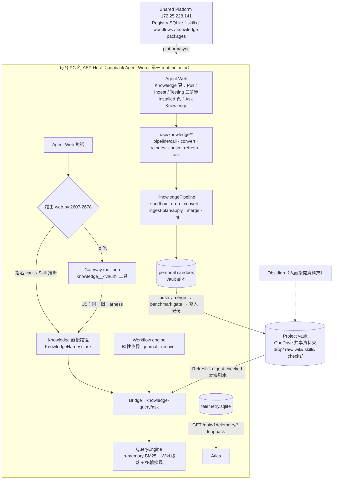
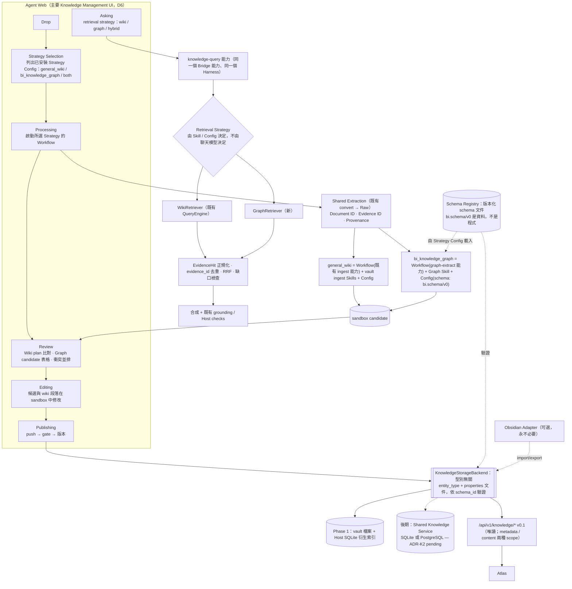

# AEP Knowledge Strategy v1.2（修訂提案，待 owner 確認）

> 2026-10-17，documentation and contract design only。取代 [v1.1](KNOWLEDGE_STRATEGY_v1.1.md)（保留作為歷史），差異見
> [KNOWLEDGE_STRATEGY_v1.2_DIFF.md](KNOWLEDGE_STRATEGY_v1.2_DIFF.md)。現況證據（檔案與行號）在
> [K01_AS_IS_GAP_ANALYSIS.md](K01_AS_IS_GAP_ANALYSIS.md)（下文以「K01 §n」引用）；v1.0 原文：
> [KNOWLEDGE_STRATEGY_v1.0_original.md](KNOWLEDGE_STRATEGY_v1.0_original.md)。
>
> 本版新增的契約與資料：
> - [bi_schema_v0/](bi_schema_v0/README.md)：BI Schema v0（PoC 契約）。
> - [knowledge_benchmark_v0/](knowledge_benchmark_v0/README.md)：25 題 benchmark 草案。
> - [../contracts/knowledge-api/](../contracts/knowledge-api/README.md)：Knowledge API v0.1，含 OpenAPI 3.1、JSON Schema 與 mock。
>
> 一致性測試：`tests/test_knowledge_strategy_docs.py`。
>
> **狀態：提案。** 本文件不改變 `docs/ARCHITECTURE.md`、`docs/DECISIONS.md` 或 `src/`。ADR 仍是草案；
> 標為「decided」的，是 owner 2026-10-17 的決定，核准 v1.2 後才寫入 DECISIONS。
> **v1.2 待 owner 確認三件事：§5.5 門檻、BI Schema v0、§7.3 整合排程。AEP-K02 之後的所有工作仍被擋住，
> 等 owner 核准 v1.2 才開始。**

## 0. 修訂原則與 owner 決定

### 0.1 修訂原則（owner，2026-10-17 第一輪，具約束力；沿用 v1.1）

| # | 原則 | v1.2 在哪裡落實 |
|---|---|---|
| P1 | 保留既有 Harness 與 Workflow Engine；Strategy = Workflow + Skills + Configuration；不另建 DSL 或執行引擎 | §1.2、ADR-K1（decided） |
| P2 | 保留長期 multi-user 目標；Phase 1 可在 Host 本機 PoC；Storage Backend 可替換；中央 PostgreSQL 為 pending ADR | ADR-K2、§1.3 |
| P3 | 主要 Knowledge Management UI 是 AEP Agent Web；Obsidian 只是可選的 Legacy Import/Export Adapter | ADR-K3（decided）、§1.4 |
| P4 | Ingestion 與 Retrieval 分開；同一文件經不同 Strategy 產生 Wiki 與 Graph，共用 Document ID、Evidence ID、Provenance | ADR-K4、§1.2 |
| P5 | 三種 benchmark（Wiki-only、Graph-only、Hybrid）；20–30 題關係型問題；六項指標；量化門檻待 owner 確認 | §5 |
| P6 | 先調查 knowledge tool path 低成功率 | K01 §2、ADR-K6 |
| P7 | Review Policy 可設定；General Wiki 維持 KNOWLEDGE_COLLAB；BI 可提議 Domain Owner Review，先列衝突 | ADR-K5 |
| P8 | 重用既有 Document Extraction；OCR、進階圖表、Object Storage、PostgreSQL RLS 屬後期 | §4 |
| P9 | 遵守 repo 架構與協作規則；列出需要修改的規則；PR 流程以問題呈現 | ADR-K9、§7.6 |
| P10 | Atlas ↔ AEP 明確 API 契約；Phase 1 定義最小 API 與 envelope，供 Atlas 以 mock 平行開發 | ADR-K7、§6 |

### 0.2 Owner 決定（2026-10-17 第二輪）

| # | 決定 | 狀態 | v1.2 落實 |
|---|---|---|---|
| D1 | 第一批目標使用者是 **BD / Marketing**。情境：市場情報、供應鏈、技術趨勢、客戶產品、測試商機分析。建立 25 題 benchmark 草案（5 類 × 5 題）。owner 為 **Benchmark Owner**；BD、PM、AE 為*建議的* Domain Reviewer，尚未指派正式審閱者。**未審閱的 Expected Answer 不是正式 Ground Truth。** 措辭須合成或不敏感 | decided | §5、[knowledge_benchmark_v0/](knowledge_benchmark_v0/README.md) |
| D2 | 建立 **BI Schema v0**，作為 PoC 契約（`bi.schema/v0`），與儲存及 Harness 解耦 | decided（內容待 owner 確認） | §4.3、ADR-K10、[bi_schema_v0/](bi_schema_v0/README.md) |
| D2a | owner 同日提供「BI 知識庫」文件（17 頁簡報，內部，不放進 repo）：**Schema v0 必須完全保留文件定義的 Entity Types 與 Relationships**，標 `origin: source-bi-doc` 並附頁碼；超出文件的部分標 `proposed-v0`，盡量少並附理由 | decided | §4.3、ADR-K10、[bi_schema_v0/](bi_schema_v0/README.md) |
| D3 | ADR-K6 的 Harness 通用規則 G1–G4，或是先量測 U7 | **未決定（pending）** | ADR-K6、§7.5 |
| D4 | **E2E-01 Gate 不得受影響**。Knowledge Strategy PoC 可平行準備，但不得擋住核心開發；不重排已核准的工作 | decided | §7.3、§7.4 |
| D5 | Atlas 由另一個 Atlas Coding Agent 建置；現在就定義最小 Knowledge API 契約與 mock | decided | §6、ADR-K7、[../contracts/knowledge-api/](../contracts/knowledge-api/README.md) |
| D6 | 架構要求重申：Agent Web 是主要 Knowledge Management UI（Drop、Editing、Review、Publishing、Asking，**新增 Strategy Selection**）；Obsidian 只是可選 adapter，永遠不是必要依賴；Strategy = 既有 Workflow + Skills + Configuration，不建第二個 workflow engine；Phase 1 只驗證 Knowledge Strategy 與 Hybrid Retrieval 的價值，**不做 PostgreSQL、Object Storage 與完整的多人審核** | decided | §1.2、§1.4、§4.1、ADR-K1、K2、K3、K5 |

D1、D2、D4、D5、D6 對應 owner 編號中的第 1、2、4、5 項與補充的架構要求；第 3 項即 D3；D2a 是同日的補充指示。

---

## 1. AS-IS vs TO-BE Architecture

### 1.1 AS-IS（已驗證，詳見 K01；自 v1.1 起未變）



重點（K01 §1）：
- 沒有 PostgreSQL、Alembic、RLS、Object Storage，也沒有多人 `/api/v1/knowledge` 伺服器。
- Vault 是 OneDrive 共享資料夾，不是 Git repository。
- 沒有 Graph / entity / relation / claim 儲存；沒有 `bi_schema.py` / `bi_ingest.py`。
- 最接近 Graph 的是 `src/knowledge/market_matrix.py`（market × product family 詞彙共現，`market_fit_verified: False`）。

### 1.2 TO-BE（Phase 1 PoC → 長期）



設計要點：
1. **Strategy 不是新引擎（ADR-K1，decided）。**
   - Ingestion Strategy 由三部分組成：一個已安裝的 Workflow（步驟是 Bridge capability）、它使用的 Skills，以及一份宣告式的 Strategy Config。
   - Strategy Config 沒有 `steps` 或 `needs`。
   - 人工審核不在 Workflow 中：Workflow 產出 sandbox candidate 後結束，接著在 Agent Web 審核，再走既有的 push / publish。
2. **Retrieval Strategy 是 knowledge-query 能力的參數**，不是新的聊天工具。
   - 每個 vault 仍只有一個 `knowledge__<vault>` 工具。
   - 選擇 wiki / graph / hybrid 的是 Knowledge Skill procedure 或 Strategy Config。
3. **一份文件只解析一次。**
   - 兩條 Strategy 都讀同一份 Raw，共用 `document_id` 與 `evidence_id`（ADR-K4）。
   - v1.2 新增：evidence_id 存在衍生索引，不寫回 Raw 檔（見 ADR-K4 與 §7.4 的 Phase 7 衝突）。
4. **Schema 是資料（ADR-K10，新增）。**
   - `bi.schema/v0` 由 Strategy Config 引用。
   - Storage Backend 只認 `entity_type` 字串與 `properties` 文件。
   - Harness 不 import 任何 BI 型別。
5. **Storage 可替換。**
   - 所有讀寫經 `KnowledgeStorageBackend` 介面。
   - Phase 1 實作是 vault 檔案加 Host 衍生索引（ADR-K2，Phase 1 部分 decided）。

### 1.3 長期多人目標（保留，P2）與 Phase 1 排除項（D6）

| 能力 | Phase 1（PoC，只驗證價值） | 長期（Shared Knowledge Service） |
|---|---|---|
| 身分 | 每台 Host 一個 `runtime.actor`；vault `maintainers` 清單 | 每個請求帶成員身分（Shared Platform 已有 Member Portal 帳號，`docs/DECISIONS.md` 2026-10-15） |
| 協作與審核 | sandbox → merge → benchmark gate → push（KNOWLEDGE_COLLAB）；**不做完整多人審核** | 同一流程，push 目標改為服務 API；Review Policy 依 ADR-K5 |
| 儲存 | vault 檔案 + Host SQLite 衍生索引；**不做 PostgreSQL** | Backend 介面背後的服務（SQLite 或 PostgreSQL，ADR-K2 pending） |
| 原始檔 | vault `drop/`；**不做 Object Storage** | 後期再評估 |
| 存取控制 | OneDrive 資料夾權限 + per-vault `privacy` + Knowledge API scope（§6） | 服務端 ACL；是否需要 RLS 取決於 ADR-K2 |
| Atlas | 讀 Host 的 `/api/v1/knowledge/*`（loopback）；開發期用 mock | 讀服務的同一版本 API |

### 1.4 Agent Web 是主要 Knowledge Management UI：能力對照（D6、K01 §3）

| 能力 | 既有（已驗證） | 規劃（Issue） | 缺口 / 註記 |
|---|---|---|---|
| Drop | 檔案上傳經 `pipeline("drop-add")` → `KnowledgePipeline.add_drop`（`src/knowledge/pipeline.py:461`）；從 project vault pull | 不變 | UI 路由請求上限 36 MB base64（K01 §3，約 26–27 MB 原檔，推論） |
| Strategy Selection（新） | 無：只有一條 wiki ingest | AEP-K05（後端：Strategy Config 安裝與列出、依所選 Strategy 啟動 Workflow）、AEP-K07（UI：在 Knowledge 頁 Processing 步驟選 `general_wiki` / `bi_knowledge_graph` / both；Asking 選 retrieval strategy） | 只列已安裝且通過 preflight 的 Strategy；`both` = 兩個 Workflow run |
| Processing | convert `start_convert`（`src/host_runtime/web.py:4777`）、re-ingest `start_reingest`（`:4865`）、ingest plan / apply | AEP-K05 把既有 ingest 包成 `general_wiki` Workflow；AEP-K06 加 `graph-extract` | 不改既有進度 UI 的行為 |
| Review | ingest plan 逐頁比對；merge 衝突並排；Reviews 面板 `#panel-reviews`（`src/host_runtime/web_page.py:1640`） | AEP-K07：Graph candidate 表格（接受 / 修改 / 拒絕 / 要求證據），**放在 Knowledge 頁，不放 Reviews 面板**（避開 S3 熱點，§7.4）；AEP-K12：衝突決策 UI | 衝突決策函式 `conflicts.append_decision`（`src/knowledge/conflicts.py:72`）、`resolve`（`:132`）目前沒有 UI |
| Editing | 只能編輯規則檔：`write_rule`（`src/knowledge/pipeline.py:379`） | AEP-K07：candidate 欄位修改（人工修改在重跑後保留，`edited_by_human`）；AEP-K12：wiki 段落編輯走 sandbox | Raw 依設計不可寫 |
| Publishing | `start_push`（`web.py:4562`，maintainer 才能 push，`pipeline.py:750` `may_push`）；`refresh_knowledge`（`web.py:4953`）；`publish_knowledge`（`web.py:4475`） | Graph candidate 走同一個 push gate（AEP-K07） | 不新增發佈路徑 |
| Asking | `POST /api/knowledge/ask`（`web.py:5967`）→ `KnowledgeHarness.ask`；Installed 頁 Ask 方塊（`web_page.py:1257`） | AEP-K08：retrieval strategy 參數；AEP-K07：選擇器 | 引用仍非可點連結（K01 §3） |
| Obsidian | 只做 `.obsidian` 排除與 frontmatter / wikilink 容忍（K01 §3） | 可選 import / export adapter（後期，ADR-K3）。現有 BI 知識庫本身是 Obsidian + Dataview 卡片資料夾（BI 文件 slide 1、7），匯入它是 adapter 的第一個實際用途 | **永遠不是必要依賴**：任何 Phase 1 功能都不得要求安裝或開啟 Obsidian；Dataview 的反向彙整由 graph 的 `neighbors` 取代 |

---

## 2. Existing Component Reuse Matrix

R = Reuse、E = Extend、N = New。路徑皆已在 K01 驗證；v1.2 新增的列以「v1.2」標示。

| 元件 | 實際路徑 | 處置 | 說明 |
|---|---|---|---|
| Workflow engine | `src/workflow/engine.py`、`src/workflow/checkpoints_sqlite.py`、`src/common/assets.py:268-273, 514-527` | R | Strategy 的執行者；線性步驟即足夠（ADR-K1） |
| Bridge | `src/workflow/dispatch.py` | R | 所有新能力都經 Bridge |
| Harness 狀態機 | `src/agent/harness_plan.py`、`harness_run.py`、`harness_runner.py` | R | Graph / Hybrid 沿用 collect → execute → validate → retry |
| Knowledge Harness（領域 adapter） | `src/host_runtime/knowledge_harness.py` | E | 加 retrieval strategy；Skill 綁定見 ADR-K6 G3（pending） |
| Gateway 工具迴圈 | `src/agent/gateway.py:98-118, 400-433, 808-817, 908-966` | R（G1–G4 若核准則 E） | 不新增 Graph 工具；**E2E-01 測試直接建構 `Gateway`**（`tests/test_product_e2e_01.py:11, 331`），見 §7.5 |
| Knowledge pipeline | `src/knowledge/pipeline.py`、`sandbox.py`、`merge.py`、`lint.py`、`src/host_runtime/knowledge_push.py` | R/E | Graph candidate 以檔案進 sandbox |
| Pipeline Bridge 能力 | `src/capabilities/knowledge_pipeline/handlers.py` | E | 新增 `graph-extract` 類能力 |
| 文件擷取 | `src/knowledge/office.py` | R | 不加 OCR；PDF 無表格模型（K01 §4.1） |
| Raw 與 provenance | `src/knowledge/raw.py`（`source_for`）、`src/knowledge/contracts.py:9-16` | R（v1.2 改：不寫回 Raw） | `document_id` = 既有 `source_id`；evidence_id 放衍生索引（ADR-K4） |
| 檢索與合成 | `src/knowledge/query.py`、`search_rounds.py`、`query_rewrite.py`、`evidence.py`、`procedure.py` | R/E | WikiRetriever = 既有 QueryEngine |
| 市場矩陣 | `src/knowledge/market_matrix.py:18-27` | R | `ProductFamily` / `TargetMarket` 成為 Schema v0 的列舉值來源 |
| 衝突與決策 | `src/knowledge/conflicts.py` | E | 補 UI（AEP-K12） |
| Agent Web Knowledge 頁 | `src/host_runtime/web_page.py:1362-1639`、`src/host_runtime/web.py` | E | Strategy Selection、Graph 審核、wiki 瀏覽（§1.4） |
| 遙測與其讀取 API | `src/telemetry/`、`src/host_runtime/telemetry_api.py`（`web.py:5265` 掛載） | R | Knowledge API 比照 `telemetry_api.py` 做成獨立模組，只在 `web.py` 加一行掛載（v1.2） |
| knowledge_v1 benchmark | `benchmarks/knowledge_v1/` | R/E | `reference_grade.py`、`evidence.py`、`compare.py` 沿用；新 suite `knowledge_bi_v0` 另開目錄（v1.2） |
| Shared Platform Registry | Registry SQLite | R（後期 E） | Shared Knowledge Service 的可能宿主 |
| Strategy Config | — | N | ADR-K1；v1.2 加 `schema` 欄位 |
| Schema Registry（v1.2） | — | N | 載入、驗證、upcast 版本化 schema 文件（ADR-K10） |
| KnowledgeStorageBackend | — | N | ADR-K2；型別無關（ADR-K10） |
| Graph 抽取、GraphRetriever、Hybrid fusion | — | N | §4 |
| `/api/v1/knowledge/*` v0.1 | — | N | §6；契約已在 `docs/contracts/knowledge-api/` |

---

## 3. ADR 草案

> 核准後才寫入 `docs/DECISIONS.md`（新增條目，不改舊條目）。

| ADR | 主題 | 狀態（2026-10-17） |
|---|---|---|
| K1 | Strategy = Workflow + Skills + Configuration | **decided**（owner，D6） |
| K2 | Storage Backend 介面；中央 PostgreSQL | Phase 1 不用 PostgreSQL：**decided**（owner，D6）；介面：proposed；**中央 PostgreSQL：pending** |
| K3 | Agent Web 主要 UI；Obsidian 為可選 adapter | **decided**（owner，D6；含 Strategy Selection） |
| K4 | 共用 Document / Evidence ID 與 Provenance | proposed（v1.2 修訂：evidence_id 不寫回 Raw） |
| K5 | 可設定的 Review Policy | proposed；Phase 1 只用 `general_collab`（D6：不做完整多人審核）；`domain_owner_review` 內容 pending |
| K6 | Harness 接合處通用規則 G1–G4 | **pending**（D3：G1–G4 或先量 U7，未決定） |
| K7 | Atlas Knowledge API 契約與版本 | 機制 **decided**（owner，D5）；scope 模型（Q10）：proposed，待確認 |
| K8 | 資料分類與外部模型路由 | 定義 proposed；BI 內容類別 **pending** |
| K9 | 協作流程（PR vs main） | **pending** |
| K10（新） | Schema 與儲存、Harness 解耦 | proposed |

### ADR-K1：Strategy = Workflow + Skills + Configuration（**decided，owner 2026-10-17**）

- **Context.**
  - v1.0 提出自有 Strategy Manifest（DAG、重試、checkpoint、human_approval）。
  - AEP 已有 Workflow engine（journal、recover、preflight、只對 read 步驟重試、安裝即核准）與統一的 Harness 狀態機（`docs/phases/HARNESS_UNIFICATION.md`）。
  - `AGENTS.md` 規則 2 要求「Workflow defines HOW EXACTLY」，規則 4 要求 Skills 是程序與領域指引。
- **Decision（owner 2026-10-17，D6）：** Strategy = 既有 Workflow + Skills + Configuration，不建第二個 workflow engine。
- **Strategy Config 的最小形狀**（v1.2 加入 `schema`）：

  ```json
  {
    "schema_version": "aep.knowledge.strategy.v1",
    "id": "bi_knowledge_graph",
    "version": "0.1.0",
    "kind": "ingestion",
    "output": "graph",
    "workflow": {"namespace": "knowledge", "name": "graph-ingest", "version": "0.1.0"},
    "skills": [{"namespace": "knowledge", "name": "bi-graph-extract", "version": "0.1.0"}],
    "schema": {"schema_id": "bi.schema/v0", "ref": "bi_schema_v0.json", "digest": "sha256:<64 hex>", "upcasters": []},
    "review_policy": "general_collab",
    "drafts_searchable": false
  }
  ```

  - Config 沒有 `steps`、`needs` 或 `condition`；順序與重試由 Workflow manifest 決定。
  - Retrieval Strategy 的 Config 形如 `{"kind": "retrieval", "mode": "wiki|graph|hybrid", "max_rounds", "max_hops", "fusion": "rrf", "schema"}`，由 Knowledge Skill procedure 引用。
- **Consequences.**
  - 不新增執行引擎；安裝、核准、遙測都沿用。
  - 「加第三個 mock strategy 不需改 Harness」可以用「安裝一個新 Workflow + Config」驗證。
  - Workflow 沒有條件分支，所以 `both` 以兩個 Workflow run 表示。
  - 審核中的暫停是 sandbox candidate 的狀態，不是 Workflow 的狀態。

### ADR-K2：Knowledge Storage Backend 介面；中央 PostgreSQL（**Phase 1 部分 decided；中央 DB pending**）

- **Context.**
  - P2 要求 backend 可替換。
  - 現況：vault 是 OneDrive 共享資料夾；Host 用多個 SQLite；Shared Platform 的 Registry 是 SQLite。
  - `docs/ROADMAP.md:312` 把「storage/index technology for knowledge retrieval」列為 open decision；repo 中沒有任何 PostgreSQL 決策（K01 §6）。
  - 在 OneDrive 中放 SQLite 檔案有同步損壞的風險（推論）。
- **Decided（owner 2026-10-17，D6）：** Phase 1 不做 PostgreSQL，也不做 Object Storage。Phase 1 只驗證 Knowledge Strategy 與 Hybrid Retrieval 的價值，因此 Phase 1 採選項 A。
- **介面（proposed，Phase 1 必做）。** 以 Python Protocol 定義，型別都是既有 `Contract`（frozen、extra=forbid）。v1.2 改為**型別無關**（ADR-K10）：

  ```text
  KnowledgeStorageBackend
    documents:  get_document(document_id) / list_documents(vault, cursor)
    evidence:   get_evidence(evidence_id) / resolve(locator) / evidence_for(document_id)
    wiki:       read_page(path) / list_pages(prefix, cursor)
    graph:      get_entity(entity_id) / find_entities(entity_type: str, text, cursor)
                neighbors(entity_id, relationship_types: list[str], depth<=3) / claims_for(entity_id)
    candidates: stage(candidate_set) / list_candidates(sandbox) / discard(...)
    publish:    publish(candidate_set, policy) -> version   # 冪等：同 digest 不重複發佈
    version:    current_version(vault) / digest()
    schema:     validator_for(schema_id) -> 由 Schema Registry 提供；backend 不含任何 BI 類型
  ```

- **Options（中央 DB，不做決定）。**

  | 選項 | 內容 | 優點 | 缺點 / 風險 |
  |---|---|---|---|
  | A | vault 檔案（Graph 為 JSONL / frontmatter）＋ Host SQLite 衍生索引 | 與 merge / gate / push / OneDrive 相容；可重建 | 單機索引；ACL 只到資料夾 |
  | B | Shared Platform 上的 Knowledge Service（SQLite） | 與 172.25.228.141 部署、憑證 pinning、Member Portal 一致 | 單寫者；需新服務與授權 |
  | C | 中央 PostgreSQL（JSONB、GIN、遞迴 CTE） | 多人並發、RLS | 新維運元件與 Alembic；與 local-first（`AGENTS.md` 規則 16）的離線行為需設計 |
  | D | 專用 Graph DB | 圖查詢表達力 | 新依賴，授權與維護需評估 |

- **Pending：** 是否採用 C（或 B / D）。決定條件：Phase 1 benchmark 結果、實際資料量、多人並發需求、IT 能否提供 PostgreSQL。
- **Consequences.** Phase 1 不寫 Alembic、不寫 RLS。任何 backend 都必須通過同一組介面契約測試。

### ADR-K3：Agent Web 是主要 Knowledge Management UI；Obsidian 是 Adapter（**decided，owner 2026-10-17**）

- **Context.**
  - Agent Web 已有 Drop、Processing、Review（部分）、Publishing、Asking（K01 §3）。
  - Obsidian 現在只是「人直接打開同一個資料夾」。
- **Decision（owner 2026-10-17，D6）：** Agent Web 是主要 UI，涵蓋 Drop、Editing、Review、Publishing、Asking，**以及 Strategy Selection**。Obsidian 只是可選的 legacy import / export adapter，**永遠不是必要依賴**。
- **Adapter 範圍：**
  - import：以既有 `adopt` 把舊 Obsidian vault 納入，使用 `src/knowledge/migrate.py`。
  - export：把發佈版本寫成 Obsidian 可讀的資料夾。
  - 不做雙向同步。
- **Consequences.**
  - 需要補的 UI 見 §1.4。
  - 現有 BI 知識庫是 Obsidian + Dataview 卡片（BI 文件 slide 1、7、10）。import adapter 應能讀取這些卡片的 frontmatter 與 `[[連結]]`，轉成 `bi.schema/v0` 的 entity 與 relationship candidate，並依 BI 文件的匯入規則運作：dry-run、冪等、不覆蓋人工內文。這是後期工作（真實卡片含客戶資料，受 ADR-K8 約束），不在 Phase 1。
  - 「規則檔在 Obsidian 中編輯」的說法（`docs/DECISIONS.md` 2026-10-11 K3）需在 ARCHITECTURE 與使用手冊改寫為「在 Agent Web 編輯，Obsidian 可選」。這在核准後進行（§7.6）。

### ADR-K4：共用 Document ID、Evidence ID 與 Provenance（proposed；v1.2 修訂）

- **Context.**
  - 現有 `KnowledgeSource{source_id, original_ref, sha256, raw_ref, page, slide, parent_source_id}`（`src/knowledge/contracts.py:9-16`）。
  - `source_id = "src-" + sha256(bytes)[:16]`（`src/knowledge/raw.py` `source_for`）。
  - 沒有持久化的 passage ID（`query.py:1449-1456`）。
- **Recommendation：內容定址。**
  - `document_id` 直接沿用既有的 `source_id`。
  - `document_version_id = document_id + "@" + extractor`。
  - `evidence_id = "ev-" + sha256(document_id | locator | normalized_text)[:20]`。
  - 重新擷取時保存 `evidence_map`（舊 ID → 新 ID）；舊 ID 永不重用。
  - Hybrid 以 `evidence_id` 去重；同一 `document_id` 的兩個 hit 不算兩份獨立證據。
- **v1.2 修訂：evidence_id 與 evidence_map 存在 Host 衍生索引（可由 Raw 重算），不寫回 Raw 檔，也不回填舊 Raw。**
  - v1.1 寫的是「Raw 寫入時計算並保存，舊 Raw 一次性回填」。
  - 這會改動 Raw 檔，與 Phase 7 的 Knowledge 平台 parity gate 衝突：該 gate 比較 content identities 與 immutable Raw files（`docs/phases/PHASE_7_MIGRATION.md`「Knowledge platform」），見 §7.4。
  - 由 Raw 文字決定性重算即可得到相同 ID，因此不需要寫回。
- **Consequences.** Raw 不變性與 Phase 7 parity 不受影響；索引遺失時可重建。

### ADR-K5：可設定的 Review Policy，及其與 KNOWLEDGE_COLLAB 的衝突（proposed；Phase 1 範圍已定）

- **Context.**
  - KNOWLEDGE_COLLAB（`docs/phases/KNOWLEDGE_COLLAB.md:170-171, 281-283`）與 `docs/DECISIONS.md` 2026-10-11 的三個條目都寫明：不需要第二人核准、不需要 domain-owner approval、不加鎖。
  - 但 `AGENTS.md:25`、`docs/ARCHITECTURE.md:160-179, 757` 與 `docs/PRODUCT_ACCEPTANCE_TESTS.md:197, 218`（E2E-05 criterion 8）仍寫著 domain-owner review（K01 §9）。
- **Phase 1（owner 2026-10-17，D6：不做完整多人審核）：**
  - 所有 Strategy（含 `bi_knowledge_graph`）都用 `general_collab`。
  - BI 內容在 Phase 1 的正確性，由 benchmark 的 Domain Reviewer 審閱（§5.6）來把關，而不是由發佈流程把關。
- **機制（proposed）：** `review_policy` 是 Strategy Config 的一個欄位，Phase 1 只實作 `general_collab`。
- **Pending：** `domain_owner_review` 的內容（依 claim domain 分派 BD / PM / AE / Account Owner），以及既有文件矛盾以哪份為準。

  | 既有決策 / 規格 | 衝突點（若日後採用 domain_owner_review） |
  |---|---|
  | KNOWLEDGE_COLLAB:170-171, 281-283 | 引入第二人核准 |
  | DECISIONS 2026-10-11 K3、branches/PR | 同上 |
  | DECISIONS 2026-10-11 no lock | 不衝突（不加鎖） |
  | ARCHITECTURE:757、PRODUCT_ACCEPTANCE_TESTS:197, 218 vs KNOWLEDGE_COLLAB | 既有矛盾，與本提案無關，owner 需裁定 |

### ADR-K6：Harness 接合處的通用規則（**pending：owner 尚未決定 G1–G4 或先量 U7**）

- **Context（K01 §2）.**
  - 「工具路徑 10/74」是 2026-10-07 sample-003 的數字，早於 U5（`0b39228a`）。
  - U5 之後，core 集工具路徑可接受率為 147/182（80.8%），直接路徑為 56/70（80.0%）。110 題 sample 集在 U5 後沒有有效量測（U7 未完成，`docs/TASKS.md` 「Harness unification U7」）。
  - 殘留根因：
    1. 未驗證的結果交回模型，且移除 record（`gateway.py:938`）。
    2. 呼叫與否、問題措辭由模型決定（`gateway.py:98-118`）。
    3. 只綁第一個 Knowledge Skill（`knowledge_harness.py:76-91, 118-121`）。
    4. 第一個 validated 結果即結束回合（`gateway.py:808-817`）。
    5. 回傳截斷為 12,000 字元（`gateway.py:948`）。
- **定位.**
  - 共用狀態機只有一套（`harness_runner.py`）；`knowledge_harness.py` 是領域 adapter。
  - 上述根因都發生在「對話工具迴圈 ↔ 領域 adapter」的接合處，所以修正要寫成所有領域適用的通用規則。
- **候選方案（owner 待選，D3）.**
  - **甲：四條通用規則 G1–G4**，每條先寫失敗測試：
    - G1：未通過驗收的結果原樣回傳，保留紀錄，不交給模型改寫。
    - G2：使用者原句優先。
    - G3：Skill 依綁定的資產選擇；沒有綁定才退回目前的「第一個符合者」。
    - G4：輸出長度與領域宣告一致，不無聲截斷。
  - **乙：先只做 U7 量測**（U5 後 110 題 sample 集，grader 1.4），不改程式，依數據再決定是否做甲。
  - 根因 4 不另立規則：retrieval mode 在同一能力內，Hybrid 融合在 Harness 內完成。
- **v1.2 補充：G1–G4 會改到所有領域共用的對話 Harness，E2E-01 測試也會經過它。**
  - `tests/test_product_e2e_01.py:11, 331` 直接建構 `agent.gateway.Gateway`；另有 25 個測試檔 import `agent.gateway`。
  - 因此無論選甲或乙，甲都必須依 §7.5 的回歸計畫進行，並且不得在 E2E-01 的 owner 實機驗證進行期間修改 `gateway.py`（§7.4）。
- **對 Knowledge Strategy 的影響.**
  - Graph / Hybrid 不新增聊天工具（選項 B），這一點不受 D3 影響。
  - G3（依綁定資產選 Skill）是「依 vault 或 mode 選 Skill」的前提。若 owner 選乙，AEP-K08 先以「每個 vault 只裝一個 Knowledge Skill」的設定運作，不改 `harness_skill`。
  - tool-path parity 門檻（§5.7）在 G1–G4 未實作前仍照量，結果作為 D3 的決策依據。

### ADR-K7：Atlas Knowledge API 契約與版本（**機制 decided，owner 2026-10-17；scope 待確認**）

- **Decision（owner 2026-10-17，D5）：** 現在就定義最小契約，給另一個 Atlas Coding Agent 以 mock 開發，並遵循遙測契約的 envelope 與版本慣例。
- **契約內容：**
  - `schema_version: "aep.knowledge.v1"`、`contract_version: "0.1"`。
  - 加選填欄位只升 contract_version；破壞性變更升 `v2`；Atlas 忽略未知欄位。
  - GET only、cursor 分頁、錯誤形狀對齊 `Failure`。
  - 交付物在 `docs/contracts/knowledge-api/`（§6）。
- **Q10 的重述與建議（待 owner 確認）。**
  - 遙測的「免 token」適用於去敏的中繼資料（遙測契約 §1 #2、§4）；Evidence 的段落原文與客戶名稱是內容。
  - 因此建議兩個 scope：
    - `knowledge.read.metadata`：比照遙測，loopback、免 token、只允許本機 Origin。
    - `knowledge.read.content`：需要 bearer token。
  - 另有與 scope 分開的分類上限：Phase 1 不對 Atlas 回傳 CONFIDENTIAL。
  - `POST /query` 會呼叫模型，延到 v0.2，使用獨立 scope `knowledge.query`。
- **Consequences.**
  - Atlas 目前的 AEP provider 不帶任何憑證（Atlas `docs/AEP_TELEMETRY_INTEGRATION.md`）。
  - 內容類畫面在 owner 決定前只能用 mock；只用 metadata 的畫面則不需要改憑證處理。

### ADR-K8：資料分類與「外部模型」路由（定義 proposed；BI 內容類別 **pending**）

- **Context（沿用 v1.1）.**
  - `src/agent/data_policy.py:11` 的 `DataClass`；未知永不當 PUBLIC。
  - 原生 agent 只收 PUBLIC（`:128-137`）；Gateway 不得核准 RESTRICTED（`:82-83`）。
  - `src/models/approved.py:36-41` 一律視為 UNCLASSIFIED。
  - 每個 vault 有 `privacy` 設定（`docs/DECISIONS.md` 2026-10-03）。
- **定義（proposed）：**

  | 類別 | 可接收的資料 |
  |---|---|
  | internal model（Gateway） | host-admin 核准的類別，RESTRICTED 除外 |
  | external agent（native CLI） | 只有 PUBLIC |
  | external model API | Phase 1 一律不允許 |

- **BI Schema v0 的預設分類**（§4.3）：
  - Account、CustomerProduct、Opportunity 為 CONFIDENTIAL。
  - Competitor 為 INTERNAL。
  - 其餘為 UNCLASSIFIED。
- **Pending：** BI 客戶 / 商機內容標 CONFIDENTIAL 還是 RESTRICTED；Gateway 核准是否涵蓋 CONFIDENTIAL。
- **Phase 1 的做法：** 含客戶資料的三種類型**只在合成 fixture 上**跑抽取與 benchmark（§5.4），真實 vault 上不抽取這三種類型。這樣 ADR-K8 的決定不會擋住 PoC。

### ADR-K9：協作流程（PR vs 在 main 直接 commit）（**pending**）

- 內容同 v1.1。實況是自 2026-10-05 起都直接在 main commit；沒有規則規定任一方式（K01 §10）。
- 選項：
  - A：維持現況。
  - B：K02+ 一律走 feature branch + PR。
  - C：docs 直接 commit，程式變更走 PR。
- 若選 B 或 C，需要修改的文件見 §7.6。

### ADR-K10（新）：Schema 與儲存、Harness 解耦（proposed）

- **Context.**
  - D2、D2a 要求以 owner 提供的 BI 知識庫文件建立 BI Schema v0，作為 PoC 契約。文件說明了類型、連結欄位與規則，但也寫明欄位名稱以 `bi_schema.py` 為唯一依據（slide 10）。`bi_schema.py`、`bi_ingest.py` 與 mapping JSON 仍不可得，因此一部分欄位名稱是 provisional。
  - 若把 v0 的類型寫成 Python 類別，或寫進 storage 的表格、Harness 的程式，日後換成真正的 schema 就會改到核心模組。這違反 v1.0 的原則「不得把 BI/Wiki 邏輯寫死於 Harness」與 `AGENTS.md` 規則 4。
- **Options.**
  - A：v0 類型寫成 pydantic 模型並被 storage 與 retrieval import。
  - B：schema 是版本化的資料文件，由 Strategy Config 引用，storage 與 Harness 型別無關。
  - C：完全不定義 schema，等真正的來源。
- **Recommendation: B.**
  1. **Schema 是資料。**
     - `bi_schema_v0.json`（`schema_id: bi.schema/v0`）由 Strategy Config 的 `schema` 欄位引用（`schema_id`、`ref`、`sha256` digest），安裝 Strategy 時載入 Schema Registry。
     - Schema Registry 以 JSON Schema 片段建立驗證器；也可由同一份 JSON 產生 pydantic 模型，但只供 Skill / 工具使用，不進核心。
  2. **Storage 型別無關。**
     - backend 只存 `entity_type`（字串）、`schema_id` 與一份 `properties` 文件。
     - 寫入前呼叫 `validator_for(schema_id)` 驗證；關係同樣只存 `relationship_type` 字串，並依 schema 的 domain / range 驗證。
  3. **Harness 不 import 任何 BI 型別。**
     - Knowledge Harness 與 GraphRetriever 只處理 EvidenceHit、claim modality（`claim_kind` / `verification_status` / `review_status`）與 evidence_id。
     - BI 特有的知識（例如 Account ≠ Ecosystem）在 Graph Skill 的 procedure 與 schema 規則中，不在 Harness。
  4. **換成真正的 schema 是 config 與 migration 變更**：
     1. 安裝 `bi.schema/v1`。
     2. 在 Strategy Config 換引用並登記 upcaster。
     3. 以 dry-run → apply 跑一次 migration。

     Harness 與 backend 的程式不變。
  5. **v0 → v1 upcast 規則**（`bi_schema_v0.json` 的 `upcast`）：
     - type_map：改名時保留舊 entity_id 為 alias。
     - property_map：v1 必填但沒有值的紀錄回到 draft / candidate；無對應的屬性移到 `properties.legacy_v0`。
     - relationship_map：沒有對應的 `proposed-v0` 關係改為不發佈並送審，Concept 之間的則改為 `related_to`。
     - claim、evidence id、document id 與 review_status 永不改寫；`edited_by_human` 的紀錄保留並回報衝突。
     - 先 dry-run 產生報告，再以 `(entity_type, canonical_key)` 與 `relationship_id` 冪等套用。
- **Consequences.**
  - 多一個小元件（Schema Registry）。
  - 契約測試要涵蓋三點：storage 拒絕不合 schema 的 properties；Harness 測試不依賴 BI 類型；一個假的 `bi.schema/v1` 可以只靠安裝與 upcast 生效。
  - Open question：請 owner 提供 `bi_schema.py` / `bi_ingest.py`，以核對 provisional 名稱（§8）。

---

## 4. Revised MVP Scope

### 4.1 範圍（D1、D6）

Phase 1 的唯一目標：**驗證 Knowledge Strategy 與 Hybrid Retrieval 對 BD / Marketing 情境的價值。**

| In（Phase 1 MVP） | Out（後期） |
|---|---|
| BD benchmark v0（25 題）審閱、合成 fixture corpus、Wiki-only baseline | OCR、掃描 PDF、進階圖表理解 |
| BI Schema v0 + Schema Registry + Strategy Config（ADR-K1、K10） | **PostgreSQL**、Alembic、RLS（ADR-K2 pending） |
| Document / Evidence ID（衍生索引）與型別無關 Storage Backend（選項 A） | **Object Storage** |
| `general_wiki` Strategy（既有 ingest 包成 Workflow）；Strategy Selection | **完整多人審核**、`domain_owner_review`（ADR-K5 pending） |
| `bi_knowledge_graph` Strategy PoC：12 種類型；Account / CustomerProduct / Opportunity 只在合成 fixture 上 | 真實客戶資料的抽取（ADR-K8 pending） |
| Graph candidate 進 sandbox、在 Agent Web Knowledge 頁審核、經既有 push 發佈 | Submission server、多人並發寫入 |
| GraphRetriever 與 Hybrid（RRF、evidence_id 去重、缺口檢查），在同一個 knowledge-query 能力內 | `auto` 策略推薦 |
| Knowledge API v0.1 唯讀路由（契約與 mock 已交付） | `POST /query`、conflicts / feedback / review queue API |
| 三種 benchmark 與門檻判定 | XLSX / HTML 擷取、Obsidian 雙向同步 |

### 4.2 階段

| 階段 | 內容 | 出口條件 |
|---|---|---|
| Phase 0 | v1.2（本文件）、Schema v0、benchmark 草案、API 契約與 mock | owner 確認門檻、Schema v0、排程，核准 v1.2 |
| Phase 1a：量測基礎 | AEP-K02 | ≥ 20 題已審閱；合成 fixture 可重現；Wiki-only baseline 已記錄 |
| Phase 1b：契約 | AEP-K03、K04、K09 | Schema / ID / Backend 契約測試通過；Knowledge API 路由與 mock 一致 |
| Phase 1c：Graph PoC | AEP-K05、K06、K07、K08 | 一份文件只解析一次，產出 Wiki 與 Graph candidate，審核後發佈；Hybrid 在同一能力內 |
| Phase 1d：判定 | AEP-K10 | 對照 §5.5 門檻；owner 決定 go / no-go 與 ADR-K2 |
| Phase 2+ | Shared Knowledge Service、OCR、Object Storage、PostgreSQL（若採用）、domain_owner_review | 另行規劃 |

### 4.3 BI Schema v0 摘要（D2、D2a；細節與頁碼見 [bi_schema_v0/](bi_schema_v0/README.md)）

- **來源：** owner 2026-10-17 提供的「BI 知識庫」簡報（17 頁，內部，不放進 repo；只引用頁碼與極短詞句）；其次是 v1.0 提案。
- **分析鏈（slide 3）：** Trend → Technology → Node → Ecosystem → CustomerProduct（鏈圖稱 Product）→ Application → TestSolution → Opportunity。
- **Entity types（12，全部 `origin: source-bi-doc`）：** Trend、Technology、Node、Ecosystem、Account、CustomerProduct、Application、TestSolution、Competitor、Concept、Signal、Opportunity。
  - 名稱與 v1.0 相同。
  - 語意依文件：
    - **Ecosystem 是節點上的供應商 / 夥伴公司**（晶片、模組、認證夥伴），**Account 是買我方儀器的客戶**，兩者不混用（slide 5）。
    - **Node 是固定的價值鏈位置**：文件說共 8 個，可辨識 7 個（晶片、模組、手機、CPE、基地台、電信網路、認證實驗室）。
    - Opportunity 在文件中沒有欄位。
- **Relationships（14 個名稱、22 個 domain 組合）：**
  - **18 個 `source-bi-doc`。** 其中 8 個欄位名稱直接出自文件（slide 7、8）：`related_tech`、`affects_nodes`、Ecosystem 的 `node`、Application 與 Concept 的 `technologies`、TestSolution 的 `applications`、`competing_solutions`、`vendor`。另外 10 個是文件描述的關鍵欄位，名稱暫定（provisional），例如 `supplied_technologies`、`suppliers`、`account`、`chip_modules`。
  - **4 個 `proposed-v0`**：Opportunity 的 `account`、`customer_product`、`test_solutions`，以及 Signal 的 `mentions`。理由是文件沒有定義這兩種卡的連結，但鏈的終點與情報追溯需要它們。
  - 另有 4 個 `source-v1.0` 的 claim 連結。
- **文件規則保留：**
  - Account ≠ Ecosystem。
  - 我方方案 vendor 留空、不建我方 Competitor 卡，對手方案 `vendor` 指向 Competitor 卡；`is_own_solution` 必填。
  - 方案覆蓋只計我方。
  - 區分宣稱 / 推論、assumed / verified、待查證清單；每個論點標頁碼。
  - Concept 由 draft 經業務試讀改為 reviewed。
  - 卡片超過 90 天未更新即提醒：Atlas 的 `stale` 狀態與 `STALE_DATA` gap。
  - 匯入先 dry-run、冪等、不覆蓋人工內文。
  - Dashboard 缺口檢查：沒有方案的 Application、缺 Concept 的 Technology、推測比例、過期資料。
- **proposed-v0 的其他新增**（皆附理由）：
  - Node 擴充 `proposed-v0-extension`：AI 資料中心與車用雷達情境需要 PSU、交換器 ASIC、光模組、雷達模組等位置，文件的固定節點是無線通訊用的。
  - `market_segments`：給 Atlas 市場篩選用。
  - `product_family`：對齊 `market_matrix.py`。
  - Opportunity 的 `hypothesis_status`。
- **形式：** `bi.schema/v0`，JSON Schema 2020-12 片段，pydantic 友善；每個屬性標 `x-origin`、`x-pages`、`x-name-status`。這是 PoC 契約，不是正式 schema。
- **待 owner 確認：**
  - provisional 名稱與列舉值，需 `bi_schema.py` 核對；
  - 第 8 個 Node 是什麼；
  - Application 的「價值鏈層級」是否連到 Node；
  - Opportunity 與 Signal 的提議連結；
  - 是否接受 Node 擴充。

---

## 5. Benchmark Plan（BD / Marketing）

### 5.1 三種 benchmark

| 名稱 | retrieval_mode | 證據來源 |
|---|---|---|
| Wiki-only | `wiki` | 既有 QueryEngine（wiki_primary + Raw） |
| Graph-only | `graph` | 已發佈的 Graph（entity / relationship / claim，各帶 evidence_id） |
| Hybrid | `hybrid` | 兩者，RRF 融合、以 evidence_id 去重 |

- 三種 mode 的其他條件都相同：同一 vault 版本、同一份 Raw、同一模型 alias、同一 Knowledge Skill 版本。
- 遙測的 `strategy_id` 記錄差異。
- 每題經直接路徑與對話工具路徑各跑一次。

### 5.2 問題集：25 題草案（D1）

- 機器可讀：[knowledge_benchmark_v0/questions.json](knowledge_benchmark_v0/questions.json)。
- 可讀版：[knowledge_benchmark_v0/README.md](knowledge_benchmark_v0/README.md)。
- 每題欄位：Question、Expected Entities、Expected Relationships（以 Schema v0 類型寫的三元組）、Evidence Requirements、Expected Answer、Review Domain、`review_status: draft-unreviewed`。
- 缺口題另有 `expected_absent_relationships`。

| 類別 | 題號：標題 |
|---|---|
| Market Trend | MT-01 AI 資料中心功率密度的相關技術與節點；MT-02 Wi-Fi 世代轉換的訊號與推論；MT-03 CPO 趨勢影響的節點與供應商；MT-04 車用雷達趨勢的節點、供應商與訊號；MT-05 6G 與 NTN 趨勢的信心度與過期資料 |
| Technology & Ecosystem | TE-01 Wi-Fi 8 的 Concept 與我方方案；TE-02 800G / 1.6T 的節點與供應商；TE-03 5G FWA 價值鏈與缺少 Concept 的技術；TE-04 Wi-Fi 鏈上的供應商與認證夥伴；TE-05 Account 與 Ecosystem 不可混用 |
| Customer & Product | CP-01 Gamma 產品的技術、上市時程與量測需求；CP-02 Beta AI PSU 的技術與量測；CP-03 Alpha AI 機櫃：宣稱與推論；CP-04 Delta 雷達模組的晶片來源與量測；CP-05 Sigma RedCap CPE 的價值鏈 |
| Application & Test Solution | AT-01 Wi-Fi 量測應用的我方與對手方案；AT-02 SerDes 一致性測試的方案對照；AT-03 PSU 與電源完整性量測的方案；AT-04 雷達量測的方案與有爭議的對手；AT-05 沒有方案的 Application（缺口） |
| Cross-domain Opportunity Discovery | OD-01 誰可能需要 Wi-Fi 8 測試；OD-02 800V DC 趨勢的測試商機；OD-03 CPO × 光模組廠：商機與方案缺口；OD-04 雷達法規與 Delta 的產線商機；OD-05 跨節點的我方方案 |

- **類型與關係名稱：** 取自 BI 文件的分析鏈與連結欄位（§4.3），三元組方向與文件的卡片欄位相同。
- **措辭：** 全部合成，不含真實客戶秘密。客戶（Alpha … Tau）、供應商（Kappa … Pi）、產品、對手（Competitor A、B）都是虛構的；技術詞彙為公開用語。
- **結構：** 比照 `benchmarks/knowledge_v1/questions/questions.json`（id + 題目 + 標籤）。正式版定稿後比照 `questions.py` 以 sha256 pin。既有 benchmark 集不修改。
- **設計涵蓋：**
  - 1–4 hops（1 hop 7 題、2 hops 9 題、3 hops 6 題、4 hops 3 題）。
  - 「不應存在」的關係（缺口）：TE-03（缺 Concept 的 Technology）、AT-02（我方方案沒有 vendor）、AT-05、OD-03（沒有方案的 Application）。
  - 矛盾題：AT-04、OD-04（disputed）。
  - 過期資料題：MT-05、AT-01（超過 90 天未更新的卡）。
  - 推論標示題：MT-02、CP-03、OD-*。
  - Account ≠ Ecosystem 陷阱：TE-05。
  - vendor / `competing_solutions` 判讀：AT-01、AT-02、AT-04。
  - Concept 審閱狀態：TE-01、CP-02、AT-03。
- **審閱分工：** owner 是 Benchmark Owner；Review Domain 欄位是*建議*的審閱領域（BD 17 題、PM 4 題、AE 4 題），尚未指派正式審閱者。BI 文件的「負責人與審閱頻率」也仍是「待指定」（slide 15）。

### 5.3 指標（保留六項；BD 情境下的子量測）

| 指標 | 定義 | 量測方式（重用既有元件） |
|---|---|---|
| Answer Accuracy | Expected Answer key points 的涵蓋率：(covered + partial/2) / key points；另記 contradicted、invented。另外分類別回報 | `benchmarks/knowledge_v1/reference_grade.py` 的方法；key points 由審閱後的 Expected Answer 切出 |
| Evidence Accuracy | (a) 引用可解析率；(b) 支持率；**(c) 模態標示率（v1.2）**：要求標示的題目中，正確標出陳述 / 推論、verified / assumed 的比例；(d) 獨立文件要求達成率 | (a) `benchmarks/knowledge_v1/evidence.py` `verify`（以 evidence_id 解析）；(b) `judge.py`；(c)(d) 依 `evidence_requirements` 欄位 |
| Relationship Accuracy | 答案中三元組對 gold triples 的 precision、recall、F1；invented relations 數；**缺口偵測（v1.2）**：`expected_absent_relationships` 不被編造且明示缺口；**Account ≠ Ecosystem 混淆數（v1.2）**；過期資料提醒（BI 文件 90 天規則） | 評分模型抽出三元組 → 依 entity_id / aliases 正規化 → 比對 |
| Latency | 每題端到端秒數（p50、p90） | 遙測 `run.completed.duration_ms` |
| Token Cost | 每題 input + output tokens；並報告 token 涵蓋率 | 遙測 `llm.completed`（遙測契約 §3、§7） |
| Loop Count | 模型輪數 + Harness retry + 檢索 rounds；Graph hops 另列 | 遙測 `tool.completed.loop_index`、`retry.scheduled`；Knowledge record |

### 5.4 Baseline 程序

1. **凍結：** AEP build、vault 版本 digest、Knowledge Skill 版本、模型 alias、問題集 sha256。
2. **Corpus。**
   - **合成 fixture**（新 suite 目錄 `benchmarks/knowledge_bi_v0/`，AEP-K02 建立）：由 mock 的 8 份合成文件產生 PPTX / PDF / DOCX，全部 25 題都在這裡跑。
   - 含 Account / CustomerProduct / Opportunity 的題目只在 fixture 上跑（ADR-K8）。
   - `real_vault_candidate: true` 的 15 題（MT、TE、AT），可由審閱者改寫 Expected Answer 後，另在**真實 vault 的副本**上跑。依 `docs/DECISIONS.md` 2026-10-09 的資料例外，限 `privacy: public` 的 vault；這部分可選。
3. **審閱：** Domain Reviewer 把 `review_status` 改為 `reviewed`，並在必要時修訂 Expected Answer 與 gold triples（§5.6）。
4. **Wiki-only baseline：** 直接路徑與工具路徑各跑 **2 次**。
5. **Graph-only 與 Hybrid：** Graph PoC 完成後，在同一 corpus 上跑，同樣 2 次。
6. **比較：** 用 `benchmarks/knowledge_v1/compare.py`（擴充 mode 與類別維度）。結果寫入 runs 目錄與遙測（`benchmark_run`、`benchmark_grading`），並經 Knowledge API `quality/benchmark-runs` 提供給 Atlas。
7. **時段：** 不需要 GUI，任何時間可跑。

### 5.5 MVP 成功門檻（**提議，待 owner 確認**）

參考值：
- knowledge_v1 core-015 涵蓋率 0.503。
- 校準上限：第二份獨立答案 0.53（`docs/DECISIONS.md` 2026-10-10）。
- BD 題目是關係型，且 Expected Answer 較短、key points 較少，因此門檻略高於 core 集。

| 指標 | Hybrid（主門檻） | Graph-only | Wiki-only |
|---|---|---|---|
| Answer Accuracy（全體平均） | ≥ 0.55，且 ≥ Wiki-only + 0.05 | 記錄 | baseline，記錄 |
| Answer Accuracy（Cross-domain Opportunity 類） | ≥ Wiki-only + 0.10（Hybrid 的價值假設） | 記錄 | 記錄 |
| Evidence (a) 可解析率 | 100%（任何無法解析的引用即該題 FAIL） | 100% | 記錄 |
| Evidence (b) 支持率 | ≥ 0.85 | ≥ 0.85 | 記錄 |
| Evidence (c) 模態標示率 | ≥ 0.90 | ≥ 0.90 | 記錄 |
| Evidence (d) 獨立文件要求 | ≥ 80% 的題目達成 | 記錄 | 記錄 |
| Relationship precision / recall / F1 | ≥ 0.80 / ≥ 0.65 / ≥ 0.70 | ≥ 0.85 / ≥ 0.50 / 記錄 | 記錄 |
| Invented relations | ≤ 0.7 × Wiki-only | ≤ 0.5 × Wiki-only | 記錄 |
| 缺口偵測（TE-03、AT-02、AT-05、OD-03 的「不應存在」關係） | 4 / 4：不編造且明示缺口 | 4 / 4 | 記錄 |
| 過期資料提醒（MT-05、AT-01） | 2 / 2 | 2 / 2 | 記錄 |
| Account ≠ Ecosystem 混淆 | 0 次 | 0 次 | 記錄 |
| Latency | p50 ≤ 1.5 × Wiki-only p50；p90 ≤ 240 s | p50 ≤ Wiki-only p50 | 記錄 |
| Token Cost | 平均 ≤ 1.5 × Wiki-only | ≤ 1.0 × Wiki-only | 記錄 |
| Loop Count | rounds ≤ 3；每次 Graph 查詢 hops ≤ 3（4-hop 題以 ≤ 2 rounds 完成）；retry ≤ Skill 預算；0 次 `tool_loop_limit` | 同左 | 記錄 |

### 5.6 未審閱的 Ground Truth（D1）

- 目前 25 題都是 `review_status: draft-unreviewed`。Expected Answer 與 gold triples 是 Claude Code 依合成資料起草的，**不是正式 Ground Truth**。
- **以未審閱題目評分，結果只能當作參考（indicative）。** 報告與 Knowledge API 都標 `ground_truth_status` 與 `indicative: true`，不得作為 go / no-go 的依據。
- **正式判定的前提（提議，待確認）：**
  - ≥ 20 / 25 題由 Domain Reviewer 審閱；每類 ≥ 3 題，且 5 題 Cross-domain Opportunity 全部審閱。
  - 門檻只對已審閱的題目計算。
  - 未達此前提時，AEP-K10 只能給「繼續 / 停止」的建議，不能給「go」。
- 審閱時可修改題目、Expected Answer 與三元組；修改後重新 pin sha256，並記錄審閱者與日期（`reviewer`、`reviewed_at`）。

### 5.7 Parity 與不退化（保留）

| 規則 | 內容 |
|---|---|
| Tool-path parity | Hybrid 在工具路徑與直接路徑的可接受率差距 ≤ 5 個百分點（兩次平均）。G1–G4 未決（ADR-K6 pending）時照量；不達標時，結果交給 owner 作為 D3 的依據，不自行修改 Harness |
| 不退化 | knowledge_v1 core 36 題、coding_v1、business_workflow_lab 不退化（各自既有判定）；`tests/test_product_e2e_01.py` … `_05.py` 與全套 pytest 通過 |

---

## 6. API Contract（Atlas ↔ AEP，contract v0.1）：摘要

完整契約在 [docs/contracts/knowledge-api/](../contracts/knowledge-api/README.md)，包括：
- `openapi.yaml`（OpenAPI 3.1）；
- `schemas/*.schema.json`（JSON Schema 2020-12）；
- `mock/*.json`（19 份合成回應）與 `mock/index.json`；
- 給 Atlas Coding Agent 的 README。

| 群組 | Endpoint（全部 GET，前綴 `/api/v1/knowledge`） |
|---|---|
| Entity Query | `/entities`、`/entities/{entity_id}` |
| Relationship / Graph Query | `/relationships`、`/graph`（`{nodes, edges}`，即 Atlas graph normalizer 要求的形狀） |
| Evidence Query | `/evidence`、`/evidence/{evidence_id}`、`/documents`、`/documents/{document_id}` |
| Knowledge Quality Metrics | `/quality/summary`（Atlas gap taxonomy）、`/quality/benchmark-runs`（六項指標 + ground-truth 審閱狀態） |
| Strategy Run Status | `/strategies`、`/strategy-runs`、`/strategy-runs/{strategy_run_id}`（含 `workflow_run_id`、`trace_id` 連到遙測 API） |
| 服務 | `/health` |

- **版本：** `schema_version: "aep.knowledge.v1"`、`contract_version: "0.1"`。加欄位只升小版；破壞性變更升 v2；Atlas 忽略未知欄位。
- **來源與 provenance：**
  - envelope 的 `source` 帶 producer、backend、vault、vault_version、schema_id、synthetic。
  - entity 與 relationship 帶 `provenance`：document_ids、evidence_ids、strategy_id、strategy_run_id、extracted_by、extracted_at、schema_id。
- **錯誤：** `{code, message, retryable, http_status, details}`。前三個欄位與 `src/common/execution.py:92` 的 `Failure` 一致。
- **Scope（Q10 建議，待確認）：**
  - `knowledge.read.metadata`：loopback、免 token，比照遙測。
  - `knowledge.read.content`：bearer token；段落、claim 敘述、文件標題 / 路徑、敏感類型的 label 都屬於這個 scope。
  - 沒有 content scope 時，這些欄位為 null，並標 `*_redacted: true`。
- **Mock：**
  - 91 個 entity（12 種類型）、163 個 relationship（14 個關係名稱全部用到）、163 個 claim、167 段 evidence、10 份文件。
  - 涵蓋 2 張過期卡、1 個 disputed claim、只有推論支持的 Opportunity 連結、1 個沒有方案的 Application，以及缺 Concept 的 Technology。
  - 它是 benchmark 的 gold graph，25 題的所有 Expected Entities 與三元組都在其中；測試會強制檢查這一點。
- **與 Atlas 共同凍結：** 建議 AEP-K09 開始實作前，與 Atlas Coding Agent 共同凍結 v0.1。

---

## 7. GitHub Issues / Implementation Plan（草案，未建立）

> 編號沿用 **AEP-** 前綴（避免與 `docs/TASKS.md` 既有 K1–K6 混淆；改名仍是 §8 的問題）。v1.2 重新編排範圍，對照見 DIFF。
> **閘門：AEP-K02 起所有 issue 都等 owner 核准 v1.2。** 流程（PR 或 main）依 ADR-K9。

### 7.1 Issue 草案

| # | 標題 | 目標 | 驗收 | 依賴 | 熱點 | 大小 |
|---|---|---|---|---|---|---|
| AEP-K02 | Review the BD benchmark and record a Wiki-only baseline | Domain Reviewer 審閱 ≥ 20 題；合成 fixture corpus（`benchmarks/knowledge_bi_v0/`）；Relationship / 模態 / 缺口評分；Wiki-only baseline 2 次 | 審閱紀錄與 sha256 pin；selftest 通過；baseline 報告含六項指標並標明 ground-truth 狀態 | owner 核准 v1.2；指派審閱者 | 無（新目錄） | M |
| AEP-K03 | Load versioned schemas through Strategy Config | Schema Registry、Strategy Config 解析與 `schema` 欄位、upcast 框架（ADR-K1、K10） | 契約測試：拒絕不合 schema 的 properties；假 `bi.schema/v1` 只靠安裝 + upcast 生效；Harness 測試不 import BI 類型 | K02 可平行 | 無（新模組） | M |
| AEP-K04 | Add evidence ids and a type-agnostic storage backend | ADR-K4（衍生索引，不寫 Raw）、ADR-K2 介面與選項 A | 同檔同 ID；重擷取 evidence_map；舊 ID 不重用；Raw 位元組不變；backend 契約測試 | K03 | `src/knowledge/raw.py`（只讀）、新模組 | M |
| AEP-K05 | Wrap General Wiki ingest as a Strategy and list strategies | `general_wiki` Workflow + Config；Strategy Selection 後端（列出、啟動） | 第三個 mock strategy 只靠安裝即可執行；既有 Knowledge 頁行為不變 | K03、K04 | `src/capabilities/knowledge_pipeline/handlers.py` | M |
| AEP-K06 | Extract BI graph candidates with Schema v0 (PoC) | Graph Skill + `graph-extract` 能力；candidate 進 sandbox；客戶類型只在 fixture | 只解析一次；Wiki 與 Graph 共用 evidence_id；重跑不重複；每個 claim 有 evidence；Schema 規則（Account ≠ Ecosystem、is_own_solution、模態）由驗證器擋下 | K04、K05 | handlers.py | L |
| AEP-K07 | Strategy Selection and graph review in Agent Web | Knowledge 頁：Strategy 選擇、Graph candidate 審核表（接受 / 修改 / 拒絕 / 要求證據）、retrieval 選擇；經既有 push 發佈 | 瀏覽器測試（深色、窄螢幕）；人工修改重跑後保留；不使用 Reviews 面板與 `experience_proposals.py` | K06；與 Productization 5 協調（§7.4） | **`web_page.py`、`web.py`** | L |
| AEP-K08 | GraphRetriever and hybrid retrieval inside knowledge-query | RRF、evidence_id 去重、缺口檢查、hops / rounds 上限；工具數不增加 | 同文件兩 hit 不算兩份證據；部分 backend 失敗時明示；不編造關係 | K04、K06；若 ADR-K6 選乙，先以每 vault 一個 Skill 運作 | **`knowledge_harness.py`**、`procedure.py` | L |
| AEP-K09 | Serve Knowledge API v0.1 from Agent Web | 依 `docs/contracts/knowledge-api/` 實作唯讀路由（獨立模組，比照 `telemetry_api.py`）；scope 依 Q10 決定 | 實際回應通過同一組 JSON Schema；metadata scope 不回傳內容；Origin 規則測試 | K04；Q10 決定；與 Atlas 凍結 v0.1 | `web.py`（只加掛載一行） | M |
| AEP-K10 | Run Wiki-only, Graph-only and Hybrid against the thresholds | §5.4 程序；報告與建議 | 每種 mode 2 次；六項指標；§5.6 前提；不退化套件 | K02、K07、K08 | 無 | M |
| AEP-K11 | Data classification for documents and evidence | ADR-K8 | 非 PUBLIC 不送 external agent；RESTRICTED 不送任何模型；`privacy` 相容 | ADR-K8 決定；真實客戶資料抽取前必須完成 | `data_policy.py`、`approved.py` | M |
| AEP-K12 | Wiki browser and conflict decisions in Agent Web | wiki 頁樹（唯讀）、衝突決策 UI | 瀏覽器測試；決策寫入 `decisions.md` 並在下次 ingest 生效 | K05 後 | **`web_page.py`、`web.py`** | M |
| AEP-K13（pending ADR-K6） | Generic Harness hand-off rules G1–G4, or U7 first | 依 owner 的 D3 選擇：甲（G1–G4）或乙（U7 量測） | 甲：依 §7.5 回歸計畫；乙：U5 後 110 題 sample 集量測報告 | **owner 決定 D3**；不得在 E2E-01 實機驗證期間進行 | **`gateway.py`、`conversation_harness.py`、`knowledge_harness.py`** | M |

### 7.2 依賴順序

```text
owner 核准 v1.2（門檻、Schema v0、排程）
  → K02（審閱 + fixture + baseline）──────────────────────────┐
  → K03 → K04 → K05 → K06 → K07 → K08 → K10 ←────────────────┘
               └→ K09（Atlas 已可用 mock 平行開發）
  K11：真實客戶資料抽取前；K12：K05 後任意時點
  K13：等 owner 的 D3；排在 E2E-01 owner 實機驗證完成之後
```

### 7.3 整合排程：Knowledge Strategy 是既有工作外圍的平行軌（D4，**待 owner 確認**）

**原則：不重排任何已核准的工作。** 主軌的順序與狀態照 `docs/TASKS.md`、`docs/ROADMAP.md`、`HANDOFF.md`；Knowledge 軌只用不衝突的時段與檔案。

| 主軌（已核准，順序不變） | 現況 | Knowledge 軌可同時做的事 | 不可同時做的事 |
|---|---|---|---|
| **E2E-01 Gate**（DUT / chipset） | owner validation pending：simulator 證明已在 CI；還需要在註冊的公司 PC 上留下實機證據（`docs/TASKS.md` E2E 表、`docs/PRODUCT_ACCEPTANCE_TESTS.md` E2E-01） | K02、K03、K04、K05、K06、K09（只碰新模組、新目錄與 knowledge 子系統） | 修改 `gateway.py`、`conversation_harness.py`、`harness_*.py`（K13）；任何會讓 E2E-01 證據的 workspace revision 失去可比性的共用核心變更 |
| **Phase 7**（migration） | Workflow 10 真實檔 parity、Workflow 13 governed release、Workflow 11 live parity 仍開著；Workflow 7 暫停；Knowledge 平台（遷移順序第 7 項）在副本上的 parity 尚未開始（`docs/phases/PHASE_7_MIGRATION.md`、`docs/TASKS.md` Phase 7 列） | 全部 Knowledge 工作都不碰 Workflow 10 / 11 / 13 的模組 | K04 不得寫回 Raw（已改為衍生索引）；Phase 7 Knowledge parity 進行時，不在同一份副本上跑 K06 抽取 |
| **Productization 5**（Agent Web 體驗，active） | 進行中（`docs/ROADMAP.md`） | 後端 issue（K02–K06、K08、K09） | K07、K12 的 UI 變更需在 P5 的 slice 之間進行，或先與 P5 協調畫面範圍 |
| **Skill suggestions S3**（on hold） | owner 在 S2 卡片品質觀察後才啟動（`docs/phases/SKILL_SUGGESTIONS.md`「Owner decision after S2」） | 全部 Knowledge 工作；K07 的 Graph 審核放在 Knowledge 頁，不碰 Reviews 面板 | K13 的 G3 若改 `SkillManifest`，必須是選填欄位，讓 S3 產生的 Skill draft 仍然有效 |
| **Harness unification U7**（open） | 未完成（`docs/TASKS.md`） | — | 由 D3 決定是否成為 K13 的乙方案 |

**建議時程（相對順序，不是日期）：**
1. **現在（Phase 0，本次完成）：** v1.2、Schema v0、benchmark 草案、API 契約與 mock。Atlas Coding Agent 可立即以 mock 開發；不需要任何 AEP 程式。
2. **owner 核准 v1.2 後：** K02（需要指派審閱者，不碰程式熱點）與 K03 → K04 → K05 → K06、K09 依序或平行進行。這些都在主軌之外。
3. **Productization 5 的 slice 之間：** K07、K12（UI）。
4. **K06、K07 之後：** K08（`knowledge_harness.py`），最後 K10 判定。
5. **E2E-01 owner 實機驗證完成，且 owner 決定 D3 之後：** K13。

### 7.4 共用程式熱點與衝突風險

churn = 2026-10-01 以來修改該檔的 commit 數（`git log --since=2026-10-01`，2026-10-17 量測）。

| 檔案 | 行數 | churn | 誰會改 | 風險與處置 |
|---|---|---|---|---|
| `src/agent/gateway.py` | 1,268 | 36 | K13（G1、G2、G4）；E2E-01 測試建構 `Gateway`（`tests/test_product_e2e_01.py:11, 331`）；另有 25 個測試檔 import `agent.gateway` | **最高**。所有領域共用的對話 Harness。K13 只在 owner 決定 D3、且 E2E-01 實機驗證完成後進行；依 §7.5 回歸計畫 |
| `src/host_runtime/knowledge_harness.py` | 481 | 6 | K08（retrieval strategy）；K13（G3 Skill 綁定） | 中。K08 與 K13 不同時進行；G3 未決前，K08 不改 `harness_skill`（`:76-91`） |
| `src/host_runtime/web_page.py` | 7,697 | 87 | K07、K12；Productization 5；S3（Reviews 面板卡片） | **高**（單一大字串、改動最頻繁）。Knowledge UI 只動 `#panel-knowledge`（`:1362` 起），不動 `#panel-reviews`（`:1640`）；與 P5 排開 slice |
| `src/host_runtime/web.py` | 6,074 | 96 | K05（列出 Strategy）、K07、K09、K12；P5；S3（`/api/reviews`） | 高。K09 做成獨立模組，只在 `web.py` 加一行掛載（比照 `telemetry_api.handle`，`web.py:5265`） |
| Experience 模組：`experience.py`、`experience_proposals.py`、`experience_review.py`、`skill_suggestions.py` | 332 / 374 / 284 / 1,338 | 低（skill_suggestions 2、experience_proposals 3） | S3（draft、candidate）；v1.1 曾考慮讓 Graph 審核沿用 Reviews 卡片 | **v1.2 決定不讓 Knowledge 工作碰這些模組**：Graph 審核放 Knowledge 頁的 sandbox candidate 流程，S3 啟動時無衝突 |
| `src/agent/skills.py`（`SkillManifest`） | — | — | K13 的 G3（綁定資產欄位）；S3（產生 Skill draft） | G3 的新欄位必須選填、預設行為不變 |
| `src/knowledge/raw.py` | — | — | K04；Phase 7 Knowledge parity（immutable Raw） | 已處置：evidence_id 放衍生索引，不寫 Raw（ADR-K4） |

### 7.5 G1–G4 的回歸計畫（若 owner 選 D3 甲）

1. **凍結基準。** 在 K13 開始前的 commit 上跑以下測試並記錄結果：
   - `tests/test_product_e2e_01.py` … `_05.py`、`tests/test_dut_host.py`；
   - 所有 import `agent.gateway` 的測試檔（目前 25 個）、`tests/test_knowledge_unified.py`；
   - coding_v1 / business_workflow_lab 的離線測試與全套 pytest。
2. **一條規則一個 commit，先寫失敗測試。** 每條規則都要以 Knowledge 與至少一個非 Knowledge 領域各驗一次（沿用 v1.1）。
3. **E2E-01 專屬斷言（新增）：**
   - G1 之後，DUT 量測超出限制、或 hardware validator 判失敗的結果，經對話工具迴圈回傳時，必須原樣保留失敗狀態與 Host 註記，模型不能把它改寫成成功。這對應 E2E-01 criterion 9 與 negative demonstration「A measurement outside the declared limit remains failed regardless of the Agent's explanation」。
   - G2 之後，未授權、錯誤或不存在的裝置請求，仍必須在任何實體命令前被拒絕（criterion 5）。
4. **每個 commit 後重跑第 1 步的全部測試**；任何 E2E-01 測試失敗即回退該 commit，不放寬斷言。
5. **時段：** E2E-01 的 owner 實機驗證進行期間，不 merge K13 的任何 commit，以免改變被驗證的 workspace revision（criterion 8 會記錄 revision）。
6. **回退：** 每條規則是獨立 commit，可單獨 revert；不加 feature flag，避免多一條執行路徑。

### 7.6 需要修改的 repo 規則與文件（核准後才改；沿用 v1.1 §7.3）

| 文件 | 需要的變更 | 觸發條件 |
|---|---|---|
| `docs/ARCHITECTURE.md` | Knowledge Strategy、Storage Backend、Schema Registry、Graph、Knowledge API；Obsidian 改為 adapter；補 KNOWLEDGE_COLLAB 協作模型 | v1.2 核准 |
| `docs/DECISIONS.md` | 依核准 ADR 新增條目：K1、K3、K7 機制、K2 Phase 1 部分可先寫；K10 核准後 | 每份 ADR 核准時 |
| `docs/ROADMAP.md` | 新增 Knowledge Strategy 平行軌；「Open decisions」的 storage/index 項目指向 ADR-K2 | v1.2 核准 |
| `docs/PRODUCT_ACCEPTANCE_TESTS.md` | E2E-05 criterion 8 與 KNOWLEDGE_COLLAB 的矛盾需 owner 裁定；本計畫不取代 active gate E2E-01 | ADR-K5 |
| `docs/phases/KNOWLEDGE_COLLAB.md` | 加註適用範圍與 BI policy 例外（若採用） | ADR-K5 |
| `docs/HARNESS_DESIGN.zh-TW.md`、`docs/HARNESS_6_LAYER_STATUS.md` | 更新過時的 10/74 與迴圈數字；G1–G4 若採用，寫入對話 Harness 一節 | K13 |
| `AGENTS.md` / `CLAUDE.md`、`.agents/skills/*` | 若採 PR 流程 | ADR-K9 |
| `docs/TASKS.md` | 新增 Knowledge Strategy 段落（本次只新增一列）；`:20-22` 過時說法 | — |
| `.github/workflows/verify.yml` | 不需要改：新測試 `tests/test_knowledge_strategy_docs.py` 只用 stdlib，CI 的 pytest 已會跑 | — |

---

## 8. Open questions for the owner

### 8.1 已回答（2026-10-17）

| v1.1 §8 | 問題 | 答案 |
|---|---|---|
| Q2 | ADR-K2：Phase 1 用選項 A？PostgreSQL 何時決定？ | Phase 1 不做 PostgreSQL 與 Object Storage，只驗證 Strategy 與 Hybrid 的價值（D6）→ Phase 1 用選項 A。中央 PostgreSQL 仍 pending，決定時點建議在 AEP-K10 之後；IT 能否提供仍未知 |
| Q3 | BI schema 來源？ | owner 2026-10-17 提供「BI 知識庫」文件（17 頁）；Schema v0 完全保留其 Entity Types 與 Relationships（`source-bi-doc`，附頁碼），超出部分標 `proposed-v0`（D2a）。`bi_schema.py` / `bi_ingest.py` 仍不可得（下方 N1） |
| Q4 | MVP 的第一個使用者與問題？ | BD / Marketing；市場情報、供應鏈、技術趨勢、客戶產品、測試商機分析（D1） |
| Q5 | 問題集與 gold triples 的審閱者？ | 25 題、5 類 × 5（§5.2）；owner 為 Benchmark Owner；BD / PM / AE 為建議的 Domain Reviewer，尚未指派；未審閱的 Expected Answer 不是正式 Ground Truth（D1、§5.6） |
| Q13 | Atlas 由誰負責、何時從 mock 開始？ | 由另一個 Atlas Coding Agent 建置；現在就定義最小契約與 mock（D5），已交付於 `docs/contracts/knowledge-api/` |
| Q14 | 與 E2E-01、Phase 7、S3 的先後？ | E2E-01 不得受影響；Knowledge Strategy 平行準備、不擋核心開發；不重排已核准工作（D4）→ §7.3 整合排程 |

### 8.2 仍待 owner 決定

1. **確認 v1.2 的三項內容**：§5.5 門檻與 §5.6 正式判定前提；BI Schema v0（12 種 source-bi-doc 類型、18 個 source-bi-doc 與 4 個 proposed-v0 關係、Node 擴充、是否需要 Market 類型）；§7.3 整合排程。
2. **（D3，原 Q11）ADR-K6**：採用四條通用規則 G1–G4（甲），還是先只做 U7 量測（乙）？
3. **N1：欄位名稱核對**：BI 文件寫明欄位名稱以 `bi_schema.py` 為唯一依據，但 `bi_schema.py`、`bi_ingest.py`、`bi_slides_extract.py` 與 mapping JSON 仍不可得。請提供，以核對 10 個 provisional 連結名稱、所有屬性名稱與列舉值，並把 v0 升為 v1。
   - 文件 slide 4 說 Node 共 8 個但只列 7 個，第 8 個是什麼？
   - Application 的「價值鏈層級」是否連到 Node？
   - Opportunity 的 3 個提議連結與 Signal 的 `mentions` 是否可以？
   - 是否接受為 AI 資料中心與車用雷達情境擴充 Node？還是 Phase 1 只用無線通訊節點？
   - 真實 BI 卡片（Obsidian + Dataview）何時、以什麼分類匯入？與 ADR-K8 相關。
4. **N2：正式審閱者**：BD、PM、AE 各由誰審？審閱期限？
5. **（原 Q10）Knowledge API scope**：是否採用 `knowledge.read.metadata`（免 token，loopback）／`knowledge.read.content`（bearer token）的分法？Atlas 的 content 畫面在決定前只用 mock，是否可以？
6. **（原 Q1）核准範圍**：ADR-K4、K5（Phase 1 機制）、K7 scope、K10 的建議是否接受？
7. **（原 Q2 後半）ADR-K2 中央 DB**：AEP-K10 後再決定是否可以？IT 能否提供 PostgreSQL？
8. **（原 Q6）門檻細節**：Hybrid 是否必須在 Cross-domain Opportunity 類優於 Wiki-only 0.10 才算成功，或「不退化且關係準確率提高」即可？
9. **（原 Q7）Review Policy**：Phase 2 是否採用 domain_owner_review？E2E-05 criterion 8 與 KNOWLEDGE_COLLAB 以哪份為準？
10. **（原 Q8）資料分類**：BI 客戶 / 商機內容標 CONFIDENTIAL 還是 RESTRICTED？Gateway 核准是否涵蓋 CONFIDENTIAL？
11. **（原 Q9）ADR-K9**：K02+ 用 PR 還是在 main 直接 commit？
12. **（原 Q12）編號**：AEP-K02… 是否改用其他前綴？
13. **N3：v0.1 凍結**：是否要求 Atlas Coding Agent 在 AEP-K09 開始前確認 v0.1？
