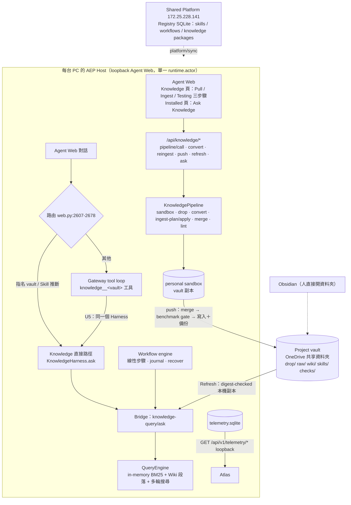
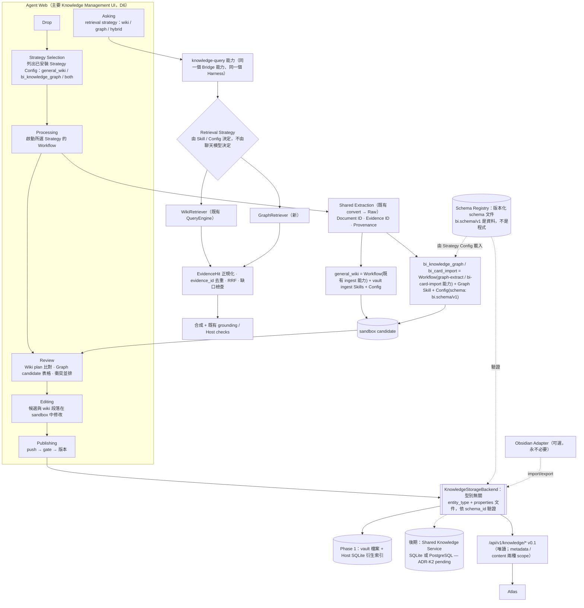

# AEP Knowledge Strategy v1.3（修訂提案，待 owner 確認）

> 2026-10-19，documentation, contract and benchmark-data only。取代 [v1.2](KNOWLEDGE_STRATEGY_v1.2.md)（保留作為歷史），差異見
> [KNOWLEDGE_STRATEGY_v1.3_DIFF.md](KNOWLEDGE_STRATEGY_v1.3_DIFF.md)。現況證據（檔案與行號）在
> [K01_AS_IS_GAP_ANALYSIS.md](K01_AS_IS_GAP_ANALYSIS.md)（下文以「K01 §n」引用）；v1.0 原文：
> [KNOWLEDGE_STRATEGY_v1.0_original.md](KNOWLEDGE_STRATEGY_v1.0_original.md)。
>
> v1.3 的起因（2026-10-19）：
> - owner 提供真正的 BI 工具（`bi_schema.py`、`bi_ingest.py`、`bi_slides_extract.py`、`bi_concept_candidates.py`、prompts、samples）與範例 vault，
>   同日核准以測試資料 commit 到 `tests/fixtures/bi_vault_example/`（e30cd8bf）。N1（欄位名稱）因此解決。
> - owner 問 Application 的 `priority` 是否合理、多人調整會不會亂掉 → 新 ADR-K11。
> - owner 分享一份 Codex 寫的「BI Knowledge Source Brief v6」，對同一份範例資料的稽核；其發現經 Claude Code 逐項對照檔案核實後併入（§4.5–§4.7、§5.2）。
>
> 本版的契約與資料：
> - [bi_schema_v1/](bi_schema_v1/README.md)：BI Schema v1（`bi.schema/v1`，由 `bi_schema.py` 產生，每個名稱附行號）。[bi_schema_v0/](bi_schema_v0/README.md) 保留不改。
> - [knowledge_benchmark_v0/](knowledge_benchmark_v0/README.md)：25 題合成 benchmark（三元組改用 v1 名稱）、補充題 SUP-01，以及第二組 8 題範例 vault 題（`vault_example_questions.json`）。
> - [../contracts/knowledge-api/](../contracts/knowledge-api/README.md)：Knowledge API v0.1（凍結前修訂：v1 名稱、`field_provenance`、`/entities/{id}/history`）。
>
> 一致性測試：`tests/test_knowledge_strategy_docs.py`。
>
> **狀態：提案。** 本文件不改變 `docs/ARCHITECTURE.md`、`docs/DECISIONS.md` 或 `src/`。ADR 仍是草案；
> 標為「decided」的，是 owner 的決定，核准後才寫入 DECISIONS。
> **v1.3 待 owner 確認：§5.5 門檻細節、BI Schema v1、ADR-K11（含 priority 評分準則）、§4.4 資料處理對應、§7.3 整合排程。AEP-K02 之後的所有工作仍被擋住，
> 等 owner 核准 v1.3 才開始。**
>
> **2026-10-19 owner 已回答 §8.2 的七題**（見文末「Owner 決定（2026-10-19）：對 §8.2 的回答」）：`competing_vendors` 要加；priority 分 market、分期間；
> judgement 欄位清單與 Node 擴充接受；Opportunity 要；講者備註可以（已實作於 `office.py`）；API 版本「好」；ADR-K9 寫好可以進 main。
> 本文件就地更新（不另開 v1.4），差異同步記在 [KNOWLEDGE_STRATEGY_v1.3_DIFF.md](KNOWLEDGE_STRATEGY_v1.3_DIFF.md) §7。

## 0. 修訂原則與 owner 決定

### 0.1 修訂原則（owner，2026-10-17 第一輪，具約束力；沿用 v1.1）

| # | 原則 | v1.2 在哪裡落實 |
|---|---|---|
| P1 | 保留既有 Harness 與 Workflow Engine；Strategy = Workflow + Skills + Configuration；不另建 DSL 或執行引擎 | §1.2、ADR-K1（decided） |
| P2 | 保留長期 multi-user 目標；Phase 1 可在 Host 本機 PoC；Storage Backend 可替換；中央 PostgreSQL 為 pending ADR | ADR-K2、§1.3 |
| P3 | 主要 Knowledge Management UI 是 AEP Agent Web；Obsidian 只是可選的 Legacy Import/Export Adapter | ADR-K3（decided）、§1.4 |
| P4 | Ingestion 與 Retrieval 分開；同一文件經不同 Strategy 產生 Wiki 與 Graph，共用 Document ID、Evidence ID、Provenance | ADR-K4、§1.2 |
| P5 | 三種 benchmark（Wiki-only、Graph-only、Hybrid）；20–30 題關係型問題；六項指標；量化門檻待 owner 確認 | §5 |
| P6 | 先調查 knowledge tool path 低成功率 | K01 §2、ADR-K6 |
| P7 | Review Policy 可設定；General Wiki 維持 KNOWLEDGE_COLLAB；BI 可提議 Domain Owner Review，先列衝突 | ADR-K5 |
| P8 | 重用既有 Document Extraction；OCR、進階圖表、Object Storage、PostgreSQL RLS 屬後期 | §4 |
| P9 | 遵守 repo 架構與協作規則；列出需要修改的規則；PR 流程以問題呈現 | ADR-K9、§7.6 |
| P10 | Atlas ↔ AEP 明確 API 契約；Phase 1 定義最小 API 與 envelope，供 Atlas 以 mock 平行開發 | ADR-K7、§6 |

### 0.2 Owner 決定（2026-10-17 第二輪）

| # | 決定 | 狀態 | v1.2 落實 |
|---|---|---|---|
| D1 | 第一批目標使用者是 **BD / Marketing**。情境：市場情報、供應鏈、技術趨勢、客戶產品、測試商機分析。建立 25 題 benchmark 草案（5 類 × 5 題）。owner 為 **Benchmark Owner**；BD、PM、AE 為*建議的* Domain Reviewer，尚未指派正式審閱者。**未審閱的 Expected Answer 不是正式 Ground Truth。** 措辭須合成或不敏感 | decided | §5、[knowledge_benchmark_v0/](knowledge_benchmark_v0/README.md) |
| D2 | 建立 **BI Schema v0**，作為 PoC 契約（`bi.schema/v0`），與儲存及 Harness 解耦 | decided（內容待 owner 確認） | §4.3、ADR-K10、[bi_schema_v0/](bi_schema_v0/README.md) |
| D2a | owner 同日提供「BI 知識庫」文件（17 頁簡報，內部，不放進 repo）：**Schema v0 必須完全保留文件定義的 Entity Types 與 Relationships**，標 `origin: source-bi-doc` 並附頁碼；超出文件的部分標 `proposed-v0`，盡量少並附理由 | decided | §4.3、ADR-K10、[bi_schema_v0/](bi_schema_v0/README.md) |
| D3 | ADR-K6 的 Harness 通用規則 G1–G4，或是先量測 U7 | **decided**：先量 U7（2026-10-18），之後 owner 核准 G1–G4（2026-10-18「好做」），已實作 | ADR-K6、§7.5 |
| D4 | **E2E-01 Gate 不得受影響**。Knowledge Strategy PoC 可平行準備，但不得擋住核心開發；不重排已核准的工作 | decided | §7.3、§7.4 |
| D5 | Atlas 由另一個 Atlas Coding Agent 建置；現在就定義最小 Knowledge API 契約與 mock | decided | §6、ADR-K7、[../contracts/knowledge-api/](../contracts/knowledge-api/README.md) |
| D6 | 架構要求重申：Agent Web 是主要 Knowledge Management UI（Drop、Editing、Review、Publishing、Asking，**新增 Strategy Selection**）；Obsidian 只是可選 adapter，永遠不是必要依賴；Strategy = 既有 Workflow + Skills + Configuration，不建第二個 workflow engine；Phase 1 只驗證 Knowledge Strategy 與 Hybrid Retrieval 的價值，**不做 PostgreSQL、Object Storage 與完整的多人審核** | decided | §1.2、§1.4、§4.1、ADR-K1、K2、K3、K5 |

D1、D2、D4、D5、D6 對應 owner 編號中的第 1、2、4、5 項與補充的架構要求；第 3 項即 D3；D2a 是同日的補充指示。

### 0.3 2026-10-19 的新輸入與決定

| # | 內容 | 狀態 | v1.3 落實 |
|---|---|---|---|
| E1 | owner 提供真正的 BI 工具與範例 vault。`bi_schema.py` 是欄位名稱的唯一依據（`bi_schema.py:1-3`，BI 文件 slide 10） | 輸入 | §4.3、[bi_schema_v1/](bi_schema_v1/README.md)、ADR-K10 |
| E2 | owner：「files/BI_Vault_Example 可以commit 進repo當測試資料」→ 已 commit 於 `tests/fixtures/bi_vault_example/`（e30cd8bf；不含第三方 `.obsidian/plugins` 與個人編輯器狀態） | **decided**（owner 2026-10-19） | §5.2 第二組題目、§4.5 |
| E3 | owner 問：Application 的 `priority` 合理嗎？大家一直調會不會亂掉？ | 問題 | ADR-K11 |
| E4 | owner 分享 Codex「BI Knowledge Source Brief v6」 | 輸入（逐項核實） | §4.5 資料品質、§4.6 Dashboard 注意事項、§4.7 Case A–E、§5.2 第二組題目 |
| E5 | Node 依 owner 2026-10-18 規則（「目前看到幾個就幾個」）改用範例 vault 的 **8 個** | 依既有規則套用 | §4.3 |
| E6 | owner 回答 §8.2 的七題（`competing_vendors`、priority 範圍、judgement 欄位與 Node 擴充、Opportunity、講者備註、API 版本、ADR-K9） | **decided**（owner 2026-10-19；第 6 題的解讀待確認） | 文末「Owner 決定（2026-10-19）：對 §8.2 的回答」 |

**已決定、不重開**（Brief v6 把這些列為待決，但它們已經決定）：
- 第一批使用者是 BD / Marketing（D1）。
- 25 題 benchmark；Answer Accuracy ≥ 0.70（owner 2026-10-18）。
- U7 已量測，G1–G4 已實作（ADR-K6；`benchmarks/knowledge_v1/runs/u7-report.zh-TW.md`、`benchmarks/knowledge_v1/runs/g14-report.zh-TW.md`）。
- Atlas 由另一個 Atlas Coding Agent 以 mock 建置（D5）。
- vault 是 OneDrive 共享資料夾，**不用 Git**：`docs/DECISIONS.md` 2026-10-11「Knowledge pipeline release direction」的 rejected alternatives 寫明「Git on the OneDrive-synced vault: sync corrupts `.git`」。Brief 重複了「vault 用 Git」的舊錯誤說法。

---

## 1. AS-IS vs TO-BE Architecture

### 1.1 AS-IS（已驗證，詳見 K01；自 v1.1 起未變）



重點（K01 §1）：
- 沒有 PostgreSQL、Alembic、RLS、Object Storage，也沒有多人 `/api/v1/knowledge` 伺服器。
- Vault 是 OneDrive 共享資料夾，不是 Git repository。
- 沒有 Graph / entity / relation / claim 儲存。`bi_schema.py` / `bi_ingest.py` 等 BI 工具不在 AEP 執行環境中；自 2026-10-19 起以**測試資料**身分存在 `tests/fixtures/bi_vault_example/tools/`（只讀，不執行於真實資料）。
- 最接近 Graph 的是 `src/knowledge/market_matrix.py`（market × product family 詞彙共現，`market_fit_verified: False`）。

### 1.2 TO-BE（Phase 1 PoC → 長期）



設計要點：
1. **Strategy 不是新引擎（ADR-K1，decided）。**
   - Ingestion Strategy 由三部分組成：一個已安裝的 Workflow（步驟是 Bridge capability）、它使用的 Skills，以及一份宣告式的 Strategy Config。
   - Strategy Config 沒有 `steps` 或 `needs`。
   - 人工審核不在 Workflow 中：Workflow 產出 sandbox candidate 後結束，接著在 Agent Web 審核，再走既有的 push / publish。
2. **Retrieval Strategy 是 knowledge-query 能力的參數**，不是新的聊天工具。
   - 每個 vault 仍只有一個 `knowledge__<vault>` 工具。
   - 選擇 wiki / graph / hybrid 的是 Knowledge Skill procedure 或 Strategy Config。
3. **一份文件只解析一次。**
   - 兩條 Strategy 都讀同一份 Raw，共用 `document_id` 與 `evidence_id`（ADR-K4）。
   - v1.2 新增：evidence_id 存在衍生索引，不寫回 Raw 檔（見 ADR-K4 與 §7.4 的 Phase 7 衝突）。
4. **Schema 是資料（ADR-K10，新增）。**
   - `bi.schema/v1` 由 Strategy Config 引用（v0 經 upcast 升級，§4.3）。
   - Storage Backend 只認 `entity_type` 字串與 `properties` 文件。
   - Harness 不 import 任何 BI 型別。
5. **Storage 可替換。**
   - 所有讀寫經 `KnowledgeStorageBackend` 介面。
   - Phase 1 實作是 vault 檔案加 Host 衍生索引（ADR-K2，Phase 1 部分 decided）。

### 1.3 長期多人目標（保留，P2）與 Phase 1 排除項（D6）

| 能力 | Phase 1（PoC，只驗證價值） | 長期（Shared Knowledge Service） |
|---|---|---|
| 身分 | 每台 Host 一個 `runtime.actor`；vault `maintainers` 清單 | 每個請求帶成員身分（Shared Platform 已有 Member Portal 帳號，`docs/DECISIONS.md` 2026-10-15） |
| 協作與審核 | sandbox → merge → benchmark gate → push（KNOWLEDGE_COLLAB）；**不做完整多人審核** | 同一流程，push 目標改為服務 API；Review Policy 依 ADR-K5 |
| 儲存 | vault 檔案 + Host SQLite 衍生索引；**不做 PostgreSQL** | Backend 介面背後的服務（SQLite 或 PostgreSQL，ADR-K2 pending） |
| 原始檔 | vault `drop/`；**不做 Object Storage** | 後期再評估 |
| 存取控制 | OneDrive 資料夾權限 + per-vault `privacy` + Knowledge API scope（§6） | 服務端 ACL；是否需要 RLS 取決於 ADR-K2 |
| Atlas | 讀 Host 的 `/api/v1/knowledge/*`（loopback）；開發期用 mock | 讀服務的同一版本 API |

### 1.4 Agent Web 是主要 Knowledge Management UI：能力對照（D6、K01 §3）

| 能力 | 既有（已驗證） | 規劃（Issue） | 缺口 / 註記 |
|---|---|---|---|
| Drop | 檔案上傳經 `pipeline("drop-add")` → `KnowledgePipeline.add_drop`（`src/knowledge/pipeline.py:461`）；從 project vault pull | 不變 | UI 路由請求上限 36 MB base64（K01 §3，約 26–27 MB 原檔，推論） |
| Strategy Selection（新） | 無：只有一條 wiki ingest | AEP-K05（後端：Strategy Config 安裝與列出、依所選 Strategy 啟動 Workflow）、AEP-K07（UI：在 Knowledge 頁 Processing 步驟選 `general_wiki` / `bi_knowledge_graph` / both；Asking 選 retrieval strategy） | 只列已安裝且通過 preflight 的 Strategy；`both` = 兩個 Workflow run |
| Processing | convert `start_convert`（`src/host_runtime/web.py:4777`）、re-ingest `start_reingest`（`:4865`）、ingest plan / apply | AEP-K05 把既有 ingest 包成 `general_wiki` Workflow；AEP-K06 加 `graph-extract` | 不改既有進度 UI 的行為 |
| Review | ingest plan 逐頁比對；merge 衝突並排；Reviews 面板 `#panel-reviews`（`src/host_runtime/web_page.py:1640`） | AEP-K07：Graph candidate 表格（接受 / 修改 / 拒絕 / 要求證據），**放在 Knowledge 頁，不放 Reviews 面板**（避開 S3 熱點，§7.4）；AEP-K12：衝突決策 UI | 衝突決策函式 `conflicts.append_decision`（`src/knowledge/conflicts.py:72`）、`resolve`（`:132`）目前沒有 UI |
| Editing | 只能編輯規則檔：`write_rule`（`src/knowledge/pipeline.py:379`） | AEP-K07：candidate 欄位修改（人工修改在重跑後保留，`edited_by_human`）；AEP-K12：wiki 段落編輯走 sandbox | Raw 依設計不可寫 |
| Publishing | `start_push`（`web.py:4562`，maintainer 才能 push，`pipeline.py:750` `may_push`）；`refresh_knowledge`（`web.py:4953`）；`publish_knowledge`（`web.py:4475`） | Graph candidate 走同一個 push gate（AEP-K07） | 不新增發佈路徑 |
| Asking | `POST /api/knowledge/ask`（`web.py:5967`）→ `KnowledgeHarness.ask`；Installed 頁 Ask 方塊（`web_page.py:1257`） | AEP-K08：retrieval strategy 參數；AEP-K07：選擇器 | 引用仍非可點連結（K01 §3） |
| Obsidian | 只做 `.obsidian` 排除與 frontmatter / wikilink 容忍（K01 §3） | 可選 Legacy Import / Export Adapter（ADR-K3、AEP-K15）。現有 BI 知識庫本身是 Obsidian + Dataview 卡片資料夾；範例在 `tests/fixtures/bi_vault_example/BI/`。匯入它是 adapter 的第一個實際用途 | **永遠不是必要依賴**：任何 Phase 1 功能都不得要求安裝或開啟 Obsidian；Dataview 的反向彙整由 graph 的 `neighbors` 取代；Dashboard 查詢改為 Knowledge API `quality/summary`（§4.6） |

---

## 2. Existing Component Reuse Matrix

R = Reuse、E = Extend、N = New。路徑皆已在 K01 驗證；v1.2 新增的列以「v1.2」標示。

| 元件 | 實際路徑 | 處置 | 說明 |
|---|---|---|---|
| Workflow engine | `src/workflow/engine.py`、`src/workflow/checkpoints_sqlite.py`、`src/common/assets.py:268-273, 514-527` | R | Strategy 的執行者；線性步驟即足夠（ADR-K1） |
| Bridge | `src/workflow/dispatch.py` | R | 所有新能力都經 Bridge |
| Harness 狀態機 | `src/agent/harness_plan.py`、`harness_run.py`、`harness_runner.py` | R | Graph / Hybrid 沿用 collect → execute → validate → retry |
| Knowledge Harness（領域 adapter） | `src/host_runtime/knowledge_harness.py` | E | 加 retrieval strategy；Skill 綁定見 ADR-K6 G3（pending） |
| Gateway 工具迴圈 | `src/agent/gateway.py:98-118, 400-433, 808-817, 908-966` | R（G1–G4 若核准則 E） | 不新增 Graph 工具；**E2E-01 測試直接建構 `Gateway`**（`tests/test_product_e2e_01.py:11, 331`），見 §7.5 |
| Knowledge pipeline | `src/knowledge/pipeline.py`、`sandbox.py`、`merge.py`、`lint.py`、`src/host_runtime/knowledge_push.py` | R/E | Graph candidate 以檔案進 sandbox |
| Pipeline Bridge 能力 | `src/capabilities/knowledge_pipeline/handlers.py` | E | 新增 `graph-extract` 類能力 |
| 文件擷取 | `src/knowledge/office.py` | R | 不加 OCR；PDF 無表格模型（K01 §4.1） |
| Raw 與 provenance | `src/knowledge/raw.py`（`source_for`）、`src/knowledge/contracts.py:9-16` | R（v1.2 改：不寫回 Raw） | `document_id` = 既有 `source_id`；evidence_id 放衍生索引（ADR-K4） |
| 檢索與合成 | `src/knowledge/query.py`、`search_rounds.py`、`query_rewrite.py`、`evidence.py`、`procedure.py` | R/E | WikiRetriever = 既有 QueryEngine |
| 市場矩陣 | `src/knowledge/market_matrix.py:18-27` | R | `ProductFamily` / `TargetMarket` 成為 Schema v1 `proposed` 欄位（`market_segments`、`product_family`）的列舉值來源 |
| 衝突與決策 | `src/knowledge/conflicts.py` | E | 補 UI（AEP-K12） |
| Agent Web Knowledge 頁 | `src/host_runtime/web_page.py:1362-1639`、`src/host_runtime/web.py` | E | Strategy Selection、Graph 審核、wiki 瀏覽（§1.4） |
| 遙測與其讀取 API | `src/telemetry/`、`src/host_runtime/telemetry_api.py`（`web.py:5265` 掛載） | R | Knowledge API 比照 `telemetry_api.py` 做成獨立模組，只在 `web.py` 加一行掛載（v1.2） |
| knowledge_v1 benchmark | `benchmarks/knowledge_v1/` | R/E | `reference_grade.py`、`evidence.py`、`compare.py` 沿用；新 suite `knowledge_bi_v0` 另開目錄（v1.2） |
| Shared Platform Registry | Registry SQLite | R（後期 E） | Shared Knowledge Service 的可能宿主 |
| BI 工具（測試資料） | `tests/fixtures/bi_vault_example/tools/`（`bi_schema.py`、`bi_ingest.py`、`bi_slides_extract.py`、`bi_concept_candidates.py`） | **規格來源，不 import**（v1.3） | 欄位與正規化規則成為 Schema v1 的資料；行為以 AEP 能力重寫並以 fixture 做對照測試（§4.4、AEP-K14） |
| Strategy Config | — | N | ADR-K1；v1.2 加 `schema` 欄位 |
| Schema Registry（v1.2） | — | N | 載入、驗證、upcast 版本化 schema 文件（ADR-K10） |
| KnowledgeStorageBackend | — | N | ADR-K2；型別無關（ADR-K10） |
| Graph 抽取、GraphRetriever、Hybrid fusion | — | N | §4 |
| `/api/v1/knowledge/*` v0.1 | — | N | §6；契約已在 `docs/contracts/knowledge-api/` |

---

## 3. ADR 草案

> 核准後才寫入 `docs/DECISIONS.md`（新增條目，不改舊條目）。

| ADR | 主題 | 狀態（2026-10-17） |
|---|---|---|
| K1 | Strategy = Workflow + Skills + Configuration | **decided**（owner，D6） |
| K2 | Storage Backend 介面；中央 PostgreSQL | Phase 1 不用 PostgreSQL：**decided**（owner，D6）；介面：proposed；**中央 PostgreSQL：pending** |
| K3 | Agent Web 主要 UI；Obsidian 為可選 adapter | **decided**（owner，D6；含 Strategy Selection） |
| K4 | 共用 Document / Evidence ID 與 Provenance | proposed（v1.2 修訂：evidence_id 不寫回 Raw） |
| K5 | 可設定的 Review Policy | proposed；Phase 1 只用 `general_collab`（D6：不做完整多人審核）；`domain_owner_review` 內容 pending |
| K6 | Harness 接合處通用規則 G1–G4 | **decided 並已實作**（owner 2026-10-18；先量 U7，再做 G1–G4） |
| K7 | Atlas Knowledge API 契約與版本 | 機制 **decided**（owner，D5）；scope 模型（Q10）：proposed，待確認 |
| K8 | 資料分類與外部模型路由 | 定義 proposed；BI 內容類別 **pending** |
| K9 | 協作流程（PR vs main） | **decided**（owner 2026-10-19：寫好且驗證通過就直接進 main） |
| K10 | Schema 與儲存、Harness 解耦 | proposed；v1.3：Schema v1 依此產生並以 upcast 升級 mock，機制已演練 |
| K11（新，v1.3） | Judgement 欄位與欄位層級 provenance | proposed；欄位清單 **decided**、priority 分 market 與期間 **decided**（owner 2026-10-19）；評分準則與 market 定義子問題 **pending** |

### ADR-K1：Strategy = Workflow + Skills + Configuration（**decided，owner 2026-10-17**）

- **Context.**
  - v1.0 提出自有 Strategy Manifest（DAG、重試、checkpoint、human_approval）。
  - AEP 已有 Workflow engine（journal、recover、preflight、只對 read 步驟重試、安裝即核准）與統一的 Harness 狀態機（`docs/phases/HARNESS_UNIFICATION.md`）。
  - `AGENTS.md` 規則 2 要求「Workflow defines HOW EXACTLY」，規則 4 要求 Skills 是程序與領域指引。
- **Decision（owner 2026-10-17，D6）：** Strategy = 既有 Workflow + Skills + Configuration，不建第二個 workflow engine。
- **Strategy Config 的最小形狀**（v1.2 加入 `schema`）：

  ```json
  {
    "schema_version": "aep.knowledge.strategy.v1",
    "id": "bi_knowledge_graph",
    "version": "0.1.0",
    "kind": "ingestion",
    "output": "graph",
    "workflow": {"namespace": "knowledge", "name": "graph-ingest", "version": "0.1.0"},
    "skills": [{"namespace": "knowledge", "name": "bi-graph-extract", "version": "0.1.0"}],
    "schema": {"schema_id": "bi.schema/v1", "ref": "bi_schema_v1.json", "digest": "sha256:<64 hex>", "upcasters": ["bi.schema/v0->v1"]},
    "review_policy": "general_collab",
    "drafts_searchable": false
  }
  ```

  - Config 沒有 `steps`、`needs` 或 `condition`；順序與重試由 Workflow manifest 決定。
  - Retrieval Strategy 的 Config 形如 `{"kind": "retrieval", "mode": "wiki|graph|hybrid", "max_rounds", "max_hops", "fusion": "rrf", "schema"}`，由 Knowledge Skill procedure 引用。
- **Consequences.**
  - 不新增執行引擎；安裝、核准、遙測都沿用。
  - 「加第三個 mock strategy 不需改 Harness」可以用「安裝一個新 Workflow + Config」驗證。
  - Workflow 沒有條件分支，所以 `both` 以兩個 Workflow run 表示。
  - 審核中的暫停是 sandbox candidate 的狀態，不是 Workflow 的狀態。

### ADR-K2：Knowledge Storage Backend 介面；中央 PostgreSQL（**Phase 1 部分 decided；中央 DB pending**）

- **Context.**
  - P2 要求 backend 可替換。
  - 現況：vault 是 OneDrive 共享資料夾；Host 用多個 SQLite；Shared Platform 的 Registry 是 SQLite。
  - `docs/ROADMAP.md:312` 把「storage/index technology for knowledge retrieval」列為 open decision；repo 中沒有任何 PostgreSQL 決策（K01 §6）。
  - 在 OneDrive 中放 SQLite 檔案有同步損壞的風險（推論）。
- **Decided（owner 2026-10-17，D6）：** Phase 1 不做 PostgreSQL，也不做 Object Storage。Phase 1 只驗證 Knowledge Strategy 與 Hybrid Retrieval 的價值，因此 Phase 1 採選項 A。
- **介面（proposed，Phase 1 必做）。** 以 Python Protocol 定義，型別都是既有 `Contract`（frozen、extra=forbid）。v1.2 改為**型別無關**（ADR-K10）：

  ```text
  KnowledgeStorageBackend
    documents:  get_document(document_id) / list_documents(vault, cursor)
    evidence:   get_evidence(evidence_id) / resolve(locator) / evidence_for(document_id)
    wiki:       read_page(path) / list_pages(prefix, cursor)
    graph:      get_entity(entity_id) / find_entities(entity_type: str, text, cursor)
                neighbors(entity_id, relationship_types: list[str], depth<=3) / claims_for(entity_id)
    candidates: stage(candidate_set) / list_candidates(sandbox) / discard(...)
    publish:    publish(candidate_set, policy) -> version   # 冪等：同 digest 不重複發佈
    version:    current_version(vault) / digest()
    schema:     validator_for(schema_id) -> 由 Schema Registry 提供；backend 不含任何 BI 類型
    fields (v1.3, ADR-K11):
                set_field(entity_id, field, value, *, base_version, actor, origin, reason) -> FieldChange | StaleEdit
                propose_field(entity_id, field, value, *, origin, source_ref) -> FieldChange(status=pending_review)
                field_history(entity_id, field=None) -> list[FieldChange]
                revert(change_id, *, actor, reason) -> FieldChange   # 新的一筆，不刪舊紀錄
  ```

- **Options（中央 DB，不做決定）。**

  | 選項 | 內容 | 優點 | 缺點 / 風險 |
  |---|---|---|---|
  | A | vault 檔案（Graph 為 JSONL / frontmatter）＋ Host SQLite 衍生索引 | 與 merge / gate / push / OneDrive 相容；可重建 | 單機索引；ACL 只到資料夾 |
  | B | Shared Platform 上的 Knowledge Service（SQLite） | 與 172.25.228.141 部署、憑證 pinning、Member Portal 一致 | 單寫者；需新服務與授權 |
  | C | 中央 PostgreSQL（JSONB、GIN、遞迴 CTE） | 多人並發、RLS | 新維運元件與 Alembic；與 local-first（`AGENTS.md` 規則 16）的離線行為需設計 |
  | D | 專用 Graph DB | 圖查詢表達力 | 新依賴，授權與維護需評估 |

- **Pending：** 是否採用 C（或 B / D）。決定條件：Phase 1 benchmark 結果、實際資料量、多人並發需求、IT 能否提供 PostgreSQL。
- **Consequences.** Phase 1 不寫 Alembic、不寫 RLS。任何 backend 都必須通過同一組介面契約測試。

### ADR-K3：Agent Web 是主要 Knowledge Management UI；Obsidian 是 Adapter（**decided，owner 2026-10-17**）

- **Context.**
  - Agent Web 已有 Drop、Processing、Review（部分）、Publishing、Asking（K01 §3）。
  - Obsidian 現在只是「人直接打開同一個資料夾」。
- **Decision（owner 2026-10-17，D6）：** Agent Web 是主要 UI，涵蓋 Drop、Editing、Review、Publishing、Asking，**以及 Strategy Selection**。Obsidian 只是可選的 legacy import / export adapter，**永遠不是必要依賴**。
- **Adapter 範圍：**
  - import：以既有 `adopt` 把舊 Obsidian vault 納入，使用 `src/knowledge/migrate.py`。
  - export：把發佈版本寫成 Obsidian 可讀的資料夾。
  - 不做雙向同步。
- **Consequences.**
  - 需要補的 UI 見 §1.4。
  - 現有 BI 知識庫是 Obsidian + Dataview 卡片（BI 文件 slide 1、7、10；範例 `tests/fixtures/bi_vault_example/BI/`）。import adapter 讀取卡片的 frontmatter 與 `[[連結]]`，轉成 `bi.schema/v1` 的 entity 與 relationship candidate，並依 `bi_ingest.py` 的規則運作：dry-run、冪等、不覆蓋人工內文（v1.3 收緊到欄位層級，ADR-K11）。Obsidian 專屬的部分（YAML frontmatter 讀寫、`"[[name]]"` 引號、Templater 模板、Dataview 查詢、檔名清理）**只在 adapter 中**（§4.4）。對真實卡片的匯入受 ADR-K8 約束；以範例 fixture 驗證不受限。
  - 「規則檔在 Obsidian 中編輯」的說法（`docs/DECISIONS.md` 2026-10-11 K3）需在 ARCHITECTURE 與使用手冊改寫為「在 Agent Web 編輯，Obsidian 可選」。這在核准後進行（§7.6）。

### ADR-K4：共用 Document ID、Evidence ID 與 Provenance（proposed；v1.2 修訂）

- **Context.**
  - 現有 `KnowledgeSource{source_id, original_ref, sha256, raw_ref, page, slide, parent_source_id}`（`src/knowledge/contracts.py:9-16`）。
  - `source_id = "src-" + sha256(bytes)[:16]`（`src/knowledge/raw.py` `source_for`）。
  - 沒有持久化的 passage ID（`query.py:1449-1456`）。
- **Recommendation：內容定址。**
  - `document_id` 直接沿用既有的 `source_id`。
  - `document_version_id = document_id + "@" + extractor`。
  - `evidence_id = "ev-" + sha256(document_id | locator | normalized_text)[:20]`。
  - 重新擷取時保存 `evidence_map`（舊 ID → 新 ID）；舊 ID 永不重用。
  - Hybrid 以 `evidence_id` 去重；同一 `document_id` 的兩個 hit 不算兩份獨立證據。
- **v1.2 修訂：evidence_id 與 evidence_map 存在 Host 衍生索引（可由 Raw 重算），不寫回 Raw 檔，也不回填舊 Raw。**
  - v1.1 寫的是「Raw 寫入時計算並保存，舊 Raw 一次性回填」。
  - 這會改動 Raw 檔，與 Phase 7 的 Knowledge 平台 parity gate 衝突：該 gate 比較 content identities 與 immutable Raw files（`docs/phases/PHASE_7_MIGRATION.md`「Knowledge platform」），見 §7.4。
  - 由 Raw 文字決定性重算即可得到相同 ID，因此不需要寫回。
- **Consequences.** Raw 不變性與 Phase 7 parity 不受影響；索引遺失時可重建。

### ADR-K5：可設定的 Review Policy，及其與 KNOWLEDGE_COLLAB 的衝突（proposed；Phase 1 範圍已定）

- **Context.**
  - KNOWLEDGE_COLLAB（`docs/phases/KNOWLEDGE_COLLAB.md:170-171, 281-283`）與 `docs/DECISIONS.md` 2026-10-11 的三個條目都寫明：不需要第二人核准、不需要 domain-owner approval、不加鎖。
  - 但 `AGENTS.md:25`、`docs/ARCHITECTURE.md:160-179, 757` 與 `docs/PRODUCT_ACCEPTANCE_TESTS.md:197, 218`（E2E-05 criterion 8）仍寫著 domain-owner review（K01 §9）。
- **Phase 1（owner 2026-10-17，D6：不做完整多人審核）：**
  - 所有 Strategy（含 `bi_knowledge_graph`）都用 `general_collab`。
  - BI 內容在 Phase 1 的正確性，由 benchmark 的 Domain Reviewer 審閱（§5.6）來把關，而不是由發佈流程把關。
- **機制（proposed）：** `review_policy` 是 Strategy Config 的一個欄位，Phase 1 只實作 `general_collab`。
- **Pending：** `domain_owner_review` 的內容（依 claim domain 分派 BD / PM / AE / Account Owner），以及既有文件矛盾以哪份為準。

  | 既有決策 / 規格 | 衝突點（若日後採用 domain_owner_review） |
  |---|---|
  | KNOWLEDGE_COLLAB:170-171, 281-283 | 引入第二人核准 |
  | DECISIONS 2026-10-11 K3、branches/PR | 同上 |
  | DECISIONS 2026-10-11 no lock | 不衝突（不加鎖） |
  | ARCHITECTURE:757、PRODUCT_ACCEPTANCE_TESTS:197, 218 vs KNOWLEDGE_COLLAB | 既有矛盾，與本提案無關，owner 需裁定 |

### ADR-K6：Harness 接合處的通用規則（**decided 並已實作，owner 2026-10-18**）

> **2026-10-18 狀態：** owner 先要求量 U7（`benchmarks/knowledge_v1/runs/u7-report.zh-TW.md`：工具路徑落後直接路徑
> 11.5 pp），看完後核准甲方案（「好做」）。G1–G4 已依 §7.5 回歸計畫實作，一條規則一個 commit：
> 6d0fe421（G1）、9e89053b（G2）、209fb885（G3）、0c9b1095（G4）；設計寫在 `docs/HARNESS_DESIGN.zh-TW.md` §5.6，
> 決策寫在 `docs/DECISIONS.md` 2026-10-18「Generic Harness hand-off rules G1–G4」。E2E-01 斷言已加入
> `tests/test_product_e2e_01.py`。G2 的模型等價檢查不在範圍內。下一步：owner 重啟 Agent Web 後，用 U7 相同命令重跑並逐題比較。

- **Context（K01 §2）.**
  - 「工具路徑 10/74」是 2026-10-07 sample-003 的數字，早於 U5（`0b39228a`）。
  - U5 之後，core 集工具路徑可接受率為 147/182（80.8%），直接路徑為 56/70（80.0%）。110 題 sample 集在 U5 後沒有有效量測（U7 未完成，`docs/TASKS.md` 「Harness unification U7」）。
  - 殘留根因：
    1. 未驗證的結果交回模型，且移除 record（`gateway.py:938`）。
    2. 呼叫與否、問題措辭由模型決定（`gateway.py:98-118`）。
    3. 只綁第一個 Knowledge Skill（`knowledge_harness.py:76-91, 118-121`）。
    4. 第一個 validated 結果即結束回合（`gateway.py:808-817`）。
    5. 回傳截斷為 12,000 字元（`gateway.py:948`）。
- **定位.**
  - 共用狀態機只有一套（`harness_runner.py`）；`knowledge_harness.py` 是領域 adapter。
  - 上述根因都發生在「對話工具迴圈 ↔ 領域 adapter」的接合處，所以修正要寫成所有領域適用的通用規則。
- **候選方案（owner 待選，D3）.**
  - **甲：四條通用規則 G1–G4**，每條先寫失敗測試：
    - G1：未通過驗收的結果原樣回傳，保留紀錄，不交給模型改寫。
    - G2：使用者原句優先。
    - G3：Skill 依綁定的資產選擇；沒有綁定才退回目前的「第一個符合者」。
    - G4：輸出長度與領域宣告一致，不無聲截斷。
  - **乙：先只做 U7 量測**（U5 後 110 題 sample 集，grader 1.4），不改程式，依數據再決定是否做甲。
  - 根因 4 不另立規則：retrieval mode 在同一能力內，Hybrid 融合在 Harness 內完成。
- **v1.2 補充：G1–G4 會改到所有領域共用的對話 Harness，E2E-01 測試也會經過它。**
  - `tests/test_product_e2e_01.py:11, 331` 直接建構 `agent.gateway.Gateway`；另有 25 個測試檔 import `agent.gateway`。
  - 因此無論選甲或乙，甲都必須依 §7.5 的回歸計畫進行，並且不得在 E2E-01 的 owner 實機驗證進行期間修改 `gateway.py`（§7.4）。
- **對 Knowledge Strategy 的影響.**
  - Graph / Hybrid 不新增聊天工具（選項 B），這一點不受 D3 影響。
  - G3（依綁定資產選 Skill）是「依 vault 或 mode 選 Skill」的前提。若 owner 選乙，AEP-K08 先以「每個 vault 只裝一個 Knowledge Skill」的設定運作，不改 `harness_skill`。
  - tool-path parity 門檻（§5.7）在 G1–G4 未實作前仍照量，結果作為 D3 的決策依據。

### ADR-K7：Atlas Knowledge API 契約與版本（**機制 decided，owner 2026-10-17；scope 待確認**）

- **Decision（owner 2026-10-17，D5）：** 現在就定義最小契約，給另一個 Atlas Coding Agent 以 mock 開發，並遵循遙測契約的 envelope 與版本慣例。
- **契約內容：**
  - `schema_version: "aep.knowledge.v1"`、`contract_version: "0.1"`。
  - 加選填欄位只升 contract_version；破壞性變更升 `v2`；Atlas 忽略未知欄位。
  - GET only、cursor 分頁、錯誤形狀對齊 `Failure`。
  - 交付物在 `docs/contracts/knowledge-api/`（§6）。
- **Q10 的重述與建議（待 owner 確認）。**
  - 遙測的「免 token」適用於去敏的中繼資料（遙測契約 §1 #2、§4）；Evidence 的段落原文與客戶名稱是內容。
  - 因此建議兩個 scope：
    - `knowledge.read.metadata`：比照遙測，loopback、免 token、只允許本機 Origin。
    - `knowledge.read.content`：需要 bearer token。
  - 另有與 scope 分開的分類上限：Phase 1 不對 Atlas 回傳 CONFIDENTIAL。
  - `POST /query` 會呼叫模型，延到 v0.2，使用獨立 scope `knowledge.query`。
- **Consequences.**
  - Atlas 目前的 AEP provider 不帶任何憑證（Atlas `docs/AEP_TELEMETRY_INTEGRATION.md`）。
  - 內容類畫面在 owner 決定前只能用 mock；只用 metadata 的畫面則不需要改憑證處理。

### ADR-K8：資料分類與「外部模型」路由（定義 proposed；BI 內容類別 **pending**）

- **Context（沿用 v1.1）.**
  - `src/agent/data_policy.py:11` 的 `DataClass`；未知永不當 PUBLIC。
  - 原生 agent 只收 PUBLIC（`:128-137`）；Gateway 不得核准 RESTRICTED（`:82-83`）。
  - `src/models/approved.py:36-41` 一律視為 UNCLASSIFIED。
  - 每個 vault 有 `privacy` 設定（`docs/DECISIONS.md` 2026-10-03）。
- **定義（proposed）：**

  | 類別 | 可接收的資料 |
  |---|---|
  | internal model（Gateway） | host-admin 核准的類別，RESTRICTED 除外 |
  | external agent（native CLI） | 只有 PUBLIC |
  | external model API | Phase 1 一律不允許 |

- **BI Schema v1 的預設分類**（§4.3；同 v0）：
  - Account、CustomerProduct、Opportunity 為 CONFIDENTIAL。
  - Competitor 為 INTERNAL。
  - 其餘為 UNCLASSIFIED。
- **Pending：** BI 客戶 / 商機內容標 CONFIDENTIAL 還是 RESTRICTED；Gateway 核准是否涵蓋 CONFIDENTIAL。
- **Phase 1 的做法：** 含客戶資料的三種類型**只在合成 fixture 上**跑抽取與 benchmark（§5.4），真實 vault 上不抽取這三種類型。這樣 ADR-K8 的決定不會擋住 PoC。

### ADR-K9：協作流程（PR vs 在 main 直接 commit）（**decided，owner 2026-10-19：A**）

- **決定（owner 2026-10-19）：「如果寫好了，可以進main」** → 選項 A：完成且通過驗證的工作直接 commit 到 main，不需要 PR 流程。這就是現行做法；
  已寫入 `docs/DECISIONS.md`（2026-10-19「Verified work is committed directly to main」）。push 仍由 owner 決定時點。
- 內容同 v1.1。實況是自 2026-10-05 起都直接在 main commit；沒有規則規定任一方式（K01 §10）。
- 選項：
  - A：維持現況。
  - B：K02+ 一律走 feature branch + PR。
  - C：docs 直接 commit，程式變更走 PR。
- 若選 B 或 C，需要修改的文件見 §7.6。（owner 選 A，§7.6 的 ADR-K9 一列不需執行；`AGENTS.md` 只補一句明文。）

### ADR-K10（新）：Schema 與儲存、Harness 解耦（proposed）

- **Context.**
  - D2、D2a 要求以 owner 提供的 BI 知識庫文件建立 BI Schema v0，作為 PoC 契約。文件說明了類型、連結欄位與規則，但也寫明欄位名稱以 `bi_schema.py` 為唯一依據（slide 10）。`bi_schema.py`、`bi_ingest.py` 與 mapping JSON 仍不可得，因此一部分欄位名稱是 provisional。
  - 若把 v0 的類型寫成 Python 類別，或寫進 storage 的表格、Harness 的程式，日後換成真正的 schema 就會改到核心模組。這違反 v1.0 的原則「不得把 BI/Wiki 邏輯寫死於 Harness」與 `AGENTS.md` 規則 4。
- **Options.**
  - A：v0 類型寫成 pydantic 模型並被 storage 與 retrieval import。
  - B：schema 是版本化的資料文件，由 Strategy Config 引用，storage 與 Harness 型別無關。
  - C：完全不定義 schema，等真正的來源。
- **Recommendation: B.**
  1. **Schema 是資料。**
     - `bi_schema_v0.json`（`schema_id: bi.schema/v0`）由 Strategy Config 的 `schema` 欄位引用（`schema_id`、`ref`、`sha256` digest），安裝 Strategy 時載入 Schema Registry。
     - Schema Registry 以 JSON Schema 片段建立驗證器；也可由同一份 JSON 產生 pydantic 模型，但只供 Skill / 工具使用，不進核心。
  2. **Storage 型別無關。**
     - backend 只存 `entity_type`（字串）、`schema_id` 與一份 `properties` 文件。
     - 寫入前呼叫 `validator_for(schema_id)` 驗證；關係同樣只存 `relationship_type` 字串，並依 schema 的 domain / range 驗證。
  3. **Harness 不 import 任何 BI 型別。**
     - Knowledge Harness 與 GraphRetriever 只處理 EvidenceHit、claim modality（`claim_kind` / `verification_status` / `review_status`）與 evidence_id。
     - BI 特有的知識（例如 Account ≠ Ecosystem）在 Graph Skill 的 procedure 與 schema 規則中，不在 Harness。
  4. **換成真正的 schema 是 config 與 migration 變更**：
     1. 安裝 `bi.schema/v1`。
     2. 在 Strategy Config 換引用並登記 upcaster。
     3. 以 dry-run → apply 跑一次 migration。

     Harness 與 backend 的程式不變。
  5. **v0 → v1 upcast 規則**（`bi_schema_v0.json` 的 `upcast`）：
     - type_map：改名時保留舊 entity_id 為 alias。
     - property_map：v1 必填但沒有值的紀錄回到 draft / candidate；無對應的屬性移到 `properties.legacy_v0`。
     - relationship_map：沒有對應的 `proposed-v0` 關係改為不發佈並送審，Concept 之間的則改為 `related_to`。
     - claim、evidence id、document id 與 review_status 永不改寫；`edited_by_human` 的紀錄保留並回報衝突。
     - 先 dry-run 產生報告，再以 `(entity_type, canonical_key)` 與 `relationship_id` 冪等套用。
- **Consequences.**
  - 多一個小元件（Schema Registry）。
  - 契約測試要涵蓋三點：storage 拒絕不合 schema 的 properties；Harness 測試不依賴 BI 類型；一個假的 `bi.schema/v1` 可以只靠安裝與 upcast 生效。
  - ~~Open question：請 owner 提供 `bi_schema.py` / `bi_ingest.py`，以核對 provisional 名稱。~~ **v1.3：已提供並完成核對（N1 的欄位名稱部分解決）。**
- **v1.3 演練結果（2026-10-19）。**
  - `bi_schema_v1.json` 由 `bi_schema.py` 讀取產生（`ast`，不執行），每個名稱附 `bi_schema.py:<行>`；測試逐一比對該行。
  - 10 個 provisional 連結名稱中 5 個確認、5 個改名；v0 的 `mentions` 其實是程式的 `related`（[bi_schema_v1/README.md](bi_schema_v1/README.md) §3.3）。
  - mock 與 benchmark 以 `upcast_from_v0` 升級：只改資料與 config，沒有任何 Harness 或 backend 程式——這正是本 ADR 要證明的。
  - 修訂 upcast 規則一處：claim 的內容永不改寫，但改名的關係以 v1 名稱重算 `relationship_id`，claim 指向的 relationship id 依 `relationship_id_map` 更新。

### ADR-K11（新，v1.3）：Judgement 欄位與欄位層級 provenance（proposed；欄位清單與 priority 範圍 **decided，owner 2026-10-19**；評分準則 **pending**）

- **Context（owner 2026-10-19 的問題：priority 合理嗎？一直調會不會亂掉？）**
  - `bi_schema.py:75` 把 Application `priority` 定義為 int 1–5；Dashboard 依它排序（`BI/Dashboard.md` 第 6 節顯示它）。
  - `bi_ingest.py` 預設 `--mode merge`：新的非空單值覆蓋舊值（`bi_ingest.py:563-574`；`tools/README.md:45`）。**重新匯入 CSV 會無聲覆蓋人工改過的 priority。**
  - OneDrive 同步的 vault 上多人改同一份 Markdown 是 last-write-wins，沒有歷史（vault 不用 Git，DECISIONS 2026-10-11）。
  - priority 是判斷，不是有來源的事實：沒有評分準則、負責人、日期或理由。`bi_ingest.py` 的「不覆蓋人工內文」只保護**內文**與未知欄位（`:15-17`、`append_note` `:588-597`），不保護欄位值。
- **Decision（proposed）：**
  1. **欄位分類（清單 decided，owner 2026-10-19「接受」）。** Schema v1 每個欄位標 `sourced` / `judgement` / `derived`（`x-field-class`，[bi_schema_v1/README.md](bi_schema_v1/README.md) §4）。依程式逐一判斷：
     - judgement：所有 `confidence`、Application `priority`（2026-10-19 起為 `priorities`）、Trend `stage` / `time_to_demand` / `market_impact` / `measurement_impact` / `our_fit`、Technology `maturity`、Competitor `strengths` / `weaknesses` / `pricing_position`、CustomerProduct `volume_tier`、Ecosystem `relationship_to_us`、Concept `audience` / `review_status`、Signal `so_what` / `reliability`，以及關係 `competing_solutions`、`influence_on`、`inferred_applications`。
     - Application `lifecycle` 判為 sourced：它描述應用所處的階段類別（RD / Certification / Production …），不是排序。
     - derived：`updated`、`is_own_solution`、`legacy_v0`。
  2. **欄位層級 provenance（storage 介面，見 ADR-K2 `fields`）。** 每個值保留 `origin`（import / human / agent / migration）、`set_by`、`set_at`、選填 `reason`、`source_ref` 與它被接受的 `version`。人設定 judgement 值時 `reason` 必填。
  3. **匯入與 agent 永不覆蓋人設定的值。** 目前值的 origin 是 human 時，匯入或 agent 的新值成為 `pending_review` 的提議（衝突），在 Agent Web 審核。這延續 BI ingest「不覆蓋人工內容」的精神，但落到**欄位層級**——目前的 merge 做不到。由匯入設定的 sourced 值可被後續匯入更新（同 `bi_ingest.py` merge）。
  4. **Judgement 歷史。** 每次變更（接受、待審、拒絕、過期被拒、復原）都留紀錄；復原是新增一筆，不刪舊紀錄。Agent Web 與 Atlas 可顯示誰在何時為何改了 priority（Knowledge API `GET /entities/{id}/history`）。
  5. **Agent Web 編輯流程。** 每次編輯帶 `base_version`；版本不符就回 `StaleEdit` 並顯示目前值與改動者，不做 last-write-wins。接受的變更使 `record_version` 加一。
  6. **評分準則（草案，待 owner 與 BD 確認）** — Application `priority`（1–5）：

     | 分數 | 準則（草案） |
     |---|---|
     | 5 | 6 個月內有具體需求證據（客戶產品進入量產或認證、或已有商機），且我方有可銷售方案或已排入 roadmap |
     | 4 | 6–18 個月需求有 ≥ 2 個獨立訊號或客戶產品支持 |
     | 3 | 相關趨勢明確，但需求在 18–36 個月，或只有單一訊號 |
     | 2 | 觀察中：沒有客戶產品或訊號直接支持 |
     | 1 | 不追：不在我方產品範圍或已決定不投入 |

     每次人工設定需寫理由並引用依據（Signal、CustomerProduct、Opportunity）；建議每季檢視一次。
     2026-10-19 起準則**在所選 market 內**判斷，6 / 18 / 36 個月從期間第一天起算（第 7 點）；準則本身仍待 owner 與 BD 確認。
  7. **單一 priority 還是分團隊 / 期間？（decided，owner 2026-10-19：分 market、分期間）**
     - 甲：維持 `bi_schema.py` 的單一 `priority`，加 provenance 與準則（相容現有工具與 Dashboard）。
     - 乙：改成有範圍的 priority，例如 `{scope: "BD", period: "2026-Q4", value: 4}`，不同團隊各自排序，過期的期間自動降為歷史。
     - ~~建議：Phase 1 用甲~~ **owner 2026-10-19 決定：「分 market，分期間」。** 範圍是 **market × 期間**（不是團隊）：
       - Schema v1.1：Application `priorities` = `[{market, period, value 1–5, origin, set_by, set_at, reason, source_ref, version}]`，每個 (market, period) 至多一筆；provenance 在每一筆裡。
       - **market** = `src/knowledge/market_matrix.py` `TargetMarket` 的五個值（即 v1 既有 `market_segments` 與 Knowledge API `market_segment` 篩選的值）+ `unspecified`。`bi_schema.py` 與範例 vault 沒有 market 欄位（`value_chain`、Node `layer` 是供應鏈位置；Account `region` 是自由文字）。**子問題待 owner：** market 指市場區隔，還是業務區域 / 客戶群？
       - **期間** = 日曆季 `YYYY-Qn`（例 `2026-Q4`）。
       - **單一 priority 的升級**（既有工具與 vault）：`{market: unspecified, period: 值的 set_at 季，否則卡片 updated 的季，否則匯入日的季, value}`；例：`5G-FR2-AiP-OTA驗證.md` priority 4、updated 2026-10-14 → unspecified / 2026-Q4 / 4。
       - **Dashboard 排序：** 選一個 market 與期間；先列該範圍的值（高到低），再列同期間 unspecified（標「未分 market」），其餘標「未評」並只顯示最近較早值作參考。過去期間不自動延用。
       - **Trend 不分範圍：** 程式的 Trend 沒有 priority；Dashboard 的趨勢優先度 `measurement_impact × our_fit` 是算出值，不儲存。
       - 細節：[bi_schema_v1/README.md](bi_schema_v1/README.md) §7、JSON `priority_scoping`；工具 `bi_schema.py` 不需修改（匯入時升級）。
- **Consequences.**
  - 契約已反映：`bi_schema_v1.json` 的 `field_provenance_record`、`priority_entry`、`priority_scoping` 與 `x-field-class`；Knowledge API 的 `Entity.field_provenance`、`record_version`、history 端點與 `FieldChange.scope`；mock 中 `Application:psu-efficiency-transient` 示範 ai_server / 2026-Q4 的人工設定、過期編輯被拒、匯入成為待審提議，以及單一 priority 升級成的 unspecified / 2026-Q3 舊值。
  - 實作落在 AEP-K04（storage `fields` 介面）、AEP-K07（Agent Web 編輯與衝突審核）、AEP-K14（匯入遵守本規則）。
  - 補充題 SUP-01（§5.2）量測答案能否說出 priority 的來龍去脈。

---

## 4. Revised MVP Scope

### 4.1 範圍（D1、D6）

Phase 1 的唯一目標：**驗證 Knowledge Strategy 與 Hybrid Retrieval 對 BD / Marketing 情境的價值。**

| In（Phase 1 MVP） | Out（後期） |
|---|---|
| BD benchmark v0（25 題）審閱、合成 fixture corpus、Wiki-only baseline | OCR、掃描 PDF、進階圖表理解 |
| BI Schema v1 + Schema Registry + Strategy Config（ADR-K1、K10）；欄位層級 provenance（ADR-K11） | **PostgreSQL**、Alembic、RLS（ADR-K2 pending） |
| Case A 垂直流程：CSV → mapping 預覽 → 逐卡 diff → 確認 → 寫入 → 查詢 → 限定範圍的缺口回答（§4.7） | 投影片 OCR（Case E 的 OCR 屬後期評估） |
| Document / Evidence ID（衍生索引）與型別無關 Storage Backend（選項 A） | **Object Storage** |
| `general_wiki` Strategy（既有 ingest 包成 Workflow）；Strategy Selection | **完整多人審核**、`domain_owner_review`（ADR-K5 pending） |
| `bi_knowledge_graph` Strategy PoC：12 種類型（11 種來自 `bi_schema.py`，Opportunity 為 owner 2026-10-19 決定的正式類型）；Account / CustomerProduct / Opportunity 只在合成 fixture 與範例 vault fixture 上 | 真實客戶資料的抽取（ADR-K8 pending） |
| Graph candidate 進 sandbox、在 Agent Web Knowledge 頁審核、經既有 push 發佈 | Submission server、多人並發寫入 |
| GraphRetriever 與 Hybrid（RRF、evidence_id 去重、缺口檢查），在同一個 knowledge-query 能力內 | `auto` 策略推薦 |
| Knowledge API v0.1 唯讀路由（契約與 mock 已交付） | `POST /query`、conflicts / feedback / review queue API |
| 三種 benchmark 與門檻判定 | XLSX / HTML 擷取、Obsidian 雙向同步 |

### 4.2 階段

| 階段 | 內容 | 出口條件 |
|---|---|---|
| Phase 0 | v1.2、v1.3（本文件）、Schema v0 → v1、benchmark 草案（含第二組）、API 契約與 mock | owner 確認 Schema v1、ADR-K11、資料處理對應、排程，核准 v1.3 |
| Phase 1a：量測基礎 | AEP-K02 | ≥ 20 題已審閱；合成 fixture 可重現；Wiki-only baseline 已記錄 |
| Phase 1b：契約 | AEP-K03、K04、K09 | Schema / ID / Backend（含 `fields`）契約測試通過；Knowledge API 路由與 mock 一致 |
| Phase 1c：Graph PoC | AEP-K14（Case A）→ AEP-K05、K06、K07、K08 | Case A 驗收清單（§4.7）全過；一份文件只解析一次，產出 Wiki 與 Graph candidate，審核後發佈；Hybrid 在同一能力內 |
| Phase 1d：判定 | AEP-K10 | 對照 §5.5 門檻；owner 決定 go / no-go 與 ADR-K2 |
| Phase 2+ | Shared Knowledge Service、OCR、Object Storage、PostgreSQL（若採用）、domain_owner_review | 另行規劃 |

### 4.3 BI Schema v1 摘要（細節見 [bi_schema_v1/](bi_schema_v1/README.md)；v0 保留於 [bi_schema_v0/](bi_schema_v0/README.md)）

- **來源：** `tests/fixtures/bi_vault_example/tools/bi_schema.py`（owner 2026-10-19 提供並核准 commit 為測試資料）。v1 的 JSON 由它以 `ast` 讀取產生，每個類型、欄位與關係都附 `bi_schema.py:<行>`，測試逐行比對；sha256 也釘住。**程式與簡報不一致時以程式為準。**
- **N1 欄位名稱：已解決。** v1.2 的 10 個 provisional 連結名稱：5 個確認（Account `node`、CustomerProduct `technologies`、`account`，Concept `applications`、`test_solutions`），5 個改名：
  - Application `node` → **`nodes`**（`:71`；簡報的「價值鏈層級」其實是 `value_chain` 列舉 `:67`，不是連結）；
  - CustomerProduct `applications` → **`inferred_applications`**（`:100`）；
  - Ecosystem `supplied_technologies` → **`technologies`**（`:109`）；
  - Account `suppliers` → **`key_suppliers`**（`:120`）；
  - CustomerProduct `chip_modules` → **`chipset_modules`**（`:96`）。
  - 另外 v0 提議的 Signal `mentions` 其實是程式既有的 **`related`**（`:182`）。
- **類型：** 11 種卡全部 `source-bi-schema-py`（名稱同 v0）；**Opportunity 不在程式中**（沒有 schema、資料夾或模板，只在 `README.md:18` 的分析鏈）。v1.3 原維持 `proposed`；**owner 2026-10-19「要」→ 正式類型**（`origin: owner-decision-2026-10-19`）：`name`、`account`、`customer_product`、`test_solutions`、`opportunity_stage`（取代 `hypothesis_status`）、`confidence`、`updated`；建議的 `bi_schema.py` 程式行在 [bi_schema_v1/README.md](bi_schema_v1/README.md) §8。
- **關係：** 25 個名稱、37 個 (domain, 名稱) 組合；33 個出自程式，4 個原為 `proposed`（Opportunity 的 `account`、`test_solutions`、`customer_product`，以及 v1.3 新增的 TestSolution `competing_vendors`），**2026-10-19 起都是 `owner-decision-2026-10-19`**（owner 決定為正式，`bi_schema.py` 待 owner 依 README §8 加入）。程式**沒有記錄連結目標類型**，所以每個 range 都附 `range_basis`。
- **Node：8 個**（v1.2 是 7 個）。程式不固定 Node 清單；範例 vault 有 8 張 Node 卡（L1-Chipset、L2-Antenna-Module、L2-RF-FEM-Module、L3-Handset、L3-WiFi-Router-CPE、L4-Base-Station、L5-Carrier-Network、X-Certification-Lab），依 owner 2026-10-18「目前看到幾個就幾個」改用 8 個（`position_set: vault-reference`）。簡報的「模組」在 vault 拆成天線模組與 RF 前端模組。AI 資料中心、車用雷達等擴充節點與「通訊模組」維持 `proposed-extension`（範例 vault 的 module 廠沒有 node，例如 `BI/Ecosystem/Quectel.md` 只有 `role: module`）；**owner 2026-10-19 接受這些擴充節點**（值名稱不變）。
- **程式的結構事實（v1 已編碼）：** 欄位種類 str / int / bool / date / enum / list / link / linklist / virtual（`:3-6`）；Signal `title` 是 virtual，只進檔名（`:174-175`）；命名欄位是 `name`，CustomerProduct 是 `product_name`（`:92`）；Account、Node、Signal 沒有 `confidence` 與 `updated`（`tail=False`，`:124, 133, 185`）；Signal `reliability` 不等於驗證；Application `lifecycle` 與 CustomerProduct `test_stage_now` 是不同列舉（規則 `lifecycle_stage_mapping`）；`launch_window` 是自由文字；缺連結目標只警告，沒有穩定 entity_id，也沒有目標類型檢查（`bi_ingest.py:722-727`）。
- **與 v0 的主要屬性差異：** Trend `our_fit`、`measurement_impact` 改為 1–5 整數，`stage` 列舉不同；Technology `maturity` 列舉不同、`standards_body` → `standard_body`；Ecosystem `role` 11 個值；Account `region` 改自由文字、`customers` 改為 `key_customers` 連結；CustomerProduct `launch_schedule` → `launch_window`；Application `measurement_topic` → `measurement_topics`（清單）並新增 `priority`；Concept `review_state` → `review_status`、`audience` 改列舉；Competitor `confirmed` 併入 `confidence`；紀錄層 `sources` 移除（程式只有 `ingested_from` 檔名）。完整表格見 [bi_schema_v1/README.md](bi_schema_v1/README.md) §3。
- **保留的 `proposed` 欄位（附理由）：** TestSolution `is_own_solution`（vendor 空白規則的明確形式，derived）、`product_family`；Trend / Application / Opportunity `market_segments`；Account `synthetic`；Node `position_set`、`reference_position`；每個類型的 `legacy_v0`（upcast 保留舊值）。
- **欄位分類（ADR-K11）：** 每個欄位標 `sourced` / `judgement` / `derived`。
- **v0 → v1 upcast（ADR-K10）：** `upcast_from_v0` 列出 type / record / property / relationship 對照；mock 與 benchmark 已依此升級。
- **owner 2026-10-19 已決定：** `competing_vendors` 要加（建議程式行見 README §8）；Node 擴充接受；priority 分 market、分期間（Application `priorities`，ADR-K11 第 7 點）；judgement 欄位清單接受。
- **仍待 owner：** `influence_on`、`key_customers` 的 range 推論；priority 評分準則（BD 確認）；market 的定義子問題（市場區隔或業務區域）。

### 4.4 資料處理方法：實際的 BI 管線，以及它在 AEP 架構中的位置

#### 4.4.1 實際管線（讀自 `tests/fixtures/bi_vault_example/tools/`，未執行）

| # | 步驟 | 實作與位置 | 重點 |
|---|---|---|---|
| 1 | 取得來源資料 | 人工：CRM 匯出、產品規格表、研究報告表格 → CSV / XLSX / Markdown 表格 / JSON（`tools/README.md:64-66`） | 客戶機密不放進雲端同步的 vault（`tools/README.md:69`） |
| 2 | 讀取 | `bi_ingest.py` `read_rows`（`:224-260`）：CSV / TSV、XLSX（`--sheet`）、Markdown 表格（`--table 0` / `0-6` / `all` / `has:欄名`，`:182-221`）、JSON | 編碼依序嘗試 utf-8-sig、cp950、gb18030，最後 `errors="replace"`（`:166-173`） |
| 3 | 重塑 | mapping JSON：`skip_rows`、`text_replace`、`explode`（一格多家廠商 → 多列，括號 → note，四碼數字 → ticker）、`derive`（關鍵字推導欄位）、`compose`（組合內文）、`exclude_names`、`name_aliases`（`:314-355`；`samples/real/README.md`） | 一列「層級」表展開成每家廠商一張卡 |
| 4 | 欄位對應 | 欄名或中英文別名 → schema 欄位（`:374-387`）；對不上的欄位列出（`:636-638`） | 別名來自 `bi_schema.py` 每個 `F(...)` |
| 5 | 正規化 | `convert`（`:123-162`）：日期含民國年、清單切分（不切括號內）、連結 → `[[名稱]]`、列舉別名、整數範圍；預設值（`:410-424`）；必填檢查（`:657-661`）；檔名（`:427-434`） | 寬鬆轉換：不合法列舉略過、bool 預設 false、整數取第一個數字（§4.5 DQ-9） |
| 6 | dry-run | `--dry-run`：列出欄位對應、每張卡 created / updated / unchanged / skipped、缺連結目標、警告，預覽第一張新卡（`:632-638, 711, 722-732`） | 不寫檔 |
| 7 | 冪等 upsert | `--mode merge`（預設）：新的非空單值覆蓋、清單取聯集、內文與未知欄位保留、新備註附在「## 匯入備註」、內容沒變就不寫（`:563-597, 678-704`）；`skip`、`overwrite`（會丟失手寫內文） | 冪等；**但 merge 會覆蓋人工改過的欄位值**（ADR-K11） |
| 8 | 來源標記 | `ingested_from: <檔名>`（`:577-585, 706`） | 只有檔名（§4.5 DQ-8） |
| 9 | 模板 | `--emit-templates` 由 schema 產生 Templater 模板（`:514-538`） | Obsidian 專屬 |
| 10 | 投影片擷取 | `bi_slides_extract.py`：pptx / pdf → 暫存 Markdown，放在 `BI/` 之外的 `_Inbox`，不被 Dataview 索引（`:1-5, 299-307`）；每頁標題、文字、表格、**講者備註**（`:138`）；可選 PaddleOCR（`:31-68`）；疑似方案頁（≥ 2 個提示詞，`:271-276`）；提到的既有卡（`:263-265`）；需要讀圖的頁另存圖片 | `status: raw` |
| 11 | 蒸餾 | 人把暫存檔貼給 Claude，配合 `tools/prompts/slide_distill.md`：每場 1 張 Signal、每個方案 1 張 TestSolution（判斷 vendor）、Competitor / Account / Ecosystem 補充、Technology / Trend 補充、Concept 候選；全部 `confidence: assumed`，最後列出待人工確認項目（`slide_distill.md:6-18`）；對我方卡只「建議」（`:14`） | 一份文件 → 多種卡（多類型分派） |
| 12 | 人工確認後匯入 | 回到步驟 6–7（`tools/README.md:79-82`） | |
| 13 | Concept 候選 | `bi_concept_candidates.py`：掃清單欄位與縮寫，列出還沒有 Concept 卡的名詞（`:13-17, 63-89`）→ 草稿（`samples/concepts_draft.json`）→ `review_status: draft` → 業務試讀 → `reviewed`（`tools/README.md:74-77`） | |
| 14 | 審閱與追蹤 | Obsidian 打開 Dashboard：缺口、過期、推測比例（`tools/README.md:67`）；驗證後手動把 `assumed` 改 `verified`（`:68`）；`BI/Dashboard.md` 15 節 Dataview 查詢 | §4.6 的注意事項 |

#### 4.4.2 對應到 AEP：Strategy = Workflow + Skills + Config（ADR-K1）

Workflow 沒有條件分支，所以「表格匯入」與「文件抽取」是兩條 Strategy，都輸出 graph candidate、都用 `bi.schema/v1`：

| Strategy（Config） | Workflow（步驟都是 Bridge 能力） | Skills | Config 內容 |
|---|---|---|---|
| `bi_card_import`（新，Case A–C） | `knowledge/bi-card-import`：read-table → map-normalize → diff-against-backend → stage-candidates（AEP-K14） | `knowledge/bi-import-mapping`（如何為新表格寫 mapping、角色劃分原則 Account / Competitor / Ecosystem，取自 `samples/real/README.md:15-19`） | `schema: bi.schema/v1`；mapping 檔引用與 digest；`review_policy: general_collab`；`drafts_searchable: false` |
| `bi_knowledge_graph`（Case E） | `knowledge/graph-ingest`：既有 convert → graph-extract → validate → stage-candidates（AEP-K06） | `knowledge/bi-graph-extract`（把 `slide_distill.md` 的規則改寫成 Skill procedure：我方 vendor 空白、不推測、宣稱 / 推論、頁碼、只建議不改我方卡） | 同上 |

| BI 步驟 | AEP 位置 | 處置 |
|---|---|---|
| 1 上傳來源 | Agent Web Drop（`KnowledgePipeline.add_drop`） | **重用** |
| 2 讀表格 | `bi-card-import` 的 read-table（CSV / XLSX / Markdown 表格 / JSON） | **新**（AEP-K14）。這是結構化匯入，不是文件擷取；`office.py` 沒有 CSV / XLSX 讀取器，v1.2 也把 XLSX 文件擷取列為後期 |
| 3–5 重塑、對應、正規化 | map-normalize 能力；別名與列舉別名取自 Schema v1（`x-aliases`、`enum_aliases`），mapping JSON 是匯入的 Config 資料 | **新，依 `bi_ingest.py` 行為重寫**（不 import 該檔：它是 CLI、用 `sys.exit`、有模組層級全域狀態、直接寫 Obsidian 檔案、沒有測試）。以 fixture 的 samples 做對照測試 |
| 6 dry-run | Workflow 產出 candidate set + 逐卡 diff + 警告；在 Agent Web Knowledge 頁預覽（人工審核不在 Workflow 中） | **新 UI**（AEP-K07），沿用 sandbox candidate 狀態 |
| 7 upsert | 確認後走既有 sandbox → merge → gate → push；storage `stage` / `publish` 依 ADR-K11 欄位規則 | **重用**發佈路徑；**不另建寫入路徑**（`bi_ingest.py` 直接寫檔，AEP 不這樣做） |
| 8 來源標記 | `provenance.document_ids`（上傳檔 sha）+ evidence locator（表格與列）+ `field_provenance` | **擴充**（ADR-K4、K11） |
| 9 模板 | Legacy Export Adapter 由 Schema v1 產生 | **adapter**（AEP-K15） |
| 10 投影片擷取 | 既有 convert：`src/knowledge/office.py` `PptxExtractor` / `PdfExtractor` → Raw | **重用，不建第二個 pptx / pdf 解析器**。講者備註：v1.3 時 `office.py` 不擷取；**owner 2026-10-19「我覺得可以」→ 已實作**：`PptxExtractor`（`pptx.v2`）把每張投影片的講者備註放在該投影片內容之後，成為同一 `slide` 的 text section，首行 `Speaker notes:`，空白備註不產生 section。Raw 是 write-once、以內容識別：已轉換的檔案保留 `pptx.v1` 的 Raw（不重寫，同一檔再放入是 `duplicate`），只有新檔或內容改變的檔（`drifted`，新 Raw supersedes 舊 Raw）才含備註；OCR 屬後期（P8）；疑似方案頁與既有卡提及由 Graph Skill 依 backend `find_entities` 判斷 |
| 11 蒸餾 | graph-extract 能力 + `bi-graph-extract` Skill；輸出依 Schema v1 驗證；對既有卡的修改成為欄位提議（ADR-K11） | **新**（AEP-K06）；**多類型分派**（一份文件產出 Signal、TestSolution、補充、Concept 候選）與**核准步驟**必須明確建模：分派結果是同一個 candidate set 的多種 entity；核准是 Agent Web 的審核，不是聊天中「人工確認後再跑一次」 |
| 12 確認後匯入 | 同 7 | 重用 |
| 13 Concept 候選 | `concept-candidates` 能力（對已發佈 graph 的決定性掃描）→ Agent Web 審閱佇列；Concept `review_status` 是 judgement | **新**（小，可併入 AEP-K14） |
| 14 Dashboard | Knowledge API `quality/summary` 與 Agent Web 檢視；Dataview 查詢只留在 export adapter 產出的 vault | **重用 API 契約**，定義依 §4.6 修正 |

**不得重複：** 文件擷取（`office.py`）、sandbox / merge / gate / push、遙測與核准、schema（Schema v1 JSON 是 AEP 內唯一的 schema；`bi_schema.py` 是上游參考，測試以 sha256 與逐行比對偵測漂移）、正規化（只在 AEP-K14 實作一次，匯入與 adapter 共用）。

**Obsidian 專屬的部分只在 Legacy Import / Export Adapter（AEP-K15）：** YAML frontmatter 讀寫與 `"[[名稱]]"` 引號規則（`README.md:14`）、檔名清理（`bi_ingest.py:37, 58-60`）、Templater 模板、Dataview 查詢與內文中的 dataview 區塊（`bi_schema.py:23-31`）、「## 匯入備註」慣例、`_Inbox` 暫存資料夾。Agent Web 是主要 UI（ADR-K3），任何 Phase 1 功能都不需要 Obsidian。

#### 4.4.3 「永不覆蓋人工內容」對 storage 介面的意義

`bi_ingest.py` 的保護範圍是**內文**與**未知 frontmatter 欄位**（`:15-17, 551-560, 588-597`）；欄位值在 merge 時會被覆蓋（`:563-574`），`--mode overwrite` 會丟失內文（`tools/README.md:48`）。AEP 的規則：
1. **人寫的內文是獨立的內容區塊**，帶 provenance；匯入與抽取永遠不改它，只能附加新的「匯入備註」區塊。
2. **欄位層級**：目前值的 origin 是 human 時，匯入與 agent 只能 `propose_field`（ADR-K11）。
3. **清單**：匯入預設取聯集（同 `bi_ingest.py`）；刪除清單項目只能由人在審核中明確執行（對應 `--replace-lists`）。
4. **未知欄位**：不進經驗證的 `properties`；adapter 以 sidecar 保留，往返匯出時寫回，並列入警告。
5. **不提供 overwrite 模式。**
6. 介面上的對應：`stage`（candidate，含 diff）、`propose_field`、`set_field(base_version)`、`field_history`、`revert`；`publish` 只發佈已審核的 candidate。

### 4.5 資料品質問題（來自 Codex Brief v6，逐項對照 fixture 核實）

每一項都成為匯入規則或驗證，並有驗收檢查。路徑相對於 `tests/fixtures/bi_vault_example/`。

| # | 問題（證據） | 規則 | 驗收檢查 |
|---|---|---|---|
| DQ-1 | **虛構卡標 verified**：`BI/CustomerProduct/Account-A-旗艦手機2027.md:16`、`BI/CustomerProduct/Account-B-WiFi7路由器.md:14` 是 `confidence: verified`，內文卻寫「(虛構範例)」（`:21`、`:19`）；`README.md:12` 說全部資料虛構或待查證 | 規則 `fictional_cards_quarantined`：來源標示虛構 / 範例 / 測試的卡標 `synthetic: true`（測試資料隔離），信任度上限 assumed；只有人帶理由才能改為 verified（ADR-K11） | 匯入 fixture 後，0 張卡被當成已驗證；兩張 CustomerProduct 都被標記並列在報告中 |
| DQ-2 | **快照與重新匯入的差異**：vault 是過去匯入與手改的快照，無法分辨哪個值來自匯入、哪個是人改的；兩張 CustomerProduct 卡沒有 `ingested_from`，`tools/samples/` 也沒有 CustomerProduct 樣本，來源不明；merge 會以標準格式重寫 frontmatter 並丟掉 YAML 註解（`tools/README.md:49`） | 第一次 legacy 匯入時，每個值記 `origin: import`、`set_by: legacy-snapshot:<vault digest>`；沒有 `ingested_from` 的卡，其 judgement 值保守地視為 human（受保護）；之後的重新匯入一律以逐卡 diff 呈現 | 對已匯入的快照再匯入同一份 samples：0 個語意變更、0 張重複卡；格式差異不算變更 |
| DQ-3 | **`competing_solutions` 型別不一致**：`BI/TestSolution/FR2-AiP-OTA緊縮場方案.md:16` → Competitor-X、`BI/TestSolution/WiFi7-MLO互通與吞吐量方案.md:16` → Competitor-Y 都是公司卡；`tools/README.md:83` 與 `slide_distill.md:14` 說應該是方案卡 | 規則 `competing_solutions_type_check`：指向 Competitor 的值遷移成 `competing_vendors` candidate 並警告，審核後發佈。**owner 2026-10-19「要加」：`competing_vendors`（TestSolution → Competitor）是正式欄位**，`bi_schema.py` 的建議程式行見 [bi_schema_v1/README.md](bi_schema_v1/README.md) §8.1 | 匯入 fixture：2 個 `competing_vendors` candidate、2 個警告、0 個指向 Competitor 的 `competing_solutions`（VE-02、VE-08） |
| DQ-4 | **內文與結構化連結不一致**：Account-A 產品的 `inferred_applications` 只有 5G-FR2-AiP-OTA驗證（`:14-15`），內文「推論的量測需求」另列衛星通道模擬與產線 RF 校正（`:27`）；Account-B 的 `inferred_applications: []`（`:13`），內文卻寫 MLO 互通（`:22`） | **永不默默從內文推出連結**。Graph Skill 可以提出 `claim_kind: inference` 的候選，標明來源是內文，需人審核 | VE-03、VE-04 的「不應存在」三元組在匯入後仍不存在；若有推論候選，狀態是 candidate 且標 inference |
| DQ-5 | **缺連結目標**：frontmatter 指向 6 個不存在的卡（例：`BI/Concept/MLO.md:10` 的「吞吐量」「共存」）；`bi_ingest.py` 只警告（`:722-727`） | 規則 `links_need_resolved_targets`：不存關係；名稱進「詞彙缺口」清單（含引用的卡），在 Agent Web 決定建卡、改名或捨棄 | 匯入 fixture：報告列出 6 個缺口與引用卡；0 個指向不存在 entity 的關係 |
| DQ-6 | **亂碼檔名**：`BI/Ecosystem/` 有 3 個檔名是亂碼（例：`BI/Ecosystem/瘚瑁.md` 一類），它們 frontmatter 的 `name` 也含 U+FFFD 替代字元，無法由 frontmatter 還原；疑為讀檔編碼回退 `errors="replace"`（`bi_ingest.py:173`）所致。fixture 位元組保持原樣 | 檔名與 frontmatter `name` 比對；含 U+FFFD 或私用區字元的名稱隔離、不發佈，要求以正確編碼重新匯入 | 匯入 fixture：3 張卡被隔離並列出；0 張發佈 |
| DQ-7 | **merge 不是仲裁**：merge 時後到的非空單值直接覆蓋（`bi_ingest.py:563-574`），不比較來源 | ADR-K11：human 值不被覆蓋；不同來源對同一 sourced 欄位給出不同值時，建立衝突紀錄（既有 `src/knowledge/conflicts.py`），不由先後決定 | 兩份來源給不同值：產生 1 筆衝突、值不變；同一來源重新匯入：照常更新 |
| DQ-8 | **來源薄弱**：`ingested_from` 只有檔名（`bi_ingest.py:577-585`），沒有列號、日期或雜湊；多來源時是檔名清單（例：`BI/Ecosystem/MediaTek.md:10`） | 每個匯入值追溯到 `document_id`（上傳檔 sha）+ locator（工作表 / 表格 / 列）+ evidence_id；`ingested_from` 只在 adapter 中保留 | 每個匯入的值都能由 `field_provenance.source_ref` 與 evidence 找到原始列 |
| DQ-9 | **寬鬆轉換**：不合法列舉警告後略過（`:154-161`）；不在 TRUE_SET 的布林一律 false（`:149-150`）；整數取第一個數字（`:140-148`，「3-4」→ 3）；日期失敗只警告（`:151-153`） | 預覽每個欄位顯示**原始值、採用值、警告**三者；無法辨識的布林與非精確整數不靜默採用，標為警告並留空 | 測試 CSV 含每種寬鬆情況：預覽逐格顯示三者；沒有任何值被靜默改寫 |

### 4.6 Dashboard 注意事項（Atlas 品質指標的定義）

`BI/Dashboard.md` 的三個查詢與 BI 規則不一致；Knowledge API `quality/summary` 不照抄：

| Dashboard | 實際行為 | AEP 定義 |
|---|---|---|
| 第 8 節「資料過期」（`:67-70`） | 用 `file.mtime`，不是 `updated`；而且只查 Ecosystem、Technology、Trend、CustomerProduct | `stale` = 紀錄 `updated` 超過 90 天，適用所有類型；Account、Node、Signal 沒有 `updated` 欄位，用最後一次被接受的變更日期 |
| 第 7 節「推測內容比例」（`:59-63`） | `WHERE confidence` 跳過沒有這個欄位的卡（Account、Node、Signal） | 報告分母，並把「沒有 confidence 欄位」單獨計數 |
| 第 6 節「沒有 Test Solution 的 Application」（`:51-56`） | 任何 TestSolution 的連入都算覆蓋，**包括 `status: planning` 與對手方案** | 分開三個量：**已建立方案**（有我方 TestSolution 連到）、**可銷售方案**（我方且 `status: available`）、**我方方案**（`vendor` 空白）。`RELATION_GAP` 以「沒有可銷售的我方方案」計算，另回報「只有 planning」的數量 |

在範例 vault 上：Dashboard 第 6 節只會列出「5G-FR2手機產線RF校正」；依 AEP 定義，4 個 Application 中有 3 個沒有可銷售的我方方案（其中 2 個只有 planning 方案）。

### 4.7 第一條垂直使用流程：Case A，之後 B–E

**Case A（第一個，AEP-K14 + K07）：CSV → mapping 預覽與警告 → 逐卡 diff → 確認 → 寫入 → 查詢 → 限定於「這份資料集」的缺口回答。**
以 fixture 的 `tools/samples/application_sample.csv`、`test_solution_sample.csv`、`competitor_sample.csv` 為測試資料。

最低驗收清單（全部要有自動化測試）：
1. dry-run 不寫任何東西（backend 與 vault 位元組不變）。
2. 原始值與正規化後的值都看得到（DQ-9）。
3. 未知欄位、缺連結目標、型別不符都看得到（DQ-3、DQ-5）。
4. 重跑不產生重複（以 `(entity_type, canonical_key)` 冪等）。
5. merge 保留人寫的內文與 human 欄位值（§4.4.3、ADR-K11）。
6. raw 擷取永遠不進索引（`drafts_searchable: false`；candidate 不可被查詢）。
7. 虛構但標 verified 的卡永遠不會變成可信（DQ-1）。
8. 回答帶來源與推論標示（claim modality）。
9. 缺口回答限定範圍：「在這份資料集中，沒有……」，不說成全世界沒有。

**Case B：** 多表格的 Markdown / Excel 報告，使用進階 mapping（`explode`、`derive`、`compose`、`exclude_names`、`name_aliases`），例如 `tools/samples/real/` 的供應鏈表 → Ecosystem / Competitor / Account；驗收另加：角色劃分正確（Account ≠ Competitor ≠ Ecosystem）、別名合併（VE-05、VE-06）。
**Case C：** Concept 候選與業務試讀佇列（`concept-candidates` 能力 → Agent Web 佇列 → `review_status` reviewed）；驗收：draft 的 Concept 在回答中被標明（VE-07）。
**Case D：** 缺口與過期的品質檢視（Knowledge API `quality/summary` → Atlas / Agent Web），依 §4.6 的定義。
**Case E：投影片。** 重用 `office.py` 擷取（不建第二個解析器）；OCR 留待後期評估；多類型分派與核准步驟明確建模（§4.4.2 第 11 列）；驗收：一份投影片只解析一次，產出的多種 candidate 都帶頁碼證據與宣稱 / 推論標示，對我方卡只產生欄位提議。

Case 的字母順序沿用 Brief v6；B–D 的內容為本文依 fixture 整理。


---

## 5. Benchmark Plan（BD / Marketing）

### 5.1 三種 benchmark

| 名稱 | retrieval_mode | 證據來源 |
|---|---|---|
| Wiki-only | `wiki` | 既有 QueryEngine（wiki_primary + Raw） |
| Graph-only | `graph` | 已發佈的 Graph（entity / relationship / claim，各帶 evidence_id） |
| Hybrid | `hybrid` | 兩者，RRF 融合、以 evidence_id 去重 |

- 三種 mode 的其他條件都相同：同一 vault 版本、同一份 Raw、同一模型 alias、同一 Knowledge Skill 版本。
- 遙測的 `strategy_id` 記錄差異。
- 每題經直接路徑與對話工具路徑各跑一次。

### 5.2 問題集：25 題草案（D1）

- 機器可讀：[knowledge_benchmark_v0/questions.json](knowledge_benchmark_v0/questions.json)。
- 可讀版：[knowledge_benchmark_v0/README.md](knowledge_benchmark_v0/README.md)。
- 每題欄位：Question、Expected Entities、Expected Relationships（以 Schema v1 名稱寫的三元組；v1.3 有 33 個三元組改名，題意不變）、Evidence Requirements、Expected Answer、Review Domain、`review_status: draft-unreviewed`。
- 缺口題另有 `expected_absent_relationships`。

| 類別 | 題號：標題 |
|---|---|
| Market Trend | MT-01 AI 資料中心功率密度的相關技術與節點；MT-02 Wi-Fi 世代轉換的訊號與推論；MT-03 CPO 趨勢影響的節點與供應商；MT-04 車用雷達趨勢的節點、供應商與訊號；MT-05 6G 與 NTN 趨勢的信心度與過期資料 |
| Technology & Ecosystem | TE-01 Wi-Fi 8 的 Concept 與我方方案；TE-02 800G / 1.6T 的節點與供應商；TE-03 5G FWA 價值鏈與缺少 Concept 的技術；TE-04 Wi-Fi 鏈上的供應商與認證夥伴；TE-05 Account 與 Ecosystem 不可混用 |
| Customer & Product | CP-01 Gamma 產品的技術、上市時程與量測需求；CP-02 Beta AI PSU 的技術與量測；CP-03 Alpha AI 機櫃：宣稱與推論；CP-04 Delta 雷達模組的晶片來源與量測；CP-05 Sigma RedCap CPE 的價值鏈 |
| Application & Test Solution | AT-01 Wi-Fi 量測應用的我方與對手方案；AT-02 SerDes 一致性測試的方案對照；AT-03 PSU 與電源完整性量測的方案；AT-04 雷達量測的方案與有爭議的對手；AT-05 沒有方案的 Application（缺口） |
| Cross-domain Opportunity Discovery | OD-01 誰可能需要 Wi-Fi 8 測試；OD-02 800V DC 趨勢的測試商機；OD-03 CPO × 光模組廠：商機與方案缺口；OD-04 雷達法規與 Delta 的產線商機；OD-05 跨節點的我方方案 |

- **類型與關係名稱：** 取自 `bi_schema.py`（Schema v1，§4.3），三元組方向與卡片欄位相同（欄位所在的卡片是 subject）。
- **措辭：** 全部合成，不含真實客戶秘密。客戶（Alpha … Tau）、供應商（Kappa … Pi）、產品、對手（Competitor A、B）都是虛構的；技術詞彙為公開用語。
- **結構：** 比照 `benchmarks/knowledge_v1/questions/questions.json`（id + 題目 + 標籤）。正式版定稿後比照 `questions.py` 以 sha256 pin。既有 benchmark 集不修改。
- **設計涵蓋：**
  - 1–4 hops（1 hop 7 題、2 hops 9 題、3 hops 6 題、4 hops 3 題）。
  - 「不應存在」的關係（缺口）：TE-03（缺 Concept 的 Technology）、AT-02（我方方案沒有 vendor）、AT-05、OD-03（沒有方案的 Application）。
  - 矛盾題：AT-04、OD-04（disputed）。
  - 過期資料題：MT-05、AT-01（超過 90 天未更新的卡）。
  - 推論標示題：MT-02、CP-03、OD-*。
  - Account ≠ Ecosystem 陷阱：TE-05。
  - vendor / `competing_solutions` 判讀：AT-01、AT-02、AT-04。
  - Concept 審閱狀態：TE-01、CP-02、AT-03。
- **補充題（不計入 25 題與門檻）：** SUP-01 問 Application priority 的來龍去脈（誰、何時、為何改；為何匯入沒有覆蓋），對照 `mock/entity_history.json`（ADR-K11）。
- **第二組：範例 vault 題（8 題，不計入 25 題與門檻，分開報告）：** [knowledge_benchmark_v0/vault_example_questions.json](knowledge_benchmark_v0/vault_example_questions.json)。
  - 語料是 `tests/fixtures/bi_vault_example/BI`（owner 2026-10-19 核准 commit 的測試資料；內容虛構或未查證）。題目來自 Codex Brief v6，經核實；使用範例的真實名稱。
  - VE-01 沒有方案的 Application；VE-02 WiFi7 MLO 方案；VE-03 Account-A 產品的明確連結 vs 只在內文；VE-04 Account-B 空的 `inferred_applications`；VE-05 聯發科 / MediaTek 別名合併；VE-06 中磊 是 Account 不是 Competitor；VE-07 用 Concept 解釋 MLO；VE-08 Competitor-X 是公司不是方案。
  - 測試檢查每張卡存在、每個三元組確實出現在卡片 frontmatter、每個「不應存在」的連結確實不存在。
- **審閱分工：** owner 是 Benchmark Owner；Review Domain 欄位是*建議*的審閱領域（BD 17 題、PM 4 題、AE 4 題），尚未指派正式審閱者。BI 文件的「負責人與審閱頻率」也仍是「待指定」（slide 15）。

### 5.3 指標（保留六項；BD 情境下的子量測）

| 指標 | 定義 | 量測方式（重用既有元件） |
|---|---|---|
| Answer Accuracy | Expected Answer key points 的涵蓋率：(covered + partial/2) / key points；另記 contradicted、invented。另外分類別回報 | `benchmarks/knowledge_v1/reference_grade.py` 的方法；key points 由審閱後的 Expected Answer 切出 |
| Evidence Accuracy | (a) 引用可解析率；(b) 支持率；**(c) 模態標示率（v1.2）**：要求標示的題目中，正確標出陳述 / 推論、verified / assumed 的比例；(d) 獨立文件要求達成率 | (a) `benchmarks/knowledge_v1/evidence.py` `verify`（以 evidence_id 解析）；(b) `judge.py`；(c)(d) 依 `evidence_requirements` 欄位 |
| Relationship Accuracy | 答案中三元組對 gold triples 的 precision、recall、F1；invented relations 數；**缺口偵測（v1.2）**：`expected_absent_relationships` 不被編造且明示缺口；**Account ≠ Ecosystem 混淆數（v1.2）**；過期資料提醒（BI 文件 90 天規則） | 評分模型抽出三元組 → 依 entity_id / aliases 正規化 → 比對 |
| Latency | 每題端到端秒數（p50、p90） | 遙測 `run.completed.duration_ms` |
| Token Cost | 每題 input + output tokens；並報告 token 涵蓋率 | 遙測 `llm.completed`（遙測契約 §3、§7） |
| Loop Count | 模型輪數 + Harness retry + 檢索 rounds；Graph hops 另列 | 遙測 `tool.completed.loop_index`、`retry.scheduled`；Knowledge record |

### 5.4 Baseline 程序

1. **凍結：** AEP build、vault 版本 digest、Knowledge Skill 版本、模型 alias、問題集 sha256。
2. **Corpus。**
   - **合成 fixture**（新 suite 目錄 `benchmarks/knowledge_bi_v0/`，AEP-K02 建立）：由 mock 的 8 份合成文件產生 PPTX / PDF / DOCX，全部 25 題都在這裡跑。
   - **範例 vault fixture**（v1.3）：`tests/fixtures/bi_vault_example/BI` 經 Legacy Import Adapter 匯入後，跑第二組 8 題；不與 25 題合併計分。
   - 含 Account / CustomerProduct / Opportunity 的題目只在 fixture 上跑（ADR-K8）。
   - `real_vault_candidate: true` 的 15 題（MT、TE、AT），可由審閱者改寫 Expected Answer 後，另在**真實 vault 的副本**上跑。依 `docs/DECISIONS.md` 2026-10-09 的資料例外，限 `privacy: public` 的 vault；這部分可選。
3. **審閱：** Domain Reviewer 把 `review_status` 改為 `reviewed`，並在必要時修訂 Expected Answer 與 gold triples（§5.6）。
4. **Wiki-only baseline：** 直接路徑與工具路徑各跑 **2 次**。
5. **Graph-only 與 Hybrid：** Graph PoC 完成後，在同一 corpus 上跑，同樣 2 次。
6. **比較：** 用 `benchmarks/knowledge_v1/compare.py`（擴充 mode 與類別維度）。結果寫入 runs 目錄與遙測（`benchmark_run`、`benchmark_grading`），並經 Knowledge API `quality/benchmark-runs` 提供給 Atlas。
7. **時段：** 不需要 GUI，任何時間可跑。

### 5.5 MVP 成功門檻（**提議，待 owner 確認**）

參考值：
- knowledge_v1 core-015 涵蓋率 0.503。
- 校準上限：第二份獨立答案 0.53（`docs/DECISIONS.md` 2026-10-10）。
- BD 題目是關係型，且 Expected Answer 較短、key points 較少，因此門檻略高於 core 集。

| 指標 | Hybrid（主門檻） | Graph-only | Wiki-only |
|---|---|---|---|
| Answer Accuracy（全體平均） | **≥ 0.70**（owner 2026-10-18），且 ≥ Wiki-only + 0.05 | 記錄 | baseline，記錄 |
| Answer Accuracy（Cross-domain Opportunity 類） | ≥ Wiki-only + 0.10（Hybrid 的價值假設） | 記錄 | 記錄 |
| Evidence (a) 可解析率 | 100%（任何無法解析的引用即該題 FAIL） | 100% | 記錄 |
| Evidence (b) 支持率 | ≥ 0.85 | ≥ 0.85 | 記錄 |
| Evidence (c) 模態標示率 | ≥ 0.90 | ≥ 0.90 | 記錄 |
| Evidence (d) 獨立文件要求 | ≥ 80% 的題目達成 | 記錄 | 記錄 |
| Relationship precision / recall / F1 | ≥ 0.80 / ≥ 0.65 / ≥ 0.70 | ≥ 0.85 / ≥ 0.50 / 記錄 | 記錄 |
| Invented relations | ≤ 0.7 × Wiki-only | ≤ 0.5 × Wiki-only | 記錄 |
| 缺口偵測（TE-03、AT-02、AT-05、OD-03 的「不應存在」關係） | 4 / 4：不編造且明示缺口 | 4 / 4 | 記錄 |
| 過期資料提醒（MT-05、AT-01） | 2 / 2 | 2 / 2 | 記錄 |
| Account ≠ Ecosystem 混淆 | 0 次 | 0 次 | 記錄 |
| Latency | p50 ≤ 1.5 × Wiki-only p50；p90 ≤ 240 s | p50 ≤ Wiki-only p50 | 記錄 |
| Token Cost | 平均 ≤ 1.5 × Wiki-only | ≤ 1.0 × Wiki-only | 記錄 |
| Loop Count | rounds ≤ 3；每次 Graph 查詢 hops ≤ 3（4-hop 題以 ≤ 2 rounds 完成）；retry ≤ Skill 預算；0 次 `tool_loop_limit` | 同左 | 記錄 |

### 5.6 未審閱的 Ground Truth（D1）

- 目前 25 題都是 `review_status: draft-unreviewed`。Expected Answer 與 gold triples 是 Claude Code 依合成資料起草的，**不是正式 Ground Truth**。
- **以未審閱題目評分，結果只能當作參考（indicative）。** 報告與 Knowledge API 都標 `ground_truth_status` 與 `indicative: true`，不得作為 go / no-go 的依據。
- **正式判定的前提（提議，待確認）：**
  - ≥ 20 / 25 題由 Domain Reviewer 審閱；每類 ≥ 3 題，且 5 題 Cross-domain Opportunity 全部審閱。
  - 門檻只對已審閱的題目計算。
  - 未達此前提時，AEP-K10 只能給「繼續 / 停止」的建議，不能給「go」。
- 審閱時可修改題目、Expected Answer 與三元組；修改後重新 pin sha256，並記錄審閱者與日期（`reviewer`、`reviewed_at`）。

### 5.7 Parity 與不退化（保留）

| 規則 | 內容 |
|---|---|
| Tool-path parity | Hybrid 在工具路徑與直接路徑的可接受率差距 ≤ 5 個百分點（兩次平均）。G1–G4 未決（ADR-K6 pending）時照量；不達標時，結果交給 owner 作為 D3 的依據，不自行修改 Harness |
| 不退化 | knowledge_v1 core 36 題、coding_v1、business_workflow_lab 不退化（各自既有判定）；`tests/test_product_e2e_01.py` … `_05.py` 與全套 pytest 通過 |

---

## 6. API Contract（Atlas ↔ AEP，contract v0.1）：摘要

完整契約在 [docs/contracts/knowledge-api/](../contracts/knowledge-api/README.md)，包括：
- `openapi.yaml`（OpenAPI 3.1）；
- `schemas/*.schema.json`（JSON Schema 2020-12）；
- `mock/*.json`（19 份合成回應）與 `mock/index.json`；
- 給 Atlas Coding Agent 的 README。

| 群組 | Endpoint（全部 GET，前綴 `/api/v1/knowledge`） |
|---|---|
| Entity Query | `/entities`、`/entities/{entity_id}`、`/entities/{entity_id}/history`（v1.3，ADR-K11） |
| Relationship / Graph Query | `/relationships`、`/graph`（`{nodes, edges}`，即 Atlas graph normalizer 要求的形狀） |
| Evidence Query | `/evidence`、`/evidence/{evidence_id}`、`/documents`、`/documents/{document_id}` |
| Knowledge Quality Metrics | `/quality/summary`（Atlas gap taxonomy）、`/quality/benchmark-runs`（六項指標 + ground-truth 審閱狀態） |
| Strategy Run Status | `/strategies`、`/strategy-runs`、`/strategy-runs/{strategy_run_id}`（含 `workflow_run_id`、`trace_id` 連到遙測 API） |
| 服務 | `/health` |

- **版本：** `schema_version: "aep.knowledge.v1"`、`contract_version: "0.1"`。加欄位只升小版；破壞性變更升 v2；Atlas 忽略未知欄位。
- **來源與 provenance：**
  - envelope 的 `source` 帶 producer、backend、vault、vault_version、schema_id、synthetic。
  - entity 與 relationship 帶 `provenance`：document_ids、evidence_ids、strategy_id、strategy_run_id、extracted_by、extracted_at、schema_id。
- **錯誤：** `{code, message, retryable, http_status, details}`。前三個欄位與 `src/common/execution.py:92` 的 `Failure` 一致。
- **Scope（Q10 建議，待確認）：**
  - `knowledge.read.metadata`：loopback、免 token，比照遙測。
  - `knowledge.read.content`：bearer token；段落、claim 敘述、文件標題 / 路徑、敏感類型的 label 都屬於這個 scope。
  - 沒有 content scope 時，這些欄位為 null，並標 `*_redacted: true`。
- **凍結前修訂（v1.3，2026-10-19）：** v0.1 尚未凍結，所以就地修訂、`contract_version` 仍是 `0.1`：關係與屬性名稱改用 Schema v1；`Relationship.origin` 改為 `source-bi-schema-py` / `proposed`；`Entity` 加選填 `record_version`、`field_provenance`；新增 history 端點。改名對照表在契約 README「Pre-freeze revision」，給 Atlas Coding Agent 照改。
- **第二次凍結前修訂（owner 決定，2026-10-19）：** `Relationship.origin` 加 `owner-decision-2026-10-19`；Application `priority` → `priorities`（market × 期間）；Opportunity `hypothesis_status` → `opportunity_stage` 並加 `confidence`、`updated`；`FieldChange` 加選填 `scope`。版本：owner 對「就地修訂或升 0.2」回答「好」，本文解讀為接受現行做法（就地修訂、仍是 0.1），**此解讀待與 owner 確認**。
- **Mock：**
  - 93 個 entity（12 種類型；新增範例 vault 的兩個 Node：天線模組、RF 前端模組）、166 個 relationship（25 個名稱中用到 17 個）、166 個 claim、167 段 evidence、10 份文件。
  - 另有 1 個 `competing_vendors` candidate（型別檢查規則的實例）、每個 judgement 值的 `field_provenance`、`entity_history.json`。
  - 涵蓋 2 張過期卡、1 個 disputed claim、只有推論支持的 Opportunity 連結、1 個沒有方案的 Application，以及缺 Concept 的 Technology。
  - 它是 benchmark 的 gold graph，25 題的所有 Expected Entities 與三元組都在其中；測試會強制檢查這一點。
- **與 Atlas 共同凍結：** 建議 AEP-K09 開始實作前，與 Atlas Coding Agent 共同凍結 v0.1。

---

## 7. GitHub Issues / Implementation Plan（草案，未建立）

> 編號沿用 **AEP-** 前綴（避免與 `docs/TASKS.md` 既有 K1–K6 混淆；改名仍是 §8 的問題）。v1.2 重新編排範圍，對照見 DIFF。
> **閘門：AEP-K02 起所有 issue 都等 owner 核准 v1.3。** 流程（PR 或 main）依 ADR-K9。v1.3 的變更：K03、K04、K06、K07 的範圍調整；新增 K14（Case A：BI 匯入能力）、K15（Legacy Obsidian Import / Export Adapter）、K16（範例 vault 題組的 runner）；K13 已完成。

### 7.1 Issue 草案

| # | 標題 | 目標 | 驗收 | 依賴 | 熱點 | 大小 |
|---|---|---|---|---|---|---|
| AEP-K02 | Review the BD benchmark and record a Wiki-only baseline | Domain Reviewer 審閱 ≥ 20 題；合成 fixture corpus（`benchmarks/knowledge_bi_v0/`）；Relationship / 模態 / 缺口評分；Wiki-only baseline 2 次 | 審閱紀錄與 sha256 pin；selftest 通過；baseline 報告含六項指標並標明 ground-truth 狀態 | owner 核准 v1.2；指派審閱者 | 無（新目錄） | M |
| AEP-K03 | Load versioned schemas through Strategy Config | Schema Registry、Strategy Config 解析與 `schema` 欄位、upcast 框架（ADR-K1、K10） | 契約測試：拒絕不合 schema 的 properties；**真正的 `bi.schema/v1` 只靠安裝 + `upcast_from_v0` 生效**，結果與 repo 中升級後的 mock 一致；Harness 測試不 import BI 類型 | K02 可平行 | 無（新模組） | M |
| AEP-K04 | Add evidence ids, a type-agnostic storage backend and field provenance | ADR-K4（衍生索引，不寫 Raw）、ADR-K2 介面與選項 A、**ADR-K11 `fields` 介面**（set / propose / history / revert，base_version） | 同檔同 ID；重擷取 evidence_map；舊 ID 不重用；Raw 位元組不變；backend 契約測試；**過期編輯被拒；匯入不覆蓋 human 值而成為待審提議；history 可復原** | K03 | `src/knowledge/raw.py`（只讀）、新模組 | M |
| AEP-K05 | Wrap General Wiki ingest as a Strategy and list strategies | `general_wiki` Workflow + Config；Strategy Selection 後端（列出、啟動） | 第三個 mock strategy 只靠安裝即可執行；既有 Knowledge 頁行為不變 | K03、K04 | `src/capabilities/knowledge_pipeline/handlers.py` | M |
| AEP-K06 | Extract BI graph candidates from documents with Schema v1 (PoC) | Graph Skill + `graph-extract` 能力（文件 → candidate，取代 `bi_slides_extract.py` + `slide_distill.md` 的手動貼給 Claude）；多類型 dispatcher（一份文件產出 Signal / TestSolution / 補充 / Concept 候選）明確建模；candidate 進 sandbox；客戶類型只在 fixture | 只解析一次（重用 `office.py`）；Wiki 與 Graph 共用 evidence_id；重跑不重複；每個 claim 有 evidence；Schema 規則（Account ≠ Ecosystem、vendor 空白 = 我方、`competing_solutions` 型別檢查、模態）由驗證器擋下；raw 擷取不進索引 | K04、K05、K14 | handlers.py | L |
| AEP-K07 | Strategy Selection, graph review and field edits in Agent Web | Knowledge 頁：Strategy 選擇、mapping 預覽與逐卡 diff（Case A）、Graph candidate 審核表（接受 / 修改 / 拒絕 / 要求證據）、**欄位編輯（base_version、StaleEdit、理由）與待審欄位提議**、retrieval 選擇；經既有 push 發佈 | 瀏覽器測試（深色、窄螢幕）；人工修改重跑後保留；過期編輯顯示目前值與改動者；不使用 Reviews 面板與 `experience_proposals.py` | K06、K14；與 Productization 5 協調（§7.4） | **`web_page.py`、`web.py`** | L |
| AEP-K08 | GraphRetriever and hybrid retrieval inside knowledge-query | RRF、evidence_id 去重、缺口檢查、hops / rounds 上限；工具數不增加 | 同文件兩 hit 不算兩份證據；部分 backend 失敗時明示；不編造關係 | K04、K06；若 ADR-K6 選乙，先以每 vault 一個 Skill 運作 | **`knowledge_harness.py`**、`procedure.py` | L |
| AEP-K09 | Serve Knowledge API v0.1 from Agent Web | 依 `docs/contracts/knowledge-api/` 實作唯讀路由（獨立模組，比照 `telemetry_api.py`）；scope 依 Q10 決定 | 實際回應通過同一組 JSON Schema；metadata scope 不回傳內容；Origin 規則測試 | K04；Q10 決定；與 Atlas 凍結 v0.1 | `web.py`（只加掛載一行） | M |
| AEP-K10 | Run Wiki-only, Graph-only and Hybrid against the thresholds | §5.4 程序；報告與建議 | 每種 mode 2 次；六項指標；§5.6 前提；不退化套件 | K02、K07、K08 | 無 | M |
| AEP-K11 | Data classification for documents and evidence | ADR-K8 | 非 PUBLIC 不送 external agent；RESTRICTED 不送任何模型；`privacy` 相容 | ADR-K8 決定；真實客戶資料抽取前必須完成 | `data_policy.py`、`approved.py` | M |
| AEP-K12 | Wiki browser and conflict decisions in Agent Web | wiki 頁樹（唯讀）、衝突決策 UI | 瀏覽器測試；決策寫入 `decisions.md` 並在下次 ingest 生效 | K05 後 | **`web_page.py`、`web.py`** | M |
| AEP-K13（**done**，2026-10-18） | Generic Harness hand-off rules G1–G4, or U7 first | owner 先量 U7，再核准 G1–G4；已實作（ADR-K6） | `benchmarks/knowledge_v1/runs/u7-report.zh-TW.md`、`g14-report.zh-TW.md` | — | — | — |
| AEP-K14（新） | BI card import as AEP capabilities (Case A) | 把 `bi_ingest.py` 的**行為**重寫為 Bridge 能力（不 import 該檔）：欄名 / 別名對應（資料來自 Schema v1 `x-aliases`、`enum_aliases`）、值正規化（日期含民國年、清單切分、列舉別名、整數範圍）、mapping JSON（`columns`、`defaults`、`enum_aliases`、`skip_rows`、`text_replace`、`explode`、`derive`、`compose`、`exclude_names`、`name_aliases`）、dry-run 預覽與逐卡 diff、冪等 upsert、別名合併；寫入走 ADR-K11（human 值不覆蓋）與 sandbox candidate | §4.7 Case A 驗收清單；以 `tests/fixtures/bi_vault_example/tools/samples/*.csv` 與 `samples/real/*` 做對照：AEP 的 dry-run 結果與 `bi_ingest.py --dry-run` 在**暫存副本**上的欄位對應與警告一致（差異逐條列為有意的 v1.3 規則，例如 DQ-8 不再無聲略過） | K03、K04 | 新模組 + handlers.py | L |
| AEP-K15（新） | Legacy Obsidian Import / Export Adapter for BI cards | import：讀 frontmatter 與 `"[[連結]]"`、`type:` → entity_type、檔名 → canonical_key、內文 → 人工內容（保留）、`ingested_from` → provenance（標弱來源）；export：發佈版本寫回 Obsidian 可讀卡片（含 Templater 模板由 Schema v1 產生）；不雙向同步 | 以範例 fixture 往返：import → export 後 frontmatter 等價、內文不變；亂碼檔名、缺目標、型別不符逐一報告（§4.5） | K14 | 新模組（adapter） | M |
| AEP-K16（新） | Run the vault-example question set | 第二組 8 題的 runner 與評分（與 25 題分開報告） | 每題 2 次；結果標 `corpus: vault_example`、`indicative` | K15、K08 | `benchmarks/` 新目錄 | S |

### 7.2 依賴順序

```text
owner 核准 v1.3（Schema v1、ADR-K11、資料處理對應、排程）
  → K02（審閱 + fixture + baseline）────────────────────────────────────┐
  → K03 → K04 → K14（Case A）→ K05 → K06 → K07 → K08 → K10 ←───────────┘
               │            └→ K15（Legacy adapter）→ K16（範例 vault 題組）
               └→ K09（Atlas 已可用 mock 平行開發）
  K11：真實客戶資料抽取前；K12：K05 後任意時點
  K13：已完成（2026-10-18）
```

### 7.3 整合排程：Knowledge Strategy 是既有工作外圍的平行軌（D4，**待 owner 確認**）

**原則：不重排任何已核准的工作。** 主軌的順序與狀態照 `docs/TASKS.md`、`docs/ROADMAP.md`、`HANDOFF.md`；Knowledge 軌只用不衝突的時段與檔案。

| 主軌（已核准，順序不變） | 現況 | Knowledge 軌可同時做的事 | 不可同時做的事 |
|---|---|---|---|
| **E2E-01 Gate**（DUT / chipset） | owner validation pending：simulator 證明已在 CI；還需要在註冊的公司 PC 上留下實機證據（`docs/TASKS.md` E2E 表、`docs/PRODUCT_ACCEPTANCE_TESTS.md` E2E-01） | K02、K03、K04、K05、K06、K09（只碰新模組、新目錄與 knowledge 子系統） | 修改 `gateway.py`、`conversation_harness.py`、`harness_*.py`（K13）；任何會讓 E2E-01 證據的 workspace revision 失去可比性的共用核心變更 |
| **Phase 7**（migration） | Workflow 10 真實檔 parity、Workflow 13 governed release、Workflow 11 live parity 仍開著；Workflow 7 暫停；Knowledge 平台（遷移順序第 7 項）在副本上的 parity 尚未開始（`docs/phases/PHASE_7_MIGRATION.md`、`docs/TASKS.md` Phase 7 列） | 全部 Knowledge 工作都不碰 Workflow 10 / 11 / 13 的模組 | K04 不得寫回 Raw（已改為衍生索引）；Phase 7 Knowledge parity 進行時，不在同一份副本上跑 K06 抽取 |
| **Productization 5**（Agent Web 體驗，active） | 進行中（`docs/ROADMAP.md`） | 後端 issue（K02–K06、K08、K09） | K07、K12 的 UI 變更需在 P5 的 slice 之間進行，或先與 P5 協調畫面範圍 |
| **Skill suggestions S3**（on hold） | owner 在 S2 卡片品質觀察後才啟動（`docs/phases/SKILL_SUGGESTIONS.md`「Owner decision after S2」） | 全部 Knowledge 工作；K07 的 Graph 審核放在 Knowledge 頁，不碰 Reviews 面板 | K13 的 G3 若改 `SkillManifest`，必須是選填欄位，讓 S3 產生的 Skill draft 仍然有效 |
| **Harness unification U7**（open） | 未完成（`docs/TASKS.md`） | — | 由 D3 決定是否成為 K13 的乙方案 |

**建議時程（相對順序，不是日期）：**
1. **現在（Phase 0，本次完成）：** v1.3、Schema v1、benchmark 草案（25 題 + SUP-01 + 第二組 8 題）、API 契約（凍結前修訂）與 mock。Atlas Coding Agent 依契約 README「Pre-freeze revision」更新後即可以 mock 開發；不需要任何 AEP 程式。
2. **owner 核准 v1.3 後：** K02（需要指派審閱者，不碰程式熱點）與 K03 → K04 → K14（Case A）→ K05 → K06、K09、K15 依序或平行進行。這些都在主軌之外。
3. **Productization 5 的 slice 之間：** K07、K12（UI）。
4. **K06、K07 之後：** K08（`knowledge_harness.py`），最後 K10 判定。
5. **E2E-01 owner 實機驗證完成，且 owner 決定 D3 之後：** K13。

### 7.4 共用程式熱點與衝突風險

churn = 2026-10-01 以來修改該檔的 commit 數（`git log --since=2026-10-01`，2026-10-17 量測）。

| 檔案 | 行數 | churn | 誰會改 | 風險與處置 |
|---|---|---|---|---|
| `src/agent/gateway.py` | 1,268 | 36 | K13（G1、G2、G4）；E2E-01 測試建構 `Gateway`（`tests/test_product_e2e_01.py:11, 331`）；另有 25 個測試檔 import `agent.gateway` | **最高**。所有領域共用的對話 Harness。K13 只在 owner 決定 D3、且 E2E-01 實機驗證完成後進行；依 §7.5 回歸計畫 |
| `src/host_runtime/knowledge_harness.py` | 481 | 6 | K08（retrieval strategy）；K13（G3 Skill 綁定） | 中。K08 與 K13 不同時進行；G3 未決前，K08 不改 `harness_skill`（`:76-91`） |
| `src/host_runtime/web_page.py` | 7,697 | 87 | K07、K12；Productization 5；S3（Reviews 面板卡片） | **高**（單一大字串、改動最頻繁）。Knowledge UI 只動 `#panel-knowledge`（`:1362` 起），不動 `#panel-reviews`（`:1640`）；與 P5 排開 slice |
| `src/host_runtime/web.py` | 6,074 | 96 | K05（列出 Strategy）、K07、K09、K12；P5；S3（`/api/reviews`） | 高。K09 做成獨立模組，只在 `web.py` 加一行掛載（比照 `telemetry_api.handle`，`web.py:5265`） |
| Experience 模組：`experience.py`、`experience_proposals.py`、`experience_review.py`、`skill_suggestions.py` | 332 / 374 / 284 / 1,338 | 低（skill_suggestions 2、experience_proposals 3） | S3（draft、candidate）；v1.1 曾考慮讓 Graph 審核沿用 Reviews 卡片 | **v1.2 決定不讓 Knowledge 工作碰這些模組**：Graph 審核放 Knowledge 頁的 sandbox candidate 流程，S3 啟動時無衝突 |
| `src/agent/skills.py`（`SkillManifest`） | — | — | K13 的 G3（綁定資產欄位）；S3（產生 Skill draft） | G3 的新欄位必須選填、預設行為不變 |
| `src/knowledge/raw.py` | — | — | K04；Phase 7 Knowledge parity（immutable Raw） | 已處置：evidence_id 放衍生索引，不寫 Raw（ADR-K4） |

### 7.5 G1–G4 的回歸計畫（若 owner 選 D3 甲）

1. **凍結基準。** 在 K13 開始前的 commit 上跑以下測試並記錄結果：
   - `tests/test_product_e2e_01.py` … `_05.py`、`tests/test_dut_host.py`；
   - 所有 import `agent.gateway` 的測試檔（目前 25 個）、`tests/test_knowledge_unified.py`；
   - coding_v1 / business_workflow_lab 的離線測試與全套 pytest。
2. **一條規則一個 commit，先寫失敗測試。** 每條規則都要以 Knowledge 與至少一個非 Knowledge 領域各驗一次（沿用 v1.1）。
3. **E2E-01 專屬斷言（新增）：**
   - G1 之後，DUT 量測超出限制、或 hardware validator 判失敗的結果，經對話工具迴圈回傳時，必須原樣保留失敗狀態與 Host 註記，模型不能把它改寫成成功。這對應 E2E-01 criterion 9 與 negative demonstration「A measurement outside the declared limit remains failed regardless of the Agent's explanation」。
   - G2 之後，未授權、錯誤或不存在的裝置請求，仍必須在任何實體命令前被拒絕（criterion 5）。
4. **每個 commit 後重跑第 1 步的全部測試**；任何 E2E-01 測試失敗即回退該 commit，不放寬斷言。
5. **時段：** E2E-01 的 owner 實機驗證進行期間，不 merge K13 的任何 commit，以免改變被驗證的 workspace revision（criterion 8 會記錄 revision）。
6. **回退：** 每條規則是獨立 commit，可單獨 revert；不加 feature flag，避免多一條執行路徑。

### 7.6 需要修改的 repo 規則與文件（核准後才改；沿用 v1.1 §7.3）

| 文件 | 需要的變更 | 觸發條件 |
|---|---|---|
| `docs/ARCHITECTURE.md` | Knowledge Strategy、Storage Backend（含欄位層級 provenance）、Schema Registry、Graph、Knowledge API；Obsidian 改為 Legacy adapter；補 KNOWLEDGE_COLLAB 協作模型 | v1.3 核准 |
| `docs/DECISIONS.md` | 依核准 ADR 新增條目：K1、K3、K7 機制、K2 Phase 1 部分可先寫；K10 核准後 | 每份 ADR 核准時 |
| `docs/ROADMAP.md` | 新增 Knowledge Strategy 平行軌；「Open decisions」的 storage/index 項目指向 ADR-K2 | v1.3 核准 |
| `docs/PRODUCT_ACCEPTANCE_TESTS.md` | E2E-05 criterion 8 與 KNOWLEDGE_COLLAB 的矛盾需 owner 裁定；本計畫不取代 active gate E2E-01 | ADR-K5 |
| `docs/phases/KNOWLEDGE_COLLAB.md` | 加註適用範圍與 BI policy 例外（若採用） | ADR-K5 |
| `docs/HARNESS_DESIGN.zh-TW.md`、`docs/HARNESS_6_LAYER_STATUS.md` | 更新過時的 10/74 與迴圈數字；G1–G4 若採用，寫入對話 Harness 一節 | K13 |
| `AGENTS.md` / `CLAUDE.md`、`.agents/skills/*` | ~~若採 PR 流程~~ owner 2026-10-19 選 A（直接進 main）：不需 PR 流程；`AGENTS.md` 只補一句明文 | ADR-K9（decided） |
| `docs/TASKS.md` | 新增 Knowledge Strategy 段落（本次只新增一列）；`:20-22` 過時說法 | — |
| `.github/workflows/verify.yml` | 不需要改：新測試 `tests/test_knowledge_strategy_docs.py` 只用 stdlib，CI 的 pytest 已會跑 | — |

---

## 8. Open questions for the owner

### 8.1 已回答（2026-10-17）

| v1.1 §8 | 問題 | 答案 |
|---|---|---|
| Q2 | ADR-K2：Phase 1 用選項 A？PostgreSQL 何時決定？ | Phase 1 不做 PostgreSQL 與 Object Storage，只驗證 Strategy 與 Hybrid 的價值（D6）→ Phase 1 用選項 A。中央 PostgreSQL 仍 pending，決定時點建議在 AEP-K10 之後；IT 能否提供仍未知 |
| Q3 | BI schema 來源？ | owner 2026-10-17 提供「BI 知識庫」文件（17 頁）；Schema v0 完全保留其 Entity Types 與 Relationships（`source-bi-doc`，附頁碼），超出部分標 `proposed-v0`（D2a）。`bi_schema.py` / `bi_ingest.py` 仍不可得（下方 N1） |
| Q4 | MVP 的第一個使用者與問題？ | BD / Marketing；市場情報、供應鏈、技術趨勢、客戶產品、測試商機分析（D1） |
| Q5 | 問題集與 gold triples 的審閱者？ | 25 題、5 類 × 5（§5.2）；owner 為 Benchmark Owner；BD / PM / AE 為建議的 Domain Reviewer，尚未指派；未審閱的 Expected Answer 不是正式 Ground Truth（D1、§5.6） |
| Q13 | Atlas 由誰負責、何時從 mock 開始？ | 由另一個 Atlas Coding Agent 建置；現在就定義最小契約與 mock（D5），已交付於 `docs/contracts/knowledge-api/` |
| Q14 | 與 E2E-01、Phase 7、S3 的先後？ | E2E-01 不得受影響；Knowledge Strategy 平行準備、不擋核心開發；不重排已核准工作（D4）→ §7.3 整合排程 |
| N1（欄位名稱） | `bi_schema.py` / `bi_ingest.py` 可否提供？ | 2026-10-19 提供；v1 完成核對（§4.3）。「第 8 個 Node」：範例 vault 有 8 個 Node 卡（模組拆成兩個），v1 用 8 個 |
| 範例 vault | 可否 commit 為測試資料？ | **可以**（owner 2026-10-19）：已在 `tests/fixtures/bi_vault_example/`（e30cd8bf） |
| D3 | G1–G4 或 U7？ | 先量 U7，再核准 G1–G4，已實作（2026-10-18） |

### 8.2 仍待 owner 決定

1. **確認 v1.3 的內容**：BI Schema v1（§4.3；含 Node 改為 8 個；Opportunity 2026-10-19 已改為正式類型）；ADR-K11；§4.4 資料處理對應（兩條 Strategy：`bi_card_import` 與 `bi_knowledge_graph`；`bi_ingest.py` 以 AEP 能力**重寫**而不是 import，AEP-K14）；§4.5 資料品質規則；§4.7 以 Case A 為第一條垂直流程；§7.3 整合排程。
2. ~~**`competing_solutions` 型別（新）**：範例 vault 指向公司卡，README 與 prompt 說指向方案卡。要（甲）新增 `competing_vendors` 並寫回 `bi_schema.py`，還是（乙）維持一個欄位、只做型別警告？v1.3 採甲作為提案。~~ **decided（2026-10-19）：要加（甲）。**
3. **link range 推論（新）**：`bi_schema.py` 沒有記錄連結目標類型。`influence_on` → Account、`key_customers` → Account 的推論是否正確？是否要在 `bi_schema.py` 加目標類型？
4. **priority（新，ADR-K11）**：§ADR-K11 第 6 點的 1–5 評分準則草案是否可用（需 BD 確認）？~~單一 priority（甲，建議 Phase 1）還是分團隊 / 期間（乙）？~~ **範圍 decided（2026-10-19）：分 market、分期間**；評分準則與 market 定義子問題仍待。
5. ~~**judgement 欄位清單（新，ADR-K11）**：依程式判定的清單是否同意？特別是 Application `lifecycle` 判為 sourced、Concept `review_status` 判為 judgement。~~ **decided（2026-10-19）：接受。**
6. ~~**Node 擴充**：是否接受 AI 資料中心、車用雷達、交換器 ASIC、光模組、通訊模組等 `proposed-extension` 節點？還是 Phase 1 只用範例 vault 的 8 個？~~ **decided（2026-10-19）：接受。**
7. ~~**Opportunity**：程式沒有這個類型。維持 `proposed`（v1.3 建議），還是請 owner 在 `bi_schema.py` 加入？~~ **decided（2026-10-19）：要**（正式類型，建議程式行見 bi_schema_v1/README.md §8.2）。
8. **真實 BI 卡片的匯入時點與分類**：範例 vault 已可當測試資料；真實卡片（含客戶資料）何時、以什麼分類匯入？與 ADR-K8 相關。
9. ~~**講者備註（新）**：`bi_slides_extract.py` 擷取講者備註，`office.py` 不擷取。是否要把它列為 `office.py` 的小擴充（另案，會影響既有擷取結果與 Phase 7 parity，需評估）？~~ **decided（2026-10-19）：可以，已實作**（`pptx.v2`；既有 Raw 不重寫；Phase 7 Knowledge parity 尚未開始，沒有既有 parity 證據受影響）。
10. **N2：正式審閱者**：BD、PM、AE 各由誰審？審閱期限？（owner 2026-10-18：開會後決定）。第二組 8 題範例 vault 題也需要審閱者。**仍待。**
11. **（原 Q1）核准範圍**：ADR-K4、K5（Phase 1 機制）、K10、K11 的建議是否接受？
12. **（原 Q2 後半）ADR-K2 中央 DB**：AEP-K10 後再決定是否可以？IT 能否提供 PostgreSQL？
13. **（原 Q6）門檻細節**：Hybrid 是否必須在 Cross-domain Opportunity 類優於 Wiki-only 0.10 才算成功，或「不退化且關係準確率提高」即可？
14. **（原 Q7）Review Policy**：Phase 2 是否採用 domain_owner_review？E2E-05 criterion 8 與 KNOWLEDGE_COLLAB 以哪份為準？
15. **（原 Q8）資料分類**：BI 客戶 / 商機內容標 CONFIDENTIAL 還是 RESTRICTED？Gateway 核准是否涵蓋 CONFIDENTIAL？**仍待（ADR-K8）。**
16. ~~**（原 Q9）ADR-K9**：K02+ 用 PR 還是在 main 直接 commit？~~ **decided（2026-10-19）：寫好且驗證通過就直接進 main（選項 A）。**
17. **（原 Q12）編號**：AEP-K02… 是否改用其他前綴？
18. **Knowledge API 凍結前修訂**：v1.3 就地修訂 v0.1（名稱改用 v1、加 `field_provenance` 與 history 端點），`contract_version` 仍是 0.1。是否同意，或要升為 0.2 以示區別？**owner 2026-10-19：「好」**——這是二選一的問題，回答有歧義；本文解讀為接受現行做法（就地修訂、仍是 0.1），**待與 owner 確認**。

**已關閉（2026-10-19）：** N1 欄位名稱（v1 完成核對）；「第 8 個 Node」（範例 vault 有 8 個）；範例 vault 是否可 commit 為測試資料（owner：可以，已 commit）；第 2、4（範圍）、5、6、7、9、16 題（owner 同日回答，見文末）；第 18 題的解讀待確認。

## Owner 決定（2026-10-18）

1. **Answer Accuracy 門檻：** Hybrid 全體平均 **≥ 0.70**（取代 §5.5 原提議的 0.55），仍需 ≥ Wiki-only + 0.05。
2. **D3（G1–G4 先做或先量 U7）：** owner 要求先說明 G1–G4 與 U7，**仍待決**。（同日稍後：先量 U7，再核准 G1–G4，已實作；見 ADR-K6 的 2026-10-18 狀態。）
3. **Node：** 「目前看到幾個就幾個」，v0 採文件列出的 7 個 Node；N1 中「第 8 個 Node」一項關閉。（v1.3：依同一規則，Schema v1 改用範例 vault 實際的 8 個 Node，§4.3。）
4. **N2 正式審閱者：** 待 owner 與同事開會討論後決定；在那之前 benchmark 維持 `draft-unreviewed`。
5. **Q10 / N3：** 同意 `knowledge.read.metadata`（loopback、免 token）／`knowledge.read.content`（bearer token）的 scope 分法，並同意在 AEP-K09 開始前與 Atlas Coding Agent 共同凍結 Knowledge API v0.1。

## Owner 決定與問題（2026-10-19）

1. **範例 vault 可 commit 為測試資料：** 「files/BI_Vault_Example 可以commit 進repo當測試資料」→ `tests/fixtures/bi_vault_example/`（e30cd8bf）。
2. **priority 問題：** 「priority 合理嗎？大家一直調會不會亂掉？」→ ADR-K11（提案；評分準則與範圍待決，§8.2 第 4 點）。

## Owner 決定（2026-10-19）：對 §8.2 的回答

owner 的回答（原文）與落實。第 1、3、8、11–15、17 題與 N2 未在這次回答中，仍待。

| # | §8.2 題目 | owner 回答 | 落實 |
|---|---|---|---|
| 1 | `competing_vendors`（§8.2 第 2 題） | 「要加」 | Schema v1.1：TestSolution → Competitor、linklist，`origin: owner-decision-2026-10-19`。`competing_solutions` 的 range 仍是 TestSolution；vault 中指向 Competitor 的值依規則 `competing_solutions_type_check` 遷移成 `competing_vendors` candidate 並警告（§4.5 DQ-3）。建議的 `bi_schema.py` 程式行：[bi_schema_v1/README.md](bi_schema_v1/README.md) §8.1。owner 的 `bi_schema.py` 與 fixture 都沒有修改 |
| 2 | priority 範圍（第 4 題） | 「分 market，分期間」 | Application `priorities`：每個 (market, period) 一筆 `{market, period, value 1–5, origin, set_by, set_at, reason, …}`。market = `TargetMarket` 五值 + `unspecified`（**子問題待 owner**：市場區隔還是業務區域）；期間 = `YYYY-Qn`；單一 priority 升級為 unspecified + 日期所在季；Dashboard 依所選 market 與期間排序；評分準則不變（ADR-K11 第 6、7 點、[bi_schema_v1/README.md](bi_schema_v1/README.md) §7）。Trend 不分範圍。mock、`field_provenance`、`entity_history.json`、SUP-01 已更新 |
| 3 | judgement 欄位清單與 Node 擴充（第 5、6 題） | 「接受」 | 兩者 decided：ADR-K11 第 1 點、§4.3；JSON `field_classes_decision`、`node_reference_set` |
| 4 | Opportunity（第 7 題） | 「要」 | 正式類型：`name`、`account`、`customer_product`、`test_solutions`、`opportunity_stage`（取代 `hypothesis_status`；不叫 `stage` 是為了避開 `ENUM_ALIASES` 依欄位名稱共用的 Trend 別名）、`confidence`、`updated`；建議程式行在 README §8.2、§8.3；mock 與 API 已更新 |
| 5 | 講者備註（第 9 題） | 「我覺得可以」 | `src/knowledge/office.py` `PptxExtractor` → `pptx.v2`：每張投影片內容之後一個 `Speaker notes:` text section（同一 `slide`）；空白備註不產生；既有 Raw 不重寫（§4.4.2 第 10 列） |
| 6 | Knowledge API 就地修訂或升 0.2（第 18 題） | 「好」 | 二選一的問題，回答有歧義。**解讀為接受現行做法**：就地修訂、`contract_version` 仍是 `0.1`（契約 README「Second pre-freeze revision」）。**待與 owner 確認** |
| 7 | ADR-K9 協作流程（第 16 題） | 「如果寫好了，可以進main」 | decided：選項 A，完成且驗證通過的工作直接 commit 到 main，不需 PR（現行做法）；`docs/DECISIONS.md` 2026-10-19 條目；`AGENTS.md` 補一句明文 |

仍待：N2 正式審閱者；ADR-K8 資料分類；link range 推論；priority 評分準則（BD）；market 定義子問題；第 6 題解讀的確認；v1.3 整體核准（AEP-K02 起仍被擋住）。
